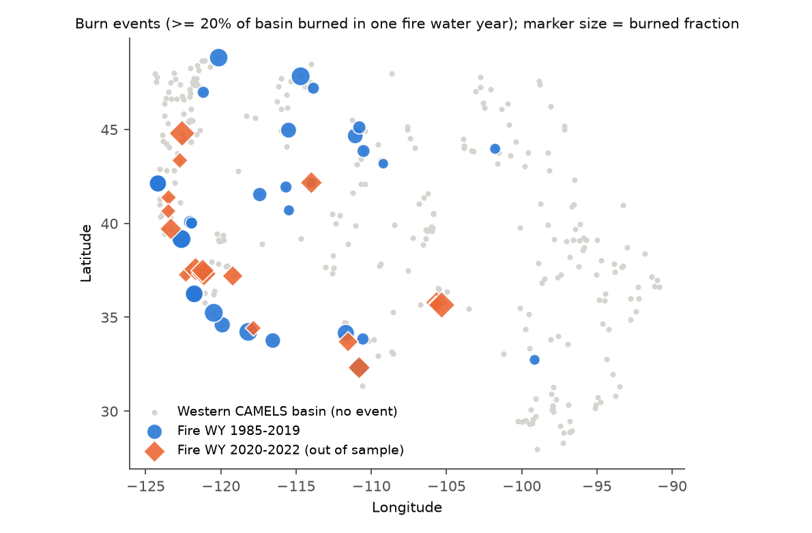
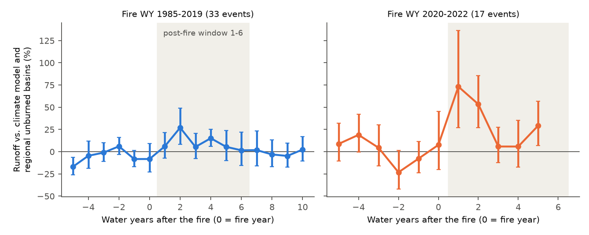
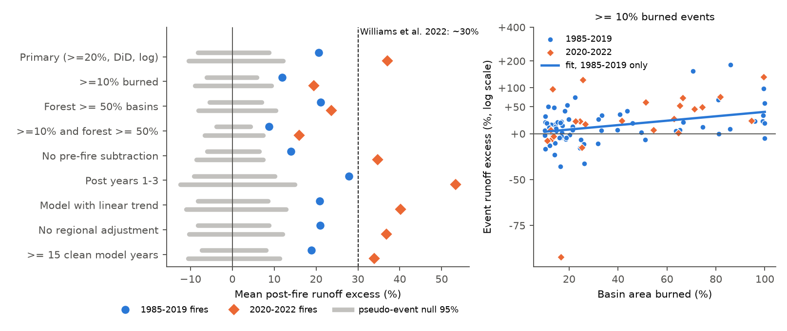

# Western U.S. reference basins had more runoff in the 1-6 water years after large wildfires, and the 2020-2022 fires confirmed the 1985-2019 increase out of sample (CAMELS, MTBS perimeters, annual data)

## Summary

Williams et al. (2022, PNAS) reported that streamflow in western U.S. basins increased by approximately 30 % for 6 years after more than 20 % of the forest area burned (fires of 1984-2019). Fire area in 2020-2021 was much larger than in any earlier year. We used those later fires as an independent test.

We used 317 western CAMELS reference basins (HUC-02 regions 10-18), annual water-year (WY, October to September) runoff and basin climate for WY 1952-2025, and MTBS burned-area perimeters. For each basin, we fitted a climate model of log runoff on years without fire. Then we compared each burned basin with unburned basins in the same HUC-02 region and in the same years (a difference-in-differences of residuals: post-fire years 1-6 minus pre-fire years -5 to -1). We fixed the method and the 2020-2022 test set before we calculated the out-of-sample result.

Main results:

1. **1985-2019 fires (33 events in 28 basins with 20 % or more of the basin area burned):** mean runoff excess +21 % (log excess 0.188). The 95 % range of the matched pseudo-event null was -8 % to +9 %. Of the 33 events, 24 (73 %) were above their pseudo-event mean.
2. **2020-2022 fires (17 events in 17 basins, out of sample):** mean runoff excess +37 % (log excess 0.315). The null 95 % range was -10 % to +12 %. Of the 17 events, 16 were above their pseudo-event mean. The size agrees with the approximately 30 % of Williams et al. (2022). It is larger than the 1985-2019 value, but the difference is inside the uncertainty.
3. **The result does not depend on one fire.** Events that share one MTBS fire form one cluster. The 17 out-of-sample events form 12 clusters, and 11 of the 12 cluster means were positive (t-test p = 0.006, sign test p = 0.006). When we removed each cluster in turn, the mean stayed between +0.28 and +0.35 (log units).
4. **A stricter null also rejects zero.** We moved all 2020-2022 fire years back by the same offset (23 shifts of 8 to 65 years) and repeated the test on the same burned basins. The observed mean (0.269) was larger than all 23 shifted means (largest 0.244, one-sided rank p = 0.04). This null keeps the spatial correlation between neighbouring burned basins. Thus it is wider than the pseudo-event null. For the 1985-2019 fires, only 5 shifts had clean data; all 5 were below the observed value.
5. **All 10 analysis variants gave a positive excess outside the null range in both periods.** The range was +9 % to +28 % for 1985-2019 fires and +16 % to +53 % for 2020-2022 fires (table below). The excess is larger for a larger burned fraction (slope +0.36 ± 0.17 log units per unit fraction for 1985-2019, +0.44 ± 0.25 for 2020-2022).
6. **The increase is short.** For 1985-2019 fires, the yearly excess was largest in post-fire years 2 and 4 (+27 % and +15 %) and was approximately 0 from year 6 to year 10. For 2020-2022 fires, the excess was +73 % and +53 % in years 1 and 2, and +6 % in years 3 and 4.
7. **The effect of the wetness of the post-fire year is not resolved.** For 2020-2022 fires, the excess was large in the dry WYs 2021, 2022 and 2025 (+108 %, +79 % and +40 % as a mean of log values) and near 0 in the wet WYs 2023 and 2024. In a regression of the year-level excess on the precipitation anomaly, the slope was negative but not clear (pooled -0.23 ± 0.13 log units per unit ln(P / mean P), p = 0.07; for 1985-2019 fires alone p = 0.39). The median absolute excess was approximately 24 mm per year in both dry and wet years.

These results confirm, with an independent set of fires, that large wildfires increase annual runoff from western U.S. reference basins for a few years. Limitations: the burned area comes from perimeters, which include unburned patches; we did not use burn severity or forest area; the sample is small (17 out-of-sample events in 12 fire clusters); the data are annual only; and post-fire debris can change the stage-discharge rating at a gauge.



*Figure 1. Western CAMELS basins (HUC-02 10-18) and the burn events of the primary test (20 % or more of the basin area burned in one fire water year). Blue circles: fires of WY 1985-2019. Orange diamonds: fires of WY 2020-2022 (out-of-sample test). The marker size shows the burned fraction.*



*Figure 2. Runoff of burned basins relative to the climate model and to unburned basins in the same HUC-02 region and year, by water year after the fire. Bars show ± 1.96 standard errors across events. Year 0 is the fire water year. The shaded area is the post-fire window (years 1-6) of the test. These yearly values have no pre-fire subtraction.*



*Figure 3. Left: mean post-fire runoff excess (difference to the matched pseudo-event mean) for the primary test and for the variants. Grey bars show the 95 % range of the pseudo-event null. The dashed line shows the approximately 30 % increase of Williams et al. (2022). Right: event excess against the burned fraction for events with 10 % or more burned, with a linear fit to the 1985-2019 events only (log scale).*

## Question and prediction

Question: did the large 2020-2022 western U.S. wildfires increase annual runoff from burned reference basins, relative to the climate and to unburned basins nearby?

Prediction (from Williams et al. 2022 and from our 1985-2019 fit): a positive excess of approximately 20-30 % in post-fire years 1-6 when 20 % or more of the basin burned. Null hypothesis: the excess of burned basins is the same as that of unburned basins in the same region and years.

## Data

| Data | Source and version | Use |
| --- | --- | --- |
| CAMELS v1.2 basin polygons and attributes | Newman et al. 2015; Addor et al. 2017; Zenodo record 15529996: `basin_set_full_res.zip`, `camels_name.txt`, `camels_topo.txt`, `camels_vege.txt`, `camels_hydro.txt` | 671 basin polygons, HUC-02 region, forest fraction, gauge location |
| MTBS burned-area perimeters | Monitoring Trends in Burn Severity (USGS/USFS), `mtbs_perimeter_data.zip`, DBF date 2026-11-08, 31,514 perimeters; shared campaign dataset `datasets/mtbs-burned-area-perimeters-20261108` | Burned area per basin and fire water year |
| Water-year runoff (USGS NWIS daily discharge) and basin-mean precipitation and temperature (NOAA nClimGrid monthly) | Derived tables `runoff_wy.csv` and `climate_wy.csv` from campaign bundle sci:sha256:664b208cefa5e9bb1114a6ccf84255fc886f296b6f72198e385cbc30055fa7af (retrieved 2026-11-07/08) | Outcome and climate covariates, WY 1949-2025 |

SHA-256 of the files that we used:

- `mtbs_perimeter_data.zip`: `f7d8b3ba9be5622f13cf10f5788bdc7658490c08589604e396214b09c33053cd` (420,877,956 bytes). Shared path: `/mnt/dell-data/shared_datasets/mtbs-burned-area-perimeters-20261108/mtbs_perimeter_data.zip` (we registered it with the campaign dataset helper).
- `basin_set_full_res.zip`: `768681294a0bef9be5a8a79e45d4c50bea9d2d25825b30c9e143b069bc02ee53`. All CAMELS hashes are in `files/provenance/camels_SHA256SUMS.txt`. They are the same as in bundle 664b208c.
- `runoff_wy.csv`: `dcc7c7ea1c201f28309ba3ea0e707894295920009939166b601f22b8c4b68ad7`; `climate_wy.csv`: `eb399ed539ae5f1cd5caaadb4a622aecab25a4d7d7955ff133eb0a9af5e1b30d` (byte-identical copies of the bundle 664b208c tables; copies are in `files/data/`).
- `burn_wy.csv` (our derived burn table): `d85e6f1538c79946ff2a0f6897100e52f0b54f82616f3a61fa2d28c5b4af0533`.

Note: the NWIS values for the last water years can be provisional. MTBS adds fires of the last calendar year late; fires of fire WY 2023 and later are not complete and are not in the test set.

## Method

**Burned fraction** (`src/burn_fraction.py`). We projected the CAMELS polygons and the MTBS perimeters to CONUS Albers (EPSG:5070). The fire water year is the water year of the ignition date. For each basin and fire water year, the burned fraction is the area of the union of all non-prescribed perimeters (types Wildfire, Wildland Fire Use, Other, Unknown, Complex) inside the basin, divided by the basin area. Prescribed fires are not in the exposure.

**Reference model** (`src/analyze.py`). For each basin, y = ln(max(Q, 0.01 × mean Q)), with Q the water-year runoff depth (mm). We fitted y = a + b ln P_t + c ln P_(t-1) + d T_t by ordinary least squares on "clean" years only. A year is clean if no fire water year from t-8 to t burned 1 % or more of the basin. We needed 25 or more clean years (317 of 330 western basins).

**Regional adjustment.** For each HUC-02 region and WY, we subtracted the mean residual of the clean basins (basins with no burn of 1 % or more from t-8 to t).

**Events.** An event is a fire water year with a burned fraction of 20 % or more (primary). When a basin had such fire years 2 years or less apart, we merged them into one event (fraction summed, capped at 1; the post-fire window starts after the last fire year). The event value is E = mean adjusted residual in post-fire years 1-6 (2 or more years needed) minus the mean in pre-fire years -5 to -1 (2 or more years needed). In-sample events: first fire WY 1985-2019. Out-of-sample events: first fire WY 2020-2022.

**Pseudo-event null.** For each event, the pool contains the other basins of the same HUC-02 region that were clean from 8 years before the pre-fire window to the end of the post-fire window. Each pool basin gets the same calendar windows as the event. We needed 3 or more pool basins. We report the excess = mean E of events minus the mean of the pseudo-event means. The 95 % range and p-values come from 2,000 random sets with one pseudo-event per event. This null keeps the region and the years of each event. It does not keep the correlation between events in neighbouring basins. Thus we also used:

- **Fire clusters** (`src/checks.py`): events that share an MTBS fire with 5 % or more of each basin burned are one cluster; t-test and sign test across cluster means, and leave-one-cluster-out means.
- **Time-shift placebo**: all event years of a set are moved by the same offset, and E is calculated for the same burned basins, when the shifted windows are clean. In-sample offsets: ±8 to ±35 years; out-of-sample offsets: -8 to -65 years. A shift is used if half of the events (and 5 or more) have clean data.

**Dryness** (`src/dryness.py`). Year-level excess d (event residual minus same-year pool mean minus the event pre-fire mean) for post-fire years 1-6, regressed on z = ln(P_t / basin mean P), with cluster-robust standard errors by event. We also converted d to an absolute excess Q × (1 - exp(-d)) in mm.

**Variants.** 10 % or more burned; basins with forest fraction 0.5 or more; both; no pre-fire subtraction; post-fire years 1-3; a linear time trend in the reference model; no regional adjustment; square-root runoff; 15 or more clean model years.

## Results

### Primary test and variants

Excess is in log units (100 × (exp(x) - 1) gives %). "Pos." is the share of events above their pseudo-event mean. "Slope" is the excess per unit burned fraction (OLS, SE in brackets). The p-values have a floor of 1/2,000.

| Variant | Fires | Events | Basins | Excess | % | Null 95 % | p (two-sided) | Pos. | Slope |
| --- | --- | --- | --- | --- | --- | --- | --- | --- | --- |
| primary | 1985-2019 | 33 | 28 | +0.188 | +20.6 | -0.086 to +0.083 | < 0.001 | 0.73 | +0.36 (0.17) |
| primary | 2020-2022 | 17 | 17 | +0.315 | +37.1 | -0.110 to +0.115 | < 0.001 | 0.94 | +0.44 (0.25) |
| >= 10 % burned | 1985-2019 | 71 | 55 | +0.112 | +11.9 | -0.064 to +0.057 | < 0.001 | 0.68 | +0.33 (0.10) |
| >= 10 % burned | 2020-2022 | 23 | 23 | +0.178 | +19.4 | -0.094 to +0.089 | < 0.001 | 0.78 | +0.78 (0.37) |
| forest >= 0.5 | 1985-2019 | 20 | 15 | +0.191 | +21.1 | -0.057 to +0.068 | < 0.001 | 0.90 | +0.23 (0.19) |
| forest >= 0.5 | 2020-2022 | 10 | 10 | +0.212 | +23.6 | -0.085 to +0.099 | < 0.001 | 0.90 | +0.61 (0.24) |
| >= 10 %, forest >= 0.5 | 1985-2019 | 43 | 29 | +0.083 | +8.7 | -0.039 to +0.042 | < 0.001 | 0.67 | +0.35 (0.10) |
| >= 10 %, forest >= 0.5 | 2020-2022 | 14 | 14 | +0.148 | +16.0 | -0.069 to +0.071 | < 0.001 | 0.71 | +0.62 (0.16) |
| no pre-fire subtraction | 1985-2019 | 34 | 29 | +0.131 | +14.0 | -0.062 to +0.063 | < 0.001 | 0.76 | +0.46 (0.14) |
| no pre-fire subtraction | 2020-2022 | 17 | 17 | +0.298 | +34.7 | -0.089 to +0.071 | < 0.001 | 1.00 | +0.12 (0.20) |
| post-fire years 1-3 | 1985-2019 | 36 | 31 | +0.245 | +27.8 | -0.096 to +0.097 | < 0.001 | 0.72 | +0.40 (0.26) |
| post-fire years 1-3 | 2020-2022 | 17 | 17 | +0.427 | +53.3 | -0.133 to +0.139 | < 0.001 | 0.94 | +0.67 (0.34) |
| linear trend in model | 1985-2019 | 33 | 28 | +0.189 | +20.8 | -0.086 to +0.082 | < 0.001 | 0.76 | +0.33 (0.16) |
| linear trend in model | 2020-2022 | 17 | 17 | +0.337 | +40.1 | -0.118 to +0.121 | < 0.001 | 0.94 | +0.48 (0.26) |
| no regional adjustment | 1985-2019 | 33 | 28 | +0.190 | +20.9 | -0.085 to +0.084 | < 0.001 | 0.73 | +0.36 (0.16) |
| no regional adjustment | 2020-2022 | 17 | 17 | +0.313 | +36.8 | -0.109 to +0.113 | < 0.001 | 0.94 | +0.44 (0.25) |
| >= 15 clean model years | 1985-2019 | 40 | 33 | +0.173 | +18.9 | -0.075 to +0.077 | < 0.001 | 0.72 | +0.36 (0.14) |
| >= 15 clean model years | 2020-2022 | 20 | 20 | +0.292 | +33.8 | -0.111 to +0.108 | < 0.001 | 0.95 | +0.26 (0.22) |
| square-root runoff (sqrt mm) | 1985-2019 | 33 | 28 | +1.20 | - | -0.35 to +0.38 | < 0.001 | 0.73 | +1.79 (0.89) |
| square-root runoff (sqrt mm) | 2020-2022 | 17 | 17 | +1.93 | - | -0.57 to +0.48 | < 0.001 | 0.88 | +1.90 (1.97) |

The 15-year variant adds 3 out-of-sample events. Two of them had a high burned fraction but too few clean years for the primary rule: Mad River above Ruth Reservoir (11480390, 100 % burned in 2020) and Shitike Creek (14092750, 91 % burned in 2020).

The in-sample dose fit predicts a log excess of -0.023 + 0.365 × 0.549 = 0.18 for the mean out-of-sample burned fraction (0.549). The observed value was 0.315. The out-of-sample events had more runoff than this prediction, but the slope uncertainty (± 0.17 per unit fraction) and the event scatter make the difference uncertain.

### Robustness to spatial correlation

| Check | 1985-2019 fires | 2020-2022 fires |
| --- | --- | --- |
| Fire clusters (events) | 30 (33) | 12 (17) |
| Cluster mean excess (log) | +0.202 | +0.278 |
| t-test across clusters | t = 3.67, p = 0.001 | t = 3.42, p = 0.006 |
| Positive clusters (sign test) | 22 of 30 (p = 0.016) | 11 of 12 (p = 0.006) |
| Leave-one-cluster-out mean | +0.160 to +0.209 | +0.279 to +0.350 |
| Time-shift placebo: shifts used | 5 | 23 |
| Time-shift placebo: largest shifted mean E | -0.003 | +0.244 |
| Observed mean E | +0.188 | +0.269 |
| Rank p (one-sided) | 1/6 (minimum possible) | 0.04 |

### Yearly profile and dryness

Out-of-sample year-level excess (with pre-fire subtraction), by water year: 2021: +0.73 (12 events); 2022: +0.58 (14); 2023: -0.02 (17); 2024: -0.02 (16); 2025: +0.34 (16). WY 2023 was very wet in California, and WY 2021-2022 were very dry.

| Set | Year-level slope of excess on ln(P / mean P) | p | Dry years: mean excess (log), median mm | Wet years: mean excess (log), median mm |
| --- | --- | --- | --- | --- |
| 1985-2019 fires | -0.12 ± 0.14 | 0.39 | +0.19, 24 mm | +0.18, 26 mm |
| 2020-2022 fires | -0.39 ± 0.24 | 0.10 | +0.39, 19 mm | +0.11, 0.2 mm |
| pooled | -0.23 ± 0.13 | 0.07 | +0.24, 24 mm | +0.16, 23 mm |

We do not have evidence that the percent increase depends on the wetness of the year. The near-zero excess in the wet WYs 2023-2024 is consistent with no dependence and with a decrease of the effect after the second post-fire year.

## Interpretation

The data support a short-term post-fire runoff increase in western U.S. reference basins of approximately 10-40 % of annual runoff when 20 % or more of a basin burns. The size increases with the burned fraction. Less transpiration and interception after the loss of vegetation is a possible cause, but our annual data cannot separate the causes. A median absolute excess of approximately 20-25 mm per year is small for wet basins and large for dry basins.

The 2020-2022 fires were not in the data of Williams et al. (2022) or in our 1985-2019 set. Thus, they give an independent confirmation of the direction and approximate size of the effect.

## Limitations

- **Burned area is from perimeters.** MTBS perimeters include unburned and low-severity patches. Thus the true burned fraction is lower than our value. We did not use burn severity or forest area burned (Williams et al. used the forest area burned).
- **Small out-of-sample sample.** 17 events in 12 fire clusters, most in California (HUC-02 18). Three regions (HUC-02 13, 15) had pools of only 3-4 clean basins.
- **Annual data only.** We did not test seasonal flow, peak flow, baseflow or water quality.
- **Gauge effects.** Debris flows and sediment after fires can change the channel and the stage-discharge rating. This can bias the measured runoff in either direction. We did not check rating changes.
- **Provisional data.** WY 2024-2025 NWIS values can be revised. MTBS adds recent fires late.
- **Other changes after fire.** Salvage logging, road work and post-fire management are not in the model.
- **Model form.** The reference model is a linear annual model of log runoff. Very dry years with near-zero flow (Arizona, New Mexico) have large log residuals; the square-root and no-pre-fire variants gave the same sign.

## Reproduction

`files/run_all.sh` downloads CAMELS from Zenodo, copies MTBS from the shared campaign dataset (or downloads it), and runs all steps:

```
bash files/run_all.sh /path/to/files
```

Run time is approximately 10 minutes on one core (the burned-area overlay takes approximately 7 minutes). The water-year runoff and climate tables are in `files/data/`; bundle 664b208c has the code that rebuilds them from NWIS and nClimGrid. Random numbers use fixed seeds (20261108 in `analyze.py`, 7 in `checks.py`).

Files:

- `files/src/`: `burn_fraction.py`, `analyze.py`, `checks.py`, `dryness.py`, `figures.py`.
- `files/data/`: `burn_wy.csv`, `fires_in_basins.csv`, `basin_area.csv`, `runoff_wy.csv`, `climate_wy.csv`.
- `files/results/`: `<variant>_summary.json` and `<variant>_events.csv` for all variants, `primary_residuals.csv`, `event_time_profile.csv`, `time_shift_placebo.csv`, `events_in_clusters.csv`, `events_oos_clusters.csv`, `oos_by_year.csv`, `postfire_years.csv`, `checks_summary.json`, `dryness_summary.json`.
- `files/provenance/`: SHA-256 lists for CAMELS and MTBS.

## Provenance of this work

- Campaign 11_07_2026; job sci-1107-dell-earth-and-ocean-sciences-d6d27c9212ff; topic earth-and-ocean-sciences; machine dell; account claude-andrii.
- Analysis and text by the AI model Claude Opus 5.5 (claude-opus-5-5), working as an automated research agent on 2026-11-08. The signing key is a campaign-machine key. It is not a personal authorship claim.
- Software: Python 3.12, numpy 2.5.4, pandas 3.1.1, geopandas 1.2.0, shapely 2.2.0, pyogrio 0.13.0, statsmodels 0.15.0, scipy 1.18.1, matplotlib 3.11.2.

## References

- Williams, A. P., et al. (2022). Growing impact of wildfire on western US water supply. PNAS 119(10), e2114069119. doi:10.1073/pnas.2114069119
- Newman, A. J., et al. (2015). Development of a large-sample watershed-scale hydrometeorological data set for the contiguous USA. HESS 19, 209-223. doi:10.5194/hess-19-209-2015
- Addor, N., et al. (2017). The CAMELS data set: catchment attributes and meteorology for large-sample studies. HESS 21, 5293-5313. doi:10.5194/hess-21-5293-2017
- Eidenshink, J., et al. (2007). A project for monitoring trends in burn severity. Fire Ecology 3(1), 3-21. doi:10.4996/fireecology.0301003
- Saxe, S., et al. (2018). Postfire streamflow responses in 82 western US basins. HESS 22, 1221-1237. doi:10.5194/hess-22-1221-2018
- Campaign bundle sci:sha256:664b208cefa5e9bb1114a6ccf84255fc886f296b6f72198e385cbc30055fa7af (water-year runoff and climate tables).
