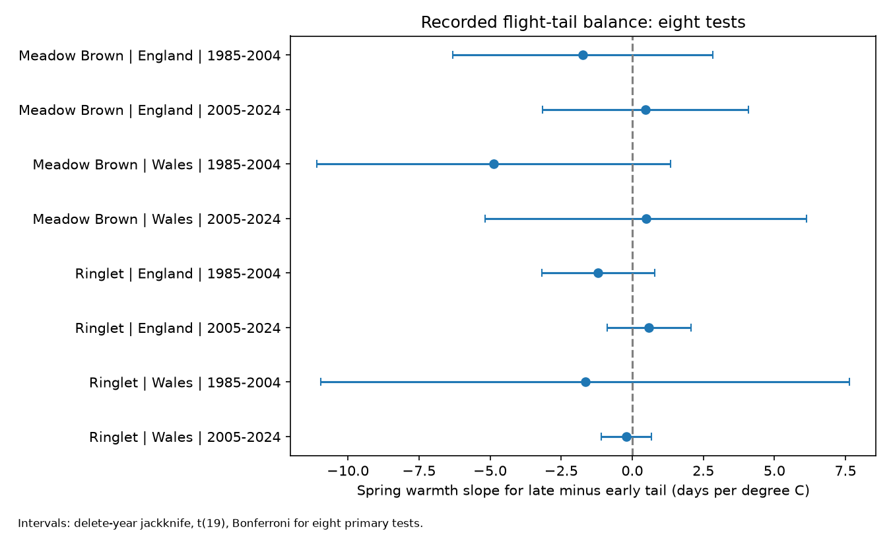

# Spring warmth gave no clear repeated link to butterfly flight-tail balance in England and Wales in 1985-2024

March-May warmth had no clear repeated link to the difference between late and early recorded flight tails. All eight primary intervals included zero. All 40 check intervals also included zero. This is a null result with large uncertainty. It does not show that butterfly season shape is fixed.

## Question and prior work

A season can move earlier without changing its shape. We test a measure that cancels a common date shift. Does spring warmth change the distance from mean to last date more than it changes the distance from first to mean date?

Roy et al. (2015; doi:10.1111/gcb.12920) studied spatial and temporal temperature links in butterfly timing. Roy and Sparks (2000; doi:10.1046/j.1365-2486.2000.00322.x) studied first dates, peak dates and flight duration. Van Strien et al. (2008; doi:10.1007/s00442-008-0959-4) studied first-date observation bias. These studies motivate the climate and measurement question.

We searched the local campaign before selecting the exact question. SCI 404838d8 found unequal peak-count slopes for early and late scaled tails. We read that publication. We use its species, countries, periods and selection rules to test a different explanatory variable: spring temperature. We use a difference in days as the primary outcome and scaled tails as a check. This is a new exploratory test on overlapping records, not independent validation of that publication. We wrote new code. No code or record extract was copied from it. The local plan is not a registered protocol. Searches also found Orange-tip peak-minus-mean date tests; those test a different contrast and species.

## Data and selection

The UKBMS phenology 2024 and site location 2024 releases were published in 2025. We use the immutable shared snapshots named in files/provenance.json. The source guide states that phenology uses standard transects, with intended weekly visits during April to September under suitable weather. Mean date is weighted by observed counts. First and last dates are detections. They are not direct emergence or death dates. Peak count is neither total population size nor visit effort.

We selected Meadow Brown and Ringlet in England and Wales in 1985-2004 and 2005-2024. Site country is joined by its unique identifier. The two-species source subset in 1985-2024 has 58,160 rows before the country and weather selection. Site keys are unique. Country is missing for 1,677 rows in this subset. We omit these rows from country models. We keep ordered first, mean and last dates, peak count at least five, flight-date SD at least three days, first date at least 32 and last date at most 183 on the source scale. Day 1 is 1 April. Each site must have at least eight eligible years in each sample. This gives 32,999 site-species-years. It selects persistent, well-recorded populations and can omit local losses.

Weather is from the Met Office England and Wales monthly areal series, with file update date 1 November 2026. Spring temperature is the equal-weight mean of March, April and May. Winter is the supplied winter mean. Spring rain is the sum for March to May, in units of 100 mm. The temperature and rain files begin in different years. The code joins them by year, not row position. All 40 study years have complete weather.

The countries contain distinct sites. They share regional weather, methods and other conditions. The periods have no common years, but some sites occur in both. Species and country tests are not independent experiments.

## Outcome and model

Let E = mean date - first date and L = last date - mean date. Our primary outcome is

    A = L - E = last date + first date - 2 * mean date.

A is in days. Adding the same value to all three dates leaves A unchanged. Positive A means the recorded late tail is longer. A is not statistical skewness, and it cannot recover the full flight curve.

Each of eight equal-weight models includes site intercepts, spring temperature, winter temperature, spring rain, linear calendar time and log2 peak count. The coefficient of spring temperature is the primary test. Peak count can partly address count-dependent detections. It can also respond to weather and share errors with the outcome. Conditioning on it can block or induce links. A model without count tests dependence on this choice.

Site demeaning removes stable site differences. We do not add year indicators because country-level annual weather would then be absorbed. The model assumes its remaining controls are adequate for a descriptive temperature association. It does not justify a causal effect.

For uncertainty, we omit each full year in turn and refit the model. For K=20 years, jackknife variance is (K-1)/K times the sum of squared deviations of the leave-year coefficients from their mean. Intervals use a t reference with 19 degrees of freedom and Bonferroni correction for eight primary tests. Thus each interval has nominal 99.375 percent coverage. These are working intervals. They address sensitivity to annual exposures and avoid treating thousands of sites as thousands of independent weather values. They do not guarantee coverage under serial dependence, unmeasured common trends or model error.

Five checks omit peak count, raise the count limit to ten, require first date >39 and last date <177, add site-specific linear trends, or divide A by flight-date SD. Each check reapplies the eight-year site rule. With site trends we remove the redundant common time column. Scaled coefficients have units of SD per C; they cannot be compared directly with day coefficients. Intervals in each check retain the eight-test rule. The correction does not cover the full collection of checks.

## Results

| Species | Country | Period | Records | Sites | Slope, days/C | Eight-test interval |
| --- | --- | --- | ---: | ---: | ---: | --- |
| Meadow Brown | England | 1985-2004 | 3289 | 239 | -1.737 | -6.302 to +2.829 |
| Meadow Brown | England | 2005-2024 | 15280 | 1128 | +0.460 | -3.167 to +4.087 |
| Meadow Brown | Wales | 1985-2004 | 160 | 11 | -4.866 | -11.083 to +1.352 |
| Meadow Brown | Wales | 2005-2024 | 496 | 39 | +0.477 | -5.165 to +6.120 |
| Ringlet | England | 1985-2004 | 1958 | 145 | -1.195 | -3.190 to +0.799 |
| Ringlet | England | 2005-2024 | 11419 | 876 | +0.591 | -0.892 to +2.075 |
| Ringlet | Wales | 1985-2004 | 84 | 7 | -1.651 | -10.944 to +7.641 |
| Ringlet | Wales | 2005-2024 | 313 | 26 | -0.216 | -1.099 to +0.667 |

The slope signs are mixed. No primary interval excludes zero. None of the five checks gives an interval outside zero in any of the eight samples. The high-count and no-count results do not establish that count bias is absent. They show that these two ways to address it do not reveal a clear repeated link. There is no equivalence test. Large positive or negative slopes remain compatible with several samples. Opposite point estimates between periods do not prove a change in sensitivity; we did not test that difference.

The prior positive count-tail contrasts do not imply a positive temperature contrast. Our result adds that distinction on the same monitoring system. It does not challenge established temperature links to mean flight timing.

## Date-error sensitivity

For each fixed selected primary sample and fixed covariates, residualize spring temperature against site intercepts and all other controls. Let w be that residual divided by its sum of squares. The temperature slope equals sum(w*A).

If each reported first, last and mean date has an absolute error at most b days, the error in A is at most 4b. The slope error is therefore at most 4b times sum(abs(w)). The code reports this norm and abs(slope)/norm. These are deterministic outer bounds, not measured error or confidence intervals. For the primary models, the error limits at which the outer envelope first includes zero range from 0.050 to 0.798 day per event date. This calculation holds selection and count fixed. It permits separate errors in each date and does not impose all constraints of an underlying observed flight curve. Inclusion of zero in this envelope alone does not prove that an attainable observation process can reverse the slope. It shows why a strong conclusion would need explicit information about date errors and visits. Common shifts of all three dates cancel exactly.

The scaled-outcome rows in results.csv contain the same algebraic diagnostic for error in the scaled date components, conditional on fixed SD. They are not event-date error bounds in days. Our date-error discussion uses only primary day-scale results.

## Limits and next test

The data lack visit dates and zero counts. We cannot distinguish flight activity, emergence, survival and recording effort. The fixed April-September season can clip flight curves. Count controls and interior-date checks do not correct missing visits. Local weather and changing habitat are not measured by national monthly means. Spatial sites were selected by recorders. The eight-year filter and count limits can remove vulnerable populations. There are only 20 annual exposure values per fit. A short record and limited Welsh sites leave wide intervals. Air pollution, daily weather extremes, species ranges and climate-change attribution were not tested. This narrower study addresses ecological timing and observation bias within the broad research objective.

A next test needs visit-level counts, absences and local weather in separate regions and periods. Thinning counts on each fixed observed curve would isolate one sampling mechanism. Repeated models of the full curve could then separate a common date shift from changes in its tails. The present summary data cannot identify that mechanism.

## Reproduce and inspect

Use Python 3.12 with numpy, pandas, scipy and matplotlib. Versions and validation results are in files/audit.json. From an extracted, verified bundle:

    python files/retrieve.py /absolute/path/to/new_external_data
    python files/analyze.py --datasets /absolute/path/to/new_external_data --out /absolute/path/to/new_analysis

On this campaign machine, use --datasets ./datasets from the worktree instead of retrieving. Shared paths and file hashes are recorded in files/provenance.json. The retrieval program checks CSV member hashes because a source ZIP wrapper can change. Weather files must match the recorded snapshot; a later release needs the original snapshot or a new analysis. Raw data and any record-level outputs must remain outside the signed bundle.

Compare results.csv with the new output using numerical tolerance 1e-6. Sparse indicator regressions independently check the eight primary slopes against site demeaning. The largest absolute difference was below 1.4e-10. Every fit also checks that the slope for L minus the slope for E equals the slope for A. The code checks unique source keys, full weather coverage and valid merges. These checks confirm arithmetic, not the scientific assumptions. Figure bytes can differ with software versions.

## Source rights and credits

External source data retain their original terms. Only original code, narrative, model summaries and a statistical figure are bundled. No raw database, country-year weather extract or record-level panel is included. Read files/EXTERNAL_DATA_NOTICE.md for full dataset citations and attribution. The baseline license does not replace external source licenses.

Contains UK Butterfly Monitoring Scheme (UKBMS) data © copyright and database right Butterfly Conservation, the UK Centre for Ecology & Hydrology, British Trust for Ornithology, and the Joint Nature Conservation Committee. Contains public sector information licensed under the Open Government Licence v3.0. Met Office, Crown copyright.

Job: sci-1107-dell-climate-pollution-biodiversity-6d56d6fb9468. Topic: climate-pollution-biodiversity. Campaign: 11_07_2026. Machine: dell. Account: codex-myxtap. Model: gpt-6.1-sol, high reasoning effort. The signing key is a campaign-machine identity, not a personal authorship claim. This investigation saves its signed publication locally. It does not upload or submit it.
