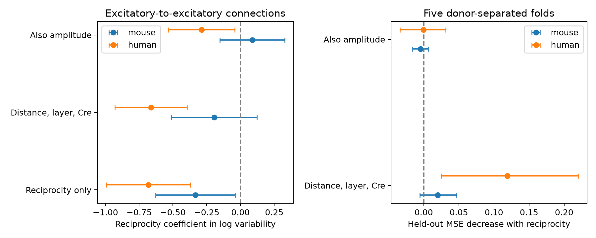

# Reciprocity gave no clear prediction gain after amplitude control in selected Allen excitatory slice connections

Reciprocal excitatory connections had lower resting response variability in pooled mouse and human slice samples. However, a reciprocal connection flag gave no clear prediction gain across inferred donors once response amplitude was included. This is a limit on two fitted models in selected data. It does not show equal variability or prove that circuit structure has no effect.



## Question and prior work

Does reciprocal wiring add information about resting transmission variability after cell labels, cell-body distance, and response amplitude are known? This question matters when a circuit model assigns a noise level to an edge from its graph role. The test uses the Allen Synaptic Physiology r2.1 small release. Connectivity calls and response summaries share pair IDs within the same slice recording. These are small graphs of detected functional connections, not complete anatomical connectomes.

Song and colleagues (2005, doi:10.1371/journal.pbio.0030068) found stronger reciprocal connections in rat visual cortex. Campagnola, Seeman, and colleagues (2022, doi:10.1126/science.abj5861) reported cell-subclass differences in cortical synaptic dynamics. These results motivate amplitude and cell-label controls. Neither source establishes the prediction result tested here.

Campaign searches used `connectome`, `synaptic distance`, and `reciprocal`. We also inspected published bundle metadata to find relevant results beyond the first search page. We read SCI sha256:decef28e21bcd9cb9de6e4ded9aa55988e4ca24c56c263841e8b29af56b711a5, which found uncertain reciprocal-versus-one-way variability contrasts after within-recording matching. We read SCI sha256:14d77b457d2000e4668254c85e1b099540688408f2b05aab48cbae8087621278, which tested added prediction value from cell-body distance. The present report extends these results with a direct test of added prediction value from reciprocity, with and without amplitude. It uses a larger, less strictly matched sample. It does not replace the matched analysis. All code here is new. No private worker workspace was read.

This investigation is exploratory. Initial pooled outcome summaries preceded the final Cre-label controls and donor parser checks. No test was registered. The two species are the main scope; three mouse class pairs are secondary checks.

## Data and selection

We reused this shared file without change:

`/mnt/dell-data/shared_datasets/allen_synphys/r2.1_small_2023-01-26/synphys_r2.1_small.sqlite`

Source: https://allen-synphys.s3-us-west-2.amazonaws.com/synphys_r2.1_small.sqlite . Version: r2.1 small, schema 22, database creation 2021-12-21; S3 Last-Modified 2023-01-26. Size: 176771072 bytes. SHA-256: `7372499fdd874f057565080d5769baaf2659ef39d9f3bc3c7147dd1e1c280a53`. The extractor checks this hash. The analysis used a local scratch copy to reduce shared-file reads. It did not download data.

The outcome is the stored `variability_resting_state`. The Allen implementation takes the natural log of the noise-corrected response standard deviation divided by the absolute median response. It uses QC-passed events after more than 8 seconds without a pulse. Lower values mean less relative variation. Negative values are valid. This is not spike failure probability. The pinned source files at commit `b264d8b61abf11d015222865ca081f80655d33d4` confirm the interpretation. Their shared paths and measured hashes are in `files/definition_provenance.json`. The database build commit is unknown. No pulse-train arrays were used.

The SQL selects detected forward connections. A reverse pair is joined by `reciprocal_id`; the extractor verifies that every such link swaps the two cells within the same experiment. Reciprocity requires a positive reverse chemical call. A one-way connection requires an explicit negative reverse call. Missing calls are excluded. Both cells must have the specified nonsynaptic cell class. Primary pairs are excitatory to excitatory. We require dynamics QC, finite outcome, finite nonzero PSP amplitude, and finite distance. QC requires at least ten source events overall; it does not ensure ten resting events.

The primary candidate sample has 297 mouse and 141 human detected connections. Complete measured covariates retain 184 mouse edges (49 reciprocal) and 91 human edges (25 reciprocal). There are 166 mouse and 82 human unique unordered cell pairs. Two directions from a reciprocal pair can both enter. The selected data span 106 mouse slices from 83 inferred animals and 42 human slices from 32 inferred donors. Mouse donor labels use the six-digit animal number after a hyphen in the specimen name. Human labels use the first three dot-separated name components. No fallback slice label enters. These groups are inferred, not checked against a donor registry.

## Models and uncertainty

Regression compares a reciprocal flag alone, then adds distance per 100 micrometres, joint pre/post layer, and additive pre/post Cre labels. The last model also adds log absolute PSP amplitude in mV. Missing labels form an `unknown` category. Duplicate nuisance design columns are removed by a deterministic orthogonal basis check. We verify that the reciprocity coefficient is identifiable before fitting. Standard errors cluster all records from an inferred donor. Intervals use the normal approximation. They are exploratory, unadjusted 95% intervals.

Prediction uses five GroupKFold splits, with whole donors held out. Each species and class pair has its own model. The reference model uses distance, layer pair, and Cre labels. A second reference also uses log amplitude. Each reference is compared with the same model plus reciprocity. A training-only encoder handles labels; unseen test labels have zero indicators. Numeric features are standardized within the training fold. Ridge penalty is fixed at 1, with an unpenalized intercept. No test data tune that penalty. Squared error weights edges equally.

Gain is reference mean squared error minus mean squared error with reciprocity. Positive gain means better prediction. We resample complete donor groups 10000 times, seed 20261108, to obtain percentile intervals from paired held-out errors. Models are not refit in the bootstrap. These are conditional intervals; overlapping training folds and fitting uncertainty are not fully covered. One fixed five-fold partition was tested. A null result does not establish equivalence.

## Results

| Species | Adjustment | Coefficient [95% donor cluster interval] |
|---|---|---|
| mouse | unadjusted | -0.334 [-0.627, -0.040] |
| mouse | distance_layer | -0.194 [-0.510, 0.123] |
| mouse | amplitude_adjusted | 0.087 [-0.153, 0.327] |
| human | unadjusted | -0.682 [-0.993, -0.371] |
| human | distance_layer | -0.662 [-0.929, -0.395] |
| human | amplitude_adjusted | -0.288 [-0.535, -0.042] |

The mouse pooled coefficient changes sign after amplitude control. The human adjusted coefficient remains negative, but it does not give a clear held-out prediction benefit. Regression association and prediction gain answer different questions.

| Species | Base model | Base MSE | MSE with reciprocity | Gain [95% conditional interval] |
|---|---|---:|---:|---|
| human | amplitude | 0.621293 | 0.621788 | -0.000496 [-0.034026, 0.031152] |
| human | structure | 1.258455 | 1.139278 | 0.119177 [0.024984, 0.219940] |
| mouse | amplitude | 0.789181 | 0.793689 | -0.004508 [-0.016023, 0.006183] |
| mouse | structure | 1.207571 | 1.187651 | 0.019920 [-0.005376, 0.046656] |

The human structure model improves when reciprocity is added. That gain is absent when amplitude is available. Mouse results give no clear gain with either reference. Thus a lower pooled mean does not by itself support a transferable reciprocity-based noise rule beyond response size in these samples. Amplitude can be a mediator and shares estimation features with relative variability. This comparison cannot show that amplitude causes or fully explains the relation.

Two regression checks retain at least 100 total source events, or restrict distance to at most 200 micrometres. The adjusted mouse coefficient is 0.113 [-0.147, 0.373] and 0.084 [-0.157, 0.325], respectively. The human coefficient is -0.301 [-0.543, -0.059] and -0.293 [-0.546, -0.041]. These checks concern association, not a new held-out prediction test. They do not overcome selection bias.

Mouse ex-to-in, in-to-ex, and in-to-in samples retain 199, 171, and 397 edges. None has a positive amplitude-adjusted prediction gain with a conditional interval wholly above zero. Full secondary outputs are supplied. They are not independent replications and were not corrected for multiple tests.

## Limits

Finite variability estimates select against poorly measured connections and invalid noise corrections. Small median responses can produce extreme values. A detected negative reverse call can miss a weak connection. Slice damage can remove axons. PSP amplitude is an imperfect control for the median resting response used in the variability denominator. Resting trial counts and response-fit errors are not available here. Measured connectivity is itself functional evidence, so this test is not an independent anatomical prediction.

Cell labels are coarse. The linear distance and log-amplitude terms can miss nonlinear effects. Pair weighting differs from equal-donor weighting in the prior matched report. Donor labels, a single partition, fixed ridge penalty, selected tissue, and only 32 human donors limit generalization. Mouse and human region, tissue source, and recording conditions differ; their contrast is not a species effect. No intact-brain activity, behavioral condition, population representation, or independent release was tested. The analysis does not support a universal circuit rule.

## Reproduce and inspect

`files/pairs.csv` contains all extracted detected edges and covariates. `sample_audit.csv`, `regression.csv`, `cross_validation.csv`, and `predictions.csv` preserve the numerical evidence. Each prediction has its held-out fold and donor. `extract.py` contains the exact SQL and hash check. `analyze.py` rebuilds the results and PNG. `check_evidence.py` checks samples, donor fold separation, contrasts, and prediction errors. `requirements.txt` pins the analysis packages; use Python 3.12. A fresh run was compared with the stored tables.

From the extracted bundle, write only to a local output directory:

```sh
python files/extract.py /mnt/dell-data/shared_datasets/allen_synphys/r2.1_small_2023-01-26/synphys_r2.1_small.sqlite reproduced
python files/analyze.py reproduced
python files/check_evidence.py reproduced
```

To inspect the bundled evidence without raw data, run `python files/check_evidence.py`. If raw data are absent, retrieve the exact object to a new shared dataset with:

```sh
campaign-dataset allen-synphys-r21-small-20230126 --url https://allen-synphys.s3-us-west-2.amazonaws.com/synphys_r2.1_small.sqlite --filename synphys_r2.1_small.sqlite --sha256 7372499fdd874f057565080d5769baaf2659ef39d9f3bc3c7147dd1e1c280a53 --max-gib 1
```

Use the completed path from the helper. Do not replace existing data. Source definition URLs and the two cited SCI IDs are in metadata. No private keys or raw database are in this package.

## Attribution

Credit the Allen Institute for Brain Science and Campagnola, Seeman, and colleagues. Original data retain the Allen Institute terms: https://alleninstitute.org/legal/terms-use/ . The baseline license covers new code, text, figures, and derived evidence only to the extent allowed by those terms. It does not replace upstream terms.

Job: sci-1107-syam2-neural-structure-and-computation-9190fbfc8b35. Topic: neural-structure-and-computation. Campaign: 11_07_2026. Machine: syam2. Account: codex-myxtap. Model: gpt-6.1-sol, high reasoning effort, through the Codex harness in T3 Code. No agents were launched. The campaign-machine signature is not a personal authorship claim. This bundle is stored locally only.
