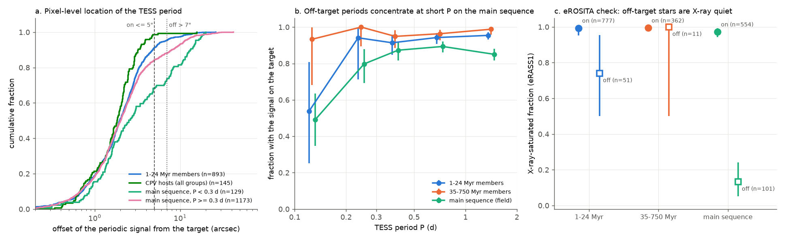
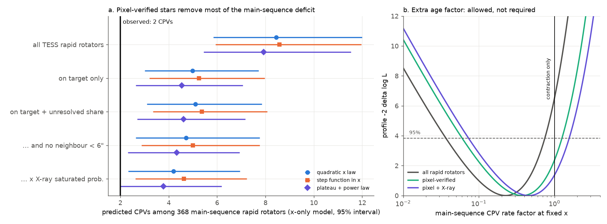
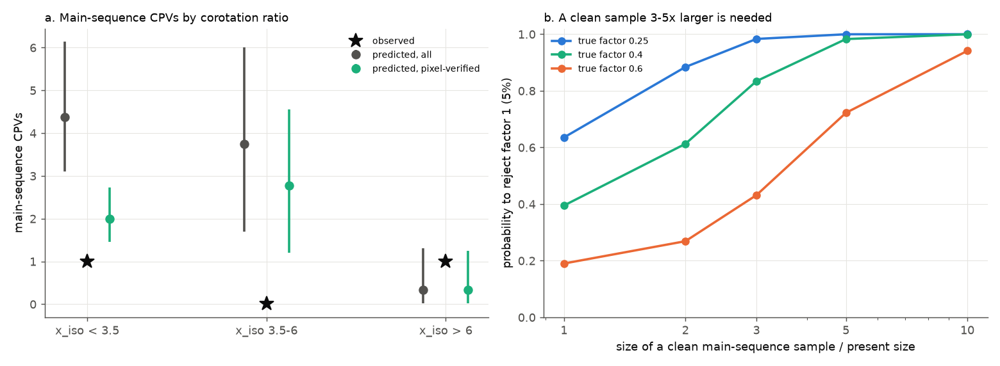

# TESS pixel centroids show that the period of half of the main-sequence M dwarfs at P < 0.2 d comes from another star; with verified rotators, contraction predicts 5.1 CPVs for 2 seen

**Job:** sci-1107-dell-astronomy-aeb650563f1e. **Campaign:** 11_07_2026. **Topic:** astronomy. **Machine:** dell. **Account:** claude-olen. **Model:** Claude Opus 5.5 (claude-opus-5-5), working as an automated research agent. **Date:** 2026-11-10. The signing key is a campaign-machine key. It is not a personal authorship claim.

## Summary

Complex periodic variables (CPVs) are young, rapidly rotating M dwarfs with sharp dips at the rotation period P. The probable cause is material near the corotation radius R_cor. Earlier campaign results found that the ratio x = R_cor / R* explains the age decline of the CPV rate in 1-750 Myr groups (`sci:sha256:fe64afde...`, the "contraction" or "x-only" model). But old main-sequence M dwarfs at the x of young CPV hosts had 2 CPVs where that model predicts 8.5-8.9 (`sci:sha256:b46f8555...`, p = 0.015). Then eROSITA data showed that many of the short-period main-sequence stars are not X-ray saturated (`sci:sha256:709005b5...`). That result inferred, but did not show, that their TESS periods come from other stars in the large TESS pixels (21 arcsec).

We did the direct test. For each of the 4,595 rapid rotators of the TESS 2-minute CPV samples (P = 0.08-2 d, BP-RP = 2.4-3.8), we located the periodic signal on the sky with the TESS flux-weighted centroids. We used 8,390 SPOC light curves (up to 3 sectors per star). Main results:

1. **The method works on known stars.** CPV hosts have a median offset of about 2 arcsec between the signal and the target, and 143 of 145 hosts are on target (offset <= 5 arcsec). 91% of 1-24 Myr members are within 5 arcsec.
2. **Many short-period main-sequence "rapid rotators" are blends** (Figure 1). The signal is off target (> 7 arcsec and > 3 sigma) for 14% of main-sequence rotators, and for 51% (26 of 51 resolved stars) at P < 0.2 d. At x_iso < 3.5 (the x of most young CPV hosts), 19 of 37 main-sequence stars are off target, and only 16 are pixel-verified ultrafast rotators. 18 main-sequence stars repeat the period of another rapid rotator within 3 arcmin.
3. **eROSITA confirms the pixel classes independently.** In the eROSITA-DE sky, the X-ray-saturated fraction of main-sequence stars is 0.97 (0.94-0.99, 554 stars) when the signal is on target and 0.13 (0.05-0.24, 101 stars) when it is off target. All subtypes of off-target stars are X-ray quiet (0.05-0.18).
4. **With verified rotators, the main-sequence deficit is not significant** (Figure 2). With pixel weights in the training and test samples, the frozen x-only model predicts 5.1 (3.1-7.9) main-sequence CPVs for 2 observed (p = 0.14). Without weights it predicts 8.45 (p = 0.016). The main-sequence rate factor at fixed x is 0.37 (0.06-1.22; p = 0.12 for a factor of 1). In 35 variant combinations the prediction is 3.8-5.7 and p = 0.10-0.30. Both main-sequence CPVs are on target.
5. **The remaining difference is at x_iso = 3.5-6, where the x law is least certain** (Figure 3). At x_iso < 3.5, 1 CPV is observed in 16 verified stars and 2.0 (1.5-2.7) are predicted. At x_iso = 3.5-6, 0 are observed and 2.8 (1.2-4.6) are predicted (p = 0.09).
6. **A larger clean sample is necessary.** If the true main-sequence factor is 0.4, the present sample rejects a factor of 1 with probability 0.40. A clean sample 3 times larger gives 0.83, 5 times larger 0.98.

**Interpretation.** About half of the "ultrafast" main-sequence M dwarfs in TESS 2-minute data are blends: the period belongs to another star. This error makes the main-sequence CPV deficit look larger. With pixel-verified rotators, stellar contraction (the change of x) alone agrees with the main-sequence CPV count. A second age-dependent factor (for example, a decrease of material supply) of about 0.4 is also allowed. The present data cannot separate the two explanations.

## Question and prior work

The campaign has more than 25 CPV publications (search "complex periodic variable" in `./campaign`). We build on these:

- `sci:sha256:22057485...`: the TESS sector 56-107 survey (29,707 red dwarfs, 126 on-target CPVs). Its `06_centroid_source.py` located the signal of CPV candidates; we apply the same method to all rapid rotators, which is the denominator of the rate tests.
- `sci:sha256:82e139ee...`: BANYAN Sigma age classes and injection efficiencies.
- `sci:sha256:fe64afde...`: the x-only model with BHAC15 radii.
- `sci:sha256:b46f8555...`: the S1-S55-only sample (39,130 stars) and the main-sequence test (2 observed, 8.9 predicted).
- `sci:sha256:709005b5...`: eRASS1 X-ray test. X-ray weights gave 4.4 predicted (p = 0.22). Its open follow-up was "TESS pixel/centroid check of the X-ray-quiet short-P stars". It covered only half of the sky.
- `sci:sha256:27277715...` and `sci:sha256:886711cb...`: K2 tests; the plateau plus power-law x law of `27277715` is one of our shape variants.

Question: Are the TESS rapid rotators behind the main-sequence test genuine rotators? With an all-sky pixel-verified sample, is an age factor beyond contraction necessary?

## Data

- **Earlier SCI publications (read only):** `22057485` (`population_s56_107_stars.parquet`, `lc_features_s56_107.parquet`, `target_stars_tess2min_gaia.parquet`), `82e139ee` (`star_age_classes_banyan2018.csv`, `injection_eta_vs_noise.csv`), `b46f8555` (`s1_55_star_tess_flags.csv`, `lc_features_s1_55.parquet`).
- **TESS SPOC 2-minute light curves:** 8,395 FITS files (17.4 GB) from the MAST public S3 bucket (`https://stpubdata.s3.us-east-1.amazonaws.com/tess/public/tid/...`; MAST redirects `mast:TESS/product/<file>` there), downloaded on 2026-11-10. Up to 3 sectors per star, chosen from the sectors searched by the source publication: sectors with the same period first (within 1%, or a factor of 2), then by S/N. `files/provenance/tess_lc_sha256.txt` gives the SHA-256 of every file.
- **TIC v8.2 within 60 arcsec** of each rapid rotator (MAST `Mast.Catalogs.Tic.Cone`, 2026-11-10; 249,106 rows). The Gaia DR3 TAP services were not available (AIP: "max connections reached"; ESA: HTTP 503), so we use the TIC (Gaia DR2-based positions, proper motions, G, parallax and TESS magnitudes) for neighbours.
- **eRASS1 aperture photometry** (eRODat upper-limit API, `DR1_eRASS1`, bands 024/021/022) at all 41,046 positions of `709005b5`, queried again on 2026-11-10 (41,041 returned), and the **HamStar** eRASS1 coronal identifications (shared datasets `erosita-dr1-hamstar-{likely,possible}-v1.1`).
- **BHAC15 tracks** (`datasets/bhac15-tracks-structure-20180417-b95474c5`, SHA-256 b95474c5...8d2a) and **Mamajek dwarf table** 2022.04.16 (`datasets/mamajek-dwarf-sequence-20220416-1de2edee`, SHA-256 1de2edee...4b7f).

`files/provenance/input_provenance.json` gives the SHA-256 of every input and record-level intermediate. `files/EXTERNAL_DATA.md` gives sources, licences and acknowledgements.

## Method

1. **Stellar parameters** (`02_combine.py`, `03_stellar_params.py`, from `709005b5`/`b46f8555`/`fe64afde`, unchanged). x_iso uses the BHAC15 radius at the group age (1 Gyr for field and main-sequence stars).
2. **Stars and light curves** (`20_select_sectors.py`, `21_download_lc.py`). Rapid rotators with P = 0.08-2 d, BP-RP = 2.4-3.8 and efficiency > 0: 1,324 main-sequence stars (dMG < 0.5, not in a 1-60 Myr group), 904 members of 1-24 Myr groups, 522 members of 35-750 Myr groups and 1,845 other stars.
3. **Signal location** (`23_centroid_source.py`). The method of `22057485`: flatten the SAP flux and the column/row centroids (MOM_CENTR1/2) with a 5-day running median, fold them at the star period in 50 bins, and regress the folded centroid on the folded flux. The variable source is at c0 + dc/d(dF/F). We convert pixels to the sky with the WCS of the aperture extension, and we move the target to the sector epoch with its proper motion.
4. **Per-star classes** (`24_assign_source.py`). Light curves with the star period in that sector and folded S/N > 10 are used. We take the inverse-variance mean of the sky offset over sectors, with a 1 arcsec error floor per light curve. Classes: on target (offset <= 5 arcsec), off target (> 7 arcsec and > 3 sigma), unresolved (other cases, or no usable light curve). If two rapid rotators within 3 arcmin have the same period (within 0.5%), the star with the larger offset is set off target, unless its own offset is <= 5 arcsec. We also mark a TIC neighbour within 6 arcsec that is bright enough to make the signal (intrinsic amplitude needed < 50%), because centroids cannot separate it.
5. **X-ray check** (`11_genuine_rotators.py` of `709005b5` with the TIC neighbour flag, and `26_xray_validation.py`). For each group and class we fit the fraction of X-ray-saturated stars with the two-component (saturated/quiet) likelihood of `709005b5`.
6. **Main-sequence CPV test** (`25_ms_test.py`). The frozen x-only model of `b46f8555`/`709005b5`: Poisson rate, quadratic in log10(x_iso/2.5) plus colour, log(efficiency x weight) as offset, fitted to S56 1-24 Myr members, applied to main-sequence stars inside the training x range (368 stars). The weight is the probability that the star is the source of its own period: `cen_strict` (on = 1, else 0), `cen_inclusive` (unresolved = 1), `cen_cell` (primary; unresolved = on-target fraction of resolved stars in its group and period bin), `cen_noclose` (also 0 with a close neighbour), `cen_xray` (cen_cell x X-ray p_sat on the eROSITA-DE sky). We use the same weights in the training stars. 95% intervals from 300 bootstrap resamples of the training stars; p = P(Poisson(pred) <= observed). A joint profile likelihood gives the main-sequence rate factor at fixed x.
7. **Variants** (`27_variants.sh`): on/off limits 4/6 and 6/8 arcsec, error floor 2 arcsec, best sector only, a step-function x law (edges x_iso = 2, 2.5, 3, 3.5, 4.5, 6), and a plateau plus power-law x law (break x0 = 3.0, slope -12 from the profile fit). `28_collect.py` gives the power forecast.

## Results

### Where the periodic signal is

| group | stars | on target | off target | unresolved | on fraction (resolved) at P < 0.2 d | 0.2-0.3 d | 0.3-2 d |
|---|---|---|---|---|---|---|---|
| 1-24 Myr members | 904 | 814 | 53 | 37 | 0.54 (7/13) | 0.94 | 0.91-0.95 |
| 35-750 Myr members | 522 | 496 | 15 | 11 | 0.93 | 1.00 | 0.95-0.99 |
| main sequence | 1,324 | 1,077 | 189 | 58 | 0.49 (25/51) | 0.80 | 0.85-0.89 |
| other field stars | 1,845 | 1,681 | 94 | 70 | 0.75 | 0.87 | 0.95-0.96 |

`files/results/source_classes_by_period.csv` gives all cells; `files/results/star_source_classes.csv` gives the class, offset and flags of every star. Off-target signals are common at short P in all groups, but short-P stars are a large part of the main-sequence sample only (main-sequence stars need P < 0.3 d to reach the x of young CPV hosts).

| X-ray-saturated fraction (eRASS1, eROSITA-DE sky; 95% interval) | on target | off target | unresolved |
|---|---|---|---|
| main sequence | 0.973 (0.943-0.993), n = 554 | 0.133 (0.051-0.240), n = 101 | 0.32 (0.10-0.58), n = 25 |
| main sequence, P < 0.3 d | 0.944 (0.736-1.000), n = 50 | 0.223 (0.028-0.512), n = 22 | |
| 1-24 Myr members | 0.994 (0.953-1.000), n = 777 | 0.74 (0.50-0.95), n = 51 | 0.78 (0.52-0.98), n = 37 |
| 35-750 Myr members | 0.995 (0.977-1.000), n = 362 | 1.00 (0.50-1.00), n = 11 | 0.54 (0.15-0.92), n = 8 |

For young members, an off-target period usually belongs to another young star (a co-moving or cluster neighbour), so these stars stay X-ray saturated. For main-sequence stars, the off-target signal comes from a star that is not the X-ray-saturated target. Off-target main-sequence stars with a feasible TIC source nearer to the signal than the target have a saturated fraction of 0.05 (0.00-0.22, n = 37); those with no such catalogued source have 0.18 (0.06-0.34, n = 55).

The 16 pixel-verified main-sequence ultrafast rotators at x_iso < 3.5 (P and sample from the earlier publications; offsets from this work):

| TIC | sample | P (h) | x_iso | offset (arcsec) | sectors used | CPV |
|---|---|---|---|---|---|---|
| 216969561 | S56 | 2.37 | 2.3 | 2.2 +/- 1.0 | 1 |  |
| 328463799 | S1-55 | 2.65 | 3.4 | 2.0 +/- 0.7 | 2 |  |
| 38269702 | S56 | 2.79 | 2.3 | 2.9 +/- 1.0 | 1 |  |
| 166546392 | S56 | 3.29 | 3.5 | 2.0 +/- 1.0 | 1 |  |
| 121441322 | S1-55 | 3.41 | 2.9 | 2.9 +/- 1.0 | 1 |  |
| 53457588 | S1-55 | 3.42 | 3.3 | 4.3 +/- 0.7 | 2 |  |
| 468336139 | S1-55 | 3.46 | 2.5 | 3.0 +/- 0.7 | 2 |  |
| 248394276 | S1-55 | 3.57 | 3.2 | 0.7 +/- 0.7 | 2 | yes |
| 177313167 | S56 | 3.60 | 3.4 | 0.9 +/- 0.6 | 3 |  |
| 46041111 | S56 | 3.70 | 3.1 | 2.8 +/- 1.0 | 1 |  |
| 308498838 | S1-55 | 3.70 | 3.4 | 4.7 +/- 1.0 | 1 |  |
| 93840000 | S1-55 | 3.85 | 2.7 | 4.8 +/- 1.0 | 1 |  |
| 35410007 | S1-55 | 4.51 | 3.5 | 1.5 +/- 1.0 | 1 |  |
| 260504446 | S56 | 4.66 | 3.3 | 1.2 +/- 0.6 | 3 |  |
| 13529372 | S1-55 | 4.92 | 3.4 | 3.8 +/- 1.1 | 1 |  |
| 673415352 | S56 | 4.95 | 3.4 | 2.0 +/- 1.0 | 1 |  |

These are good targets for spectroscopic v sin i (expected 40-60 km/s) and for searches for material at corotation.

### Main-sequence CPV test

| weight (primary variant: quadratic x law) | sum of weights (368 stars) | observed | predicted (95%) | p | MS rate factor (95%) | p (factor = 1) |
|---|---|---|---|---|---|---|
| none | 368 | 2 | 8.45 (5.85-11.99) | 0.016 | 0.22 (0.04-0.74) | 0.011 |
| on target only | 276 | 2 | 4.98 (3.01-7.71) | 0.15 | 0.39 (0.06-1.28) | 0.14 |
| on + unresolved share (primary) | 290 | 2 | 5.10 (3.09-7.85) | 0.14 | 0.37 (0.06-1.22) | 0.12 |
| ... and no TIC neighbour < 6" | 278 | 2 | 4.72 (2.64-7.75) | 0.18 | 0.41 (0.07-1.35) | 0.17 |
| ... x X-ray p_sat | 270 | 2 | 4.19 (2.32-6.95) | 0.24 | 0.45 (0.07-1.49) | 0.24 |

| subset (primary weight) | observed | predicted (95%) | p |
|---|---|---|---|
| x_iso < 3.5 (16 on target of 37) | 1 | 1.99 (1.45-2.73) | 0.41 |
| x_iso = 3.5-6 | 0 | 2.78 (1.21-4.56) | 0.09 |
| x_iso > 6 | 1 | 0.33 (0.02-1.25) | 0.92 |
| S56 main-sequence stars | 0 | 2.45 (1.41-3.92) | 0.10 |
| S1-S55 main-sequence stars | 2 | 2.65 (1.66-3.96) | 0.51 |
| 35-750 Myr members (check) | 17 | 15.3 (11.0-19.6) | 0.70 |

`files/results/variants.csv` has all 42 combinations of 7 variants and 6 weights. With pixel weights, the prediction is 3.8-5.7 and p = 0.10-0.30; the factor is 0.33-0.52 and its 95% upper limit is 1.1-1.8. Without weights, every variant gives p = 0.015-0.023. The step-function x law gives 5.37 (p = 0.12) and the plateau plus power law 4.62 (p = 0.19) for the primary weight.

## Interpretation

The main-sequence test of the contraction model depends on the TESS stars with the shortest periods. About half of these "ultrafast" main-sequence M dwarfs are blends. Their periods belong to other stars, and eROSITA shows that they are not X-ray-saturated rotators. This confirms the inference of `709005b5` with a different and all-sky method. When we use only pixel-verified rotators, the predicted number of main-sequence CPVs falls from 8.45 to about 5, and the 2 observed CPVs agree with it (p = 0.10-0.30). Thus the claim of `b46f8555` that a second age-dependent property is necessary is not supported. Contraction of the star (the change of x) is sufficient to explain the counts at present.

The data do not exclude a second factor. The best main-sequence factor is 0.37, and factors down to about 0.06 are allowed. The remaining difference is at x_iso = 3.5-6. In this range the shape of the x law is not well measured (`27277715` found that the published quadratic law misplaces older CPVs there), and our step-function and power-law variants change the prediction by 10-15%. At the smallest x (x_iso < 3.5), where the young CPV rate is highest, the 16 verified main-sequence stars have 1 CPV for 2 predicted.

The geometric (contraction) and supply (age) explanations make different predictions only in a larger clean sample. The present all-sky 2-minute sample has about 290 effective main-sequence stars in the x range. A sample 3-5 times larger (for example from TESS full-frame images, with the same pixel verification) would detect a factor of 0.4 with probability 0.83-0.98. Spectroscopic v sin i of the 16 verified ultrafast stars would also check the period attribution for the most important stars.

## Limitations

- **Close blends.** The centroid method cannot separate sources closer than about 5 arcsec. A star with a close companion of similar brightness can be "on target" when the period belongs to the companion. A variant that removes stars with a feasible TIC neighbour within 6 arcsec gives the same result.
- **Centroid systematics.** Flux-weighted centroids are biased when the source is near the aperture edge or partly outside it. For 58% of off-target main-sequence stars, no catalogued source closer to the signal position passes our amplitude test. Their X-ray data show that they are mostly not saturated rotators (0.18), so the class is correct, but the true source is not always identified.
- **Neighbour catalogue.** We used TIC v8.2 (Gaia DR2-based) because the Gaia DR3 TAP services were not available. This changes the X-ray neighbour flag of `709005b5` slightly (X-ray-weighted prediction 4.6 here against 4.4 there).
- **Same labels and models.** We use the CPV labels, efficiencies and x model of the earlier publications without change, with an x_iso from 1-Gyr BHAC15 radii for all main-sequence stars. TIC 35227582, one of the two main-sequence CPVs, was noted in `b46f8555` as a possible eclipsing binary; without it, p for the primary weight would be lower.
- **Small numbers.** 2 main-sequence CPVs, 16 verified main-sequence stars at x_iso < 3.5.

## Reproduction

`sh files/code/run_all.sh CAMPAIGN_DIR DATASETS_DIR SCRATCH` repeats the full analysis in a separate scratch folder. CAMPAIGN_DIR holds the ZIPs of `22057485`, `82e139ee` and `b46f8555`; DATASETS_DIR is the shared campaign dataset folder (BHAC15, Mamajek, HamStar). The script verifies the ZIPs with `sci verify`, downloads the 8,395 TESS light curves (17.4 GB; about 1 h at 5 MB/s; compare with `files/provenance/tess_lc_sha256.txt`), queries the MAST TIC cone service (about 40 min) and the eRODat API (about 20 min), and runs all steps. The analysis steps take about 30 minutes with 12 processes. Python 3.12, numpy, scipy, pandas, astropy and matplotlib (versions in `files/provenance/input_provenance.json`).

Files:

- `files/code/`: all code (MIT licence). Steps 01-03 and 11, `xlib.py` and `cpvlib.py` come from earlier publications (`11_genuine_rotators.py` has one added option, `PSAT_OUT`); steps 20-30 are new.
- `files/results/star_source_classes.csv`: one row per rapid rotator: TIC, group, sample, P, CPV label, number of light curves, offset of the signal (arcsec) and its error, RA/Dec offset, sector consistency, folded SAP amplitude and S/N, CROWDSAP, class, reason, duplicate, and two neighbour flags. Offsets are our measurements from TESS data.
- `files/results/variants.csv`, `files/results/variants/<variant>/` (predictions, suppression factors and profiles, X-ray fractions by class), `files/results/source_classes_by_period.csv`, `files/results/power_forecast.csv`, `files/results/xray_rerun/` (aggregate outputs of the X-ray re-run).
- `files/figures/`: three figures. `files/provenance/`: input hashes, light-curve hashes, the download log and run logs.
- `files/EXTERNAL_DATA.md`: external data, licences and acknowledgements.

## Acknowledgements

This paper includes data collected by the TESS mission, which are publicly available from the Mikulski Archive for Space Telescopes (MAST). Funding for the TESS mission is provided by the NASA Explorer Program. This work uses the TESS Input Catalog (Stassun et al. 2019, AJ 158, 138). This work is based on data from eROSITA, the soft X-ray instrument aboard SRG, a joint Russian-German science mission supported by the Russian Space Agency (Roskosmos), in the interests of the Russian Academy of Sciences represented by its Space Research Institute (IKI), and the Deutsches Zentrum für Luft- und Raumfahrt (DLR). The SRG spacecraft was built by Lavochkin Association (NPOL) and its subcontractors, and is operated by NPOL with support from the Max Planck Institute for Extraterrestrial Physics (MPE). The development and construction of the eROSITA X-ray instrument was led by MPE, with contributions from the Dr. Karl Remeis Observatory Bamberg & ECAP (FAU Erlangen-Nuernberg), the University of Hamburg Observatory, the Leibniz Institute for Astrophysics Potsdam (AIP), and the Institute for Astronomy and Astrophysics of the University of Tübingen, with the support of DLR and the Max Planck Society. The Argelander Institute for Astronomy of the University of Bonn and the Ludwig Maximilians Universität Munich also participated in the science preparation for eROSITA. This work has made use of data from the European Space Agency (ESA) mission Gaia (https://www.cosmos.esa.int/gaia), processed by the Gaia Data Processing and Analysis Consortium (DPAC, https://www.cosmos.esa.int/web/gaia/dpac/consortium), through the earlier SCI publications and the TIC.
