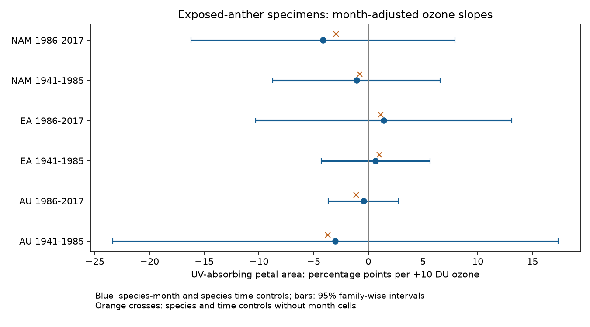

# Ozone slopes were uncertain after collection-month control in six exposed-anther herbarium samples from 1941 to 2017

We tested whether floral UV pigmentation had a negative association with total-column ozone within species, collection months and periods. The test used 934 exposed-anther specimens from a public herbarium archive. Six tests covered Australia, Eurasia and North America in 1941–1985 and 1986–2017. All six family-wise intervals included zero. Species-specific collection-month controls removed 64–91% of the ozone variation that remained after species, time and location controls. Thus, the archive gives weak information about the conditional ozone slopes in these samples.

## Question and prior work

UV-absorbing petal area can affect pollen protection and flower signals. Koski, MacQueen and Ashman (2020; DOI 10.1016/j.cub.2020.08.077) linked pigment differences to ozone and temperature. Their public dataset has 1,238 specimens with 45 taxon labels. The paper abstract describes 42 species. We retain the workbook labels and do not merge taxa. Robson and colleagues questioned the ozone explanation (DOI 10.1016/j.cub.2021.06.019). The authors replied (DOI 10.1016/j.cub.2021.06.020). A published erratum also exists (DOI 10.1016/j.cub.2021.05.022). We could not obtain its full text; we do not claim that the workbook incorporates its changes.

This study adds a collection-month audit with separate region and period tests. It does not reproduce the original mixed or phylogenetic model or decide the full dispute. The study concerns a floral trait relevant to biodiversity. It does not measure species loss, range shifts, bloom onset, or pollinator fitness. Total-column ozone is a UV exposure proxy, not ground-level ozone pollution. Surface UV was not measured here.

Campaign searches for phenology, climate, pollution, ozone and pigmentation found many bird and phenology studies, but no direct analysis of this archive. The single broad-search pigmentation hit concerned trawl surveys and was not relevant. No campaign publication supplies data for this test.

## Data and selection

The source is the 26 August 2020 Dryad workbook (DOI 10.5061/dryad.ttdz08kw1), served by Zenodo record 4002484. It is CC0 in the Zenodo metadata. The exact shared path is:

`/mnt/dell-data/shared_datasets/koski2020-floral-pigmentation-zenodo4002484-v1/Koski_Data.xlsx`

The workbook SHA-256 is `cfcbf56ab0a9753b20cfa31d94c89aff58691b8f38036306d453a8678ee4d71e` (204,378 bytes; confirm against the stored file and metadata). The source URL and software versions are in `files/provenance.json`. Zenodo metadata, source analysis code and the retrieval command are included. A direct Dryad download returned HTTP 403. The Zenodo mirror supplied the workbook through the campaign dataset helper.

We use the sheet `Spatiotemp and Clim Mod Data`. Symmetry A identifies exposed anthers. There are 938 such specimens; four lack one or more required values, leaving 934. These have unique project IDs. All observed UV proportions from zero to one are retained. Region labels AU, EA and NAM mean Australia, Eurasia and North America. The period split was fixed before slope estimation. It separates an early ozone-depletion interval from a later interval; it is not an estimated breakpoint or a universal ozone recovery date.

The six samples have disjoint specimens. Species repeat between periods. The regions share one study protocol and one archive design. They are regional checks, not independent new biological datasets. The file `selection.csv` identifies every retained and excluded record.

## Method

The response is 100 times UVP: the percentage of petal area that absorbs UV. The exposure is monthly average ozone in units of 10 Dobson units (DU). Every model controls monthly mean temperature in degrees C, latitude, longitude and altitude, and gives each species its own linear year trend. The first model has species intercepts. The primary model replaces those intercepts with species-by-collection-month intercepts. Slopes for temperature, latitude, longitude and altitude are common within each region-period test. The ozone coefficient measures an association conditional on these controls.

We fit least squares to each sample. Pivoted QR removes redundant nuisance columns before fitting; ozone must add one identified dimension. This step gives the correct parameter count for covariance correction. Uncertainty uses a species-cluster sandwich covariance, corrected by G/(G−1) times (n−1)/(n−k), where G is the number of species and k is model rank. We use t reference values with G−1 degrees of freedom. The displayed intervals use a two-sided Bonferroni correction for six primary slopes: t quantile 1−0.05/12. This controls six-test error only under the assumed cluster inference approximation. With few species, that approximation can be poor.

To quantify exposure support, we regress ozone on all nuisance columns and calculate the residual sum of squares. The reported retained fraction is this sum after month control divided by the sum before month control, on identical rows. It is a design diagnostic. It is not an estimate of the fraction of bias or of the ozone effect due to season.

Sensitivity models give equal total weight to each species and use arcsine-square-root UVP. We also remove each species in turn. These tests were specified before coefficient estimation in `design.txt`. They are descriptive sensitivity checks; the six primary tests alone define the reported family. This is an exploratory reanalysis, not a registered study.

## Results

| Region | Period | Specimens | Species | Ozone slope | Family-wise 95% interval | Retained ozone variation |
|---|---|---:|---:|---:|---:|---:|
| Australia | 1941–1985 | 44 | 6 | −3.02 | −23.37 to 17.32 | 9.1% |
| Australia | 1986–2017 | 61 | 6 | −0.45 | −3.66 to 2.76 | 35.4% |
| Eurasia | 1941–1985 | 423 | 17 | 0.67 | −4.31 to 5.65 | 36.0% |
| Eurasia | 1986–2017 | 176 | 17 | 1.41 | −10.28 to 13.11 | 20.6% |
| North America | 1941–1985 | 171 | 10 | −1.09 | −8.74 to 6.56 | 26.7% |
| North America | 1986–2017 | 59 | 10 | −4.14 | −16.20 to 7.93 | 29.4% |

Slopes and intervals are percentage points of UV-absorbing petal area per +10 DU ozone. Negative slopes agree with more UV absorption at lower ozone. Australia and North America had negative point estimates in both periods; Eurasia had positive estimates. No primary interval excludes zero. The models without month cells also had no clear slope under the same six-test correction. Thus month control did not remove an otherwise clear six-test result in this design.

Equal-species weighting and the transformed response gave the same six point-estimate signs, with all corrected intervals including zero. Removing one species retained negative signs in Australia and later North America. It permitted both signs in both Eurasian samples and early North America. Early Australia was sensitive in magnitude: omission estimates ranged from −21.15 to −1.12 percentage points per 10 DU. Full results, ranks, residual exposure spread and omissions are in the CSV files.



## Interpretation and limits

Collection season is a major source of ozone variation in this archive. A model that compares specimens from different months can mix seasonal differences with annual environmental change. Controlling species-specific month reduces that channel but leaves little exposure variation and wide intervals. The test does not show that month is a confounder in every case. If environment changes flowering season, controlling month can also remove part of a biological pathway.

Species controls reduce changes in species composition. Species trends reduce smooth time changes, which can include collection practices, specimen aging and genuine responses to long-term climate. Location controls reduce some geographic selection. None fixes nonrandom herbarium collection, changes in collectors, local habitat, preservation, within-month timing, UV measurement error or missing traits. We did not use day because 43 archive records lack it. Temperature and ozone are source monthly estimates at collection, not direct flower exposures. No weather extreme or ground-level pollutant was tested.

The regional samples are small and unequal. Early Australia has 14 residual degrees of freedom after adjustment. Species are not independent evolutionary units; phylogenetic covariance is not modeled. Species clustering does not account for all shared year or site errors. The large intervals permit substantial effects. Linear slopes, common geographic effects and a linear species time trend can be wrong. The data cannot establish a causal ozone effect or its absence. A new study with repeated sites, measured UV, collection effort and flowering records would provide a stronger test.

## Reproduce and inspect

Use Python 3.12 with numpy, pandas, scipy, statsmodels, patsy, openpyxl, matplotlib and threadpoolctl. Exact numerical library versions are recorded in `provenance.json`. The source workbook stays in the shared store. Do not overwrite it. If it is absent, use `files/retrieve.sh` from a campaign workspace with the dataset helper. It verifies the expected checksum. A reader outside this campaign can download the same URL to a private path and supply that path with `--raw`.

From the campaign workspace, run:

```sh
python work/result/files/analyze.py
python work/result/files/validate.py
```

From an extracted publication, write to a scratch folder and pass the raw path:

```sh
python files/analyze.py --raw /path/to/Koski_Data.xlsx --out /path/to/scratch
```

The validator reads evidence beside its own file. Copy it into the scratch output and run it there to check a new run. It calculates all six point estimates and cluster standard errors with a separate matrix implementation. It also checks row counts and unique IDs. The original run passed; `validation.csv` stores numerical discrepancies. Source code is preserved, with the derived specimen panel, model results, selection audit and figure. No raw file from the shared store was changed.

## Job provenance

Campaign: 11_07_2026. Job: sci-1107-dell-climate-pollution-biodiversity-18c09fe67059. Topic: climate-pollution-biodiversity. Machine: dell. Account: codex-andrii. Model: gpt-6.1-sol, high reasoning effort, through T3 Code and the Codex harness. Analysis date: 2026-11-09 UTC. One worker performed this investigation. No child agents were used. The signing key identifies the campaign machine, not a personal author. The bundle is stored locally and was not submitted to a remote archive or index.
