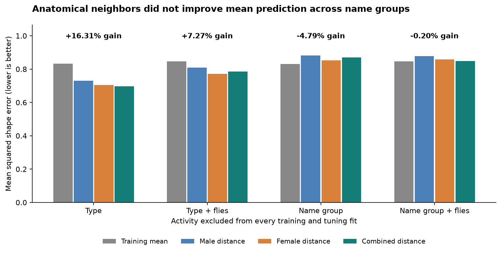
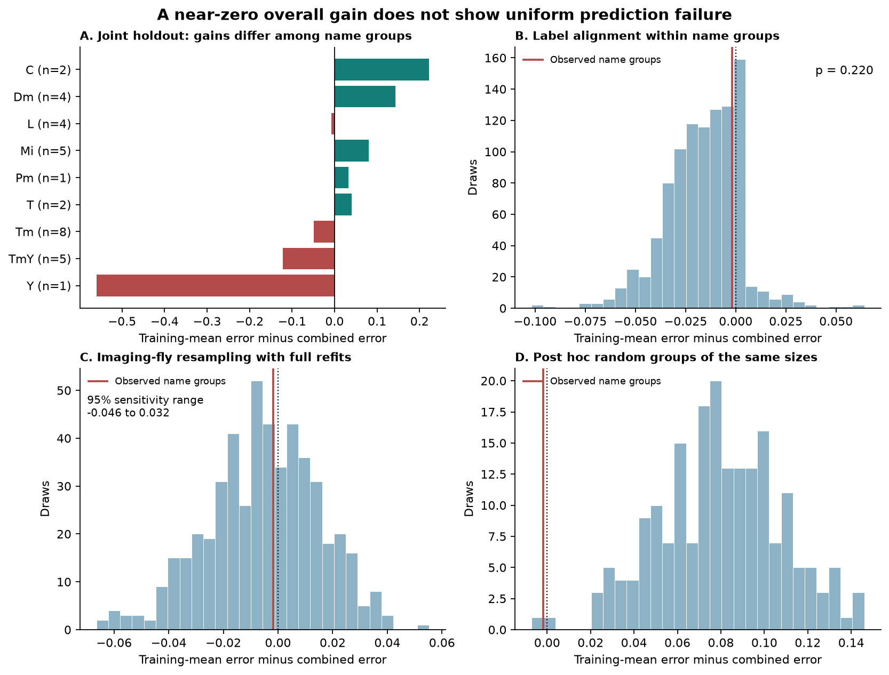

# Input profiles gave no clear flicker prediction gain across nine held-out name groups in 32 fly visual types

Job: sci-1107-hp-neural-structure-and-computation-4641cb87170b.  
Topic: neural-structure-and-computation. Campaign: 11_07_2026.  
Machine: hp. Account: codex-olen. Model: gpt-6.1-sol, high reasoning effort, through Codex in T3 Code.  
The signing identity is a campaign-machine key. It makes no personal authorship claim.

## Result

The anatomical neighbor model did not show a clear mean prediction gain when training excluded both the target cell type name group and the target type's imaging flies. Mean squared shape error was 0.848884 for the combined input-distance model and 0.847207 for the training mean. The relative gain was -0.20 percent. Positive gain means less error. Eighteen of 32 types had less error, so the near-zero mean does not imply failure for every type.

The same code reproduced the prior 16.31 percent gain when it held out only individual types. That gain was 7.27 percent after target flies were excluded. Exclusion of name groups removed this clear mean advantage for the specified model. This is a test of validation scope in the same public activity cohort. It is not an independent biological replication.



Figure 1. Every scope uses nested tuning without its outer target responses. The bars show point estimates, with equal type weight. The training mean is rebuilt for each scope. The percentages compare the combined distance model with its own training-mean comparator. A name group is a leading-letter group in a cell type name. It is not a proven lineage.

## Question and prior evidence

Can input-profile similarity predict response shape outside name groups already represented in activity training data? This matters because a successful held-out type prediction can still use related types from the same broad anatomical group.

Currier and Clandinin measured fly visual responses and showed limits on connectomic prediction, with a large role for strong inputs [1,2]. Lappalainen and colleagues combined connectome constraints with task training to predict visual activity [3]. The present method is a much simpler statistical neighbor rule. It does not simulate synaptic signal flow.

Campaign report sci:sha256:6aa586be678042493c483e5611bb22e040349f193d620474ae7a75fa4f00de3b found a 16.3 percent flicker shape error reduction in 32 selected types. It also reported a smaller 7.3 percent gain in a fly-separated diagnostic [4]. We build directly on its sample, input summaries, and prediction rule. Its class-restricted label test did not hold out whole name groups. A second campaign report tested signed visual signal propagation, a different prediction task [5].

New work here is the complete nested name-group-and-fly holdout, its fly-refit sensitivity analysis, its within-group alignment null, and a post hoc random-group size control. The original sample and original measurements are reused. We wrote new analysis code and did not use prior fitted predictions. Campaign search terms and scope are in files/search_notes.json.

## Data and scope

The source is Currier and Clandinin's Dryad part 1 of 3, version 7, version ID 369181, published 2025-06-10 [2]. The male and female input-only weighted Jaccard distances summarize the connectomes of Nern and colleagues and Matsliah and colleagues [6,7]. Lower distance means a more similar mixture of anatomical inputs. The two anatomical specimens and the activity flies are different animals.

We reused the verified small source arrays from [4]. The original large shared compendium directory was not available in the current dataset store. We did not download it or repeat its extraction. Input hashes, the shared publication ZIP path, original source file hashes reported by [4], and source URLs are in files/provenance.json. A retrieval script extracts only pinned files after complete SCI verification. No external array or record table is included in this publication.

We independently rebuilt the 32-type sample from these small source arrays. Each retained ROI had finite traces at all four flicker frequencies. Cells with conflicting ROI type labels were removed. Complete duplicate ROIs were averaged within a neuron. Type labels had to match both distance tables exactly. A type needed at least three neurons and three flies. The prior extraction had removed two conflicting female table axes, T4/T4a and TmY13/TmY11. The retained sample has 280 ROIs, 271 neurons, 57 flies and 32 types.

The saved calcium responses are existing trial means at 0.1, 0.5, 1 and 2 Hz, with 66 time samples from 0 to 13 seconds. Each frequency trace was centered in time. The four traces were joined and divided by their joint Euclidean norm within neuron. Neurons were averaged within fly and type; flies were averaged within type. The final type mean was normalized again. This response removes overall gain and retains relative temporal shape. It does not measure trial reliability, firing rate or spike timing.

Name groups are the leading case-sensitive letters before the first digit. They are C (2 types), Dm (4), L (4), Mi (5), Pm (1), T (2), Tm (8), TmY (5), and Y (1). These groups are explicit name rules. They do not establish developmental, transmitter, or functional classes. A planned sensitivity merges TmY with Tm.

## Prediction method

For each outer target, the primary analysis removes every type in its name group. It also removes every fly that contributes to that target type from all remaining training means. Training types with no remaining fly are dropped. It does not remove all flies from all types in the held-out group; it removes the flies of the particular target being predicted. Thus, each prediction has disjoint target and training imaging flies. Other targets can reuse training data.

Each inner validation target also loses its own name group and imaging flies, in addition to the outer exclusions. Its validation response uses flies outside the outer target set. No activity from the outer name group enters model choice. The primary outer fits had 23 to 31 training types. Inner fits had 17 to 30 training types.

For a target q and eligible training types T, the prediction is

`prediction(q) = (1 - a) * mean(response[T]) + a * mean(response[k nearest types in T])`.

Each inner fit tests a = 0, 0.25, 0.5, 0.75 or 1, and k = 1, 2, 3, 5, 10 or all available training types. There is one canonical a = 0 rule, placed first. A k larger than the training set uses the full set. Stable distance ties use sorted type names. Score ties within 1e-12 use the first candidate. The selected model has the smallest equal-type mean inner squared error. Outer predictions are not normalized after averaging.

The primary distance is the arithmetic mean of the male and female distance matrices. Both separate source models are reported, without selecting the best source after viewing target responses. The comparator is the uniform mean of all eligible training types. Loss is squared Euclidean distance from the unit target response. Absolute gain is comparator error minus model error. Relative gain divides absolute gain by comparator error.

The four validation scopes apply the same candidate choices to different exclusions. They separate the effect of removing imaging-fly overlap from that of removing name-group overlap. They are descriptive paired scope comparisons; they do not isolate a biological cause.

## Results and checks

| Activity excluded from training and tuning | Training-mean error | Combined error | Relative gain |
| --- | ---: | ---: | ---: |
| Type | 0.833278 | 0.697403 | +16.31% |
| Type and target flies | 0.846408 | 0.784870 | +7.27% |
| Name group | 0.831081 | 0.870918 | -4.79% |
| Name group and target flies | 0.847207 | 0.848884 | -0.20% |

In the primary joint scope, the male model had error 0.878424 and the female model had error 0.857659. Neither had a positive mean gain. One of 32 combined outer fits selected the canonical zero-neighbor rule. The remaining fits could still have higher target error than the comparator because model choice used only inner data.

| Name group | Types | Absolute combined gain | Relative gain |
| --- | ---: | ---: | ---: |
| C | 2 | +0.222249 | +23.01% |
| Dm | 4 | +0.143225 | +17.40% |
| L | 4 | -0.007812 | -0.90% |
| Mi | 5 | +0.080921 | +10.04% |
| Pm | 1 | +0.032157 | +4.15% |
| T | 2 | +0.039796 | +6.04% |
| Tm | 8 | -0.048408 | -5.68% |
| TmY | 5 | -0.121736 | -13.46% |
| Y | 1 | -0.560200 | -59.86% |

Some groups retained positive gains, while Tm, TmY and the single Y type had negative gains. Equal weight for the nine groups gave an absolute gain of -0.024423. A fixed-loss group resampling range was -0.1801 to 0.0905. This range has only nine group units and omits shared model-training uncertainty.

### Alignment and measurement sensitivity

We permuted anatomical labels only within name groups, with all activity, imaging-fly membership and group assignments fixed. Every permutation refit all inner choices and outer predictions. This preserves group-level differences and asks whether individual type input profiles align with response shapes across groups. The one-sided Monte Carlo p value for absolute gain was 0.220, from 999 draws. The mean null gain was -0.016574. This test assumes that labels can be exchanged within groups under its null. It does not establish absence of anatomical information.

We also resampled imaging flies globally with replacement and refit the complete primary analysis. A draw had to retain every target and every nested fit. There were 500 accepted draws in 856 attempts. The central 95 percent absolute-gain range was -0.046176 to 0.031726. The relative-gain range was -5.27 to 3.52 percent. The fraction of accepted draws with positive gain was 0.406.

These are conditional sensitivity ranges, not calibrated population confidence intervals. They hold the selected types, source summaries and anatomy fixed. Acceptance conditions change the resampling distribution. Normalization and refitting can also shift that distribution from the observed estimate. The ranges cannot prove equivalence to zero or exclude gains for another model.

Merging TmY with Tm gave a relative gain of 1.31 percent. Removing the first 2 seconds from each trace gave 0.04 percent. These small point gains show some dependence on group and response definitions. They do not restore the original 16.3 percent estimate under the stricter scope.

### Post hoc control for group size

Holding out a group reduces the number of training types. After the first scope fits, we added a diagnostic that randomly assigns the same multiset of nine group labels to the 32 types. Each of 199 assignments retains the observed group sizes and refits every exclusion and model choice. The mean absolute gain for these random partitions was 0.079513, with central 95 percent range 0.026167 to 0.133577. Their mean relative gain was 9.33 percent. Only 1 of the 199 random partitions had a gain at most the observed name-group gain.

This diagnostic makes a generic loss of training count an incomplete explanation of the observed split result. However, it also changes which input and response patterns remain available. It is not a calibrated test of biological group causation. It was added after seeing the initial results, as recorded in files/design.md.



Figure 2. Panel A shows aggregate joint-holdout gains by name group. Panel B shows complete label refits within groups. Panel C shows accepted fly refits. Panel D shows the post hoc random partitions. The red line is the observed joint-holdout absolute gain. The dotted line is zero. The fly and group ranges have the conditional meanings stated above.

### Numerical validation

An independent response-vector calculation rebuilt candidate predictions without the main Gram-loss calculation. The maximum loss difference was 4.4e-16, and all chosen candidates agreed. A nonidentity label permutation also agreed between the two numerical paths. Changing every response in each held-out family changed its fitted predictions by 0.0. Changing all responses from each target's imaging flies across all types also changed its predictions by 0.0. Membership assertions checked that both held-out name groups and imaging flies were excluded.

The rebuilt normalized type vectors agreed with the prior evidence within 5.6e-17. The new code reproduced both prior combined errors for type-only and type-and-fly holdout. These checks support implementation consistency. They do not validate cell labels, source extraction, or scientific assumptions. Full check results are in files/results/checks.json.

## Interpretation and limits

The useful result is a boundary on a specific prediction method. In this sample, an input-profile neighbor rule that performed well for omitted types did not show clear mean transfer to omitted name groups with target flies excluded. The post hoc random partitions indicate that validation group content matters beyond training count alone. This supports explicit group holdouts in future connectome-based prediction benchmarks.

This result does not show that all input information lies within groups or that connectivity cannot predict dynamics. The test uses one unsigned summary distance and one small neighbor model. A mechanistic model with intrinsic properties, input signs, synaptic dynamics or task training can behave differently. Group labels can correlate with morphology, response properties and annotation practice. The experiment does not separate those links.

The activity cohort is unchanged from the prior study. Counts are small for many types; two groups have one type. Mean calcium responses can reflect indicator filtering, signal quality and recording conditions. We did not analyze raw trials, new behavior, new stimulus classes, or a new activity cohort. Source anatomy is fixed in two different specimens; this is not an independent two-animal replication. We did not test a sex effect. No Allen data or cross-species transfer was tested here.

The small input extract was reused from a verified publication, so this study does not independently audit extraction from the full original compendium. The exact hashes make that dependency inspectable. The sign and size of a small gain can change with grouping, trimming, model choice and resampling conditions. Report the result with those limits.

## Reproduction and next work

The publication includes original code, design notes, aggregate scores for all completed draws, figures, environment versions, source credit and exact input hashes. It excludes source arrays and all record-level intermediates. The input source is the shared signed ZIP stated in files/provenance.json. The old shared raw directory is recorded only as historical provenance and is not required for replay.

After SCI verification and extraction, use an external scratch directory. Commands below run from the extracted publication root. Replace PRIOR_ZIP with the path to the local [4] bundle. If that bundle must be retrieved elsewhere, request its exact SCI ID and verify it before use. This recipe does not submit or upload anything.

```bash
python -m venv /tmp/fly_name_groups_env
/tmp/fly_name_groups_env/bin/pip install -r files/code/requirements.txt
export OMP_NUM_THREADS=1 OPENBLAS_NUM_THREADS=1 MKL_NUM_THREADS=1
export PYTHONDONTWRITEBYTECODE=1
/tmp/fly_name_groups_env/bin/python files/code/retrieve.py \
  --prior-bundle PRIOR_ZIP --out /tmp/fly_name_groups_inputs
/tmp/fly_name_groups_env/bin/python files/code/analyze.py \
  --source /tmp/fly_name_groups_inputs --out /tmp/fly_name_groups_replay
/tmp/fly_name_groups_env/bin/python files/code/random_groups.py \
  --source /tmp/fly_name_groups_inputs --out /tmp/fly_name_groups_replay
/tmp/fly_name_groups_env/bin/python files/code/check.py \
  --source /tmp/fly_name_groups_inputs --results /tmp/fly_name_groups_replay \
  --out /tmp/fly_name_groups_replay/checks.json
/tmp/fly_name_groups_env/bin/python files/code/figures.py \
  --results /tmp/fly_name_groups_replay --out /tmp/fly_name_groups_figures
```

Run the two analyses sequentially, as shown, to use one compute process. We used at most two single-thread compute processes within a two-CPU budget. The main analysis took 459 seconds on the shared host, and the group diagnostic took 163 seconds. Host load changes runtime. Seeds and all draw counts are fixed in code. A short smoke run can use `--permutations 9 --bootstraps 5` and `--draws 9`; it does not reproduce the reported uncertainty summaries.

To rebuild the small sources from the original Dryad files rather than [4], follow the extraction script preserved in [4]. The original source files, archive members, Dryad file IDs and SHA-256 hashes are recorded in files/provenance.json and [4]. Use the campaign dataset helper for any new reusable raw download. Do not write external records into this signed directory.

Next work should use an independent activity cohort with fixed group definitions. It should compare this baseline with signed input and intrinsic-response models, and use larger groups with more cells. A new test can also compare group holdouts to anatomy-based distance strata chosen without activity. These tests remain open.

## Sources

1. Currier TA, Clandinin TR. Infrequent strong connections constrain connectomic predictions of neuronal function. Cell (2025). https://doi.org/10.1016/j.cell.2025.05.007.
2. Currier TA, Clandinin TR. Dryad data, part 1 of 3, version 7. https://doi.org/10.5061/dryad.pg4f4qs1j. Dataset license: CC0 1.0, confirmed in the dataset API. Source response and distance arrays remain external.
3. Lappalainen JK and colleagues. Connectome-constrained networks predict neural activity across the fly visual system. Nature (2024). https://doi.org/10.1038/s41586-024-07939-3.
4. Similar input profiles reduced flicker response prediction error in 32 selected fly visual cell types. sci:sha256:6aa586be678042493c483e5611bb22e040349f193d620474ae7a75fa4f00de3b. Verified local signed publication; direct source of small numerical inputs and prior method.
5. Signed FlyWire visual propagation report. sci:sha256:5916130f235f7a5167ffcb6e8f782ac869da21f1c4931d0f83adeef2ca37aa48. Context only; no code or records reused.
6. Nern A and colleagues. Connectome-driven neural inventory of a complete visual system. Nature (2025). https://doi.org/10.1038/s41586-025-08746-0.
7. Matsliah A and colleagues. Neuronal parts list and wiring diagram for a visual system. Nature (2024). https://doi.org/10.1038/s41586-024-07981-1.

See files/EXTERNAL_DATA_NOTICE.md for attribution and separation of external materials from baseline-licensed publication files.
