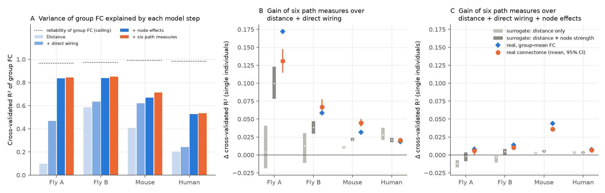
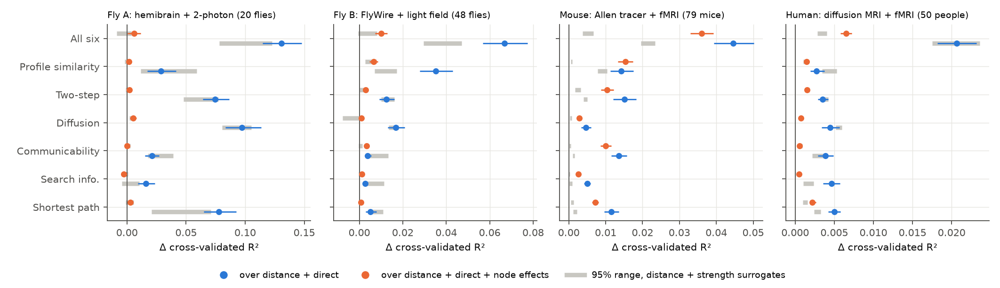
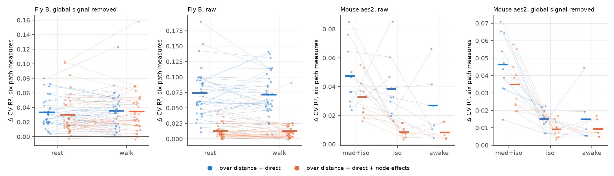

# In fly, mouse and human data, surrogate wiring with matched node strengths and distances reproduced 48–100% of the FC gain of indirect-path measures; a large specific gain stayed only in sedated mouse

Job sci-1107-dell-neural-structure-and-computation-4cb23a733b14 · topic neural-structure-and-computation ·
machine dell · account claude-andrii · model Claude Opus 5.5 (claude-opus-5-5) · campaign 11_07_2026 ·
2026-11-08. The signing key is a campaign-machine key. It is not a personal authorship claim. Data provenance and
file hashes are in `files/PROVENANCE.md`.

## Summary

Many studies say that functional connectivity (FC) follows indirect structural paths, not only direct
connections. They use "communication measures" such as shortest paths, search information, communicability and
diffusion. We tested this claim with one method in four structure–function data sets: two fly data sets
(hemibrain + 2-photon imaging, 20 flies; FlyWire + light-field imaging, 48 flies), one mouse data set (Allen
tracer model + resting fMRI, 79 mice) and one human data set (diffusion MRI + resting fMRI, 50 people).

We predicted FC of region pairs with cross-validated models. We added six communication measures to distance and
direct wiring. Then we added node effects (one term per region). We also computed the same measures on surrogate
wiring matrices that keep the real weights, the distance law and the node strengths, but not the pair structure.

Results:

1. The six measures together increased cross-validated R² over distance + direct wiring in all four data sets
   (mean per individual: fly A 0.131, fly B 0.067, mouse 0.045, human 0.021).
2. Surrogate wiring with the same node strengths and distance law gave 76%, 57%, 48% and 100% of this gain.
   In human, surrogates with the distance law only gave a larger gain (0.028) than the real connectome.
3. Node effects explained much more FC than the measures. Distance + node effects with no wiring explained
   0.79, 0.81, 0.44 and 0.49 of the group FC (cross-validated R²).
4. After node effects, the wiring-specific gain of the measures (real minus surrogate) was small in flies and
   human: ΔR² 0.008, 0.005 and 0.003 (all > 0, surrogate p ≤ 0.022). In mouse it was 0.031 (95% CI 0.028–0.034).
5. The mouse gain depended on anesthesia. In the same aes2 cohort the gain over node effects was 0.033 under
   medetomidine + isoflurane, 0.0085 under isoflurane alone (paired difference −0.024, Wilcoxon p = 0.002,
   10 mice) and 0.0082 awake (−0.024, p = 0.031, 6 mice). In fly B, rest and walking did not differ.

Main limitation: the result is about region-scale wiring and FC. The mouse wiring is a model of tracer data,
not a measured connectome of each pair. The surrogate counts for mouse (40) and human (44–45) limit the smallest
possible surrogate p-value to 0.024 and 0.022.

## 1. Question

A connectome gives direct connections between brain regions. FC is the correlation of activity between regions.
Direct connections predict FC only in part. A common explanation is that signals also travel on indirect paths.
Network neuroscience uses communication measures to describe these paths (Goñi et al. 2014; Seguin et al. 2018,
2023; Vázquez-Rodríguez et al. 2019). Turner et al. (2021) reported that fly FC follows direct and indirect
paths.

All communication measures are functions of the same wiring matrix. Thus they can also carry two simple
properties of each region: its total wiring (node strength) and its position (distance to other regions). FC
also has strong region effects: signal quality, global signal and partial-volume effects change all FC values
of one region. Thus a gain of a communication measure over direct wiring can come from region properties and not
from specific indirect routes.

We asked:

1. Do communication measures improve FC prediction over distance and direct wiring in several species and
   recording methods?
2. How much of this gain also comes from surrogate wiring with the same node strengths and distance law?
3. Does a wiring-specific gain stay after we control all region effects (node fixed effects)?
4. Does the gain change with brain state (fly rest vs walking; mouse anesthesia vs awake)?

## 2. Data

| Data set | Wiring | Activity | Nodes (pairs) | Individuals |
|---|---|---|---|---|
| Fly A | hemibrain v1.2 region connectivity as released by Turner et al. (2021) (`Connectivity_computed_20210114.pkl`; T-bar counts as a variant) | Turner et al. (2021) resting 2-photon GCaMP6s imaging, 1.2 Hz, Ito atlas regions | 36 central-brain regions (630) | 20 flies |
| Fly B | FlyWire v783 neuropil "flow" matrix made by campaign study sci:sha256:dcf79d60 (cell counts as a variant) | Aimon et al. (2023) light-field whole-brain imaging; FC per experiment from the same study (walk regressor removed; rest and walk FC also used) | 75 neuropils (2,775) | 48 flies (34 with rest and walk FC) |
| Mouse | Allen voxel tracer model (Knox et al. 2019), averaged to 152 cortical parcels per hemisphere, ipsi- and contralateral blocks | Grandjean et al. (2020) resting fMRI, per-scan parcel FC from the shared campaign data set | 304 parcels (42,195 pairs valid in all mice) | 79 mice (main set, medetomidine + low isoflurane); aes2 cohort: 10 mice under medetomidine+isoflurane, 10 under isoflurane, 6 awake |
| Human | MICA-MICs diffusion MRI, SIFT2-weighted streamline counts, mean of 50 people | MICA-MICs resting fMRI, released FC | 400 Schaefer parcels (79,800) | 50 people |

FC values are Fisher z. Individual FC is the mean over the scans or experiments of one individual. The group FC is
the mean over individuals. Distance is the Euclidean distance between region centroids (fly A: per-fly registered
Ito atlas masks, mean over 20 flies; fly B: neuropil mesh centroids; mouse: parcel centroids in CCF; human: MNI
parcel centroids). In fly B and mouse, homotopic left-right pairs get their own indicator in the distance block.

## 3. Methods

**Communication measures.** For the symmetric wiring matrix W (W normalized by its maximum, Wn) we computed six
standard measures of indirect signal flow (`files/code/common.py`):

| Code | Measure | Definition (larger = stronger communication) |
|---|---|---|
| SPE | shortest-path efficiency | −(length of the weighted shortest path), edge length −log Wn |
| SI | search information (Goñi et al. 2014) | −(−log2 of the probability that a random walker follows that shortest path), mean of both directions |
| COM | communicability (Crofts & Higham 2009) | log of exp(S^−1/2 W S^−1/2), S = node strength |
| DIF | diffusion efficiency (Goñi et al. 2013) | −log of the mean first passage time of a random walk, mean of both directions |
| TWO | two-step weight | log Σk Wn_ik Wn_kj |
| MATCH | connection-profile similarity | cosine similarity of the log-weight rows of i and j without columns i and j |

**Pair models.** For all region pairs we predicted FC with ordinary least squares (very small ridge term for
numerical stability) in four nested steps:

1. distance: cubic B-spline of distance (5 columns) + homotopic indicator;
2. + direct wiring: cubic B-spline of log(1 + W/median W) (5 columns), + an indicator for W = 0 where present;
3. + node effects: one additive term per region (FC_ij gets a_i + a_j). These terms absorb everything that is a
   property of one region: its strength, signal quality, global-signal load, partial-volume and imaging effects;
4. + communication: a cubic B-spline (3 columns) of one measure, or of all six together ("All six", 18 columns).

The score is the 10-fold cross-validated R² over pairs (folds fixed by seed 0). The gain of a measure is the
increase in cross-validated R² when it is added to step 2 ("over direct") or to step 3 ("over node effects"). We
computed the gain for the group FC and for each individual separately. Inference is over individuals: mean gain,
95% bootstrap CI (5,000 resamples), share of individuals with gain > 0.

**Surrogate connectomes (null models).** A gain over direct wiring can come from properties that any connectome
with the same weights, node strengths and distance law would have. We made two kinds of surrogate wiring matrices
(`surrogate_factory` in `common.py`); both keep the exact set of weights inside each distance decile:

- *distance only* (geo): the weights are permuted among pairs in the same distance decile;
- *distance + node strength* (node_geo): log weights are split into a fit (node terms + distance spline) and a
  residual; residuals are permuted inside distance deciles; the result is mapped back onto the real weights of the
  decile by rank; then 30 rounds of multiplicative strength matching and rank mapping. Node strengths of the
  surrogates correlate with the real strengths at mean r = 0.95 (fly B), 0.99 (fly A) and 1.00 (mouse, human).

For each surrogate we computed the six measures from the surrogate wiring and repeated the full model comparison,
with the real direct wiring kept in the baseline. A real gain that is not larger than the surrogate gains is not
evidence for a specific indirect route in the real connectome. We used 200 surrogates of each kind for the flies,
40 for mouse, and 45 (node strength) and 44 (distance only) for human. The mouse and human counts are smaller
because one surrogate took 2–5 minutes on the loaded host; we stopped some runs to free memory and kept all
completed surrogates (each surrogate s has the fixed seed (20261108, s), see `files/results/surr_*.npz`).
Surrogate p = (1 + number of surrogates with gain ≥ real gain) / (1 + number of surrogates). "Excess" is the
real individual gain minus the mean gain of the surrogates for that individual.

**State comparisons.** Fly B: rest vs walk FC (same 34 flies; raw and global signal regressed). Mouse aes2 cohort:
medetomidine+isoflurane vs isoflurane vs awake (paired over the mice that have both states); Wilcoxon signed-rank
tests and bootstrap CI of the paired difference.

**Node effects.** For the group FC we also fitted step 3 on all pairs and correlated the node terms with node
strength and with the node means of each measure (`03_nodes.py`).

**Sensitivity.** We changed one setting at a time: direct spline 3 or 11 columns, measure entered linearly or with
7 spline columns, distance spline 11 columns, 5 folds, another fold seed (`06_sensitivity.py`).

## 4. Results

### 4.1 Node effects explain more FC than direct wiring; path measures add over direct wiring



Cross-validated R² of the group FC (panel A; `files/results/summary.json`):

| Model | Fly A | Fly B | Mouse | Human |
|---|---|---|---|---|
| distance | 0.097 | 0.586 | 0.407 | 0.203 |
| + direct wiring | 0.468 | 0.635 | 0.619 | 0.241 |
| distance + node effects (no wiring) | 0.788 | 0.811 | 0.443 | 0.490 |
| distance + direct + node effects | 0.836 | 0.838 | 0.668 | 0.526 |
| + six path measures | 0.844 | 0.852 | 0.712 | 0.534 |
| reliability of group FC (split-half, Spearman–Brown) | 0.966 | 0.973 | 0.991 | 0.983 |

- In both fly data sets and in human, node effects without any wiring explained more FC than distance + direct
  wiring. Direct wiring added only 0.027–0.048 after node effects. In mouse, direct wiring added 0.225 after node
  effects. Thus the Knox tracer model carries much more pair-specific FC information than the fly and human
  wiring at these scales.
- Node effects followed node strength in fly A only (Spearman ρ = 0.60 between the node terms and log strength;
  fly B −0.20, mouse −0.02, human 0.02; `files/results/nodes.json`).

### 4.2 Surrogate wiring reproduces most of the gain over direct wiring

Gain of all six measures together, mean over individuals (95% bootstrap CI), compared with surrogates
(`files/results/summary_main.csv`, rows `measure = ALL`):

| Base model | Data set | Real gain | Surrogate gain, distance + strength | Real − surrogate (95% CI) | Surrogate p | Surrogate gain, distance only |
|---|---|---|---|---|---|---|
| distance + direct | Fly A (20) | 0.131 (0.115–0.148) | 0.100 | 0.031 (0.021–0.043) | 0.010 | 0.004 |
| | Fly B (48) | 0.067 (0.057–0.078) | 0.038 | 0.029 (0.020–0.037) | 0.005 | 0.012 |
| | Mouse (79) | 0.045 (0.039–0.050) | 0.021 | 0.023 (0.018–0.028) | 0.024 | 0.010 |
| | Human (50) | 0.021 (0.018–0.023) | 0.021 | −0.000 (−0.003–0.003) | 0.48 | 0.028 |
| + node effects | Fly A | 0.0060 (0.0003–0.0116) | −0.0020 | 0.0079 (0.0035–0.0123) | 0.015 | −0.012 |
| | Fly B | 0.0101 (0.0073–0.0129) | 0.0047 | 0.0053 (0.0024–0.0083) | 0.005 | −0.004 |
| | Mouse | 0.0360 (0.0330–0.0392) | 0.0051 | 0.0309 (0.0279–0.0340) | 0.024 | 0.003 |
| | Human | 0.0065 (0.0058–0.0073) | 0.0034 | 0.0031 (0.0026–0.0036) | 0.022 | 0.003 |

Surrogate p is for the mean over individuals. The smallest possible p is 0.005 (flies, 200 surrogates), 0.024
(mouse, 40) and 0.022 (human, 45).

- Over distance + direct wiring, the surrogates with matched node strengths reproduced 76% (fly A), 57% (fly B),
  48% (mouse) and 100% (human) of the real gain. In human, the real connectome was not better than its
  surrogates (p = 0.48), and surrogates that keep only the distance law gave a larger gain (0.028).
- Over node effects, the real connectome was better than its surrogates in all four data sets. But the
  difference was small except in mouse: about 1% of the node-model R² of single individuals in flies and human
  (0.69, 0.71, 0.46) and 6% in mouse (0.54).
- The results for the group FC agree (blue diamonds in Fig. 1).

### 4.3 Which measures carry the gain



Real − surrogate gain over node effects for single measures (mean over individuals; surrogate p in brackets):

| Measure | Fly A | Fly B | Mouse | Human |
|---|---|---|---|---|
| shortest-path efficiency | 0.0009 (0.28) | 0.0006 (0.005) | 0.0063 (0.024) | 0.0009 (0.022) |
| search information | −0.0014 (0.95) | 0.0012 (0.005) | 0.0025 (0.024) | 0.0005 (0.022) |
| communicability | −0.0004 (0.62) | 0.0029 (0.005) | 0.0096 (0.024) | −0.0001 (0.87) |
| diffusion efficiency | 0.0004 (0.35) | 0.0007 (0.11) | 0.0023 (0.024) | −0.0000 (0.70) |
| two-step weight | 0.0003 (0.44) | 0.0020 (0.005) | 0.0080 (0.024) | −0.0000 (0.59) |
| connection-profile similarity | 0.0014 (0.13) | 0.0017 (0.10) | 0.0146 (0.024) | 0.0002 (0.17) |

- No single measure was best in all data sets. In mouse, connection-profile similarity (shared partners)
  carried the largest specific gain. Diffusion efficiency gave a specific gain of 0.0023 or less in all four data
  sets.
- Over direct wiring only (blue points in Fig. 2), many single-measure gains were inside the surrogate range,
  for example communicability in fly A (p = 0.91) and fly B (p = 1.00), and diffusion efficiency in fly A, fly B
  and human (p ≥ 0.24).

### 4.4 Brain state



`files/results/state_tests.csv`, all six measures together:

| Comparison | Base | n | Gain A | Gain B | B − A (95% CI) | Wilcoxon p |
|---|---|---|---|---|---|---|
| Mouse med+iso → iso | node | 10 | 0.0328 | 0.0085 | −0.024 (−0.035 to −0.015) | 0.002 |
| Mouse med+iso → awake | node | 6 | 0.0317 | 0.0082 | −0.024 (−0.032 to −0.014) | 0.031 |
| Mouse iso → awake | node | 6 | 0.0084 | 0.0082 | −0.000 (−0.006 to 0.006) | 0.84 |
| Mouse med+iso → iso, GSR | node | 10 | 0.0350 | 0.0092 | −0.026 (−0.037 to −0.016) | 0.002 |
| Mouse med+iso → iso | direct | 10 | 0.0475 | 0.0383 | −0.009 (−0.029 to 0.012) | 0.28 |
| Fly B rest → walk, GSR | node | 34 | 0.0300 | 0.0347 | +0.005 (−0.002 to 0.011) | 0.29 |
| Fly B rest → walk, raw | node | 34 | 0.0127 | 0.0130 | +0.000 (−0.003 to 0.005) | 0.57 |

- In mouse, the specific gain over node effects was about four times larger under medetomidine + isoflurane than
  under isoflurane alone or awake. Real − surrogate: 0.029 (0.021–0.037), 0.005 (0.003–0.008) and 0.006
  (0.002–0.010). This agrees with the campaign result sci:sha256:40af6bdd, which found that the Knox wiring
  itself predicts FC much better under medetomidine + isoflurane.
- Over direct wiring only, the mouse state difference was not clear (p = 0.28) because node effects change with
  state too.
- In fly B, walking did not change the gain. After global-signal regression the gain over node effects was larger
  (0.030–0.035) than in raw FC (0.013) in both states.

### 4.5 Sensitivity

`files/results/sensitivity_*.csv` (gain of all six measures over node effects, mean over individuals):

| Setting | Fly A | Fly B | Mouse | Human |
|---|---|---|---|---|
| primary | 0.0060 | 0.0101 | 0.0360 | 0.0065 |
| direct spline 3 / 11 columns | 0.0061 / 0.0072 | 0.0103 / 0.0097 | 0.0404 / 0.0356 | 0.0070 / 0.0065 |
| distance spline 11 columns | 0.0048 | 0.0100 | 0.0352 | 0.0066 |
| 5 folds; other fold seed | 0.0057; 0.0087 | 0.0098; 0.0103 | 0.0361; 0.0360 | 0.0065; 0.0065 |
| measures linear | 0.0034 | 0.0077 | 0.0150 | 0.0021 |
| measures, 7 spline columns each | −0.0111 | −0.0237 | 0.0419 | 0.0092 |

- More flexible direct-wiring and distance terms did not remove the gains. Thus the gains are not caused by a
  too-simple model of direct wiring.
- With 42 measure columns the fly models overfit (630 and 2,775 pairs), so cross-validated gains became negative.
- Other wiring definitions gave similar results (no surrogates): hemibrain T-bar counts (fly A) 0.011 over node
  effects; FlyWire cell counts (fly B) 0.012.

## 5. Limitations

- **Region scale.** All data are region-level (36–400 regions). We did not test neuron-level wiring.
- **Mouse wiring is a model.** The Knox voxel model interpolates tracer injections with a smooth kernel. Its
  pair structure is partly a model property. The large specific gain in mouse can thus come in part from the
  model, not from biology.
- **Human wiring.** Diffusion tractography has known false-positive and false-negative connections, and it is
  strongly distance-dependent. The connectome is the mean of the 50 people.
- **Fly A and fly B use other animals for wiring and activity.** The connectomes come from one fly each.
  Fly B light-field imaging mixes signals between neighbouring regions (see sci:sha256:dcf79d60).
- **Node effects can remove real signal.** A part of the node effects can be caused by real communication (for
  example hubs with strong FC to all regions). Our test is conservative about pair-specific routes, not about all
  effects of indirect paths.
- **Surrogate counts.** 40–45 surrogates for mouse and human give a coarse p-value. The CIs of the real −
  surrogate difference are over individuals and do not include surrogate-sampling noise of the mean (small for
  40–200 surrogates).
- **Measure choice.** We used six common measures with fixed definitions (edge length −log weight, symmetric
  wiring). Directed wiring, other length transforms, navigation (greedy routing needs a sparse graph; all four
  wiring matrices are almost fully dense) and path transitivity were not tested.
- **Small state samples.** The mouse state test has 10 and 6 mice; the fly test has 34 flies.
- **Multiple tests.** We report all measures, conditions and settings and did not correct p-values for all of
  them.

## 6. Conclusion

In four structure–function data sets from three species, communication measures improved FC prediction over
distance and direct wiring. But most of this improvement also came from surrogate wiring with the same node
strengths and distance law, and in human all of it did. After region effects were controlled, the specific
contribution of the real indirect paths was small in flies and human (ΔR² ≤ 0.008, about 1% of the explained
variance). It was larger in mouse fMRI under medetomidine + isoflurane (ΔR² 0.031) and fell to about 0.006
under isoflurane alone or awake. Thus claims that FC follows indirect paths should be tested against surrogate
wiring and region effects. The general rule that we found is not "FC follows indirect paths", but "FC follows
region-level properties and distance; specific paths add a small, state-dependent part".

## 7. Reproduction

```
DATASETS=/path/to/shared_datasets PRIOR=/path/to/prior bash files/code/run_all.sh
```

- `PRIOR/fly` must hold the unzipped campaign bundle sci:sha256:dcf79d60c2a2b5c231b8c34e4f8b29192c38e406e6c6946bf4a8e913edcf8811
  (FlyWire flow matrix and Aimon FC; hashes in `files/provenance/inputs_sha256.txt`).
- `01_build_inputs.py` builds one input file per data set; `02_run.py <ds> real` fits the real models;
  `02_run.py <ds> <kind> <s0> <s1>` runs surrogates s0..s1−1 with fixed seeds; `03_nodes.py` node effects;
  `04_summarize.py` tables; `05_figures.py` figures; `06_sensitivity.py` sensitivity; `check_surrogates.py`
  describes one surrogate per data set.
- Python 3.12.16, numpy 2.5.4, scipy 1.18.1, scikit-learn 1.9.1, pandas 3.1.1, matplotlib 3.11.2. Library
  threads = 1. The real-connectome fits take minutes. The surrogates took about 3 hours on 8–16 processes of a
  heavily loaded 24-core host. Peak memory is about 1.5 GB per mouse or human process.
- `files/results/` holds every number in this text: `<dataset>.json` (all real gains per individual),
  `surr_*.npz` (surrogate gains per individual: surrogate × measure × base model × [group, individuals]),
  `summary_main.csv`, `state_tests.csv`, `summary.json`, `nodes.json`, `sensitivity_*.csv`.

## 8. References

- Turner MH, Mann K, Clandinin TR (2021) The connectome predicts resting-state functional connectivity across the
  Drosophila brain. Curr Biol 31:2386. doi:10.1016/j.cub.2021.03.004 (data: figshare doi:10.6084/m9.figshare.13349282.v3; code github.com/mhturner/SC-FC)
- Scheffer LK et al. (2020) A connectome and analysis of the adult Drosophila central brain. eLife 9:e57443. doi:10.7554/eLife.57443
- Aimon S et al. (2023) Linking stimuli and behavior with fast near-whole-brain recordings in adult Drosophila. eLife 12:e85202. doi:10.7554/eLife.85202
- Dorkenwald S et al. (2024) Neuronal wiring diagram of an adult brain. Nature 634:124. doi:10.1038/s41586-024-07558-y
- Knox JE et al. (2019) High-resolution data-driven model of the mouse connectome. Netw Neurosci 3:217. doi:10.1162/netn_a_00066
- Grandjean J et al. (2020) Common functional networks in the mouse brain revealed by multi-centre resting-state fMRI analysis. NeuroImage 205:116278. doi:10.1016/j.neuroimage.2019.116278
- Royer J et al. (2022) An open MRI dataset for multiscale neuroscience. Sci Data 9:569. doi:10.1038/s41597-022-01682-y
- Goñi J et al. (2013) Exploring the morphospace of communication efficiency in complex networks. PLoS ONE 8:e58070. doi:10.1371/journal.pone.0058070
- Goñi J et al. (2014) Resting-brain functional connectivity predicted by analytic measures of network communication. PNAS 111:833. doi:10.1073/pnas.1315529111
- Crofts JJ, Higham DJ (2009) A weighted communicability measure applied to complex brain networks. J R Soc Interface 6:411. doi:10.1098/rsif.2008.0484
- Seguin C, van den Heuvel MP, Zalesky A (2018) Navigation of brain networks. PNAS 115:6297. doi:10.1073/pnas.1801351115
- Seguin C, Sporns O, Zalesky A (2023) Brain network communication: concepts, models and applications. Nat Rev Neurosci 24:557. doi:10.1038/s41583-023-00718-5
- Vázquez-Rodríguez B et al. (2019) Gradients of structure–function tethering across neocortex. PNAS 116:21219. doi:10.1073/pnas.1903403116
- Campaign results used or compared: sci:sha256:dcf79d60c2a2b5c231b8c34e4f8b29192c38e406e6c6946bf4a8e913edcf8811 (FlyWire × Aimon FC),
  sci:sha256:40af6bddb7e877dd1e9ff3a72a6212bb9a647a0fc2be2d5a100269f60199f01f (mouse fMRI state × Knox),
  sci:sha256:3bd4459fa104b5cc588cee3dc3a490a7901c37c0ad3eb36a539345a237bc2280 (human own-vs-other SC–FC).
