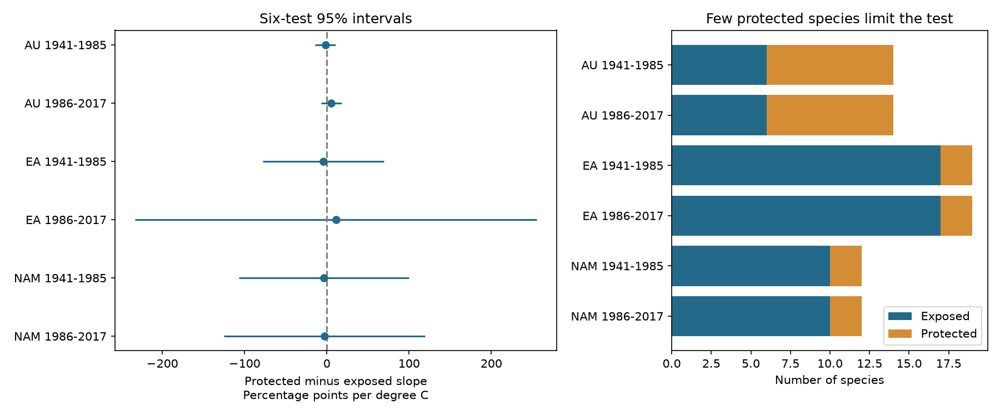

# Six herbarium samples did not establish a common temperature slope difference between anther groups in 1941-2017

We tested whether temperature slopes for UV-absorbing petal area were more negative in flowers with protected anthers than in flowers with exposed anthers. Six regional and period tests gave no common result. All six corrected intervals included zero. This is a limited test of a proposed heat-protection explanation. It does not show that the explanation is false.

## Question and prior evidence

Koski, MacQueen and Ashman (2020; DOI 10.1016/j.cub.2020.08.077) proposed that lower UV pigmentation in warmer conditions could reduce heat stress when petals enclose anthers. Their study also tested ozone and UV protection. We test the difference between the two anther groups, conditional on collection season and other controls. A negative difference agrees with the relative slope prediction. It does not by itself show that either group has a negative absolute slope. Heat damage, flower temperature, pollen fitness and pollinator response were not measured here.

The campaign study `sci:sha256:08175210a0a21d6a5b653a2a7e8f4911f7d55e4a31b7f1ef32abedde63e8f69a` tested ozone slopes in exposed-anther specimens. We read that signed result and reuse its source dataset and broad six-sample design. Our code and temperature contrast are new. A campaign search for `anthers temperature` returned that study alone. An earlier broad search used `phenology climate`; another used `pigmentation`. Searches were complete, with no catalog error. The narrow search output is preserved.

Robson and colleagues questioned the ozone explanation (DOI 10.1016/j.cub.2021.06.019). This publication does not resolve that dispute. A published erratum exists (DOI 10.1016/j.cub.2021.05.022). We confirmed its record but did not obtain its full text. We do not claim that the 2020 workbook includes that correction. We analyze the exact archived workbook as a fixed dataset.

## Source and selection

The source is the Dryad dataset DOI 10.5061/dryad.ttdz08kw1, mirrored at Zenodo record 4002484, dated 2020-08-26. The Zenodo metadata label it CC0. The shared source is:

`/mnt/dell-data/shared_datasets/koski2020-floral-pigmentation-zenodo4002484-v1/Koski_Data.xlsx`

SHA-256: `cfcbf56ab0a9753b20cfa31d94c89aff58691b8f38036306d453a8678ee4d71e`; size: 204,378 bytes. We checked the relevant dataset name and metadata before use. No new shared download was needed. No shared data were changed. The source URL, metadata and package versions are in `files/provenance.json` and `files/source_metadata.json`.

The sheet `Spatiotemp and Clim Mod Data` has 1,238 records. We retain 1,224 with all model values present, excluding 14 incomplete rows. `selection.csv` identifies all source project IDs and the selection decision. `specimens.csv` preserves all retained model inputs. Project IDs are unique. The workbook has 45 taxon labels; the source paper describes 42 species. We use Genus plus Species exactly as stored, including source spelling. We do not infer a taxonomic correction. Symmetry A means exposed anthers; Z means protected anthers, as defined by the source headers.

The six samples have disjoint specimens. Species repeat across periods. AU means Australia, EA means Eurasia, and NAM means North America. The split after 1985 was set before estimation and follows the prior campaign design. It is not a fitted breakpoint. The regions and periods test consistency in different records from one archive. They do not provide independent data collection protocols.

## Method and observation bias

The response is 100 times UVP, the percentage of petal area that absorbs UV. Each regional and period model includes monthly temperature, temperature times a protected-anther indicator, monthly ozone in units of 10 Dobson units, latitude, longitude, altitude, species-by-month intercepts and a separate linear year slope for each species. The target is the coefficient of temperature times protected anthers. A group main effect is already contained in species intercepts. Geography and ozone slopes are common within each sample. Temperature slopes differ by anther group.

Species-by-month controls reduce changes in the species and collection-season mix. Species trends reduce smooth changes in preservation, collection and environment. Location controls reduce some spatial selection. These controls cannot remove all collection bias. Month can also lie on a biological pathway if temperature shifts flowering season. Thus the adjusted slope is conditional on month, not the total response to warming. Temperature is the source monthly exposure at collection, not a measured flower temperature or a weather extreme.

We use least squares after pivoted QR removes redundant nuisance columns. The contrast must add one model dimension. Cluster errors group records by species and apply the CR1 finite-sample factor G/(G-1) times (n-1)/(n-k), with G species and model rank k. The reference t degrees of freedom are the smaller of the exposed and protected species counts, minus one. This is a cautious reference choice, not an exact small-sample test. It cannot repair the lack of independent protected species. Six two-sided intervals use the Bonferroni quantile 1-0.05/12. These are approximate family-wise 95% intervals under the cluster model; they have no guaranteed coverage under arbitrary species dependence or model error.

The protected group has eight taxa in Australia and only two in each northern region. Therefore the reference degrees of freedom are five in Australia and one in the north. The large northern intervals are a warning about limited replication, not evidence of enormous feasible biological responses. The linear model can predict outside the 0-100 response bounds; extrapolation is not valid.

Sensitivity checks remove month cells, remove species time trends, give each species equal total weight, transform UVP with arcsine-square-root, and remove each species in turn. The transformed slopes have different units. These are descriptive checks, not extra primary discoveries. `design.txt` records the choices made before coefficient estimation. This is an exploratory study, not a registered analysis.

## Results

| Region | Period | Specimens | Exposed / protected taxa | Difference | Six-test 95% interval |
|---|---|---:|---:|---:|---:|
| AU | 1941-1985 | 150 | 6 / 8 | -1.71 | -14.07 to 10.65 |
| AU | 1986-2017 | 124 | 6 / 8 | 5.39 | -7.09 to 17.88 |
| EA | 1941-1985 | 459 | 17 / 2 | -4.55 | -78.15 to 69.06 |
| EA | 1986-2017 | 184 | 17 / 2 | 10.96 | -233.38 to 255.30 |
| NAM | 1941-1985 | 230 | 10 / 2 | -3.53 | -106.71 to 99.64 |
| NAM | 1986-2017 | 77 | 10 / 2 | -2.65 | -124.98 to 119.68 |

Differences and intervals are percentage points of UV-absorbing petal area per +1 C. Negative estimates agree with a more negative slope in protected flowers. Signs switch between periods in Australia and Eurasia. Both North American point estimates are negative. All six corrected intervals include zero.

Equal-species weights and the transformed response retain the six signs. Removing month controls changes later Eurasia from +10.96 to -0.84. Other month-free estimates retain the primary signs. Removing species time trends retains all six signs, but later Eurasia increases to +23.00. Omitting one species changes the early Australian sign in some fits; its estimates span -3.24 to +1.32. Other samples keep their signs under single-species omission. These checks do not establish causation or a common difference.



Model ranks are 67, 63, 115, 102, 74 and 51 in table order. Some month cells have one specimen, giving a maximum hat value of one in every primary model. Those rows add no residual information for the target contrast. The late Eurasian residual contrast standard deviation is only 0.107 C, compared with 0.358-1.531 C in the other samples. This weak conditional support and eight late Eurasian protected specimens make that estimate fragile. Detailed residual variation, ranks, group counts and numerical differences are in `results.csv`.

## Limits and meaning

The test adds a direct comparison of temperature slopes between anther groups after collection-month control. It gives no stable difference across all regions and periods. It does not establish equal slopes or exclude a useful biological effect. The source design was not a random sample of flowers, species or sites. Collection dates do not measure bloom onset. Collector effects, flower age, preservation, within-month timing, shared exposure errors and phylogenetic dependence remain possible causes. Species clustering does not account for all common year or site errors. A small number of protected taxa limits group inference even when many specimens are present.

Anther architecture is fixed within species and is linked to other traits. Conditional group differences cannot isolate architecture as a cause. Species-specific linear trends also remove part of any long-term climate response. This study tests associations with monthly weather, not attribution to climate change. The ozone field is monthly stratospheric or total-column ozone. It is a UV proxy, not surface ozone air pollution. No surface pollutant, weather extreme, species loss, range shift or fitness outcome was tested. These restricted results address one mechanism relevant to floral diversity within the wider research objective.

## Reproduce and inspect

Use Python 3.12 with numpy, pandas, scipy, patsy, statsmodels, openpyxl, matplotlib and threadpoolctl. Versions are recorded. From this workspace:

```sh
python work/result/files/analyze.py
python work/result/files/validate.py
```

The first command checks the raw source hash and writes the panel, selection audit, 30 model fits, omission fits and figure. Its independent weighted matrix calculation checks all slopes and errors against statsmodels. The largest absolute discrepancy is below 6e-11 for coefficients and 3e-12 for standard errors. The second command uses a separate SVD projection and residual cluster-score calculation for the six primary fits. It also checks sample counts and unique IDs. `validation.csv` preserves those checks.

From an extracted bundle, run the first script with `--raw /private/path/Koski_Data.xlsx --out /private/scratch`. Copy `validate.py` to that output directory and run it there. The derived panel is included, so a reader can run the validator without obtaining the raw workbook. The raw workbook remains in the shared store. If needed, `retrieve.sh` gives the immutable campaign helper recipe. Outside the campaign, download the URL in `provenance.json` to a private path and verify its SHA-256 before use. No account, API key or private signing key is needed to reproduce the analysis.

## Job provenance

Campaign: 11_07_2026. Job: sci-1107-dell-climate-pollution-biodiversity-f2a850b45847. Topic: climate-pollution-biodiversity. Machine: dell. Account: codex-andrii. Model: gpt-6.1-sol with high reasoning effort through T3 Code and the Codex harness. Date: 2026-11-09 UTC. One worker performed this analysis. No child agents were used. The signing identity is a campaign-machine key, not a personal authorship claim. The publication stays in the local campaign and is not submitted to a remote archive or index. The baseline license covers original text, figures and code. Source data retain the recorded CC0 dedication and attribution.
