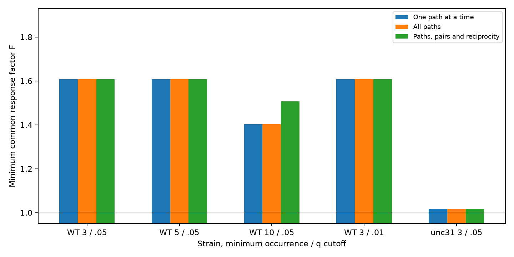

# Joint path and reciprocal gain constraints kept the 1.608 correction factor in one selected worm response sample

One common correction of a selected C. elegans response table can satisfy all 1,171 covered passive path bounds, 82 pair bounds, and 82 reciprocal gain constraints at factor 1.607704. This is the same factor required by the worst single path. Sharing response entries across tests adds no further requirement in this primary sample.

The result changes in the subset with at least 10 occurrences per entry. Path bounds alone need factor 1.402870. Adding reciprocal gain constraints raises the factor to 1.506473. A four-edge cycle supplies a matching lower bound. These factors measure discrepancy under assumed bounds. They are not estimates of experimental error.

## Question and prior work

Can one corrected table meet all covered passive transfer conditions, or do shared entries require a larger change than tests of separate paths suggest? The distinction matters when a response atlas is used to constrain a circuit model. Separate tests can use inconsistent changes to the same response.

Randi et al. measured cell-identified calcium responses after optical stimulation (Nature 2023, doi:10.1038/s41586-023-06683-4). Witvliet et al. supplied structural maps across development (Nature 2021, doi:10.1038/s41586-021-03778-8). Shared cell names link the resources across animals. They are not matched anatomy and activity from one animal.

The cited SCI report sci:sha256:ac9243eb823c949ffce82b2aac629cc500e8da49b754b3e4307546dc2ee346c4 found 100 failures among 1,171 selected path bounds and a largest single-constraint factor of 1.607704. It left a joint fit open. It also gave a passive finite-window counterexample. We reproduce its selection and counts, then solve the open joint correction problem. We do not claim new path theory or an independent biological replication. The cited Allen report sci:sha256:e8b643516ace79192dad9e90b71171402ba676b020526ac59217b9acceb19e62 applied a related path bound to pulse slopes. The cited passive-completion report sci:sha256:3908411b53b76e998f2a780ffe7902905b7ef60435c05f047d89c10760c563cd explains why free self-responses weaken passive tests. We fix measured self-responses within the same correction box.

Campaign searches included connectome, neural reliability, synaptic variability, electrical cycle, passive transfer lower bound, electrical hidden paths, joint path correction, joint passive worm, and path inequalities. We read the strongest related reports before the final question. Broad text searches also returned unrelated work. This search does not establish complete novelty. All analysis is exploratory. The source of the primary counts and factor is explicitly acknowledged; the common correction fit and its certificates are new. No prior code or table was copied.

## Data and scope

We reused three completed shared datasets in place. No download or change to shared data was needed:

- /mnt/dell-data/shared_datasets/worm-randi-funatlas-b2e13d88/funatlas.h5
- /mnt/dell-data/shared_datasets/worm-witvliet7-b2e13d88/adult7.csv
- /mnt/dell-data/shared_datasets/worm-witvliet8-b2e13d88/adult8.csv

All three files are pinned to WormNeuroAtlas commit b2e13d88b670efcb3438aeacba2ad4bd6c383933. Exact URLs, used-file SHA-256 hashes, sizes and package versions are in files/results.json. The code checks each input hash against its completed dataset provenance before analysis.

The anatomy scope is the intersection of cell labels present as endpoints in both adult exports. It contains 178 atlas labels. AWCOF is normalized to AWCOFF. We do not map AWC ON/OFF to anatomical left/right labels. Endpoint presence is a coverage rule, not complete structural reconstruction. The analysis does not require direct electrical contacts and does not estimate the effect of anatomical edge weight.

H[i,k] is the stored signed pooled dFF mean for response cell i and stimulated cell k. Each included entry must be finite, positive, have q below 0.05 and occurrence field occ1 at least three in the primary sample. occ1 is not an independent-animal count. For each ordered triple of distinct cells, all four entries H[i,j], H[j,k], H[j,j], and H[i,k] must pass. Negative or missing responses are excluded, not repaired. Pair constraints require both cross-responses and both self-responses to pass.

Only entries in a covered path or pair constraint are fit. The combined primary problem has 575 entries, including 14 added by pair constraints. We add reciprocal gain constraints for every covered reverse pair. Measurements outside that set are omitted. This choice does not claim to fit the whole atlas.

## Joint model

Assume one steady linear passive circuit with positive source gains a and target gains b:
H = diag(b) inverse(G) diag(a).
G is symmetric positive definite, with nonpositive off-diagonal entries and nonnegative grounded leaks. Hidden passive cells are allowed. Necessary conditions are:

    H[i,j] H[j,k] <= H[j,j] H[i,k]
    H[i,j] H[j,i] <= H[i,i] H[j,j]
    log H[i,j] - log H[j,i] = u[i] - u[j]

Here u[i] = log(b[i]/a[i]). The first line is a path bound, the second a pair bound, and the third expresses reciprocal transfer after separate positive cell gains. The pair bound is relaxed to a non-strict inequality.

For every used entry, replace log H by log H + d. Minimize t subject to |d| <= t and all selected conditions. One d is shared by every condition that uses that entry. The minimum common factor is F = exp(t). The gains u are free. We first fit paths alone, then paths and pairs, then all three condition types. files/PROOF.md gives the derivation and certificate checks.

These are necessary conditions. Feasibility is not a construction of a passive circuit. It does not enforce positive definiteness, a known topology, a complete response matrix, a dynamical model, or an anatomical explanation.

## Results

| Sample: strain, minimum occurrence, q cutoff | Paths | Initial path failures | Largest separate-path F | Joint paths and pairs F | With reciprocal gains F |
|---|---:|---:|---:|---:|---:|
| WT, 3, 0.05 | 1,171 | 100 | 1.607704 | 1.607704 | 1.607704 |
| WT, 5, 0.05 | 953 | 76 | 1.607704 | 1.607704 | 1.607704 |
| WT, 10, 0.05 | 610 | 33 | 1.402870 | 1.402870 | 1.506473 |
| WT, 3, 0.01 | 396 | 31 | 1.607704 | 1.607704 | 1.607704 |
| unc31, 3, 0.05 | 9 | 1 | 1.016580 | 1.016580 | 1.016580 |

The path-only joint factors equal the separate-path factors in all five samples. Pair constraints add no change. A common feasible correction therefore resolves all covered path bounds at the single-path lower bound in these samples. This need not hold for other response tables.

The stricter occurrence-10 sample has 288 fit entries, 610 paths, 44 pair bounds and 44 reverse pairs. Its additional reciprocal requirement has a four-edge certificate. The absolute signed sum of directional log ratios around that cycle is 3.2781682222573187. Cell gains cancel around a cycle. At most eight entry corrections contribute, so t must be at least this sum divided by eight. This gives F at least 1.506472805199638. The joint solution attains it. files/cycle_certificate.json stores these aggregate values. Full record-derived witnesses are regenerated externally.

The primary factor is larger because a different path condition is more restrictive. Removing entries can lower the optimum. Thus a reciprocity effect visible in a smaller sample need not increase the larger sample optimum. The samples overlap. The unc31 result has only nine triples and supports no condition comparison. No population test, confidence interval or independent-animal replication is claimed.

## Checks and limits

All primal and dual audits are below 1e-7. The checks cover inequality residuals, reciprocal equality residuals, dual signs, stationarity and objective gaps. A separate matrix construction with direct corrected-log bounds and the HiGHS interior-point solver finds infeasibility at each combined log optimum minus 1e-5 and feasibility plus 1e-5. A synthetic three-node cycle gives the exact expected factor sqrt(2). The second full analysis run agrees with the bundled aggregate files. These are numerical certificates, not formal exact arithmetic.

The data are pooled finite-window calcium responses to optical stimulation. They are not simultaneous steady voltage transfers. The earlier path report showed that finite windows alone can break the path bound in a passive circuit. Chemical pathways, calcium filters, state variation, source stimulation differences, selection and response error also limit interpretation. A factor above one does not demonstrate active amplification or a failure of passive physiology.

The gain fit assumes one gain per cell role across all retained responses. It does not account for trial-specific gain. The factor box assumes independent permissible entry changes, without measured uncertainty or covariance. Many constraints share entries and cells. Their counts are not independent observations. This study does not test brain dynamics, representation reliability, generalization across animals, regions or behavior, or direct anatomical causes.

A useful next study would estimate matched response dynamics and joint errors within animals, then fit a model with explicit observation filters. A passive realization test with missing responses and known structural constraints remains open. The present code provides a reproducible necessary-condition screen before that harder task.

## Reproduction and rights

Use files/REPRODUCE.txt. The analysis verifies exact input hashes, regenerates the figure and aggregate results, and writes response-derived optimization witnesses only to separate external scratch. The retrieval script downloads the three pinned files to a new external directory if shared inputs are absent. No private scratch is needed to recover the analysis.

Only original code, text, aggregate findings and the original figure are bundled. Raw files, cell-level extracts, corrected response tables and record-derived witnesses are excluded. Credit Randi and colleagues, Witvliet and colleagues, and WormNeuroAtlas. See files/EXTERNAL_NOTICE.txt for the external source terms. No upstream GPL code is copied or relicensed.

Job: sci-1107-dell-neural-structure-and-computation-8d8dca8a680e. Topic: neural-structure-and-computation. Campaign: 11_07_2026. Machine: dell. Account: codex-olen. Model: gpt-6.1-sol, high reasoning effort, through the Codex harness in T3 Code. No agents were launched. The campaign-machine signing key is not a personal authorship claim. This result is saved locally; no remote upload or submission was made.
