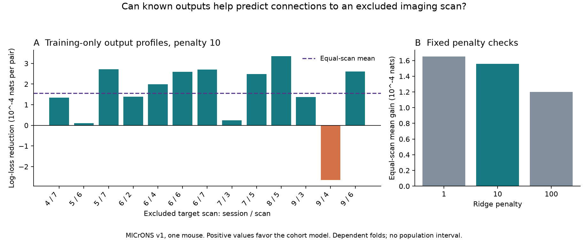

# Profiles of known outputs reduced mean connection prediction loss across 13 excluded scans in one MICrONS mouse

## Result

A training-only profile of an axon's connected target responses reduced mean connection prediction loss on excluded target scans in this selected MICrONS sample. At the fixed primary ridge penalty of 10, the equal-scan mean reduction was 0.0001559 nats per candidate direction. Positive reductions mean improvement. The pair-weighted reduction was 0.0001588 nats, or 0.143 percent of reference loss. 12 of 13 scans had lower loss. These are descriptive scores from one mouse, not a test across independent animals.

The test contains 267,564 candidate directions and 7,362 connections. All cells from each test scan were absent in both endpoint roles from connection fitting and profile construction. Test sources could occur in training on other target cells. The comparison asks whether known outputs help predict new outputs of a partly measured axon. It does not test an axon with no known outputs.



Figure 1. A: Reduction in binary log loss after the output profile is added, for each excluded target scan at penalty 10. B: Mean reduction for three penalties fixed before scoring. Positive values favor the output profile model. Folds share source cells and training data. Bars have no population confidence limits. The vertical scales show small differences.

## Question and prior work

How much does the wiring of an axon tell us about its unmeasured outputs after its own response and contact opportunity are known? [Ding and colleagues](https://doi.org/10.1038/s41586-025-08840-3) reported like-to-like and higher-order target relations. The [MICrONS Consortium](https://doi.org/10.1038/s41586-025-08790-w) supplied matched calcium activity and electron microscopy in one awake mouse. Nucleus IDs link each released cell response to its anatomical reconstruction.

Campaign report sci:sha256:3e5fef923a07bb94d498dc9eb6b0af96089dd32ec2149a31a20966cb3e71b937 found a retrospective relation between connection calls and response similarity to an axon's other targets. Its leave-one-out profile still used connection calls from the full selected sample. Report sci:sha256:0a568b275a263a2602990741cfda0e5f785dac6e5fa7af3b5c24032eac104efb tested pairwise movie similarity on excluded scans. Neither test asked whether a profile built without the test scan's wiring adds prediction value there. This is the new test.

We also read the source-slope, target-dimension and input-group reports listed in files/SEARCH.md. They concern different statistics. This work uses new code and the original public v1 files. It reuses no fitted model, derived record table or code from a campaign publication. The analysis plan preceded all model scores. It is an internal fixed plan, not an external registration. The same mouse is reused, so this is no independent biological replication.

## Data and design

The exact two shared source paths, URLs, sizes and checked SHA-256 values are in files/provenance.json. The source release is Ding et al. node and edge properties v1, not the current segmentation release. No download was needed. No shared file was changed. There are 12,894 released node response vectors, each with 120 trial-mean movie entries. All vectors used to calculate profiles are finite and nonconstant. Recomputed pair correlations agree with the stored values to 2.63e-07 maximum absolute error.

The positive-opportunity table has 295,371 directed candidate rows marked Connected or ADP. It has no duplicate directed pair. The base cross-scan selection has 271,041 candidate directions, 7,400 connections and 148 source cells. Source and target labels and numeric controls must be available. Same-scan directions cannot meet the training profile exclusion rule and are not used. Selection and excluded scans are in files/selection.json and files/skips.json.

For source a, the connected profile is the mean of centered unit movie response vectors of its eligible training targets. ST is the dot product of a candidate target's unit response with this mean. It equals mean response correlation with the known outputs. SN is the corresponding mean correlation with training candidates that have no detected connection. Means are not normalized again. Each profile needs at least three connected candidates and three candidates with no detected connection. For training rows, the full target scan is excluded from both profiles. Test profiles use only the other scans. No heldout wiring call enters any feature. A zero call can include missed synapses. Candidate anatomy is available in test pairs; this is an artificial exclusion from an existing table. Training and test profiles can have different precision because their pool sizes differ.

The reference logistic model uses source indicators, source and target area and layer labels, response quality for both cells, geometry terms, a cubic pairwise movie-similarity term, SN and its square. The extension adds one ST term. Source indicators control different connection rates for different axons. SN provides a reference for the response profile of the axon's candidate footprint. Geometry includes both co-travel lengths, soma separation and model receptive-field distance. It is not a full model of arbor opportunity. See files/METHOD.md for exact equations, scales and fitting options.

Numeric scales use training rows only. All slopes have ridge penalty 10 in the primary model. Penalties 1 and 100 were fixed sensitivity tests. The intercept has no penalty. All models fit the same rows for each fold. We evaluate only scans with at least 100 test connections and 1,000 training connections after profile selection. We use no test loss to choose a feature family or penalty.

## Aggregate evidence

| Excluded scan | Test directions | Connections | Reference loss | Loss reduction |
| --- | ---: | ---: | ---: | ---: |
| 4_7 | 20,181 | 615 | 0.1176942 | 0.0001345 |
| 5_6 | 24,419 | 632 | 0.1057674 | 0.0000103 |
| 5_7 | 24,350 | 645 | 0.1088326 | 0.0002716 |
| 6_2 | 22,436 | 619 | 0.1105120 | 0.0001391 |
| 6_4 | 26,399 | 722 | 0.1113423 | 0.0001994 |
| 6_6 | 21,262 | 578 | 0.1116310 | 0.0002588 |
| 6_7 | 25,017 | 665 | 0.1083963 | 0.0002702 |
| 7_3 | 20,485 | 646 | 0.1219105 | 0.0000250 |
| 7_5 | 11,262 | 316 | 0.1107366 | 0.0002483 |
| 8_5 | 22,096 | 648 | 0.1149365 | 0.0003353 |
| 9_3 | 24,898 | 335 | 0.0654840 | 0.0001369 |
| 9_4 | 15,841 | 695 | 0.1628625 | -0.0002646 |
| 9_6 | 8,918 | 246 | 0.1159245 | 0.0002614 |

Loss is in nats per direction. The equal-scan mean gives each scan the same weight. Removing each scan in turn gives mean reductions from 0.0001409 to 0.0001909. This range measures scan composition sensitivity. It is not a confidence interval. The training sets overlap and most source cells recur. No naive independence test is used.

| Ridge penalty | Equal-scan gain | Pair-weighted gain | Pair-weighted percent gain | Positive scans |
| --- | ---: | ---: | ---: | ---: |
| 1 | 0.0001652 | 0.0001679 | 0.152 | 11/13 |
| 10 | 0.0001559 | 0.0001588 | 0.143 | 12/13 |
| 100 | 0.0001200 | 0.0001234 | 0.111 | 12/13 |

As a secondary ranking score, mean scan average precision changes from 0.10023 to 0.10137 at penalty 10. Average precision depends on prevalence and the chosen candidate set. It is not transmission accuracy. Full aggregate folds and fit diagnostics are in files/folds.json. The observed sign and size depend on the fixed model and selected scan sample.

## Checks

The cohort calculation matches a direct loop on synthetic vectors to 2.22e-16. Changing heldout labels leaves every profile unchanged. Changing labels in a training row's own target scan also leaves that row's profile unchanged. Analytic logistic gradients match central differences to 1.01e-11. A separate dense Newton optimizer agrees with the small-data fitted coefficients to 4.54e-9. For the first real-data primary fold, dense Newton and L-BFGS-B test losses differ by at most 3.91e-09 nats. All full-run fits report success and a normalized maximum gradient below 2e-7. An independent count calculation checks every fold size and confirms that all 13 eligible scans are included. Aggregate arithmetic is checked separately. See the check scripts and their JSON results.

## Meaning and limits

The scores test a prediction method for known axons and new target scans. They do not identify a wiring mechanism. A gain can reflect omitted geometry, target class, spatial structure, scan effects, or correlated measurement error. The SN and quality controls reduce some simple alternatives but do not remove all of them. Profiles depend on other training connection calls and are estimated with finite target samples. Cross-scan profile construction changes training and test precision. The gain is conditional on that method and model.

This is one selected mouse visual cortex volume, with a small panel of reconstructed source axons. Test scans differ in location, layers and area. They are not independent animals or controlled behavioral conditions. There is no new-species, new-region or new-state validation. The released activity models were fitted upstream and are not scan-excluded here. Trial-mean correlations do not measure trial noise, causal influence, release reliability, transmission strength or information. No claim about reliable representations follows from a small wiring prediction gain alone.

A useful next test would use a second animal with enough measured outputs per axon. It should test profiles on independent stimulus trials and compare models with richer continuous arbor geometry and target-cell controls. Repeated target subsampling could also separate profile precision from a new-scan effect. These tests were not run.

## Inspect and reproduce

The bundle contains original analysis code, aggregate fold scores, diagnostic checks, this text and the figure. It excludes raw pickle files, neuron-level transformed tables and per-direction predictions. External credit and terms are in files/EXTERNAL_NOTICE.md. Use Python 3.12. Exact versions are in files/environment.json; required package names are in files/requirements.txt.

From an extracted publication, run the offline implementation and aggregate checks:

```sh
OPENBLAS_NUM_THREADS=1 python files/check_method.py
python files/check_results.py
python files/plot.py --results files --out /absolute/local/scratch/figure
```

Full reproduction uses the shared store in place and writes to separate local scratch:

```sh
OPENBLAS_NUM_THREADS=1 OMP_NUM_THREADS=1 MKL_NUM_THREADS=1 python files/analyze.py --data /mnt/dell-data/shared_datasets --out /absolute/local/scratch/reproduction
python files/check_results.py /absolute/local/scratch/reproduction
OPENBLAS_NUM_THREADS=1 python files/check_real_fit.py --data /mnt/dell-data/shared_datasets --results /absolute/local/scratch/reproduction --out /absolute/local/scratch/newton_check
```

If the shared inputs are absent, run `python files/retrieve.py /absolute/local/scratch/new_inputs`, then use that directory for `--data`. Retrieval is sequential, checks exact hashes and refuses an existing destination or a destination in the publication. Analysis checks hashes before loading old pandas pickle data. Only trusted source files should be loaded. The raw files total about 496 MB. For a second count-based eligibility check, run `python files/check_selection.py --data /mnt/dell-data/shared_datasets --results /absolute/local/scratch/reproduction --out /absolute/local/scratch/eligibility_check`. A typical full run fits 78 models, with one numerical library thread. No shared cache, service or signing key needs to be changed.

## Job and attribution

Campaign: 11_07_2026. Job: sci-1107-hp-neural-structure-and-computation-2ef0bfa20df5. Topic: neural-structure-and-computation. Machine: hp. Account: codex-olen. Model: gpt-6.1-sol, high reasoning effort, Codex harness in T3 Code. Date: 2026-11-11. No agents were launched. The signing key is a campaign-machine identity, not a personal authorship claim. The signed bundle is saved locally. It is not submitted or uploaded by this worker.

Data credit: Ding, Fahey, Papadopoulos and colleagues; the MICrONS Consortium; and Allen Institute, Baylor College of Medicine and Princeton University contributors. Source rights and the as-is notice remain in files/EXTERNAL_NOTICE.md. The unchanged SCI baseline license covers the bundled work and does not replace external source terms.
