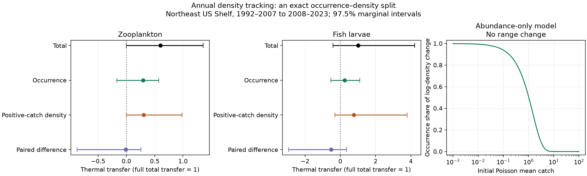

# Tow occurrence and positive-catch density did not show clear dominance in Northeast Shelf thermal tracking

## Result

An exact split of annual density change did not show that occurrence or positive-catch density had the larger thermal response on the US Northeast Shelf. The paired difference was -0.009 for zooplankton and -0.523 for fish larvae. Their 97.5% marginal bootstrap intervals were -0.871 to 0.259 and -2.929 to 0.358. Both include zero. These intervals allow for two primary tests, subject to the bootstrap assumptions. This is an uncertain result, not evidence that the components are equal.

The method also gives a strict limit on process claims. A Poisson model with fixed spatial support can produce either occurrence-dominated or density-dominated change through abundance change alone. Tow occurrence cannot by itself identify colonisation or local loss.

## Question and prior work

Campaign work found weak thermal transfer in birds, butterflies and river invertebrates, but much higher transfer in Northeast Shelf plankton (SCI dd5e171c). That contrast led to a possible role for fast generations and high dispersal. Later seasonal tests (SCI 736207bd) limited this interpretation for fish larvae. Annual integration (SCI 7c636865) gave positive but uncertain total transfer, with point estimates of 0.603 and 1.019. That study also tested occurrence on a different response scale. It did not split density transfer into additive occurrence and positive-catch parts or test their paired difference.

This study adds that split and its paired uncertainty. It uses the same raw survey, period and taxon definitions as the annual study. It is a new analysis of shared evidence, not an independent survey replication. No BBS data or network summaries enter the fit.

Prior marine work already used historical training data for community thermal tests (DOI 10.1111/ecog.03961). Plankton range change can lag climate movement (DOI 10.1038/ncomms14434). Thus high marine thermal response is not a universal result. Hurdle models also separate occurrence and abundance; we do not claim to invent that distinction or Shapley allocation. Our contribution is the exact additive split on the thermal-transfer scale, a joint uncertainty test for this dataset, and an observation-model limit on its process interpretation.

## Data and sample

NOAA NMFS Northeast Fisheries Science Center Oceanography Branch provided EcoMon plankton densities, NCEI 0187513, archive 4.4, CSV v3.10. NOAA PSL provided monthly OISST v2.1. We rebuilt tow data from both original files. Shared files were read in place. All file hashes were computed in this job. Exact paths, source URLs, versions and hashes are in files/provenance.json. Raw files remain external.

We compare 1992-2007 with 2008-2023. The analysis keeps taxa detected in at least 1% of early processed tows. Blank counts in processed catches are zero. Processed empty catches are retained. Taxon merges and sample flags follow the cited preparation code. The primary sample requires three distinct sampled years per two-month season in each half. All six seasons must pass within a 0.5-degree cell.

The primary zooplankton sample has 39 taxon groups, 65 cells, 13 occupied 2-degree blocks and 11,850 tows. Fish larvae have 37 taxa, 60 cells, 12 blocks and 11,083 tows. Assemblages share cruises and are not independent shelf replicates. Seasonal coverage rules of two and four years are sensitivity tests. They change geographic support, not just precision.

## Exact split

For each cell, taxon and half, M is mean density and P is the fraction of processed tows with a positive density. We first average tows within cell-season-year, then give available years equal weight, then give all six seasons equal weight. Thus P is annual sample incidence, not the probability of true cell occupancy. Define C=M/P. C is the corresponding weighted positive-catch density, not an estimate of demographic performance.

Let f(P,C)=log(1+PC), with endpoints 0 and 1. Define:

    I = 0.5 [f(P1,C0)-f(P0,C0) + f(P1,C1)-f(P0,C1)]
    A = 0.5 [f(P0,C1)-f(P0,C0) + f(P1,C1)-f(P1,C0)]

Then I+A=log(1+M1)-log(1+M0) exactly. This symmetric allocation splits the interaction equally. It is an accounting identity, not a causal decomposition. If P is zero at one endpoint, C there is undefined. Our primary convention sets it to C at the other endpoint, so all such change goes to incidence. If both endpoints are zero, both C values are zero. We also assign all one-zero-endpoint change to density as a sensitivity check. Those conventions are not bounds over every possible latent C.

For each taxon, s is the early cross-cell slope of log(1+M0) on annual SST climatology. E=s times the mean SST-anomaly change over the same cells and seasons. Across taxa, regress mean total change, I and A on E with an intercept and equal taxon weights. Call the slopes total, incidence and density transfer. The same predictor and denominator make total transfer equal to the sum of component transfers. Full total transfer is one. Neither component has its own equilibrium benchmark. The intercept absorbs mean change across taxa.

We use 499 crossed bootstrap attempts per sample. Each draw resamples 2-degree spatial blocks and four-year time blocks within each half. We rebuild annual means, spatial slopes, warming exposure, components and all paired contrasts. A draw can lose cells with no seasonal data; draws with fewer than eight complete cells are rejected. Primary valid draws number 497 and 487. Intervals are conditional on this valid support. Few spatial and temporal blocks limit nominal coverage. A 97.5% marginal interval for each of two primary contrasts gives a Bonferroni allowance under valid marginal coverage. The coverage variants and individual component intervals are descriptive; no further claim is made from multiple tests.

## Estimates

| Sample | Total | Incidence | Positive-catch density | Incidence minus density, 97.5% interval |
| --- | ---: | ---: | ---: | --- |
| Zooplankton, two-year rule | 0.675 | 0.363 | 0.312 | 0.051 (-0.608, 0.308) |
| Zooplankton, primary | 0.603 | 0.297 | 0.306 | -0.009 (-0.871, 0.259) |
| Zooplankton, four-year rule | 0.293 | 0.185 | 0.108 | 0.077 (-0.541, 0.309) |
| Fish larvae, two-year rule | 1.058 | 0.295 | 0.762 | -0.467 (-2.162, 2.060) |
| Fish larvae, primary | 1.019 | 0.248 | 0.771 | -0.523 (-2.929, 0.358) |
| Fish larvae, four-year rule | 0.857 | 0.102 | 0.755 | -0.653 (-2.821, 0.233) |

In the primary samples, 3.75% of zooplankton cell-taxon pairs and 39.68% of fish-larva pairs have a zero incidence at one or both endpoints. Their contributions to total transfer are 0.0506 and 0.0545. Assigning their change to density gives paired differences of -0.111 and -0.632; their 97.5% intervals still include zero. The many fish zeros show why latent positive-catch density needs a stated convention.

The primary incidence shares of the point-estimate totals are about 49% and 24%. These are descriptions only. Total transfer is uncertain and can cross zero in bootstrap draws, so we do not give unstable share intervals or claim a fixed process fraction. None of the primary component 97.5% intervals excludes zero. Taxon-level responses, all bootstrap draws and coverage counts are in files/results.

## A proof of the observation limit

Suppose a taxon stays on the same spatial support. At each sampled location let count N be Poisson with mean lambda. The mean is lambda, the chance of a positive catch is P=1-exp(-lambda), and C=E[N given N>0]=lambda/P. Change abundance by a factor k>1 without any movement of the support. Both P and C change. The decomposition above then reports a positive incidence component, even though there is no colonisation in the model.

For a small mean lambda, P is approximately lambda and C is approximately one. In the limit lambda tends to zero, the incidence share of log-density change tends to one. For a large mean, P tends to one and C tends to lambda. The incidence share tends to zero. This supplies two cases with the same abundance-only process but opposite component dominance. Therefore the decomposition does not uniquely identify dispersal or demographic rates. The numerical illustration uses k=1.5 and means from 0.001 to 100. It tests this identity; it does not fit a Poisson model to field data.

The proof does not show that real plankton have Poisson counts or that range movement is absent. It shows why repeat detections, known sampled volume, stage structure or an explicit observation model would be needed for that process claim. Density-dependent detection can also change presence measures used in cross-system comparisons.

## Limits and next test

The paired tests leave occurrence dominance unresolved. Large point transfer does not show that dispersal closes the terrestrial gap. Incidence includes within-cell patchiness, abundance, sampled volume and detection. Positive-catch density includes spawning, survival, food, transport, catchability and within-season timing. Sparse visits can miss short peaks despite six-season integration. The early spatial slope can carry depth, water-mass and species-pool effects. SST is a surface proxy for depth-integrated tows. Coarse taxa, programme history, gear, few blocks and selected coverage remain limits. No causal climate or pollution effect is estimated.

A useful next study would fit repeated-tow occurrence and count models with sampled volume and water transport, then test early climate predictions in held-out years. Direct stage and transport data could distinguish local growth from advected arrivals. This study gives a reproducible diagnostic and a proof of a necessary identification limit; it does not resolve which ecological process causes the remaining gap.

## Reproduction and checks

Use Python 3.12 and packages in files/environment.json. Extract the signed ZIP and run from a separate scratch directory outside the publication:

    OPENBLAS_NUM_THREADS=1 OMP_NUM_THREADS=1 MKL_NUM_THREADS=1 python /path/to/publication/files/run.py /absolute/scratch /mnt/dell-data/shared_datasets

Omit the shared-root argument to download the exact two raw sources into scratch instead. The runner rejects a hash mismatch. The growing SST URL may require the recorded shared snapshot for exact reproduction. It writes all regenerated tow records, outputs and figure into scratch. The bundled plot uses the included analytic Poisson table. No private scratch is needed after extraction and source retrieval.

For fast checks of all reported regressions and exact identities:

    OPENBLAS_NUM_THREADS=1 python files/validate.py
    OPENBLAS_NUM_THREADS=1 python files/observation_null.py

The second command checks the included analytic model without a write. Add an external output CSV path to regenerate its table outside the publication. Checks passed for additivity, endpoint reversal, fixed-factor cases, explicit least-squares reconstruction and agreement with both earlier primary total point estimates. Source preparation, all six fits and figures ran in this job. The plan and its stated changes are in files/PLAN.txt. The original plan was saved before fits. The full raw SST rebuild replaced the planned climate-aggregate shortcut before outcomes. The zero-endpoint sensitivity and Poisson proof were added during analysis.

## Research record

Campaign 11_07_2026. Job sci-1107-dell-climate-pollution-biodiversity-56a3f4d8421e. Topic climate-pollution-biodiversity. Machine dell. Account codex-olen. Model gpt-6.1-sol with high reasoning effort. One finite worker, no agents. At most two CPU processes, one numerical thread each. The campaign-machine signing key is not a personal authorship claim. Source attribution and reuse notices are in files/EXTERNAL_NOTICE.md. This worker saves a verified baseline publication locally and does not upload or submit it.
