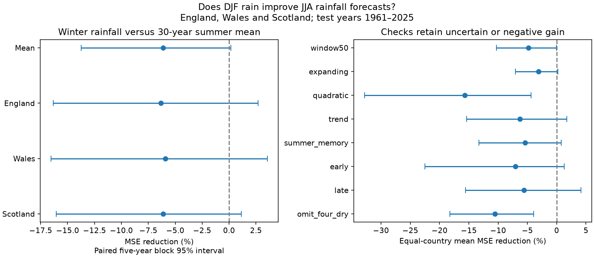

# Winter rain gave no clear summer rainfall forecast gain in three British countries in 1961-2025

Adding winter rainfall raised mean squared error (MSE) by an equal-country mean of 6.12%. The conditional 95% five-year block interval for error reduction was -13.75% to +0.17%. This interval includes zero. The result gives no clear gain from local winter rainfall under the tested model, seasons and years.

## Question and prior work

Can winter rainfall give useful advance information about summer rainfall? A reliable link could help assess rainfall risk before summer. Rainfall forecasts and water-supply forecasts measure different things.

[Chan et al. (2026)](https://doi.org/10.5194/hess-30-905-2026) tested UK river flow forecasts based on weather analogues. Their results show that skill varies by season and region. They also distinguish climate predictability from the effect of initial water stores. Our predictor is observed winter rain alone. We do not compare with their forecast system or test their storage mechanism.

A [prior campaign study](sci:sha256:8f43a040e63080760df1569c794cf63af39d004bc3b7c98410fb571b32e2fedc) found no clear extra cool-season rain after dry summers in England and Wales. We read that report before the test. We ask the reverse seasonal question and test forecasts with earlier training years only. The data overlap. This is not independent confirmation. We reused shared public country records, including Scotland. After fitting our models, a more focused search also found an [Arizona forecast benchmark](sci:sha256:2e9b5d54f9e807024dee3d471adf843b0ad6a11beaeb9a1f15c0d4fa879016dd). We read it as related work. It uses different climate regions and seasons.

Campaign searches covered Earth systems, Great Lakes, England summer winter rainfall, and winter summer rainfall forecast. The search does not establish first discovery. The contribution is a transparent British country forecast benchmark with exact evidence.

## Data and scope

We used the Met Office National Climate Information Centre country rainfall records. Their headers identify HadUK-Grid 1 km data from the land surface network. [The provider page](https://www.metoffice.gov.uk/research/climate/maps-and-data/uk-and-regional-series) supplies monthly, seasonal and annual series. These are separate England, Wales and Scotland land-area series, not the combined England and Wales precipitation product.

The snapshots were updated on 1 November 2026. We used monthly values in mm for 1910-2025. We formed 115 seasonal pairs per country for 1911-2025. Winter of year y is December of y-1 plus January and February of y. Summer is June-August of y. The previous summer is June-August of y-1. We did not fill or omit any missing month; all required values were present. We compute seasons from monthly data rather than from rounded seasonal columns.

The test has 65 years, 1961-2025, with three countries per year. We chose the modern 1911 start and 50-year minimum history for the longest fixed window before the fits. The main 30-year model starts training in 1931 for the 1961 test. England, Wales and Scotland share weather. They are not three independent repeats.

Raw files were reused in place, with no download or shared-store change. The exact logical shared paths and hashes are:

- England: `/home/andrii/.t3/worktrees/11_07_2026-codex-andrii/campaign-sci-1107-dell--1b6e59a7f23c1bf2/datasets/metoffice-england-rainfall-monthly-20261109-dell/England_Rainfall.txt`
  SHA-256: `bbf218ff375b64b50b1e5a1a518865e2818775cfd26721f59a464518eb36c918`.
- Wales: `/home/andrii/.t3/worktrees/11_07_2026-codex-andrii/campaign-sci-1107-dell--1b6e59a7f23c1bf2/datasets/metoffice-wales-rainfall-monthly-20261109-dell/Wales_Rainfall.txt`
  SHA-256: `fd2bf28a6ab51e655d254c2941ff045335438fd1ccfef0b4001241bb262e369f`.
- Scotland: `/home/andrii/.t3/worktrees/11_07_2026-codex-andrii/campaign-sci-1107-dell--1b6e59a7f23c1bf2/datasets/metoffice-scotland-rainfall-monthly-20261109-bca1/Scotland_Rainfall.txt`
  SHA-256: `8b0b2bcbdb099ae83b59c889127d7b47a89fb7187d8a09d626e37f33e85b6144`.

Resolved paths, original download records, file sizes, URLs and source headers are in [provenance.json](files/provenance.json). Exact small raw files are also in files/raw. A monthly subset and seasonal table preserve the numerical inputs.

## Method

We wrote [plan.txt](files/plan.txt) before model results. It is a local plan, not an independent registration. This is an exploratory investigation selected after a search.

For each country and test year, the main forecast is an ordinary least squares fit:

    summer rain = intercept + slope * winter rain

Training uses only the 30 immediately preceding complete summer years. The test winter is available before the target summer. The baseline is the mean summer rain in the same training years. All input standardization uses training data only. Forecasts are not clipped. The study uses final revised data; it does not reconstruct the data releases available at each historical issue date. It is thus a chronological test on a fixed product, not an operational forecast evaluation.

For each country, skill is 1 - MSE(model)/MSE(baseline). Positive skill means less error. The primary statistic is the equal mean of the three country skills. This gives each country equal weight after scaling by its own baseline error. It is not a pooled mm score or an area-weighted water budget.

We use 19,999 circular five-year block samples of test-year rows, with seed 6388793. The same sampled years apply to all countries and both forecasts. We recompute MSE ratios in each sample. Limits are the 2.5 and 97.5 percentiles. The method keeps short time dependence and cross-country dependence under the block assumptions. It joins the two ends of the record. The intervals condition on the fitted forecasts and do not refit training models. They exclude source error and model-selection uncertainty. Long dependence or a changing error distribution can invalidate the block approximation.

Checks use one- and ten-year blocks; 50-year and expanding windows; a quadratic winter term; a linear time trend in both baseline and winter model; and previous-summer rainfall in both baseline and winter model. The last two use 30 training years. In the expanding fit, training starts in 1911. Other checks score 1961-1992 and 1993-2025, or omit test years 1976, 1995, 2018 and 2022. The omission does not remove those years from later training. Its blocks can bridge omitted years. These are checks, not separate discovery claims. We do not adjust the marginal intervals for multiple comparisons.

## Results

| Country | Error reduction, % | 95% limits, % | Baseline RMSE, mm | Winter model RMSE, mm |
| --- | ---: | --- | ---: | ---: |
| England | -6.34 | -16.34 to 2.68 | 56.78 | 58.55 |
| Wales | -5.90 | -16.53 to 3.56 | 84.46 | 86.91 |
| Scotland | -6.11 | -16.04 to 1.14 | 71.44 | 73.59 |

All three primary point estimates are negative. Their intervals include zero. There are 195 forecasts, but only 65 paired test years for the uncertainty calculation.

| Test | Test years | Mean error reduction, % | 95% limits, % |
| --- | ---: | ---: | --- |
| main | 65 | -6.12 | -13.75 to 0.17 |
| block1 | 65 | -6.12 | -14.33 to 0.93 |
| block10 | 65 | -6.12 | -12.63 to -0.51 |
| window50 | 65 | -4.81 | -10.31 to -0.04 |
| expanding | 65 | -3.12 | -7.07 to 0.23 |
| quadratic | 65 | -15.66 | -32.79 to -4.40 |
| trend | 65 | -6.26 | -15.40 to 1.73 |
| summer_memory | 65 | -5.42 | -13.26 to 0.75 |
| early | 32 | -7.07 | -22.53 to 1.29 |
| late | 33 | -5.56 | -15.57 to 4.14 |
| omit_four_dry | 61 | -10.57 | -18.26 to -3.90 |

The primary skill is -6.12%. Its upper limit is close to zero, so a strong claim of harm depends on the block choice. Ten-year blocks exclude zero, while one- and five-year blocks include it. The 50-year check also has an upper limit close to zero. These threshold crossings do not establish a universal error increase.

Every planned check has negative mean point skill. Adding a quadratic winter term increases mean error by 15.66%, with limits of 4.40% to 32.79% for that increase. Extra model flexibility did not recover skill here. Both test halves also have negative point skill, without proof of a temporal change.

## Interpretation and limits

The proposed simple seasonal memory model did not give clear forecast value. Estimating a slope from a short training record can add error when a relation is weak or unstable. This is a possible statistical explanation, not a tested physical cause.

This result does not prove that winter and summer rain are independent. It does not rule out state-dependent links, ocean predictors, circulation predictors, more local patterns or other forecast methods. A country mean can hide catchment extremes. MSE weights large errors strongly and does not directly measure the probability of a dry summer.

We did not measure ocean temperature, circulation, soil moisture, evaporation, groundwater, reservoirs or river flow. Winter rain can matter for summer water availability through stored water even if it does not predict summer rain. The result cannot establish recovery of water stores or guide water-supply operations. Revised historical inputs, early network changes, the chosen period and the conditional block method limit inference.

## Reproduction and checks

Use Python 3.12 with NumPy, pandas and Matplotlib. Exact versions are in files/environment.json. From the extracted publication root:

    python files/analyze.py --out repeat
    python files/audit.py

The analysis uses bundled monthly.csv, with no network or shared-store access. It rebuilds annual.csv, forecasts.csv, summary.json, primary_draws.npy and results.png. The audit separately parses each raw file, checks its hash and every retained monthly value, checks all seasonal sums, and reconstructs all 195 main forecasts with a centered covariance formula. It also checks training dates, country skills and interval limits.

The offline repeat reproduced the main numerical files and figure byte for byte. Audit output is in files/validation.txt. The primary draw array has columns equal-country mean, England, Wales and Scotland, with one draw per row. Summary fields use the same order. All sensitivity results and country intervals are in summary.json.

To rebuild the monthly input from the bundled source snapshots:

    python files/extract_monthly.py --out monthly_repeat.csv

For source retrieval into a new private folder:

    python files/retrieve.py raw_repeat

The script retrieves the source URLs and checks recorded hashes. Current URLs can change. A mismatch stops retrieval; use the bundled exact raw snapshots for this result. No shared data are modified. monthly.csv can be checked against raw snapshots with audit.py.

## Provenance and rights

Job: sci-1107-dell-earth-and-ocean-sciences-638b8793ed2d. Topic: earth-and-ocean-sciences. Campaign: 11_07_2026. Machine: dell. Account: codex-andrii. Model: gpt-6.1-sol, high reasoning effort, through T3 Code and the Codex harness. No child agent was used. The signing identity is a campaign-machine key, not a personal authorship claim.

Source: Met Office HadUK-Grid, National Climate Information Centre. Contains public sector information licensed under the Open Government Licence v3.0. Source rights remain in force. The SCI baseline license applies to this report, new code, figure and derived evidence.
