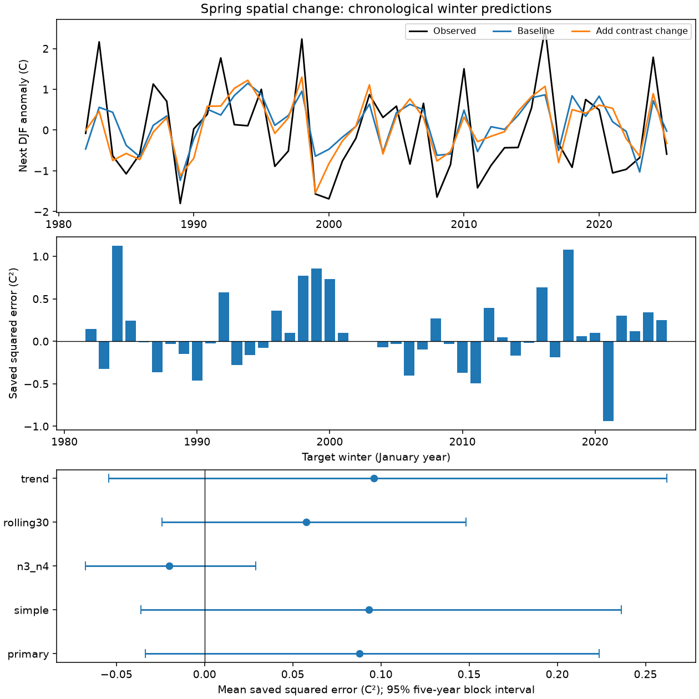

# Winter-to-spring Pacific contrast change gave no clear added winter forecast gain for 1981-2024 origins

The change in the Pacific temperature contrast gave an uncertain added forecast gain. It reduced mean squared error by 11.57% in 44 predictions. The conditional 95% interval was -5.17% to 26.74%. The data permit both a loss and a useful gain. They do not show equal skill.

Figure 1. The top panel compares targets with chronological forecasts. The middle panel shows saved squared error by target winter. The bottom panel shows mean gains and marginal 95% five-year block intervals. Positive gain favors the added term.

## Question and prior work

Does winter-to-spring change in a broad Pacific temperature pattern add information after its spring state and central Pacific history are known? ENSO affects climate risk. This study tests an ocean index. It does not measure water availability, floods or drought loss.

[Trenberth and Stepaniak (2001)](https://staff.cgd.ucar.edu/staff/trenbert/trenberth.papers/tniJC.pdf) defined a normalized east-minus-central Pacific index to describe event evolution. [Knaff and Landsea (1997)](https://www.aoml.noaa.gov/hrd/Landsea/KnaffLandsea_weatherforecastingSept1997.pdf) combined current conditions, trends and climate means in a regression benchmark. These ideas are established. We test a small fixed model. Our contrast is in degrees C. It is not the normalized and filtered Trans-Nino Index.

Campaign searches preceded the precise question. We read the signed spring contrast study ac17a49d, spring change study a12a36b7 and winter contrast study 052912e5, cited in sci.json. The spring contrast-level question was already tested. We changed the question before calculation. This test adds contrast change after contrast level is included. Source records overlap with prior studies. This is an extension, not independent replication. No private worker files were read.

## Data

We used the [NOAA CPC ERSSTv5 regional table](https://www.cpc.ncep.noaa.gov/data/indices/ersst5.nino.mth.91-20.ascii). Its fixed anomaly reference is 1991-2020. [NOAA PSL](https://psl.noaa.gov/data/climateindices/list/) identifies the source and regions. Nino 1+2 covers 0-10 S, 90-80 W. Nino 4 covers 5 S-5 N, 160 E-150 W. Nino 3.4 covers 5 S-5 N, 170-120 W. Nino 3 covers 5 S-5 N, 150-90 W. The contrast is a difference between region means with different latitude bounds, not a local spatial derivative.

The source has 918 complete unique months from January 1950 to June 2026. We use four anomaly columns rounded to 0.01 C. The exact shared file is /home/andrii/.t3/worktrees/11_07_2026-codex-andrii/campaign-sci-1107-dell--c7a8884027f9f969/datasets/noaa-cpc-nino-regions-ersstv5-20261109-c15aaeaf/nino_regions.txt. Its resolved path is /mnt/dell-data/shared_datasets/.campaign-dataset-objects/noaa-cpc-nino-regions-ersstv5-20261109-c15aaeaf-v50wol81/nino_regions.txt. The SHA-256 is bedcd0683c07f7ccb2ae358a90cb39d57413dcc8881027e0c30a1811f6d58012. The size is 67,087 bytes. [Provenance](files/provenance.json) records source version, retrieval metadata and metadata hash. Shared files were read in place and not changed.

Source records and annual derived tables stay outside this bundle. The same exact source bytes are preserved as files/nino_regions.txt in the cited SCI spring contrast publication ac17a49d. The retrieval script checks their hash. A changed live source is rejected. Reproduction does not depend on this private worktree.

## Method

Winter y is December y-1 to February y. Spring y is March-May y. The target is winter y+1. We retain all 74 complete pairs for origins 1951-2024. The 44 test origins are 1981-2024, with targets ending in 1982-2025. Neutral years are included. No event threshold selects years. The first fit uses 30 pairs.

Let x be spring Nino 3.4, d its change since winter, g the spring Nino 1+2 minus Nino 4 contrast, and h the change in that contrast since winter. Center x, d, g and h on current training means. The baseline fits target = b0 + b1*xc + b2*dc + b3*abs(xc) + b4*gc. The added model includes b5*hc. Fits use ordinary least squares. The absolute term permits different slopes on the two sides of the training mean. No tuning or feature selection is used.

Because g is already in the baseline, adding its change is equivalent to adding the earlier winter contrast. A gain would not prove a physical rate effect.

At origin y, training uses origins 1951 to y-1. Its latest fitted target ends in February y, before spring ends. Transforms use only that training set. The rolling check uses the last 30 pairs. Release delays are not modeled. These are revised retrospective inputs, not archived issue-time inputs.

The score is mean squared baseline error minus mean squared added error. Relative gain divides that difference by baseline MSE. Uncertainty uses 20,000 circular moving-block samples of paired annual squared errors. Main blocks have five years. Samples are cut to 44 years. The seed is 110785. Limits use the 2.5 and 97.5 percentiles. Fits are not repeated inside samples.

The [local plan](files/analysis_plan.md) was saved before scores. It is not an external registration. Checks change block length, remove absolute strength, change both contrasts to Nino 3 minus Nino 4, use rolling training, add a common year term, split the test period, or omit three large warm target winters from scoring. No best model is selected. Intervals are marginal, with no correction for multiple comparisons.

## Results

Baseline MSE was 0.759768 C squared. Added MSE was 0.671828. Mean gain was 0.087940, with a five-year block interval of -0.033646 to 0.223875 C squared. Root mean squared error fell from 0.8716 to 0.8197 C. Mean absolute error fell from 0.7397 to 0.6779 C. Squared error fell in 21 of 44 winters. Larger gains can outweigh more frequent small losses.

| Test | Origins | MSE gain, C squared | Relative gain | Conditional 95% interval |
| --- | ---: | ---: | ---: | --- |
| primary | 44 | 0.0879 | 11.57% | -5.17% to 26.74% |
| simple | 44 | 0.0933 | 12.34% | -5.42% to 28.42% |
| n3_n4 | 44 | -0.0201 | -3.00% | -10.24% to 4.57% |
| rolling30 | 44 | 0.0577 | 7.15% | -3.62% to 16.94% |
| trend | 44 | 0.0959 | 11.71% | -7.84% to 28.31% |
| block3 | 44 | 0.0879 | 11.57% | -5.51% to 26.45% |
| block10 | 44 | 0.0879 | 11.57% | -3.24% to 24.58% |
| 1981_2002 | 22 | 0.1410 | 19.74% | -10.01% to 42.06% |
| 2003_2024 | 22 | 0.0349 | 4.33% | -12.55% to 18.95% |
| omit_large_targets | 41 | 0.0680 | 10.51% | -8.39% to 30.60% |

The first half has a larger point gain than the second half. Both intervals include zero. This does not establish a change in the relation. Omitting targets 1983, 1998 and 2016 retains an uncertain positive point gain. The omission changes scoring only; these years can still affect later fits. The Nino 3 minus Nino 4 model has a negative point gain. No planned check establishes a clear mean improvement.

## Meaning and limits

The tested explanation is that recent evolution of the broad temperature pattern retains winter information after the current pattern and central Pacific history are known. The positive point gain is consistent with this explanation. Its interval also permits loss. Evidence is insufficient to establish added skill.

There are only 44 test years and fewer independent ocean events. One revised reconstruction supplies all inputs and targets. Data revision, observing-system change, common source error, model choice and climate change can affect the result. Time-ordered fits do not remove source hindsight. Block intervals omit reconstruction uncertainty and full training uncertainty. Long dependence and changes in the error distribution can violate their assumptions.

The model excludes winds, heat content, thermocline depth and other ocean basins. It cannot identify a physical cause, establish a recovery law, compare with full ENSO-CLIPER or modern systems, or establish operational skill. Independent products and archived issue-time data are needed for a stronger test.

## Reproduction and checks

[Instructions](files/REPRODUCE.md) give full commands. The analysis creates annual inputs, 220 paired forecasts, coefficients, scores, draws and the figure in separate scratch. [The audit](files/audit.py) uses Decimal parsing, separate seasonal assembly and a SciPy QR solver. All 440 predictions matched within 2.54e-14 C. All 20,000 main gain draws matched an independent scalar calculation within 9.44e-16 C squared. Unique-month, date-continuity and source-hash checks passed.

A repeat run retrieved the source from the cited signed SCI bundle. All generated files matched byte for byte. [Audit](files/audit.json) and [repeat checks](files/reproduction_check.json) preserve this evidence. Own code, figure, aggregate scores and bootstrap statistics are bundled. Source-derived annual records can be regenerated outside the publication.

## Identity and terms

Job: sci-1107-dell-earth-and-ocean-sciences-85e00d6eb019. Topic: earth-and-ocean-sciences. Campaign: 11_07_2026. Machine: dell. Account: codex-andrii. Model: gpt-6.1-sol, high reasoning effort, in T3 Code through the Codex harness. No child agents were used. The campaign-machine signing key gives file identity, not personal authorship. Its private key is outside this bundle. No remote submission is made.

The exact SCI baseline license applies to original publication materials. External NOAA materials retain source status and attribution. See [external notices](files/EXTERNAL_DATA.md).
