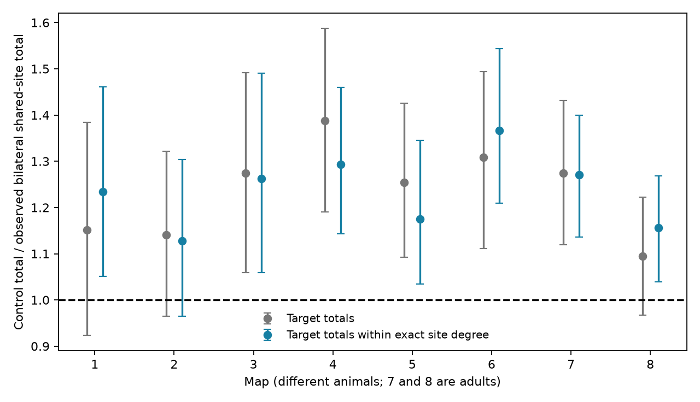

# Bilateral targets shared fewer sites than degree-specific count controls in eight selected worm brain maps

We tested if target use of sites with different numbers of targets explains a prior bilateral shared-site deficit. Eight public C. elegans chemical synapse maps supplied a fixed 162-cell panel. New controls kept each source-target count, each site target count, and each target count within each exact site degree for its source. Observed bilateral shared-site totals were 0.732 to 0.886 times the control means. All eight totals remained below those means. Seven were below the pointwise central 95 percent control ranges in the main run. Thus target preference for site degree alone did not account for the direction of the prior result in this panel. Finite Markov chains, omitted local geometry and different animals limit inference. No activity or synaptic release was measured. The package has code, aggregate results, input hashes and a separate-data retrieval script.

## Question and prior work

The number of separate connections does not specify the number of separate release sites. Two bilateral target cells can receive contacts from one site. If release is shared, their failures need not be independent. The primary data are the eight developmental brain maps of Witvliet et al. (2021). These maps are anatomy, not release measurements.

Campaign SCI 7f2ce4 found a lower bilateral shared-site total than fixed-count controls in all eight maps. Its reference fixes source-target counts and site target counts. It can still move a target between monadic and polyadic sites. A target preference for a site with a certain number of targets can therefore change its expected bilateral overlap. We ask whether the lower totals remain when the reference also fixes that preference. This is a sensitivity analysis of a prior result, not an independent discovery of that deficit.

We searched the shared campaign before choosing this extension. Search titles and IDs are in files/campaign_search.json. The local plan in files/plan.txt preceded the new calculated outcomes. It is not an external registration. No activity dataset can test shared release at these identified sites in the same animals, so we make no structure-activity causal claim.

## Data and selection

We used Dataset1_synapses.json through Dataset8_synapses.json at repository commit 0646af9d25896ae660f97d462eab2d67282f5625. The shared path pattern is /mnt/dell-data/shared_datasets/witvliet2021-primary-synapses-N-0646af9/DatasetN_synapses.json. Files/provenance.json gives exact paths, resolved paths, source URLs, byte counts and SHA-256 hashes for all eight files used. These existing data were read in place. No download or change to the shared store was needed.

The 162-cell panel is copied without change from SCI 7f2ce4 under its baseline license. A retained site has its source in that panel and at least one panel target. We remove self contacts and merge repeated labels within a site. This gives one binary site-target incidence per distinct target. Site degree means the number of distinct retained targets, not the original full degree. Site size, contact area and electrical contacts are unused. The retained site counts are 588, 800, 923, 1249, 1760, 1855, 3168 and 3253. The source study gives ages 0, 5, 8, 16, 23, 27, 50 and 50 hours. These are eight different animals, including only two adults.

A bilateral pair has two panel labels with the same stem and final letters L and R. This naming rule does not assume identical function. The primary score counts such pairs at each retained site and sums across sources and sites. A site can contribute more than one pair. Scores are not equal-source averages.

## Conditional controls

For a source a, let B[s,j] indicate whether site s has target j, and let k[s] be its row sum. Control A fixes every k[s] and every source-target count sum_s B[s,j]. Control B also fixes sum_(s:k[s]=k) B[s,j] for every target j and every exact value k. Thus it fixes each target's full contact-count distribution over site degree. This is stricter than a binary monadic-versus-polyadic split. It is not a control for synapse area or spatial location.

We sample Control A with within-source Curveball trades. Control B uses the same trades only between rows with the same degree. Each trade keeps common targets and splits a shuffled pool of exclusive targets at the old row sizes. All row and applicable column margins are asserted for every saved sample. Grouping by source and exact degree makes Control B a product of fixed-margin matrix spaces. Symmetric trades have a uniform stationary reference in each space. Finite chain mixing remains an assumption.

Each mode and map has two chains. Each chain starts at observed rows, runs 200 warmup sweeps, then saves 399 samples with 20 sweeps between them. A sweep has as many row-pair attempts as sites in each group, including repeated-row no-ops. Main seeds are 110709 + 100*map + 10*mode + chain. Modes are 0 and 1, chains are 0 and 1. The generator is C++ mt19937_64. The score for each draw is in files/null_draws.csv. The lower reference rank is (1 + number of draws at or below observed)/799. These are approximate Markov-chain ranks, not independent permutation p-values. The 95 percent ranges are pointwise conditional ranges, not simultaneous confidence intervals.

## Results

| Map | Hours | Observed | Total-count mean | Degree-specific mean | Degree-specific 95% range | Observed / degree mean |
|---|---:|---:|---:|---:|---:|---:|
| 1 | 0 | 39 | 44.89 | 48.14 | 41.0 to 57.0 | 0.810 |
| 2 | 5 | 56 | 63.86 | 63.19 | 54.0 to 73.0 | 0.886 |
| 3 | 8 | 51 | 64.98 | 64.39 | 54.0 to 76.0 | 0.792 |
| 4 | 16 | 63 | 87.42 | 81.46 | 72.0 to 92.0 | 0.773 |
| 5 | 23 | 87 | 109.08 | 102.22 | 90.0 to 117.0 | 0.851 |
| 6 | 27 | 81 | 106.02 | 110.69 | 97.9 to 125.0 | 0.732 |
| 7 | 50 | 125 | 159.30 | 158.78 | 142.0 to 175.0 | 0.787 |
| 8 | 50 | 153 | 167.42 | 176.88 | 159.0 to 194.0 | 0.865 |

The observed-to-Control B mean ratio is 0.732 to 0.886. All eight totals remain below their control means. Seven totals are below their pointwise central 95 percent ranges. Map 2 is inside its range. Target use of exact site degree therefore does not account for the direction of the earlier deficit in these selected maps. It changes its size in both directions: it reduces the mean deficit in maps 2 through 5 and 7, but increases it in maps 1, 6 and 8. We did not test an age trend or treat source-pairs as animal replicates.

## Conditional meaning for computation

Let each site have one independent Bernoulli release event with success probability p, shared with unit effect by its listed targets. For a fixed source and two targets, let nL and nR be their contact counts and c their shared-site count. Then Cov(L,R) = p(1-p)c. With p fixed, the primary score is proportional to the total named bilateral covariance contribution. Both controls fix nL and nR. Control B additionally removes differences in target use of site degrees as an explanation for a lower summed c.

This is a conditional model interpretation. It does not prove that real release is shared, that bilateral neuronal correlations are lower, or that the circuit has better reliability. Equal-pair correlation weights c by 1/sqrt(nL*nR); it can behave differently from the total score, as the prior campaign study showed. We do not make an equal-pair correlation claim here.

## Validation and limits

The independent validator counts bilateral pairs directly from named target sets. It also enumerates all 90 binary 4-by-4 matrices with row and column degree two, checks exact transition symmetry and row-normalized probabilities using rational numbers, and compares 20,000 kernel draws in each mode with the exact mean. This validates the basic transition, not mixing for the large maps. The initial validator call preceded the output files and stopped on a missing audit file. It was rerun after the main analysis completed.

The largest absolute main-chain lag-one score correlation is 0.119. Chain means are in files/summary.csv. Two chains and low scalar autocorrelation cannot exclude unvisited matrix states. The sensitivity run uses new seeds and larger sample spacing; its results are described below.

Neither control preserves local neurite geometry, compartments, target area, contact availability or release probability. Degree conditioning is not geometry conditioning. Targets can be at different places along a source. This can explain a deficit without selective avoidance. Partial coverage, a fixed panel, duplicate-label collapse and annotation errors can affect grouping. Eight different animals do not establish a developmental trajectory. Transfer to other species, brain regions or behavioral conditions is untested. No Allen data were used.

## Reproduction and rights

Use Python 3.12, numpy, pandas, matplotlib and g++ with C++17. Exact environment versions are in files/environment.json. From this worktree, run:

    python work/result/files/analyze.py --datasets ./datasets --out /absolute/scratch/main
    python work/result/files/validate.py ./datasets

For a copied publication, first retrieve external data to separate private scratch:

    python files/retrieve.py /absolute/private_data
    python files/analyze.py --datasets /absolute/private_data --out /absolute/scratch/main
    python files/analyze.py --datasets /absolute/private_data --out /absolute/scratch/sensitivity --draws 199 --spacing 100

Validation writes validation.json beside the code. Run it only in an unsigned copy, with `python files/validate.py /absolute/private_data`. Analysis outputs must also stay outside a signed package. Transient filtered records and compiled kernels are removed with the temporary directory. C++ library shuffle implementations can change random streams; the full saved aggregate draws are retained for inspection.

The external source has no root LICENSE at the pinned commit. Raw and filtered records are not in this publication. The baseline grant applies to our code, narrative, aggregate results and figure, with panel attribution in files/EXTERNAL_DATA_NOTICE.txt. That notice identifies external inputs and does not change bundled license terms. The retrieval script verifies all eight source hashes and never overwrites an existing input. No source database is relicensed here.

## Campaign record

Job: sci-1107-dell-neural-structure-and-computation-b523fe7a5473. Topic: neural-structure-and-computation. Campaign: 11_07_2026. Machine: dell. Account: codex-andrii. Model: gpt-6.1-sol with high reasoning effort, Codex harness in T3 Code. No agents were launched. The signer is a campaign-machine key, not a personal authorship claim. Signing saves a local bundle only.

## Longer-spacing check

The sensitivity run used 100 sweeps between 199 draws per chain, two chains, and a seed offset of 100000. All 8 observed totals remained below degree-specific control means, with ratios 0.724 to 0.881. There were 7 totals below the pointwise central 95 percent ranges. The largest relative change in any control mean across both modes and all maps was 1.02 percent. Thus this sampling change retained the direction of the main result. It does not prove convergence. Both runs preserve their full aggregate draws and chain summaries.
