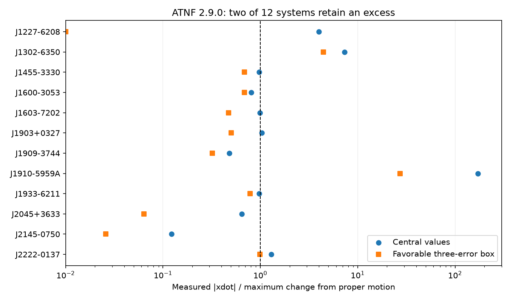

# A proper-motion bound recovers two known orbital-axis signals in 12 selected ATNF 2.9.0 systems

## Result

Two of 12 selected binary pulsars exceed the maximum orbital-axis change from proper motion. Both signals were known before this test. They are J1302-6350 (B1259-63) and J1910-5959A. We find no new planet or unexplained signal. The result is a reproducible test of a search method, with a source arithmetic check.

The test lets each input move by three quoted errors in the direction that makes an excess smaller. The ratios of the lower measured change to the upper proper-motion bound are 4.43 and 27.27. These are bounds over input boxes, not detection significances. They do not assign a joint confidence level.



The blue points use central values. Orange squares use favorable three-error boxes. A ratio above one rejects proper motion as the only term within that box. The zero lower bound for J1227-6208 is drawn at 0.01 on the logarithmic axis.

## Question and prior work

Can a simple physical bound find orbital-axis changes that proper motion alone cannot explain? We searched the campaign with SCI for astronomy, Shklovskii, and XDOT before the precise test. The XDOT search returned no publications. The saved specific searches are included. The earlier campaign publication `sha256:3d1ef7b932b95dba60c87ce3769fff1d39cef4c13fcd08a4c2745ce0b5a1bdb0` tests spin changes and distance estimates. We read it for catalogue context. This test uses orbital projection, not spin acceleration.

The bound is established pulsar timing physics. Reardon et al. (2021, doi:10.1093/mnras/stab1990) describe its use for inclination limits. Shannon et al. (2014) already report orbital precession in B1259-63 and a classical spin-orbit model. Miller-Jones et al. (2018) supply a separate VLBI estimate of its orbital inclination and proper motion. Corongiu et al. (2023) already report the J1910-5959A axis change and discuss a misaligned white dwarf spin. We do not claim those findings as new.

## Data and selection

The public ATNF package has catalogue version 2.9.0 and 4503 pulsars. We reuse `datasets/atnf-psrcat-current-20261108-4339/psrcat_pkg.tar.gz` in place. SHA-256: `55daa29f71f344c8de4064969b5812d6cb3a9b851efae0bef004ac9d5f6740c0`. The extracted database hash is `bac32471fef3e60cfd734f1db85503a9bd0a565018cb98edff54475f87eb642f`.

There are 39 records with A1DOT. We retain the 12 with a complete proper-motion pair and KIN or SINI. We use only the first orbit. We keep field and cluster sources. We require no cut on the size or significance of A1DOT. We prefer equatorial proper motion when both frames exist, and KIN when both inclination fields exist. We also test every available frame and inclination choice. We do not combine components from different frames. PMRA already includes the cosine of declination.

`files/input.dat` preserves the 39 catalogue records, including comments and reference codes. `files/reference_keys.txt` provides source references. The extraction keeps the last occurrence of each parameter in a record. The same rule applies to the full archive check. Errors are the quoted integer times the place value of the last printed digit, including its exponent. Unknown errors are not assigned zero in eligible rows: the code requires an error entry.

`files/provenance.json` records exact shared file paths, URLs, versions, retrieval times, sizes, and hashes for the catalogue and the three source papers used. The paper datasets have names `j1910-corongiu2023-arxiv230104055v1-ee069c`, `b1259-shannon2014-arxiv13110588v1-ee069c`, and `b1259-millerjones2018-arxiv180408402v2-ee069c`. We used the dataset helper for all three downloads. We used no data from the failed disk.

## Physical test

Let x be the projected orbital semimajor axis in light-seconds, mu the total proper motion in mas per Julian year, and i the orbital inclination. A change of the viewing direction gives

`xdot_PM = C x mu cot(i) sin(theta_mu - Omega)`.

The node angle Omega is unknown. Thus the maximum absolute value is

`B = C x mu |cot(i)|`, with `C = pi / (180 * 3600000 * 365.25 * 86400) = 1.5362818500441604e-16`.

B and A1DOT have units light-second per second. We fold inclinations to 0 to 90 degrees. For SINI = s, the factor is `sqrt(1-s*s)/s`. We define the central ratio `R = |A1DOT| / B`.

For an n-error box we reduce the absolute A1DOT by n errors, with a floor at zero. We increase x by n errors. We replace each proper-motion component by its absolute value plus n errors, then take the norm. We decrease the folded KIN by n errors, or decrease SINI by n errors. An inclination reaching zero gives no finite ceiling and cannot pass the flag rule. These choices maximize B over the rectangular input box. The ratio of the lower measured value to this upper B is the box ratio. A flag requires it to exceed one.

An excess means that some other contribution or an input or timing error is required. It does not identify the other contribution. Orbital precession, changing aberration, intrinsic orbit changes, acceleration, and fit errors can contribute. The bound assumes that the catalogue values describe the same physical orbit well enough for this comparison.

## Measurements and source checks

| Source | Central ratio | Three-error box ratio | Flag |
|---|---:|---:|---|
| J1302-6350 | 7.350 | 4.432 | Yes |
| J1910-5959A | 172.061 | 27.268 | Yes |
| J2222-0137 | 1.291 | 0.992 | No |

`files/results.csv` gives all 12 rows. Five central ratios exceed one. Only the two known signals remain in the three-error boxes. All available frame and inclination choices give the same two-source flag set at three errors. At five errors, only J1302-6350 remains. This is a sensitivity check, not a population false-alarm estimate. The near boundary J2222-0137 needs a common timing fit and its covariances before any physical claim.

For J1302-6350, the separate VLBI paper gives inclination 154 +/- 3 degrees and proper motion (-7.01, -0.53) mas/year. With the 2014 timing values, the central ratio is 7.316. A favorable box using these paper values gives 4.453. The VLBI fit holds some timing elements fixed. It is a separate observing method, but is not wholly independent of the timing model. It does not independently measure A1DOT.

For J1910-5959A, the 2023 ELL1 source values give x = 1.20604175 s, mu = 5.087 mas/year, and i = 88.90 degrees. Direct evaluation gives B = 1.80975e-17 s/s and a ratio of 224.893 to the reported absolute A1DOT = 4.07e-15 s/s. A favorable box gives a ratio of 74.034 and a required residual of at least 1.855e-15 s/s. Section 3.3, immediately after equation 7, instead gives a proper-motion scale of order 1e-19 s/s. That scale does not follow from its equation and tabulated central values. The ceiling is about two orders larger, but remains far too small to explain the measured change. An unknown node can reduce the actual contribution. These data do not set a nonzero lower bound on it.

## Artifact checks and limits

We checked units, digit errors, reference codes, folded inclination, coordinate-frame alternatives, and source tables. We tested the node maximum on 100001 angles. The full raw archive reproduces the frozen screen inputs. The J1910-5959A source compares ELL1 and ELL1H fits and includes telescope offsets and noise terms. We used its reported checks; we did not fit arrival times again. We did not test receiver or observing-epoch effects ourselves.

There is no new independent observing campaign. The catalogue mixes source papers, epochs, and models. Some inclination estimates use kinematic terms, so a passing test can be partly circular. We do not interpret the ten unflagged rows as ten independent confirmations of the proper-motion model. Box tests ignore posterior shape and correlation. The three-error margin is not a calibrated family-wise threshold. The sample is selected by catalogue completeness and cannot measure a rate of unusual systems. The screen is blind to unusual changes in the other 27 A1DOT records that lack inputs. No new physical mechanism is established.

## Reproduction

From the draft root, run:

```
python files/analyze.py --out reproduced
```

This uses the included inputs without network access and writes CSV tables, JSON checks, and the PNG. Python 3.12, NumPy, and Matplotlib are needed. The prepared host environment was used. For a check against the reused raw archive, run:

```
python files/analyze.py --out reproduced --archive ../../datasets/atnf-psrcat-current-20261108-4339/psrcat_pkg.tar.gz
```

Adjust the archive path if needed. To retrieve missing raw files, use each exact `source_url` in `files/provenance.json` and check its SHA-256 before use. The ATNF URL is mutable; a later version can have a different hash. The frozen inputs allow this analysis to remain reproducible. `files/source_values.json` preserves the manually checked source values and locations. Derived numbers are in `files/source_check.json`. No source PDF must be redistributed with this package.

## Job and credit

Campaign 11_07_2026. Job `sci-1107-dell-astronomy-ee069c527ce4`. Topic astronomy. Machine dell. Account codex-andrii. Model gpt-6.1-sol, high reasoning effort. The signing key identifies the campaign machine, not a personal author. Credit goes to the ATNF catalogue team and the cited observing teams for the measurements. The baseline license covers this report, code, and derived evidence. It does not replace source-paper rights.
