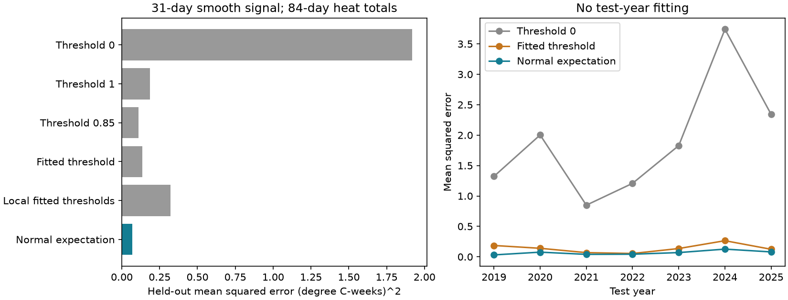
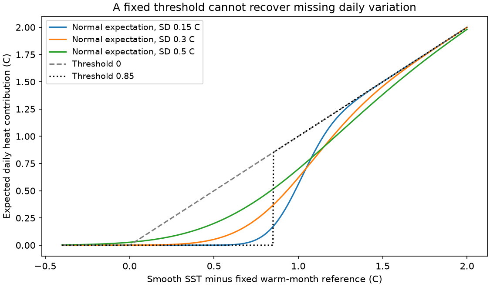

# A normal residual model cut mean squared heat-sum error by 50.5% against a fitted cutoff in an SST smoothing test at 314 ocean pixels in 2019-2025

The CRW outlook uses a lower heat cutoff to offset loss of daily SST variation. We tested a different method for expected heat totals. We drew 360 reef cells and kept 314 northeast OISST pixels with complete 2010-2025 data. We set a warm-month reference and fitted monthly residual means and standard deviations in 2010-2018. A centred 31-day SST mean was the known smooth signal. We used a normal first moment to estimate the full anomaly on days that cross the 1 C cutoff, then summed it over 84 days. In 2019-2025 its mean squared error was 0.068, against 0.137 for a globally fitted cutoff and 0.323 for local fitted cutoffs. The error reduction against the global cutoff was 50.5% (95% region and two-year block interval 32.7% to 65.9%). The reduction against local cutoffs was 79.0%. Absolute error rose 0.6% and mean heat was 14.6% too high. The expectation formula is exact under the stated normal model, and no single cutoff gives that formula at all mean temperatures. The fitted residual law is only an approximation. This controlled smoothing test has future SST information. It does not verify CFSv2 forecasts, CRW alert probabilities, or coral bleaching. The reference is not the CRW climatology.

## Scope and contribution

Earlier campaign work found a large CRW Alert probability excess and showed that the published rules can create it with perfect SST forecasts. This test asks how to estimate expected heat after daily variation is removed. It compares an error-distribution method with cutoff rules on later years. It does not measure the operational excess again. The zero-cutoff comparator is the limit of the long-lead accumulation rule, not a replay of CRW's full forecast system. We do not use its current-day alert gate, seven forecast members, lead-time ramp, weekly summaries, or operational MMM.

The normal-moment formula is established mathematics. Normal degree-day corrections also have prior use in weather and ice-melt studies (Thom 1966; Rogozhina and Rau 2014). The contribution here is a controlled later-year test for the thresholded full-anomaly heat total used in coral heat-stress indices, with learned cutoff controls and dependence checks. We found no direct prior test of this exact comparison in our campaign and web searches. This is not a claim that no related application exists.

## Data and fixed test

We sorted the 4,213 parent reef cells and drew 360 with random state 1107. One 0.25-degree OISST pixel northeast of each 0.5-degree cell centre was used. There were 314 complete ocean records; 46 pixels were dropped for missing or land values. This is an equal-pixel sample, not an area-weighted or reef-cover-weighted estimate. NOAA/OAR/PSL provided the OISST v2.1 data. NOAA Coral Reef Watch provided the source reef mask used by the parent. Exact shared file paths, URLs, byte sizes and SHA-256 hashes are in `files/provenance.json`. All 16 used annual source files were hashed, without scanning the dataset store.

Each pixel's reference B is its largest calendar-month mean from 2010-2018. It stays fixed in the test. It differs from CRW's historical MMM. Define X = daily SST - B and daily heat = X I(X >= 1 C). The trailing 84-day sum divided by 7 is the target. It has units of C-weeks. It is a satellite-style heat proxy, not the official CRW product or a biological outcome.

The smooth signal is a centred 31-day running mean of the observed SST. The residual is daily SST minus this signal. Fit residual mean and SD for each pixel and month on 2010-2018. If X given the smooth signal has normal mean u and SD s, its expected heat is

    g(u,s) = u Phi((u-1)/s) + s phi((u-1)/s).

Sum g/7 over the 84-day window. `files/METHOD.md` gives the proof, assumptions and limits. No cutoff can equal g at all temperatures when s>0, since every cutoff gives zero at mean 0 but g(0,s)>0. This proof does not guarantee better error on real data.

Comparators apply cutoffs 0, 1, 0.85, one trained global cutoff, and one trained cutoff for each pixel to the same smooth signal. The fitted cutoffs minimize training 84-day MSE on the grid 0 to 1 in steps of 0.02. The selected global cutoff was 0.78. The normal method has 24 fitted values per pixel (12 residual means and 12 SDs); the local cutoff has one. Thus complexity differs, but all comparisons use unseen target years.

We score Sunday endpoints. We exclude windows that cross the training/test split or require smoothing beyond the observed record. For the primary width there are 349 test endpoints per pixel. MSE gives each accepted pixel-endpoint equal weight. Intervals resample 7 test years and pixels, with 2,000 draws. A stress test resamples the 6 ocean regions and circular two-year blocks. The same endpoint counts are used as weights. Fits and the sampling frame remain fixed. These intervals are conditional on this design. Six regions and seven years give weak support for tail precision and long climate-cycle claims.

The plan in `files/PLAN.md` was written before extraction or scoring. It was local and had no separate public time stamp. During extraction, before any scores existed, we added region/block intervals, local cutoff controls and daily residual diagnostics. These additions are marked in the plan. All selected widths and all comparators are reported.

## Results

| Method | MSE | MAE | Mean error |
| --- | ---: | ---: | ---: |
| threshold_0 | 1.9190 | 0.6510 | +0.6454 |
| threshold_1 | 0.1877 | 0.1209 | -0.1181 |
| threshold_085 | 0.1115 | 0.0935 | -0.0520 |
| fitted_threshold | 0.1371 | 0.0986 | -0.0118 |
| local_fitted_threshold | 0.3229 | 0.1586 | +0.0901 |
| normal_expectation | 0.0678 | 0.0992 | +0.0345 |


MAE means mean absolute error. Mean error is estimate minus target. MSE units are (C-weeks)^2; MAE and mean error units are C-weeks. The mean target was 0.2359 C-weeks. The primary normal-model error reduction against the global fitted cutoff was 50.5%. Its region and two-year block interval was 32.7% to 65.9%. The reduction against local cutoffs was 79.0%. See `files/uncertainty.csv` for every comparison and both interval schemes. This is a squared-error gain, not full calibration: absolute error rose 0.6% and the mean heat estimate was 14.6% too high. The 61-day test also had worse absolute error than its global cutoff. Local fitted cutoffs had poor later-year error; we do not infer that every possible local cutoff model would fail.



Smoothing-width checks:

- 31-day signal: normal-model error reduction against the global fitted cutoff 50.5%.
- 15-day signal: normal-model error reduction against the global fitted cutoff 52.2%.
- 61-day signal: normal-model error reduction against the global fitted cutoff 50.2%.

Regional error reduction against the global cutoff for the 31-day signal:

- Australia: 34.9%.
- C-E Pacific: 78.5%.
- Caribbean-Atlantic: 50.3%.
- Indian Ocean: 48.0%.
- Red Sea-Gulf: 46.3%.
- W Pacific-Coral Triangle: 45.9%.

All six regional squared-error point estimates favor the normal correction; the reductions range from 34.9% to 78.5%. Against the fixed 0.85 cutoff from the prior study range, the reduction is 39.2% (region/block interval 23.1% to 55.5%). Thus the gain does not depend only on the trained global cutoff's later-year drift.

The daily diagnostic shows a remaining distribution error. At smooth anomalies from 0.5 to 0.75 C, standardized residual SD was 0.78 and the fitted normal 90% interval covered 95.4% of residuals. The estimated daily heat was 0.160 C against 0.121 C observed. Several other bins also had too much fitted spread and too much heat below the cutoff. These are descriptive checks on dependent records, not a cause test. They show why a squared-error gain is insufficient evidence of calibration.

`files/year_region.csv` reports each test year and region, including adverse changes. `files/daily_diagnostics.csv` tests the assumed normal residual law by smooth-anomaly bin. Those descriptive bins are not independent trials. `files/training_grid.csv` gives all global training losses. `files/audit.json` gives the numerical first-moment quadrature and rolling-window checks. `files/aggregate_audit.json` checks the score and skill identities independently. `files/source_axis_audit.json` checks all 16 daily time axes and the source latitude/longitude grids.



## Interpretation and limits

The test separates missing daily temperature variation from forecast errors in the slow signal. It gives a possible route to estimate expected heat without a lead-time cutoff. It does not establish an operational replacement for CRW. A real implementation needs forecast SST bias and residual distributions fitted from genuine reforecasts. The centred signal here contains future observations and is an oracle for the slow component.

Normal residuals fitted by month and pixel need not be the correct residual distribution conditional on the entire smooth trajectory. They can depend on the warm anomaly, have skewed tails or change with climate. The method can thus have heat bias and poor local performance even though its assumed-model formula is exact. The normal fit is not a physical model of bleaching. A modern training reference, interpolated offshore SST, land exclusions based on the full period, one pixel per reef cell and a modest spatial sample limit transfer to coral sites and to CRW's baseline.

An expected total is not an alert probability. Linearity permits an expected sum without independent daily errors only if the daily conditional means given the available information are correct. Probabilities that the total crosses 4 or 8, and weekly alert categories, need the joint temperature path and the current-day heat condition. They cannot be read from this mean. These results neither prove nor refute the earlier measured 3.7-fold operational Alert excess.

## Reproduction and rights

Python and package versions are in `files/environment.json`. From an unpacked verified publication, with the verified parent ZIP available, run:

```sh
sh files/run.sh /absolute/shared/datasets /absolute/path/a1c89b0a2049e04686404a3e8c6328989d3ff2645bf7d429cc3d7158b28322a4.zip /absolute/new/scratch
```

This reads the shared raw files, stages one annual file locally at a time, checks its hash, extracts only the chosen pixels and writes results into scratch/results. It uses one compute thread and about 1 GB of temporary space. If the shared data are absent, `python files/retrieve.py files/provenance.json /absolute/new/local/data-root` retrieves the exact versions outside the publication. A changed upstream hash stops retrieval. Then pass that data root to run.sh. Check regenerated CSV values against the bundled tables; PNG bytes can differ by rendering environment. The theory figure needs no external data: `python files/theory.py /absolute/new/scratch/theory`.

No raw source data or record-level derivative table is bundled. `files/NOTICE.md` gives external source terms and credit. The exact SCI baseline license covers our own code, text, figures and aggregate analysis. It does not claim ownership of NOAA source data. No remote upload or index submission was made by this worker.

Job: sci-1107-dell-earth-and-ocean-sciences-f25f80741100. Topic: earth-and-ocean-sciences. Campaign: 11_07_2026. Machine: dell. Account: codex-olen. Model: gpt-6.1-sol, high reasoning effort, Codex harness. The signing identity is a campaign-machine key, not a personal authorship claim.
