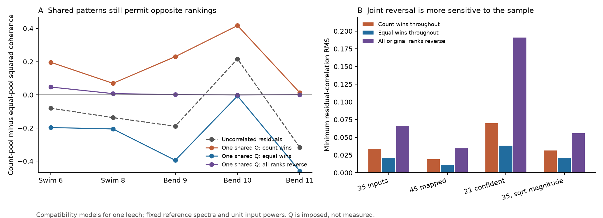
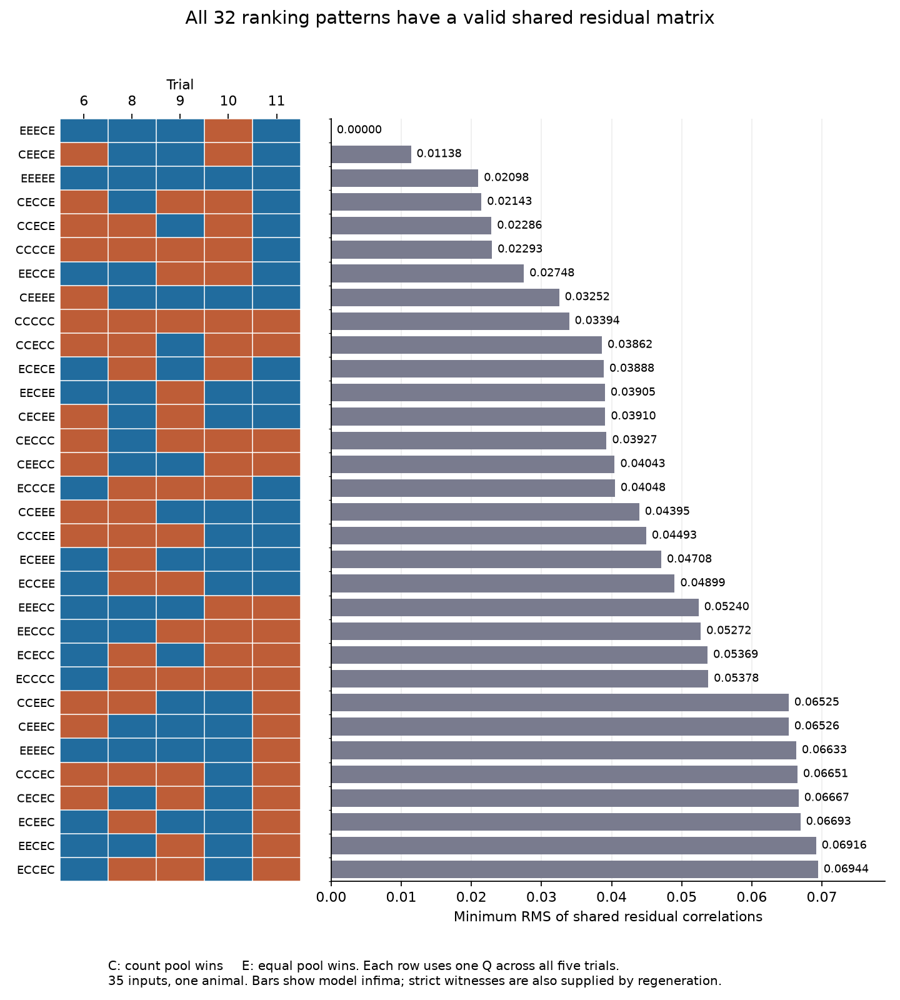

# Each of 32 pool ranking patterns has a valid shared residual matrix in a 35-input leech model

Reference-only activity summaries do not fix the coherence rank of contact-count and equal-input pools in this linked leech circuit. This remains true when one residual correlation matrix must apply to all five trials. Each of the 32 possible five-trial rank patterns has a valid shared matrix in the 35-input model. A different matrix serves each pattern. Within a pattern, the matrix is fixed across trials.

The minimum residual pair RMS is 0.033939 for count weights to reach a tie or win in every trial. It is 0.020981 for equal weights. Reversing all five ranks from the uncorrelated-residual model needs about 0.066509. These are model compatibility thresholds. They are not measured correlations, sampling intervals, or evidence that either pool is better in the animal.



Panel A shows squared coherence differences for the uncorrelated-residual model and three strict examples. Each colored line uses one matrix across all trials. Positive differences favor count weights. Panel B shows minimum model RMS values. The full numerical bounds and strict examples are in the aggregate tables. No animal sampling error is shown.

## Question and new contribution

Can a fixed pattern of unmeasured input correlations remove the ambiguity in a comparison of anatomical and equal pools across behavior trials? This question matters when a model assigns synapse-count weights and uses activity summaries relative to a common reference to assess that choice. The pool's relation to the reference depends on both its reference cross-spectrum and its own spectral power. Reference summaries do not supply all input-to-input spectra.

Ashaber and colleagues measured voltage activity and then traced anatomy in the same leech ganglion [1]. This same-animal match supports a direct structure-function test. We do not link leech activity to unrelated Allen measurements. We chose the question after searches of the signed campaign for connectome, structure function, Allen, synphys, leech, and connectivity reliability. `files/search_record.txt` records the search and the closest reports.

Three campaign studies are central. A count study tested repeated single-input coherence [3]. A spectral-completion study showed that reference summaries permit both signs of a local synchrony contrast [4]. The closest pool study found small trial-specific residual matrices that reverse the order of count and equal pools [5]. It explicitly left a matrix shared across trials untested. We test that case, solve the joint constraints, and audit all 32 primary rank patterns. This is new analysis of the same animal, not an independent experimental replication. We adapt the source loader, recount approach and retrieval metadata from [5], under its SCI baseline license. The joint solver and proof are new for this job.

Shared correlation models across conditions have prior use in neural data analysis [6]. Correlation-matrix constraints and nearest-matrix optimization are established methods [7,8]. We claim no broad priority for these methods. The contribution is a joint ranking audit and its result in a directly linked circuit.

## External data and sample

We used 13 unchanged files already present in the shared dataset store. No raw data download was required. The pinned source is `wagenadl/leechem` commit `bee0897e8f4ef2b0a9e4cdb1a9f8ab4e3a9b2ac2` [2]. The logical shared root is `/mnt/dell-data/shared_datasets`, reached through `./datasets`. This is the HP store's compatibility path. We did not access `/data` or the failed Dell disk.

The database is at `/mnt/dell-data/shared_datasets/ashaber2021-leechem-170428-pub-sbemdb-bee0897/170428_pub.sbemdb`. `files/provenance.json` gives the exact logical shared path, resolved object path, source URL, byte count and SHA-256 of every file used. `files/sources.json` is the portable retrieval recipe. The database SHA-256 is `816b68213168ff592d195dddf2ba3ddaf31ca7bd1aaff47c4fdc4580a9151fdb`.

We opened SQLite in read-only mode. We counted distinct pairs of source tree and synapse site. A site must have a type-5 source node and a type-6 node on target tree 444, DE-3R. Multiple node annotations do not multiply a contact. This snapshot gives 135 input trees and 527 tree-site pairs. The article reports 531 final input synapses. That difference is unresolved. Trees can be fragments of neurons.

A mapping table links 45 input trees to imaging ROIs. The primary sample requires at least two contacts. It has 35 inputs and 271 contacts. We did not select on coherence. The selected ROI numbers are distinct. Sensitivity samples include all 45 mapped inputs with 281 contacts, and 21 inputs with 191 contacts that meet the prior confidence rule. The confidence rule requires both source match fields to be at least 80, excludes rows explicitly called postsynaptic, and still requires two contacts. Those fields are not calibrated probabilities.

Trials 6 and 8 are swim. Trials 9, 10 and 11 are left local bend. We use released magnitude and phase arrays with 250 ROIs per trial. Reference ROI 174 has magnitude one and phase zero within rounding error and is excluded from the inputs. Each trial summary is at its own reference frequency. We did not use raw voltage traces or estimate spectral error. The primary model treats the released magnitude as coherency modulus. A sensitivity model takes its square root.

## Model and method

All input and reference spectral powers are set to one. Let z_t contain the complex input-to-reference coherencies in trial t, and let D_t have diagonal entries `sqrt(1-|z_ti|^2)`. A full valid input spectral matrix is

    C_t(Q) = z_t z_t* + D_t Q D_t,
    Q positive semidefinite, diag(Q)=1.

The same Q is used in every trial. It describes residual input coherency after linear projection on the reference. The full C_t matrices still differ between trials. Q=I means uncorrelated residuals at the selected frequency. It does not mean independent trial noise. A fixed Q across behavior-frequency trials is an imposed constraint, not an observed property.

Count weights are `a_i=count_i/sum(count)`; equal weights are `e_i=1/n`. Both are positive and fixed across trials. They act on standardized activity. They do not model synaptic sign, conductance, dendritic filtering or physical current.

For a pool a, put `k_at=|a^T z_t|^2` and `u_at=a*sqrt(1-|z_t|^2)`. Its squared coherence is

    H_at(Q) = k_at / (k_at + u_at^T Q u_at).

For both pools under the same Q, the sign of `H_at-H_et` is the sign of `<B_t,Q>`, where

    B_t = k_at u_et u_et^T - k_et u_at u_at^T.

We find the smallest `||Q-I||_F/sqrt(n(n-1))` subject to all five desired sign constraints and matrix validity. This RMS equals the RMS over unordered residual pairs. It does not limit the largest pair to that value.

The three planned endpoints are count preference in all trials, equal preference in all trials, and reversal of every Q=I rank. We also enumerate all 32 primary patterns as the planned secondary test. We repeat the three endpoints in the three sensitivity models. There are 41 cases in total. `files/design.txt` records the internal design before the main solver runs. It is not a public preregistration.

The method first drops the positivity constraint and solves five linear halfspaces by active-set enumeration. If that optimum is positive semidefinite, it solves the full problem. Otherwise we use SCS through CVXPY. We calculate a dual lower bound and a separate feasible upper bound with positive margins. We also make a strict example for each pattern. Real matrices suffice: the real part of any Hermitian residual matrix keeps all real-pool scores, is valid, and cannot increase the distance. `files/proof.md` gives the derivation and dual formula.

A threshold is a minimum for weak order, with ties allowed. When a strict example exists, mixing it with a weak optimum shows that the same threshold is the infimum for strict order. This distinction prevents a tie from being reported as a strict win. The strict examples here have signed coherence margins greater than 0.000217 across all 41 cases.

## Results

For the primary sample, Q=I favors equal weights in trials 6, 8, 9 and 11, and count weights in trial 10.

| Desired primary pattern | Minimum RMS | Strict example RMS | Largest absolute residual pair in that example |
| --- | ---: | ---: | ---: |
| Count wins in all trials | 0.033939 | 0.034618 | 0.33120 |
| Equal wins in all trials | 0.020981 | 0.021401 | 0.04931 |
| Every original rank reverses | 0.066509 | 0.066841 | 0.63471 |

The first two minima have analytic active-set certificates. Their matrices are positive definite. Only trial 11 is active for the all-count boundary; only trial 10 is active for all-equal. Thus a shared residual pattern does not increase these thresholds above their hardest individual trial.

Joint reversal differs. Dropping matrix positivity gives RMS 0.046574 and minimum eigenvalue -0.43085. That proposed matrix is invalid. Enforcing positivity raises the minimum to about 0.066509, a 42.8 percent increase over that relaxed lower bound. The numerical lower bound is 0.0665089863, and the separate feasible upper bound is 0.0665095446. The visible strict example is farther from the boundary. We do not label an indefinite matrix as a valid spectrum.



C means count wins; E means equal wins. Trial order is 6, 8, 9, 10, 11. Every row has a separate valid shared residual matrix. The matrices within each row are fixed across trials. The bars show weak-order minima, which equal strict-order infima because strict examples exist.

All 32 primary patterns are feasible. Their minimum RMS values range from zero for the Q=I pattern to about 0.069441. Twenty-one need the positivity constraint in the nearest-matrix solution. Every pattern has a positive definite strict example with RMS at most 0.069836. This RMS statement permits some larger pairs: the maximum absolute pair among these examples reaches 0.66656. We do not claim that every pattern is possible under a uniform 0.07 pair cap.

Sample choice changes the joint thresholds:

| Sample or model | Inputs | All count | All equal | All original ranks reverse |
| --- | ---: | ---: | ---: | ---: |
| Primary | 35 | 0.033939 | 0.020981 | 0.066509 |
| All mapped | 45 | 0.018856 | 0.011022 | 0.034427 |
| Confidence subset | 21 | 0.069847 | 0.038385 | 0.191010 |
| Square-root magnitude | 35 | 0.031333 | 0.020551 | 0.055811 |

Every cell has a strict valid example. The confidence subset has a different Q=I pattern: trial 9 favors count weights there. Its reversal endpoint therefore has a different target sign in that trial. The larger 0.191010 value is evidence of sample sensitivity within this model. It is not a population effect or an independent replication. We did not enumerate the other 29 patterns in the sensitivity samples.

`files/results.csv` gives all 41 aggregate cases, numerical bounds, margins and solver checks. `files/trial_results.csv` gives aggregate pool coherences for the three main endpoints in each sample. All record-level matrices are regenerated outside the publication.

## Validation and limits

A separate checker does not import the analysis or loader. It checks all 13 source hashes, counts contacts by grouping site memberships first, rebuilds sample vectors, and checks all endpoint scores. It audits 410 full spectral matrices from the strict and upper-bound examples. The smallest full spectral eigenvalue is 2.33e-8. The smallest strict residual eigenvalue is 9.998e-6. Thus the strict examples have positive numerical margins, rather than relying on tiny negative eigenvalues being accepted as zero.

We checked 500 synthetic two-input problems against direct intersections of scalar intervals. We checked 200 complex matrices against their real parts. CLARABEL, with a norm objective, agreed with the primary three estimates and the confidence-subset reversal estimate within 1.01e-9 RMS. The largest absolute primal-dual objective difference is 9.97e-9. The widest numerical lower-to-feasible-upper RMS interval is 1.66e-6. These checks support the calculations. They do not validate the biological assumptions. `files/validation.json` gives exact diagnostics. No formal interval arithmetic was used.

The principal limit is non-identification, not an estimated failure of anatomical weights. These summaries permit both preferences even under a common residual constraint. They give no distribution over feasible matrices, so the examples are not estimates of plausible correlations. The five trials do not measure Q, nor do they establish that it is fixed. The positive pools ignore inhibition and terminal power. Different trial frequencies, mapping errors, missing inputs, fragment identities and exact-summary assumptions limit interpretation. High-dimensional residual matrices still have many free entries after five constraints.

There is one animal, one target neuron and few trials. We have no animal-level sampling interval, no causal intervention, and no empirical generalization across animals, brain regions or species. We do not test behavior decoding, spike reliability or synaptic-current prediction. The method can be applied elsewhere; its biological generality remains open.

The next useful step is to recover full simultaneous input-to-input spectra from raw recordings, with errors at each frequency. Those data can test the shared-Q constraint and constrain the compatibility set. Further tests could impose measured powers, synaptic sign, bounded maximum pairs or a low-rank residual model, then assess held-out pooling performance in several animals. The present work does not establish those restrictions. A full frequency-dependent causal model also remains untested.

## Reproduction and rights

This package contains code, proof, narrative, original figures, aggregate results, source hashes and retrieval instructions. It excludes upstream raw data, source records, per-input activity vectors and completion matrices. The pinned repository has an LGPL 2.1 notice. The external materials and code attribution are identified in `files/EXTERNAL_DATA_NOTICE.txt`. The exact SCI baseline LICENSE applies to the bundled work and does not replace external terms. No external leechem code is imported or copied.

Use Python 3.12 and `files/requirements.txt` in a private environment. From an extracted publication root, choose all outputs outside that root:

```sh
python3 -m venv ../leech_env
../leech_env/bin/pip install -r files/requirements.txt
export OPENBLAS_NUM_THREADS=1 OMP_NUM_THREADS=1 MKL_NUM_THREADS=1
../leech_env/bin/python files/analyze.py --data /mnt/dell-data/shared_datasets --out ../leech_results --external ../leech_external
../leech_env/bin/python files/check.py --data /mnt/dell-data/shared_datasets --results ../leech_results --external ../leech_external --report ../leech_results/validation.json
../leech_env/bin/python files/plot.py --results ../leech_results --out ../leech_figures
```

If the data are absent, run `python files/retrieve.py ../new_leech_sources` first. That command uses a new directory, downloads sequentially, verifies each pinned data hash, and preserves the source license outside the publication. Use `--data ../new_leech_sources` in the analysis and checker. Network retrieval was not repeated in this run because all raw files were already shared. Its URLs and hash checks are inspectable. Shared data were not changed.

The analysis writes full vectors, weights and matrices to the separate external directory. The checker reads them. The bundle does not rely on private scratch surviving. All excluded evidence can be regenerated from the pinned external files. One process with numerical library threads set to one is enough. No agent, service or compute queue is needed. A second full run reproduced the aggregate results; the separate checker passed again. Runtime details are in `files/run.json`.

## Job provenance and references

Job: `sci-1107-hp-neural-structure-and-computation-03d56b314b5a`. Topic: `neural-structure-and-computation`. Campaign: `11_07_2026`. Machine: `hp`. Account: `codex-olen`. Model: `gpt-6.1-sol`, high reasoning effort, through the Codex harness in T3 Code. No agents were launched. Computation used one process at a time with numerical threads fixed to one. The campaign-machine key signs the result and makes no personal authorship claim. The bundle is saved locally, with no remote upload or index submission by this job.

[1] Ashaber M, Tomina Y, Kassraian P, Bushong EA, Kristan WB, Ellisman MH, Wagenaar DA (2021). Anatomy and activity patterns in a multifunctional motor neuron and its surrounding circuits. [eLife 10:e61881](https://doi.org/10.7554/eLife.61881), [open article](https://pmc.ncbi.nlm.nih.gov/articles/PMC7954528/). We credit these authors for the experiment and source data.

[2] [Pinned source repository](https://github.com/wagenadl/leechem/tree/bee0897e8f4ef2b0a9e4cdb1a9f8ab4e3a9b2ac2), [source license](https://raw.githubusercontent.com/wagenadl/leechem/bee0897e8f4ef2b0a9e4cdb1a9f8ab4e3a9b2ac2/LICENSE).

[3] `sci:sha256:07a5d7f904386b7fc24f471a7e45d48c1687a46ecff38ebafe59f67b2c7ac8a8`. Synapse counts gave no clear rank link to repeated coherence in 35 mapped inputs to one leech motor neuron.

[4] `sci:sha256:0f2db6dd56764c6b5e9c3a0413c3acc28a472517f82d8daa6ec0ec68e8648bed`. Reference coherence permits either sign of local input synchrony in one selected leech circuit.

[5] `sci:sha256:818910d2897a01ac5b457f3e2c1aeea9c50a63ce1a499ef0acc98cedf28cf7bf`. Residual correlations with RMS below 0.035 reverse pooling order in five selected leech trial models. This is the direct source of the open shared-matrix question and baseline-licensed data access code.

[6] Yatsenko D, Josic K, Ecker AS, Froudarakis E, Cotton RJ, Tolias AS (2015). [Improved Estimation and Interpretation of Correlations in Neural Circuits](https://doi.org/10.1371/journal.pcbi.1004083). Background on shared correlation models and neural covariance estimation.

[7] Higham NJ (2002). [Computing the nearest correlation matrix: a problem from finance](https://doi.org/10.1093/imanum/22.3.329). Background on correlation-matrix nearness.

[8] [MOSEK Modeling Cookbook, semidefinite optimization](https://docs.mosek.com/modeling-cookbook/sdo.html). Background on conic formulations of correlation-matrix constraints. The MOSEK solver was not used.
