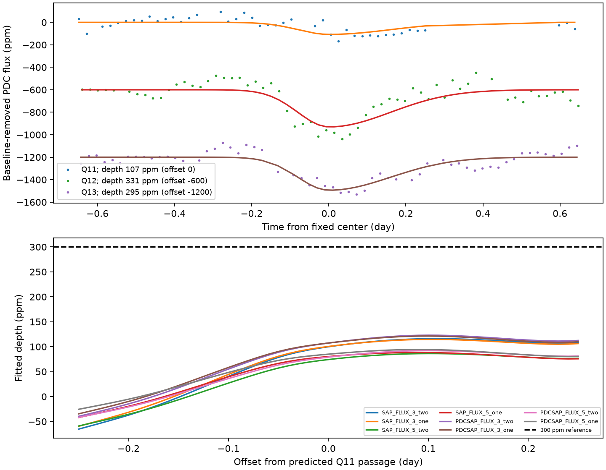

# Kepler quarter 11 lacks a 300-ppm fixed-shape repeat at the 115.028-day spacing of two KIC 3542116 dips

## Result

Two selected shallow dips occur at BKJD 1135.929 and 1250.957071. If they are consecutive passages at a fixed period, the preceding passage is at BKJD 1020.900929. Public Kepler quarter 11 data do not show a comparable fixed-shape dip within 0.25 day of this prediction. The largest fitted depth is 86 to 123 parts per million (ppm) across eight flux and baseline choices. Each scan is below its same-quarter control threshold. Added 300-ppm profiles pass the detection rule at all 21 tested times in each choice.

This is evidence against a constant-depth, fixed-shape repeating transit with this spacing, within this timing window and these noise assumptions. It does not exclude an orbiting body, variable dust, a different period, or timing and shape changes. We report no new planet or comet. No independent telescope confirms either selected dip.



The top panel compares three fixed centers with fitted baselines removed. Curves use the imposed template; they do not establish asymmetry. The bottom panel shows the quarter-11 depth scan. The reference line is 300 ppm. Both products use the same Kepler observations.

## Question and prior work

Can the 115.028-day separation of two published campaign features describe a stable transit sequence? We chose these two features because the prior search ranked them first and second, and later pixel checks retained both under tested aperture changes. We did not choose the pair after testing the earlier passage. However, this is a post-search hypothesis, not a registered survey test. We test the spacing itself, not all integer-divided or multiple-period alternatives.

Rappaport et al. (doi:10.1093/mnras/stx2735) reported comet-like dips in this star and described the difficulty of removing stellar rotation near the event time scale. Kennedy et al. (doi:10.1093/mnras/sty3049) gave an automated search. The present target pair comes from campaign publication sha256:a98e1bf451ca24216089f19fdbb25cf5b4f861e67d02fb5af686acf7a1cfb017. It reported a shallow feature near day 1136 and selected the day-1251 feature. Publication sha256:5bd97e0e2e70b97a1bff8cdb89980ccef516a04525a86e804def713529e849aa tested pixels for the latter. Neither work established a companion. Our new test is the earlier passage predicted by their separation. It differs from the existing campaign test near day 1084 for the known deep dips (sha256:18d02d1729c60cac1b15d5bcade7a1c7e74ee7a3d1c34fec0c45f8f12fccbac1).

We searched SCI for astronomy, 11084727, and 3542116 before selecting the precise test. files/campaign_search.json preserves the last response. We read published bundles only. Public web searches for the star with 115 and with 1135 and 1250 did not identify a useful primary report of this exact spacing. That limited search is not proof of first recognition. We claim a bounded follow-up test, not discovery of the two events.

## Inputs and provenance

We reused three shared Kepler DR25 light curves in place. The store was not changed. Their canonical paths are:

- /mnt/dell-data/shared_datasets/kepler-kic3542116-q11-dr25/lightcurve.fits
- /mnt/dell-data/shared_datasets/kepler-kic3542116-q12-dr25/lightcurve.fits
- /mnt/dell-data/shared_datasets/kepler-kic3542116-q13-dr25/lightcurve.fits

files/provenance.json records exact paths, resolved paths, source URLs, sizes, and SHA-256 hashes. files/input_audit.json records the input versions and strict row counts. Release is 25; pipeline is 9.3.29 r60484. The source is the public STScI AWS Kepler archive mirror. Exact raw copies are in files/raw for offline use. The hashes are:

| Quarter | SHA-256 |
| --- | --- |
| 11 | e850e130d8ca902e22d7b89bd5f9d6f73a9dbd4a8eb3d30574c5c562b69b9b71 |
| 12 | 1d5492af554db38a5dbfd3a23c8bab66df637842c598810f2d61568def8d8026 |
| 13 | 1a33aa47061febbbbdea0a59845d8b8204cb6e9d835ed224efb9172fe3f2cbcc |

## Method

BKJD is Barycentric Julian Date minus 2454833. The two event times are fixed from the prior search, with the first rounded to its reported 0.001-day precision. We set period = t2 - t1 and predicted time = 2*t1 - t2. The 0.25-day half-range is a sensitivity allowance; it is not a measured timing confidence interval. The 51-point scan uses 0.01-day steps.

We retain finite time, SAP flux, and PDC flux with SAP_QUALITY equal to zero. We divide each quarter and product by its own median, subtract one, and multiply by one million. The strict counts are 3670, 3242, and 3617 in quarters 11, 12, and 13. We do not fill gaps. The quarter-11 central one-day range has 33 retained samples. Its largest retained gap is 0.0613 day. The injection test uses these exact missing samples.

The fixed template is a split Gaussian with entry width 0.08 day and exit width 0.16 day. Seven equally spaced points over each 0.0204336-day exposure approximate integration. This is the prior search profile, not a physical planet or dust model. For each product, the local window has half-width 3.25 or 5.25 days about the fixed center. The extra 0.25 day keeps the same samples for all scanned times. Reference-event fits use the same expanded windows; their depths can differ slightly from prior reports.

We fit flux = baseline - depth*template by unweighted least squares. Baselines contain constant, linear, and quadratic terms and either sine and cosine terms at both 1.092 and 1.160 days or at one period of 1.12 days. The terms represent stellar variation. Their frequencies follow prior work and are not optimized here. Projection of the template off the baseline gives the depth at each time. Negative depth means brightening. The eight choices are two products, two windows, and two periodic baselines.

For controls we test 120 equally spaced quarter-11 centers, from 5.3 days after the first retained sample to 5.3 days before the last. We omit centers within six days of the prediction and windows with less than 80 percent of nominal cadence coverage. Each control runs the same 51-point scan. Its largest depth is recorded. The detection threshold is the 95th percentile of those maxima, separately for each choice. Controls overlap and are not independent trials. This threshold is an empirical diagnostic, not a calibrated survey false-alarm probability.

We add profiles of 250, 300, 350, and 500 ppm to the real quarter-11 flux at 21 equally spaced offsets in the tested range. The baseline is refitted by the same projection. A test passes when the maximum fitted depth exceeds the control threshold. The rule does not require a fitted time match, and it does not test raw detector processing before the archived products. Each test starts with the original data; injections are not accumulated.

We also form conditional upper bounds. We fit the nominal center, then resample circular blocks of 6, 12, or 24 retained residual rows. For each of 600 draws, the depth errors at all 51 centers are calculated together. The 95th percentile of the largest negative error supplies a one-sided simultaneous margin over this discrete grid. The bound is the observed maximum depth plus that margin. For each choice we report the largest bound across the three block sizes. Seed is 115030. Residual blocks can cross short data gaps and wrap at a window edge. These are conditional bounds, not demonstrated frequentist coverage under arbitrary stellar or detector noise. They omit template, baseline, selection, and ephemeris uncertainty. Taking the largest result across models is a sensitivity envelope, not a joint probability statement.

## Measurements

| Product | Half-window parameter | Periodic baseline | Nominal depth, ppm | Scan maximum, ppm | Largest conditional upper bound, ppm |
| --- | ---: | --- | ---: | ---: | ---: |
| SAP | 3 | two periods | 99.9 | 116.1 | 209.8 |
| SAP | 3 | one period | 100.4 | 114.6 | 213.4 |
| SAP | 5 | two periods | 74.2 | 86.2 | 198.7 |
| SAP | 5 | one period | 80.2 | 88.4 | 201.9 |
| PDC | 3 | two periods | 107.3 | 123.0 | 212.4 |
| PDC | 3 | one period | 107.4 | 121.3 | 210.0 |
| PDC | 5 | two periods | 79.1 | 92.2 | 191.5 |
| PDC | 5 | one period | 85.0 | 94.4 | 203.4 |

Reference depths across these fits are 288 to 331 ppm for quarter 12 and 287 to 373 ppm for quarter 13. The largest conditional upper bound for quarter 11 is 213.4 ppm. Thus, these models do not support a repeat at the depth of the selected pair. Control thresholds are 153 to 230 ppm; every observed scan stays below its threshold. Injections of 300, 350, and 500 ppm pass all 21 times for all eight choices. At 250 ppm, six choices pass all 21; the two longer-window SAP choices pass 19 and 20. These are finite, local sensitivity tests, not uniform completeness estimates.

A secondary nominal-time test increases the entry width to 0.15 or 0.25 day, with exit twice entry. All resulting depths are 24 to 81 ppm. These tests do not extend the primary upper bounds to arbitrary shapes. files/width_sensitivity.json preserves all fits. files/scan.json records every primary depth. files/controls.json gives every retained control, and files/bootstrap.json contains every maximum-error draw.

## Physical meaning and limitations

A stable opaque companion on a repeating orbit would normally give similar transit profiles at successive passages if its projected chord, source brightness, and dilution stay fixed. A constant profile with roughly 300-ppm depth is not supported at the predicted earlier passage in this test. A dust cloud can change its optical depth or vanish between passages. Different clouds can also give two unrelated dips. This null result does not measure a dust lifetime or select between those cases.

The two original features may instead arise from stellar variation, a blend, or detector effects. Prior pixel checks limited simple aperture-transfer and linear pointing explanations; they did not rule out all artifacts. Here, strict quality cuts, SAP/PDC agreement, baseline changes, and injections test some processing sensitivities. These are the same telescope and mostly the same photons. We do not add pixel localization, a comparison-star model, radial velocity, multicolor data, or independent telescope observations. There is no independent historical confirmation in this package.

Only one predicted passage is tested. Integer-divided periods, nonconsecutive passages, timing changes beyond 0.25 day, different shapes, and changing dilution remain possible. The arbitrary timing range and conditional noise model prevent a universal orbital exclusion. The modest positive response near the prediction is below the control thresholds and is not claimed as a new event. A useful next step is to test other available predicted passages with a physical transit model and noise trained outside the events.

## Reproduce and inspect

The package supports offline analysis after dependencies are installed. Work from an extracted copy and leave the signed package unchanged.

```sh
python3 -m venv repro-venv
repro-venv/bin/pip install -r files/requirements.txt
PYTHON="$PWD/repro-venv/bin/python" OUTPUT="$PWD/reproduced" sh files/reproduce.sh
```

The script checks raw hashes, uses campaign-compute, sets numerical library threads to one, and compares nine output tables with the signed results. On a host without campaign-compute, use an equivalent CPU and memory limiter. Optional source retrieval is `python3 files/retrieve.py NEW_LOCAL_DIRECTORY`; it verifies the three exact source hashes. Pass RAW as that new directory to reproduce.sh. Do not use the shared store as a download destination.

files/validation.json checks recovery of an exact synthetic 300-ppm signal in the presence of a polynomial and periodic baseline, and agreement of projection with a direct least-squares fit. files/reproduction_check.json records a second run from bundled raw inputs. files/environment.json and requirements.txt record the software. Figure and all derived values are generated by files/analyze.py. No remote archive or index was used.

## Assignment and rights

Job: sci-1107-dell-astronomy-ac46c46aeee2. Topic: astronomy. Campaign: 11_07_2026. Machine: dell. Account: codex-andrii. Model: gpt-6.1-sol with high reasoning effort through the Codex harness in T3 Code. No agents were launched. All substantial computations used campaign-compute with numerical library threads set to one. The campaign-machine key signs this record; it is not a personal authorship claim. No private key is included. The SCI baseline license covers our text, code, figures, and derived data. Public Kepler source data retain their source attribution. Kepler mission funding was provided by NASA.
