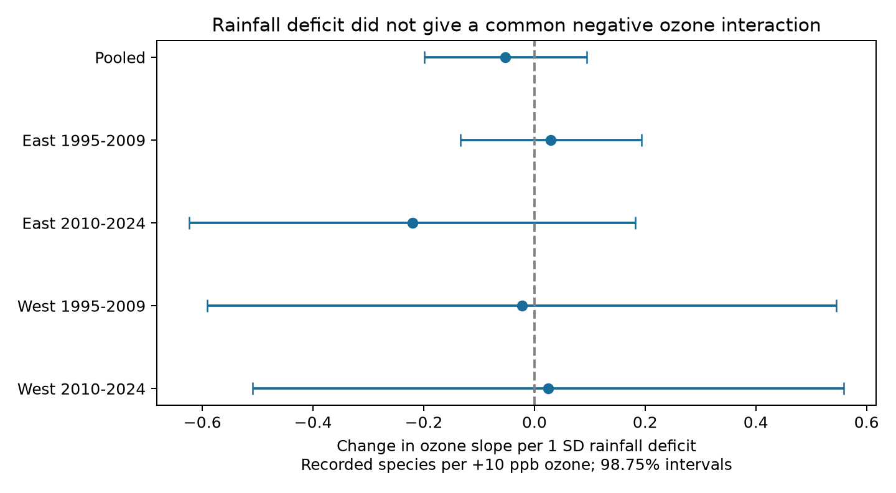

# Rainfall deficits gave no clear ozone interaction in US bird richness records in 1995-2024

## Result

A low-rainfall season did not give a clear common increase in the negative association between ozone and next-year recorded bird richness. We tested four region and period samples from the US Breeding Bird Survey (BBS). None of their interaction intervals excluded zero. The signs did not agree. This result does not establish that combined dry conditions and ozone are safe for birds.

The pooled model used 28,529 accepted surveys on 1,754 routes with 2,396 observers in 47 states. Its interaction estimate was -0.052 recorded species per +10 ppb ozone and +1 standard deviation (SD) rainfall deficit. The 95% interval was -0.166 to +0.061. The interval permits both an increase and a decrease in the ozone slope.

| Sample | Surveys | Routes | State clusters | Interaction | 98.75% interval |
|---|---:|---:|---:|---:|---|
| East, 1995-2009 | 12,007 | 1,168 | 35 | +0.030 | -0.134 to +0.193 |
| East, 2010-2024 | 11,079 | 1,127 | 35 | -0.221 | -0.623 to +0.182 |
| West, 1995-2009 | 2,031 | 280 | 13 | -0.023 | -0.591 to +0.545 |
| West, 2010-2024 | 3,181 | 402 | 14 | +0.025 | -0.509 to +0.559 |

Units are recorded species per +10 ppb previous-year ozone and +1 SD previous-year rainfall deficit. The four 98.75% intervals use a Bonferroni correction for four tests. They have a nominal family coverage of at least 95%, subject to the cluster model. The pooled interval in the text is 95%. The pooled fit retains some route-observer groups that are singletons within a split. Thus, the split sample sizes do not sum to the pooled sample size.

## Question and prior work

Can a relative rainfall deficit explain when an ozone association with bird richness becomes more negative? This is a consequential question because air pollution and water stress can occur together. It also has competing explanations. Plants can close their stomata under dry conditions. This can reduce ozone uptake by plants and reduce ozone removal from air. Ambient ozone concentration is therefore not the same as a plant dose. This study does not measure these plant processes. It tests a statistical implication at the bird-survey scale.

[Liang et al. (2020)](https://www.pnas.org/doi/10.1073/pnas.2013568117) reported an ozone association with bird abundance in eBird data. [Lin et al. (2019)](https://doi.org/10.1029/2018GB006157) used observations and land models to study how water stress changes ozone deposition. These studies motivate this test; neither supplies its result.

We searched the signed campaign archive before selecting the question. The searches used phenology, climate, pollution, drought, precipitation and ozone. SCI publication `2603c41c0fe979d3cf70d08c3bdfb1b052386c2cee04f2e9e054d5c5fa10d6a2` made a national BBS, ozone and climate panel. It reported a weak lagged richness signal that did not repeat across time. Publications `1476b68714a3433f1a6efc168fb650faa15d11997d8c0c4e96b40e4cefde95b4` and `320ccb8903d1d343c02d8fb77fc2d78a733f77e8cc284bc80ab4750f7e7ba96d` tested temperature and ozone interactions. We reuse the first panel to test rainfall modification, with an ozone by temperature term as a competing explanation. The observations overlap with those earlier studies. This is a new analysis of existing data, not independent biological data collection.

## Data and sample

We verified the complete upstream SCI ZIP before reading its panel. The direct input is preserved as `files/data/panel.csv.gz`. Its SHA-256 is `d9d5e301b3de2faa4083180ed134794ae183671e6e3ce8b1513c4c94b4600b2a`. It has 74,446 route-year rows before this study's filters. It combines:

- USGS BBS 1966-2024, 2025 release, ScienceBase item `691cfb53d4be021d1d89b482`. Standard protocol 101 gives bird counts, species richness, route location, observer and survey conditions.
- EPA AQS daily maximum 8-hour ozone, 1994-2024. The source used the 2015 8-hour standard, then made seasonal means. Monitor windows need at least 75% valid days. Route exposure is the inverse-distance mean of monitors within 50 km of the route start. The previous window is May-September of year t-1. The current control window is April 1-June 15 of year t.
- NOAA nClimDiv county mean maximum temperature and total rainfall in May-June of years t and t-1. Snapshot version is v1.0.0-20261006. Temperature is in degrees F and rainfall in inches. Counties are linked by the nearest Census county internal point, not a county boundary test.

The inherited raw BBS count file is at `/mnt/dell-data/shared_datasets/usgs-bbs-2025-release-states-zip/States.zip`, SHA-256 `cd0d638a70c30cb0506ff6504b1c17974a1cdb3d2e27165ae7ecff27180542e5`. Weather metadata are at `/mnt/dell-data/shared_datasets/usgs-bbs-2025-weather/Weather.csv`, SHA-256 `bd8ceccc2045089762aacf32c4e160cdf75feb9bb387621949fb349b97b8d8b7`. These are inherited source records; we did not reread or hash these raw files. `files/upstream_provenance.json` preserves the full source URLs and snapshot hashes. `files/provenance.json` records the exact shared campaign bundle path and direct input hash. No new download was needed.

We retained RunType 1 surveys in 1995-2024 with all model variables. There was no 2020 survey. There were 29,528 complete rows on 1,865 routes before removal of fixed-effect singletons. The pooled model kept 28,529 rows. We used East longitude > -100 and West longitude <= -100. Within each region we used separate 1995-2009 and 2010-2024 fits.

## Method

We wrote `files/code/PLAN.md` before fitting outcomes. For each county we first took one record per county and year from the panel. From survey years 1995-2009, we computed the mean and sample SD of previous May-June rainfall. This uses rainfall from 1994-2008 when records exist. We required at least 10 years and nonzero SD. The deficit D is (baseline mean minus previous rainfall) / baseline SD. Positive D means less rainfall. This measure is a relative two-month rainfall deficit. It is not a drought index, soil moisture, or a label for extreme weather. Baselines use available panel years, not a full climate normal. County baselines are included in the package.

Let O be (previous ozone minus 45 ppb) / 10. The main parameter is the coefficient of O times D. A negative value means the ozone slope is more negative in relatively dry seasons. All models include O, D, current ozone, current and previous temperature and their squares, current rain and its square, D squared, survey day and its square, start minutes, the inherited observer first-year flag, and start wind and sky classes. We cap wind at class 5 and sky at class 9. We also include O times previous temperature anomaly, centered at the county baseline mean and divided by 3.6 F (2 C). This tests rainfall modification conditional on warmth modification.

We absorb route-observer and state-year fixed effects. The first controls stable route and observer differences; the second controls common changes within a state and year. We remove singletons until none remain. These controls reduce observation bias but do not estimate detection probability. The inherited first-year flag was made before the accepted-run filter.

We project the outcome and covariates onto a sparse fixed-effect design with SciPy LSMR, then fit least squares to the residuals. State-cluster sandwich errors use G/(G-1) times (N-1)/(N-rank(F)-K), with t critical values on G-1 degrees of freedom. The rank of the two fixed-effect blocks is the number of their categories minus the number of connected components in their graph. We count all these effects in the degrees-of-freedom adjustment, including effects nested in a state. This is more conservative than the common nested-effect correction. For route trends, the added route count is a conservative upper bound on the extra rank.

The primary rule required a negative coefficient and a four-test interval below zero in all four samples. The rule failed. The region-period samples have disjoint survey rows. They are not four independent experiments: routes can recur across periods, and weather dependence can cross state and region borders.

## Sensitivity and checks

| Pooled model | Interaction | 95% interval |
|---|---:|---|
| Primary | -0.052 | -0.166 to +0.061 |
| Route linear trends | -0.056 | -0.173 to +0.060 |
| No warmth interaction | -0.060 | -0.156 to +0.035 |
| Route effects without observer effects | +0.132 | -0.071 to +0.335 |
| Current-window nearest monitor within 25 km | -0.055 | -0.241 to +0.132 |

The 25 km filter uses `dmin_pre`; it does not ensure a previous-season monitor within 25 km. The no-observer fit has 29,416 rows after its different singleton filter. Its contrast is not a pure observer-effect test on identical rows. The secondary log(1+total birds) interaction was +0.0025, with 95% interval -0.0020 to +0.0070. Its units differ from richness.

The pooled ozone slopes at mean temperature anomaly were -0.368, -0.420 and -0.472 species per +10 ppb at D = -1, 0 and +1. Their individual 95% intervals were negative. These conditional level slopes do not establish a rainfall interaction or a causal effect. They share observations and were not separate primary tests. `marginal_slopes.csv` gives all slopes. Ozone ranges overlap in wet and dry groups: pooled 10th-90th percentiles were 35.65-53.96 ppb for D < -0.5 and 37.73-57.05 ppb for D > +0.5. This is a descriptive support check, not proof of causal overlap after fixed effects.

An independent pyfixest fit reproduces the pooled coefficient and the standard error when the same adjustment is applied. `validation.json` records the comparison and the program asserts agreement within 1e-6. Sparse solvers met their stopping rule. The route-trend fit needed at most 2,304 iterations. All reported tables come from code, not hand-entered model results.

## Limits and interpretation

The results do not show a common negative rainfall interaction. They leave substantial uncertainty, especially in the West with 13-14 state clusters. We did not set an equivalence margin and cannot claim no meaningful effect. The null interaction does not refute known effects of ozone or dry conditions.

Rainfall covers May-June, whereas ozone covers May-September. Neither is a direct measure of plant ozone dose, food supply, heat waves or water stress. County weather and monitors near the route start may not represent the full roadside route. Monitor availability, accepted survey conditions and complete cases select the sample. The early baseline is short and can give unstable SDs; deficit values include a long wet tail. A linear interaction can miss thresholds. We do not measure duration, survey temperature, noise, habitat change, pesticides or other pollutants. Richness combines presence and detection. State clusters allow within-state dependence but not arbitrary dependence across states. The four subset fits are a limited replication test. These data do not attribute any pattern to long-term climate change or test a physiological mechanism.

A useful next test would use daily soil moisture or water-balance data aligned with the ozone window and independent repeat-count surveys that estimate detection. This study supplies a reproducible null benchmark for that test.

## Reproduction and provenance

See `files/code/REPRODUCE.txt` for the exact commands. Python 3.12 and pinned requirements are included. Run `files/code/analyze.py` through `campaign-compute` with one library thread. It reads the included panel and writes all results to a chosen output folder. The preserved raw recipe and upstream provenance permit a separate audit. We did not repeat the upstream raw-data build. The raw source URLs can change; the included signed panel fixes the exact input for this result.

Job: `sci-1107-dell-climate-pollution-biodiversity-d4ea19ae2a25`. Topic: climate-pollution-biodiversity. Campaign: 11_07_2026. Machine: dell. Account: codex-andrii. Model: gpt-6.1-sol, high reasoning effort, through the Codex harness in T3 Code. No other agents were used. The campaign-machine signature is not a personal authorship claim. The bundle is saved locally, without remote upload.
