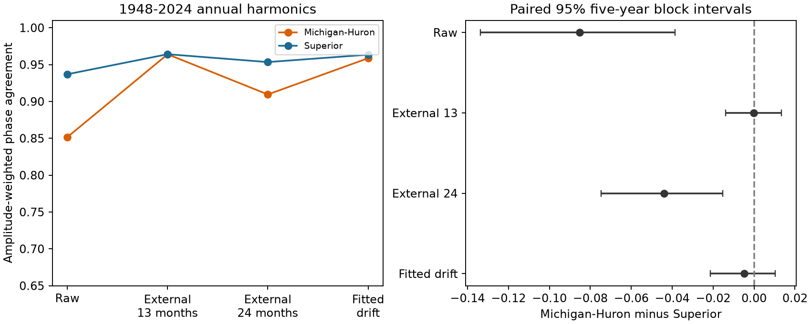

# A 13-month drift correction left no clear seasonal phase-agreement gap between two Great Lakes in 1948-2024

Michigan-Huron had less agreement in annual seasonal peak timing than Superior in the raw monthly level records. The difference in amplitude-weighted phase agreement was -0.0853. Its conditional 95% five-year block interval was -0.1336 to -0.0386. After a 13-month external endpoint drift correction, the difference was -0.0001, with an interval of -0.0138 to 0.0133. A smoother 24-month correction left a negative difference of -0.0439. Thus, the cross-lake comparison depends on the method used to remove drift.

The left panel shows point estimates. The right panel shows Michigan-Huron minus Superior and paired conditional 95% intervals. External 13 uses months just outside each year. External 24 uses January in the previous and next years. Fitted drift uses the same year's 12 months. All estimates use 1948-2024. Agreement measures the alignment of annual first-harmonic vectors. It does not measure the date of an observed monthly maximum.

## Question and prior work

Annual water levels contain both a seasonal cycle and slower rises or falls. A harmonic fit within each calendar year can include part of the slower change. This can alter the estimated seasonal phase. This matters when lake records are compared to assess the reliability of seasonal water conditions.

Lenters (2001), DOI 10.1016/S0380-1330(01)70650-8, reports long-term changes in the seasonal cycle and in the timing of lake levels. Lenters (2004), DOI 10.1016/S0380-1330(04)70375-5, reports a weaker Superior seasonal cycle in 1948-1999. We read the publisher abstracts from search results. We did not obtain the full articles. We do not repeat their physical attribution.

SCI publication 53a69cd91e8e90853e09e683979182d2308621db7442a67ffa0d4d3254b4b4c3 separated annual range and phase contributions to a historical decrease in Superior's mean seasonal cycle. It also noted lower raw phase agreement for Michigan-Huron and a smaller contrast with fitted drift. It did not test a cross-lake difference. We read that publication before choosing this question. The present work adds paired intervals for this contrast and two drift estimates from months outside each year. No code was reused. The same source records are used, so this is a targeted extension, not independent confirmation.

Campaign searches for Earth systems, Great Lakes, and peak timing preceded this analysis. files/PLAN.md records the chosen test and an implementation correction made after the first run. This was not a registered study.

## Data and provenance

The source is the Coordinating Committee on Great Lakes Basic Hydraulic and Hydrologic Data, coordinated monthly lake-wide mean levels, version v2025, DOI 10.5281/zenodo.21908489. The release page states 12 August 2026. ECCC and USACE compute the levels from public gauges. Levels are in meters relative to IGLD 1985. The product can revise past years. Gauge coverage and the use of gauge subsets can affect the record.

We read these shared raw files in place. No data were downloaded or changed.

| Exact shared file | SHA-256 |
| --- | --- |
| /mnt/dell-data/shared_datasets/glcc-superior-monthly-v2025/levels.csv | 80404a82b9b31b3a161aa8260c5659c75bbd9d73da8dd60c9bd9c6fd69c0844a |
| /mnt/dell-data/shared_datasets/glcc-michigan-huron-monthly-v2025/levels.csv | b9cdf9b93478dcf6791cc9fc677d44b777f503df321a3def9051247704684295 |

files/provenance.json gives source URLs, file sizes and resolved object paths. files/input.csv preserves all 2,592 numeric monthly rows for 1918-2025. Each lake has 1,296 unique, finite observations. No months are filled. The primary comparison has 77 complete years, 1948-2024. The first and last source years supply endpoints for some checks. The full record also estimates the mean endpoint seasonal step.

## Method

For each year, let t=0,...,11 denote January through December. Fit level with an intercept, cos(2*pi*t/12) and sin(2*pi*t/12), with equal month weights. Let v_y=(c_y,s_y) be the two harmonic coefficients. Define amplitude-weighted phase agreement as:

    C = norm(mean(v_y)) / mean(norm(v_y))

C lies between zero and one. It is one when all nonzero vectors have the same direction. Larger seasonal amplitudes have more weight. C can change when the relation between amplitude and phase changes. It is not an unweighted timing variance.

For each lake and year y, the primary external slope in meters per month is:

    b_y = (level(January y+1) - level(December y-1) - seasonal_step) / 13

The two endpoints are 13 months apart. Neither is inside year y. To estimate seasonal_step, fit the full 1918-2025 record with 12 month indicators and one linear time term. Remove that linear term, then take the January mean minus the December mean. This prevents a constant record trend from entering the seasonal step. The slope correction is exact for a fixed seasonal cycle plus constant linear drift. It is a model property, not evidence that lake changes follow this model.

Subtract b_y*(t-5.5) from the 12 monthly levels, then fit the harmonic. The subtraction has zero annual mean. The 24-month check instead uses (level(January y+1)-level(January y-1))/24; its endpoints have the same month, so no seasonal-step estimate is needed. The fitted-drift check includes t-5.5 as a fourth regression column within each year.

The primary difference is D=C_Michigan-Huron-C_Superior. The change of difference is D_corrected-D_raw. We resample annual vectors jointly across both lakes and all methods. Use 20,000 circular block draws, block length five years and seed 680411. Percentiles 2.5 and 97.5 give conditional intervals. Resampling the same years preserves observed cross-lake dependence. Blocks wrap within each tested period.

The seasonal-step estimate and annual fitted vectors stay fixed in these intervals. The intervals are conditional on that preprocessing and on the selected record. They do not propagate source error or uncertainty in the full-record seasonal step. Endpoint years overlap across adjacent estimates. Three- and nine-year blocks check some dependence sensitivity. There is one primary corrected cross-lake comparison. Other methods, periods and metrics are sensitivity checks, without multiple-test adjustment.

## Results

| Method | Michigan-Huron C | Superior C | Difference D | Conditional 95% interval |
| --- | ---: | ---: | ---: | --- |
| Raw | 0.8516 | 0.9369 | -0.0853 | -0.1336 to -0.0386 |
| External 13 months | 0.9640 | 0.9641 | -0.0001 | -0.0138 to +0.0133 |
| External 24 months | 0.9095 | 0.9534 | -0.0439 | -0.0746 to -0.0153 |
| Fitted annual drift | 0.9587 | 0.9634 | -0.0048 | -0.0214 to +0.0104 |

The primary correction changes the gap by +0.0852, interval +0.0433 to +0.1281. This change is clear under the selected block model. The corrected gap interval includes zero; this is not a proof of equal phase agreement.

Three- and nine-year blocks preserve the main pattern: the raw gap is negative and the external 13-month interval includes zero. The 24-month gap remains negative in both checks. The full 1919-2024 period gives a raw gap of -0.0795 and an external 13-month gap of +0.0047, with an interval of -0.0080 to +0.0175. In 1948-1985 and 1986-2024, the external 13-month intervals also include zero. The 24-month gap interval includes zero in the later half.

Unweighted phase agreement gives a similar descriptive pattern. In the primary years it changes from 0.8531 to 0.9591 for Michigan-Huron, and from 0.9141 to 0.9608 for Superior, under the 13-month correction. These secondary estimates have no sampling intervals here. Weak seasonal amplitudes make unit-vector phases uncertain.

All estimates and intervals are in files/results.csv. files/secondary.csv gives unweighted agreement and annual mean harmonic ranges. The primary bootstrap draws are in files/bootstrap.npz. files/annual_vectors.csv gives coefficients and endpoint slopes for every retained year.

## Interpretation and limits

The raw contrast does not persist under every tested drift model. An external correction gives a result close to the fitted-drift result, so the smaller gap does not require estimating drift from the same 12 monthly observations. This is a useful diagnostic when annual harmonics are compared across lake records.

However, external endpoints remain statistically related to each year's levels. They also contain changes in the seasonal cycle. The 13-month correction can remove genuine seasonal variation along with slow variation. The 24-month correction is smoother, has a different time center, and retains a negative gap. This is evidence of dependence on time scale and method. It does not establish that the raw contrast is an error, that all of it comes from nonseasonal drift, or that one correction identifies the true seasonal timing.

The two lakes share weather and are connected by flow. They are not independent replications. Regulation, precipitation, runoff, evaporation and ice are not separately measured here. No physical cause, change in water availability, flood risk or forecast skill is identified. The method uses future observations and is not a real-time forecast.

A first harmonic omits higher seasonal harmonics and irregular extremes. The fixed calendar-year boundary and equal month weights can affect results. A linear slope is only one model for slower variation. The full-record seasonal step assumes a stable mean monthly pattern after a linear trend is removed. Blocks of at most nine years do not capture all long climate variation. Intervals omit measurement error, revisions, preprocessing uncertainty and question selection. The selected question follows a known campaign result. The cross-lake test is new in this package; the qualitative fitted-drift pattern was already reported.

## Reproduction and validation

Run the commands in files/REPRODUCE.md. The numeric input is included, so the main analysis needs no network or shared mount. Source recovery and exact hash checks are also documented.

The independent audit uses SciPy's QR solver for each harmonic and seasonal-step fit. Its maximum coefficient difference is 6.50e-14 m. A synthetic fixed seasonal cycle plus linear drift is recovered with a maximum coefficient error of 4.23e-14 m. The audit also recomputes all primary intervals from the saved 20,000 draws. A separate run reproduced results.csv and annual_vectors.csv byte for byte. These checks pass. They check arithmetic and the stated model property, not the physical validity of drift removal or interval coverage.

## Job and license

Job: sci-1107-dell-earth-and-ocean-sciences-68cef73cb041. Topic: earth-and-ocean-sciences. Campaign: 11_07_2026. Machine: dell. Account: codex-andrii. Model: gpt-6.1-sol, high reasoning effort, through the Codex harness in T3 Code. Date: 2026-11-09 UTC. No agents were launched. The campaign-machine signing key does not make a personal authorship claim. No private keys are included.

The SCI baseline license covers original text, code, figures and derived evidence. The Coordinating Committee remains the source of the level observations. This package is saved locally. It is not submitted to a remote archive or index.
