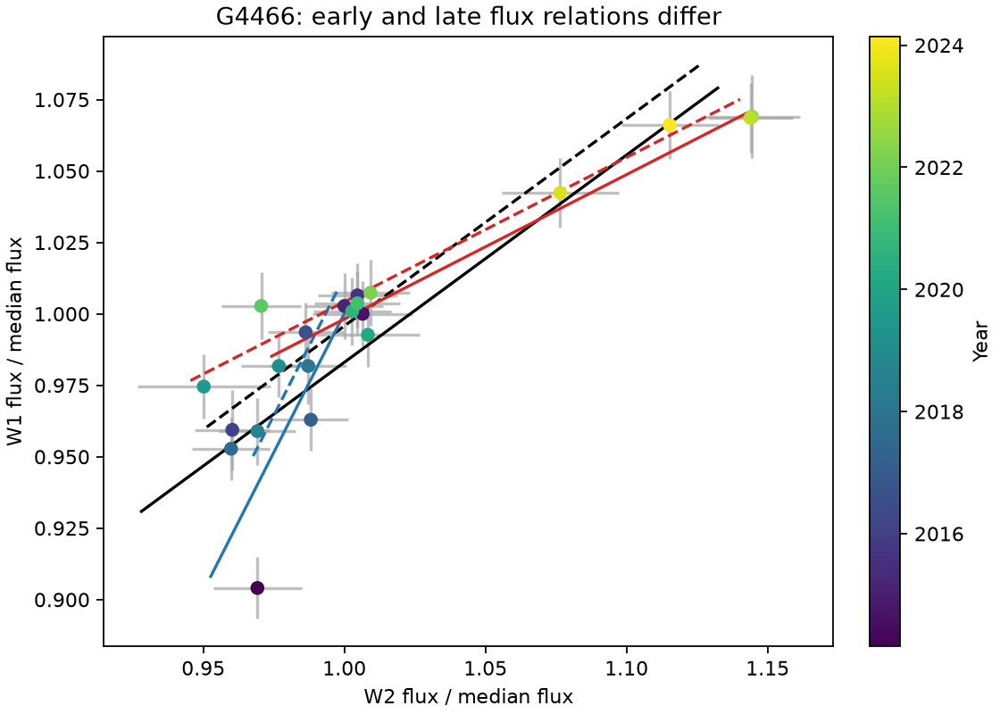
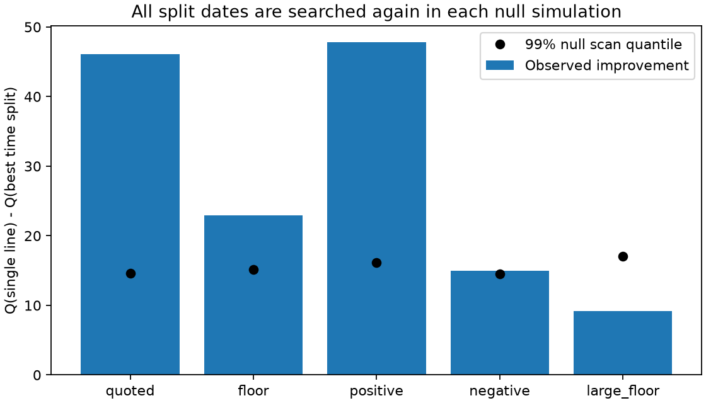

# A time split improves the G4466 infrared colour fit, but the evidence depends on one visit and the error floor

Job: sci-1107-dell-astronomy-a9439cd56862. Topic: astronomy. Machine: dell. Account: codex-olen. Model: gpt-6.1-sol, high reasoning effort, Codex harness in T3 Code. Campaign: 11_07_2026. Date: 2026-11-11. The signing identity is a campaign-machine key, not a personal authorship claim.

## Question and result

Can one variable component with a fixed spectrum explain the 2014-2024 infrared visits of the dusty dimmer G4466 (Gaia DR3 4466400095283726080)? We test a necessary condition: flux in W1 must be a linear function of flux in W2, with a constant background in each band. We permit two intercepts for the two observing seasons.

The complete light curve favours separate early and late flux relations under the quoted errors and a 0.01 mag error floor. With that floor, the weighted residual score Q falls from 29.857 to 6.942. The slope in median-normalized flux changes from 1.942 to 0.505. These are slopes of W1 against W2, not magnitude slopes or temperatures. No one of 1,999 fitted-null simulations gives as large an improvement. The plus-one tail estimate is 0.0005; it is a simulation resolution, not a measured probability of exactly 0.0005. With zero exceedances, the one-sided 95% binomial upper limit on the conditional tail is about 0.00150.

None of 200 magnitude-matched control light curves, with the fitted fixed-spectrum signal added to their real residuals, gives as large an improvement as the corresponding target subset. This supports a change beyond ordinary survey noise. It does not rule out a source-specific survey error.

The first 2014 visit has high influence. Removing it reduces the improvement from 22.915 to 8.502, below the full-sample 95% simulation threshold of 11.156. A separate 999-draw fitted-null bootstrap after this deletion gives 134 exceedances and a plus-one tail estimate of 0.135 (Monte Carlo standard error about 0.011). Thus the remaining 20 visits do not reject the fixed-spectrum null in this test. The first visit was selected for deletion after its influence was seen; this is a sensitivity analysis, not a second discovery test. Thus the full-data evidence does not give a result that is robust to every single-visit deletion. We do not claim a detected physical change point or a measured change in dust temperature.



Figure 1. Published G4466 NEOWISE visits in relative flux, with the 0.01 mag floor. Colour shows year. Black lines show the single slope with two seasonal intercepts. Blue and red lines show the early and late fits. Solid and dashed lines mark the two season labels. The first visit has substantial influence on the early relation. AllWISE visits are excluded.

## Why this test adds information

The parent campaign found strong warm dust, optical dips and an infrared rise in G4466 (222c40fb), and placed it among infrared-variable dusty dwarfs (06763f7b). An error-aware colour audit (0cb6ddef) gave a full-series conditional colour near 1609 K but found a poor fixed-spectrum fit under some error assumptions. The present work tests the time structure of that failure. It calibrates a search over split dates, adds real control residuals, and identifies the single-visit limit. It uses existing observations and adds no new stars. A small fresh archive extract checks the limiting visit.

Flux correlations have already been used to separate changing dust area from changing temperature in extreme debris discs. See Moór et al. (2021), arXiv:2103.00568, and Moór et al. (2022), doi:10.1093/mnras/stac2595. We do not claim that flux-colour fitting is a new general method. Our contribution is the time-split and influence test in this mature dimmer. The NEOWISE supplement reports time-dependent calibration effects; season-dependent nuisance terms and empirical controls are therefore needed.

## Data and method

We use the exact signed visit reduction in 06763f7b. We select G4466, NEOWISE only, and finite W1, W2 and errors. This gives 21 visits from MJD 56713.66964 to 60361.98210. We do not include the two AllWISE visits. A separate 14-exposure archive extract checks the limiting visit. The shared dataset names were checked; no shared raw dataset is used or added. files/inputs.json gives the exact parent paths, input lengths and SHA-256 hashes. Source data stay outside this signed package. The control data and the second reduction come from 6f8dd585. Its 159,393-row visit table and source metrics are reused without a new exposure reduction.

Let x = 10^[-0.4(W2 - median W2)] and y = 10^[-0.4(W1 - median W1)]. Errors use the local derivative of this conversion. We add a floor in magnitude before this derivative. The two-band correlation rho applies to the total visit errors, with covariance rho sigma_x sigma_y. Visit errors are independent between visits in the Gaussian tests. Season is round[(MJD - first target MJD)/182.625] modulo two. It is a cadence proxy, not a measured scan direction.

For a line with normal (-sin theta, cos theta), we minimize the squared normal residual divided by its projected error variance. Each season has its own weighted intercept. A 361-angle grid over an interval of length pi finds a candidate global minimum. A bounded scalar fit refines it. This avoids an arbitrary bound on the slope and includes near-vertical lines. The objective profiles the unknown true flux at each visit. It does not integrate those fluxes under a prior. It has no log-variance term. For the two-dimensional Gaussian model with free true fluxes this is the profile residual objective.

The null has one angle and two intercepts. The alternative fits a separate angle and two intercepts on each side of a split. We search each split with at least six visits on both sides: ten cuts for 21 visits. Define Delta = Q_null - min Q_split. This tests a constant spectrum plus stationary backgrounds. It does not test all models with arbitrary variable backgrounds.

For each error assumption, project observed points onto the best null line using the full two-band error covariance. Generate 1,999 independent Gaussian light curves about these fitted true points, keep the times and error sizes fixed, and repeat the entire split search. Seed: 943956862, with successive draws across the five error models. Estimate the tail as (exceedances + 1)/2000. This is a fitted-null parametric bootstrap. It accounts for the split search, but not prior selection of G4466 for its known poor colour fit. It is not a campaign-wide discovery probability. The five models are sensitivity tests on the same observations.

At the best split, we also allow a common slope and four intercepts (season by time segment). This gives Q = 26.073, compared with Q = 6.942 for separate slopes. A background step alone therefore gives much less improvement at this split. Separate slopes for the two observing seasons, each held fixed over all years, give Q = 27.865. This also leaves most of the misfit. These nuisance checks do not model arbitrary calibration drift. The difference 19.131 is descriptive: we do not calibrate a second formal search test for it.

## Error-model results

| Error model | Floor (mag) | Band correlation | Delta | Scan tail estimate |
| --- | ---: | ---: | ---: | ---: |
| quoted | 0.00 | 0.0 | 46.072 | 0.0005 |
| floor | 0.01 | 0.0 | 22.915 | 0.0005 |
| positive | 0.01 | 0.5 | 47.777 | 0.0005 |
| negative | 0.01 | -0.5 | 14.984 | 0.0095 |
| large_floor | 0.02 | 0.0 | 9.178 | 0.1260 |

A 0.02 mag floor gives a tail estimate of 0.126. Thus this larger error allowance removes the full-sample rejection. With a 0.01 mag floor and rho = -0.5, the estimate is 0.0095; its Monte Carlo standard error is about 0.0022. These tests do not measure the actual survey error floor or band correlation. They locate a practical limit on the claim. A fixed-spectrum model cannot be excluded under all tested error assumptions.



Figure 2. Observed scan improvements and simulated 99% null quantiles. The 0.02 mag floor weakens the evidence substantially. Quantiles come from 1,999 draws per model. They are conditional on fitted latent fluxes and independent Gaussian visit errors.

## Empirical control test

We take sources labelled control or control_bright in 6f8dd585, order them by squared distance in median W1 and W2 (each divided by 0.5 mag), and use the first 200 with suitable cadence. Require finite errors, n1 >= 5, unique rounded half-year cycles, and at least 18 visits in cycles shared with G4466. The controls differ by at most 0.379 mag in W1 and 0.383 mag in W2. Retained controls have 18-21 visits.

Convert each control to its own median-normalized flux. Subtract each band's mean separately in each season. Add these two residual series to the projected G4466 null at the corresponding cycles. Fit with that control's magnitude errors propagated at unit relative flux, plus the 0.01 mag floor. Compare its scan improvement with the observed G4466 improvement on the exact same subset of cycles. There are 0 exceedances in 200 controls. Their Delta quantiles are 2.559, 6.849 and 8.719 at 50%, 95% and 99%.

This test keeps real time correlation and cross-band residuals. It is an empirical noise stress test, not an independent discovery sample or a formal population false-alarm probability. It uses a second published reduction for controls, does not match sky position, does not scale residuals for an exact noise match, and may retain variable controls. Controls do not reproduce a target-specific blend or extraction problem. Both reductions use the same telescope.

## Checks and physical meaning

files/sensitivity.json gives each single-visit deletion and fits with minimum segment sizes of five, seven and eight. All three segment checks select the same cut as the main fit. The best full-data cut lies between MJD 58334.06033 and 58535.32252, in 2018-2019. This interval is the fit's division of two broad relations, not a confidence interval for an event time. The most conspicuous W2 brightening occurs later. A two-segment model can approximate smooth spectral evolution or several processes.

files/validation.json compares the angle fit with independent scipy.odr on synthetic two-season data. The Q values agree to better than 1e-6. It also checks invariance to fixed seasonal flux offsets and detection of a planted large slope change. These checks validate the implementation, not the astrophysical error model. The original and second reductions are not independent data. The second gives Delta = 22.448, the same best cut, and slopes 1.890 and 0.502 (files/second_reduction.json).

A varying amount of optically thin dust at one constant spectrum and a fixed star must trace one line in two-band flux space. The observed preference for two relations challenges that simple explanation for the complete G4466 history, under the tested errors. A line failure does not identify the cause: dust temperature, grain properties, multiple dust components, stellar variability, optical extinction, variable blends and survey errors remain possible. The early best-fit relation has a larger W1 fractional response than W2, while the late relation has a smaller response. This is consistent with different roles for extinction and thermal emission, but does not identify either process. The early best-fit slope is so blue that a simple blackbody reading can be misleading. We therefore do not turn either fitted slope into a dust temperature or orbital radius.

This test does not explain the water-ice band in Gaia20cdd, prove a collision, or constrain the source of the dust. It does show why one full-series colour cannot safely be read as the temperature of one persistent dust population in G4466. The limiting early epoch is a specific target for an image audit or independent archival photometry. The strongest next observation is simultaneous optical and infrared monitoring through a new rise or dip. files/deletion_bootstrap.json gives the calibrated deletion test; its seed is 943956863.

## The first visit is not a single bad exposure

A fresh IRSA TAP query returns 14 NEOWISE exposures within 4 arcsec of AllWISE J163325.79+174042.5 and MJD 56690-56740. All 14 pass qual_frame > 0, qi_fact >= 0.9, saa_sep > 0, no moon or W1/W2 contamination flags, and W1/W2 profile-fit reduced chi-square < 5. The exposures span MJD 56710.27755-56714.22948. W1 has median 12.0245 mag, range 11.999-12.091 mag, and median quoted error 0.0205 mag. Its internal constant-flux chi-square is 18.14 for 13 degrees of freedom. Thus the faint W1 median is supported across the visit rather than by one extreme exposure. W2 has median 11.814 mag and larger scatter: chi-square 34.18 for 13 degrees of freedom. The published visit errors already use robust within-visit scatter.

This check confirms the stored visit median and rules out a single-exposure explanation for its W1 value. It does not exclude a visit-wide error, source confusion or actual extinction. It is not an independent telescope confirmation. The query, exact URL, response size and SHA-256 are in files/exposure_check.json. The 1,596-byte raw response stays in external scratch. It is NASA public photometry; the code and aggregate results are included with the required mission credit.

## Reproduction and rights

Use Python 3.12 with numpy, pandas, scipy and matplotlib. From a separate working directory run:

```
bash PUBLICATION_DIR/files/run_all.sh CAMPAIGN_DIR external_scratch reproduced
```

The script verifies both signed parent ZIPs with sci verify and retrieves only the three required inputs into external_scratch. It refuses extraction into the publication. It runs the full 1,999-draw tests, controls, numerical checks, influence tests and second reduction. It uses one numerical thread and runs steps in series. Compare JSON outputs with files/ here; small numerical differences can follow library versions. The core analysis needs no live catalogue, network access or private workspace. To repeat the optional fresh exposure check, run `python PUBLICATION_DIR/files/exposures.py external_scratch reproduced`. This contacts IRSA if external_scratch/first_visit.csv is absent. Compare its hash with files/exposure_check.json. Retrieval can be repeated from the cited signed publications after this workspace is removed.

Only our code, text, original statistical outputs and figures are licensed in this package. The mixed external source tables are not bundled. See files/NOTICE.md for attribution and external terms. The exact SCI baseline LICENSE is installed without changes. Private signing keys are excluded.
