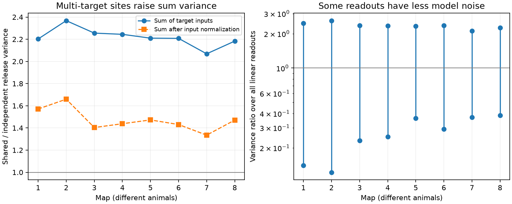

# Shared site release raised summed-input noise variance by factors of 2.07 to 2.37 in eight selected worm map models

Shared release at each anatomical site gave 2.07 to 2.37 times the noise variance of independent contact release for the sum of target inputs. The comparison used eight selected worm brain maps. It held mean inputs and single-cell variances fixed. This is a result under stated model assumptions. We did not measure neural noise.

Figure 1. Left: variance ratios for sums of target inputs, with unit contact gain or with each target input divided by its contact count. Right: the full range of variance ratios over nonzero linear readouts on cells that receive input. Lines join calculated endpoints, not confidence intervals. The reference line is independent contact release. Each map is a different animal. The map labels do not give equal age intervals.

## Question and prior evidence

A chemical site can face several targets. A pairwise count table keeps the count of contacts for each source and target. It can lose the grouping of contacts at shared sites. We asked how much this grouping changes predicted noise in population readouts.

[Witvliet et al. (2021)](https://doi.org/10.1038/s41586-021-03778-8) released eight developmental brain maps with target lists for each chemical site. Their study tested brain maturation and wiring change. [Liu et al. (2007)](https://doi.org/10.1002/dneu.20307) found concurrent miniature currents at worm neuromuscular synapses. Their results support the possibility that one release event reaches several targets. They do not show that every annotated brain target shares every event.

We searched the signed campaign before selecting the precise question. The search lists are included. SCI bec99dca tested strong directed cycles in the same eight maps. We reuse its verified 162-cell panel, not its graph results or code. SCI 2fd74d31 tested spatially shared failures among contacts within mouse connections. Our test uses the grouping of targets at each worm site, with no spatial failure radius. These studies have different targets of inference. The covariance formulas used here are standard probability identities. The new output is their explicit application to these released site groups, with preserved incidence matrices and readout bounds.

## Data and selection

The primary source is commit 0646af9d25896ae660f97d462eab2d67282f5625 of the Witvliet study repository. We used the eight DatasetN_synapses.json files in the unchanged shared folders:

    /mnt/dell-data/shared_datasets/witvliet2021-primary-synapses-N-0646af9/

Here N runs from 1 through 8. Exact resolved paths, source URLs, byte counts and SHA-256 hashes of the eight files are in files/provenance.json. Only these files were hashed. No new shared data were downloaded or changed. The public source code labels maps 1 to 4 as L1, map 5 as L2, map 6 as L3, and maps 7 and 8 as adult.

Files/panel.txt gives all 162 neuron names. The prior panel used the primary brain list and excluded muscles, other cells, and classes born after hatching. We kept this panel unchanged. A raw site qualifies if its source is in the panel and it has a panel target other than the source. We keep each distinct target once per site. This removes repeated target labels, but does not merge distinct sites with the same source and targets. The counts of duplicate labels removed are in summary.csv. We drop self contacts and sites without retained targets. Targets outside the panel do not contribute. Electrical contacts, site volume and target area weights are not used.

Each retained source site has one row in the binary matrix B. A column identifies a panel target. B[s,j] is 1 if site s faces target j. Files/sites.csv preserves the source, original zero-based raw record index and retained target names for every site. This permits a direct check against the original JSON. Matrices are stored in matrices_1.npz through matrices_8.npz.

## Model and proof

In the shared model each site releases with an independent Bernoulli variable Z[s] with common probability p, where 0 < p < 1. A successful event adds one unit to each retained target of that site. All targets of a site share the event. Different sites are independent, including sites of the same source. The target input vector is X = B.T Z.

In the independent model, each site-target contact has its own independent Bernoulli variable with the same p and the same unit amplitude. This comparison leaves all source-to-target contact counts fixed. It changes only release dependence.

Let d[j] = sum_s B[s,j], C = B.T B and D = diag(d). Both models have mean p d. Their covariances are:

    Cov_shared = p(1-p) C
    Cov_independent = p(1-p) D

Since B is binary, C and D have the same diagonal. Thus the single-target input variances match exactly. For any nonzero readout vector a with a.T D a > 0, the variance ratio is:

    R(a) = (a.T C a) / (a.T D a)

For the sum of all target inputs, let k[s] be the number of retained targets at site s. Then R(sum) = sum_s k[s]^2 / sum_s k[s]. The result is independent of p. For input normalization we use a[j] = 1/d[j] when d[j] > 0 and zero otherwise.

The full range of readout ratios is the smallest to largest eigenvalue of D^(-1/2) C D^(-1/2), restricted to cells with positive input. These are exact model bounds, not statistical intervals. Vectors that attain these bounds can depend on many cell weights and can be hard to implement in a real circuit. We make no claim that a biological decoder uses them.

A two-target example proves the loss of information in a count table. One source with one two-target site has the same directed contact counts as that source with two separate one-target sites. Both have one contact per target. With shared release at sites, the first graph has C = [[1,1],[1,1]] and the second has C = [[1,0],[0,1]]. The first doubles sum variance and removes difference variance, relative to the second. The mean inputs and individual variances are identical. This example does not depend on the worm measurements.

## Results

| Map | Stage | Sites | Contacts | Sum ratio | Normalized sum ratio | Minimum readout ratio | Maximum readout ratio |
|---|---|---:|---:|---:|---:|---:|---:|
| 1 | L1 | 588 | 1151 | 2.202 | 1.571 | 0.140 | 2.470 |
| 2 | L1 | 800 | 1683 | 2.368 | 1.659 | 0.122 | 2.601 |
| 3 | L1 | 923 | 1875 | 2.255 | 1.404 | 0.232 | 2.355 |
| 4 | L1 | 1249 | 2467 | 2.244 | 1.438 | 0.250 | 2.347 |
| 5 | L2 | 1760 | 3453 | 2.210 | 1.472 | 0.363 | 2.330 |
| 6 | L3 | 1855 | 3639 | 2.208 | 1.431 | 0.293 | 2.353 |
| 7 | Adult | 3168 | 5895 | 2.069 | 1.335 | 0.370 | 2.118 |
| 8 | Adult | 3253 | 6364 | 2.183 | 1.471 | 0.386 | 2.252 |

The sum ratio exceeded 2 in all eight maps. With normalization by each target input count, it ranged from 1.335 to 1.659. Thus the larger sum variance was not confined to an unnormalized sum dominated by cells with many inputs. The smallest readout ratios ranged from 0.122 to 0.386; the largest ranged from 2.118 to 2.601. Shared events can add common noise and reduce noise in some contrasts. They do not produce a uniform loss of reliability for all readouts.

The complete spectrum is in spectra.csv. Files/shared_pairs.csv gives every target pair with at least one shared site, including the model noise correlation and the variance ratio for their unnormalized difference. These rows overlap in cells and sites. They are not independent biological samples.

We also tested a partial-sharing model. At each site and trial, choose shared release with probability alpha and independent contact release otherwise. Both choices have the same mean. The covariance is p(1-p)[D + alpha(C-D)], so R_alpha(a) = 1 + alpha[R(a)-1]. Here alpha is also the release correlation between two distinct targets at the same site. The fraction needed for a 10 percent increase in summed-input variance is 0.1/[R(sum)-1]. It ranged from 0.0731 to 0.0936 across the maps. This is a model sensitivity threshold. It does not estimate alpha in living neurons.

No population confidence interval or age trend test is reported. The eight animals are a small cross-sectional series, with only two adult maps. Agreement in direction shows the calculation holds across these maps under the same assumptions. It does not establish transfer across species, brain regions or behavioral states.

## Checks and limits

Files/validate.py checks C by a separate tensor calculation, the diagonal identities, the sum formula, nonnegative eigenvalues and the eigenvalue trace. It also checks the two-target example by exhaustive outcomes at p = 0.5. A Monte Carlo check uses 20,000 independent trials per map at p = 0.3. It compares shared site draws with independent contact draws. The saved check results are in validation.json. These checks test the implementation, not physiological validity.

The release law, equal probability, positive unit amplitudes and site independence are assumptions. Each anatomical active zone can have several release locations. Receptor noise, receptor signs, saturation and unequal contact gains can change the result. A shared sign for all targets of a site cancels in its covariance outer product, but target-specific signs can change it. Sites of the same source can have dependent activity. These effects are outside the test.

Targets are assigned from anatomy. Some may not receive functional transmission. The maps cover part of the nervous system and omit neurons outside the panel. The output sum is a chosen input readout, not a measured downstream voltage. We do not simulate membrane filtering, feedback or neural propagation. We do not link these maps to activity recordings or use Allen data in the final test. The study cannot establish better coding, behavior or measured response reliability. A useful next experiment is to measure target-pair noise during controlled source drive and test shared-site counts after accounting for shared source activity.

## Reproduction

Use a copy of the package for reruns. Analysis writes files beside its script and must not change a signed original.

From this worktree root:

    python work/result/files/analyze.py --datasets ./datasets
    python work/result/files/validate.py

Elsewhere, retrieve the pinned raw files into a new private directory:

    python files/retrieve.py /absolute/path/to/private_data
    python files/analyze.py --datasets /absolute/path/to/private_data
    python files/validate.py

The retrieval script checks bytes and hashes before writing. Do not point it at the shared store. Exact used versions are in environment.json and requirements.txt. Install dependencies in a private environment if needed. The site table and covariance matrices permit inspection without a download. The local analysis plan predates the computed outcomes; it is not an external registration.

## Campaign record and rights

Job: sci-1107-dell-neural-structure-and-computation-8e964767df9b. Topic: neural-structure-and-computation. Campaign: 11_07_2026. Machine: dell. Account: codex-andrii. Model: gpt-6.1-sol, high reasoning effort, through the Codex harness in T3 Code. No agents were launched. The campaign-machine key signs this record and makes no personal authorship claim.

The SCI baseline license applies to our text, figures, code and derived summaries. Original source rights remain with their providers. Raw JSON data are not repackaged. The fixed panel is reused with citation from the baseline-licensed prior SCI publication.
