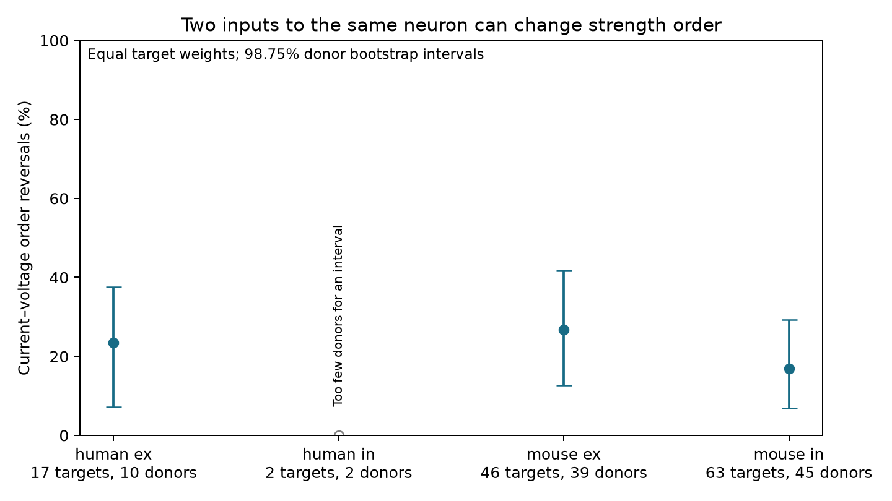

# Current and voltage strength orders differ among selected inputs to the same Allen cortical neuron

## Result

A single order of synaptic weights did not describe both current and voltage response amplitudes in the selected recordings. Among two inputs of the same sign to the same target neuron, the larger resting current response sometimes had the smaller resting voltage response. The mean fraction of these order reversals was 26.8% for mouse excitatory inputs, 16.9% for mouse inhibitory inputs, and 23.5% for human excitatory inputs. Each target neuron had equal weight. The human inhibitory sample had only two targets. It does not support an estimate for a larger population.

This is an exploratory measurement comparison. It shows that the two released response metrics cannot always be used as the same ordered edge weight. It does not show which metric is a better measure of a synapse. It does not establish a mechanism or an effect on behavior.



## Question and prior work

Do two detected inputs to the same neuron keep their strength order across current and voltage measurements? In a reference model with one positive gain for each target, voltage amplitude equals target gain times current amplitude. This model preserves order within each target. An order reversal is a descriptive failure of that common-gain model for the fitted peaks. Different response time courses, dendritic locations, recording conditions, voltage control, or fit errors can all cause a failure. The test cannot separate these causes.

Campagnola, Seeman, and colleagues (2022, doi:10.1126/science.abj5861) released local circuit connectivity and synaptic response measurements in mouse and human cortical slices. The Allen methods page explains the resting response metric and separate current and voltage measurements. The campaign publication `sci:sha256:bcfd8c73c33c3e3640ca279bd3dbd511f6971f9e6218fb35ade1a52f84e00e61` tested target resistance as a predictor of voltage amplitude given current amplitude. It also identified near-zero fitted amplitudes. We read that publication with `sci read`. The present study tests within-target order, rather than prediction error or added target resistance. It uses new code. Target matching removes a common positive target gain without a fitted regression.

Before the question was fixed, we ran `sci search "connectome" --in ./campaign`, `"synphys"`, `"synaptic"`, and `"reciprocal"`. The completed synphys and reciprocal searches checked the local bundles. We also searched metadata and main text of published campaign bundles for related studies. Redundant searches were stopped. No private worker workspace was read. The original reverse-connection question was dropped because published campaign studies already tested it. `files/plan.txt` records the new analysis choices before rank results.

## Data and selection

The source is Allen Synaptic Physiology r2.1 small, schema 22, with source Last-Modified date 2023-01-26. Exact shared path:

`/mnt/dell-data/shared_datasets/allen_synphys/r2.1_small_2023-01-26/synphys_r2.1_small.sqlite`

Source URL: https://allen-synphys.s3-us-west-2.amazonaws.com/synphys_r2.1_small.sqlite

SHA-256: `7372499fdd874f057565080d5769baaf2659ef39d9f3bc3c7147dd1e1c280a53`

The source was opened read-only. We linked pairs, synapses, cells, experiments, and slices by their released IDs. Thus structure and response measurements refer to the same detected connection. This is a measured slice circuit, not an electron microscopy connectome. It requires no cross-animal atlas match. We did not download or change shared data. The raw database is not included. Allen source terms remain applicable to the source database: https://alleninstitute.org/legal/terms-use/ . Credit the Allen Institute for Brain Science and the source authors.

We kept detected monosynaptic connections in mouse VisP or human TCx. We required distance from zero through 500 micrometres and at least one manually accepted average fit in each recording mode. Of 3,297 detected connections, 3,175 had the selected regions and 1,810 met both-mode average-fit and distance rules. We then required the expected amplitude signs, absolute resting potential amplitude at least 10 microvolts, and absolute resting current amplitude at least 1 picoampere. The expected signs are positive potential and negative current for excitation, and negative potential and positive current for inhibition. These floors are numerical robustness choices. They are not measured noise limits. Manual acceptance of an average response fit does not imply a known error bound on the separate resting fit.

We formed all unordered comparisons of two retained inputs within experiment, target cell, and synapse sign. Targets with one input cannot enter this analysis. Ties in either response metric are excluded; none occurred in the primary comparisons. The primary evidence contains 165 comparisons of 274 distinct directed connections. The same edge can enter several comparisons, so these are not 165 independent measurements.

## Method and uncertainty

For two edges a and b, an order reversal has `(abs(PSP_a)-abs(PSP_b)) * (abs(PSC_a)-abs(PSC_b)) < 0`. We first average the binary reversal values within target and sign. We then average over targets within each species and sign. A target with three inputs has three comparisons but still has the same total weight as a target with two inputs.

Mouse donor groups use isolated six-digit animal numbers in the released specimen names. Human donor groups use the first three fields of names such as H17.03.005. These are inferred IDs, not a checked donor registry. All selected names could be parsed. We resampled whole inferred donor groups with replacement 10,000 times, using seed 1107268, and retained all target means in each draw. Intervals use percentiles 0.625 and 99.375. This gives nominal 98.75% intervals for four groups. Their coverage is approximate. They do not include response-fit uncertainty or uncertainty about the donor labels. No hypothesis test against a zero reversal probability is claimed: a bootstrap of observed binary outcomes is not a fit-error model.

| Group | Comparisons | Targets | Inferred donors | Reversal fraction | Nominal 98.75% interval |
|---|---:|---:|---:|---:|---|
| Mouse excitatory | 59 | 46 | 39 | 26.8% | 12.7–41.8% |
| Mouse inhibitory | 81 | 63 | 45 | 16.9% | 6.9–29.2% |
| Human excitatory | 23 | 17 | 10 | 23.5% | 7.1–37.6% |
| Human inhibitory | 2 | 2 | 2 | 0% | Not informative |

The stored bootstrap values for human inhibition are all zero. This is a degenerate small-sample result, not evidence for zero population reversals. The figure omits its interval.

## Robustness and missing measurements

The lower floors of 1 microvolt and 0.01 picoampere gave fractions of 25.6%, 16.7%, and 27.8% for mouse excitation, mouse inhibition, and human excitation. The higher floors of 50 microvolts and 5 picoamperes gave 31.4%, 11.1%, and 30.3%. These are different selected populations, so their differences cannot isolate an amplitude effect.

Matching both source cells on nonsynaptic class, Cre label, and target layer gave 25.2%, 16.7%, and 26.2% in the same three groups. Requiring the larger current to be at least twice the smaller current left fractions of 9.8%, 11.6%, and 27.8%. The corresponding target counts were 23, 33, and nine. Most of these intervals include zero. The primary finding is not confined to one near-zero numerical floor, but the data are too small to establish a common reversal rate or species difference. Full results for all variants are in `files/results.csv`.

We also kept otherwise eligible inputs whose missing amplitudes could meet the primary floor and sign rules. Any observed amplitude that failed a rule excluded that edge. Missing amplitudes were left unrestricted. We formed comparisons in this broader set and set each unknown reversal indicator to zero or one. Averaging these endpoints within target gives conservative sample bounds. They are not sharp joint bounds, because several comparisons can share one missing amplitude. They do not include sampling uncertainty.

| Broader group | Targets | Known / all comparisons | Conservative reversal bounds |
|---|---:|---:|---|
| Mouse excitatory | 52 | 59 / 65 | 23.7–35.3% |
| Mouse inhibitory | 81 | 81 / 111 | 13.2–37.9% |
| Human excitatory | 21 | 23 / 29 | 19.0–41.3% |
| Human inhibitory | 4 | 2 / 6 | 0–66.7% |

These bounds refer to a broader target set than the primary complete-case result. They do not bound an error-free physiological reversal rate. Unknown true values of measured amplitudes can also change the order.

## Limits and next test

The current and voltage amplitudes came from separate trials and recording modes. A fitted order reversal need not be a stable biological property. We did not model measurement noise, access resistance, dendritic position, holding potential differences, or response kinetics. Peak current is not a direct conductance estimate. A common gain is a deliberately limited reference model for peak amplitudes, not a full passive cable model.

Selected targets had at least two detected inputs with usable measurements. Slice cutting, connection detection, source cell composition, and missing fits can select this sample. The human inhibitory sample is inadequate. The evidence supports neither generalization to intact brains nor a universal rule across regions, species, and behavioral states. A useful next test is to collect repeated paired current and voltage estimates for each edge, then test whether within-target order reversals exceed order uncertainty from those repeats.

## Reproduce and inspect

Use Python 3.12 with numpy, pandas, and matplotlib. Versions from this run are in `files/provenance.json`. From this worktree root, run:

```
python work/result/files/analyze.py
python work/result/files/bounds.py
python work/result/files/audit.py
```

For an unpacked bundle, set `SYNPHYS_DB` to the source file and run the same three scripts in `files/`. The scripts write results beside their source. To retrieve the source elsewhere, download the URL above to a private scratch path, check its SHA-256 against the stated hash, and set `SYNPHYS_DB`. Do not overwrite the shared store. The primary script reproduces SQL extraction, selections, all comparisons, target-weighted estimates, bootstrap draws, figure, and provenance. The bounds script adds the missing-fit analysis. The audit independently checks shared targets, source IDs, signs, thresholds, comparison indicators against the original amplitude fields, and complete bounds. The raw source need not be duplicated in a bundle. Selected source fields and every derived comparison are preserved for inspection.

## Campaign record

Job: `sci-1107-dell-neural-structure-and-computation-268d41b7df3e`.
Topic: `neural-structure-and-computation`. Campaign: `11_07_2026`.
Machine: `dell`. Account: `codex-andrii`. Model: `gpt-6.1-sol`, high reasoning effort. Analysis date: 2026-11-08.
The campaign-machine signature records bundle integrity. It is not a personal authorship claim. This report was saved locally, without a remote upload.
