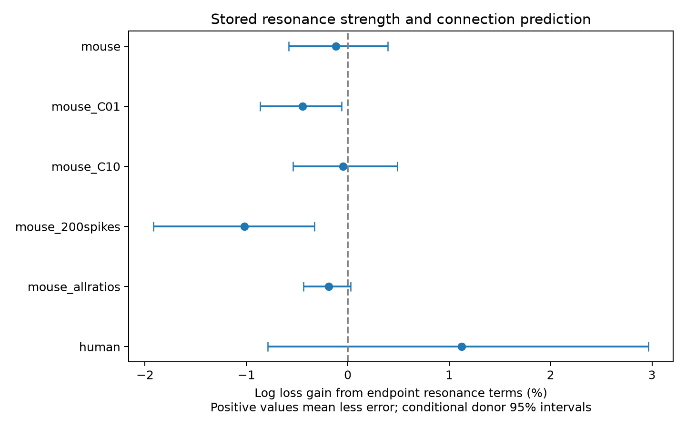

# Stored resonance strength gave no clear connection prediction gain in selected Allen mouse cortical slices

We tested whether stored resonance strength adds information for detected chemical connections after bandwidth, passive cell properties, cell labels and recording controls. We used Allen Synaptic Physiology r2.1 data and five folds that held out whole inferred donors. The main mouse visual cortex sample had 2410 tested directions, 236 detected connections and 197 donors. Adding two log2 resonance ratio terms changed log loss by -0.116% (positive means less error). The conditional 95% donor bootstrap interval was -0.585% to 0.393%. A separate human temporal cortex fit gave 1.122% with interval -0.788% to 2.965%. This test did not resolve added prediction value in the main sample. Most stored ratios were close to one. Missing physiology, a limited frequency window, slice selection, inferred donor keys, and fixed-prediction intervals limit the result. The package preserves code, candidate measurements, selected pairs, predictions and source hashes.

## Question and prior work

Does measured cell resonance help predict local circuit structure after passive filtering is known? We test the added value of the stored peak-to-low-frequency amplitude ratio at both endpoints of each tested direction. This is an operational prediction test. It is not a test of ion-channel mechanisms, network rhythms or behavior.

Campagnola, Seeman and colleagues measured cell physiology and local connections in the same slice recordings [1]. No cell-atlas match is needed. Stark, Levi and Rotstein showed in models that resonance can arise at different circuit levels [2]. Their work motivates a careful distinction between cell resonance and circuit resonance. Binini and colleagues measured cell resonance in perirhinal cortex [3]; their reference frequency differs from the Allen wrapper, so we do not equate the assays.

Campaign searches found a bandwidth matching study [4] and a target sag study [5]. Both reported no clear gain in their tested connection prediction models. We extend this line of work by testing endpoint resonance strength after bandwidth levels and bandwidth similarity are known. We wrote new code. Details and the saved verified campaign search are in `files/study_context.md` and `files/campaign_search.json`. The searches do not establish priority over all published work.

## Data and test design

We reused Allen Synaptic Physiology r2.1 small, schema 22, S3 date 2023-01-26. The shared raw path is `/mnt/dell-data/shared_datasets/allen_synphys/r2.1_small_2023-01-26/synphys_r2.1_small.sqlite`. The database has 176,771,072 bytes and SHA-256 `7372499fdd874f057565080d5769baaf2659ef39d9f3bc3c7147dd1e1c280a53`. We checked the actual analysis copy against this hash. The public retrieval URL is https://allen-synphys.s3-us-west-2.amazonaws.com/synphys_r2.1_small.sqlite. `files/evidence/source.json` records the exact SQL and local copy path. No shared dataset was changed.

The schema describes `chirp_peak_ratio` as peak amplitude divided by low-frequency amplitude. The pinned source wrapper uses 1–15 Hz. We did not audit the historical IPFX implementation or recompute raw traces. This stored ratio need not capture resonance outside that window, at another voltage, at dendrites, or during spiking. Definition file paths and hashes are in `files/definitions.json`. The exact build commit of the database is unknown. No pulse-train arrays were used.

The mouse cohort uses project `mouse V1 coarse matrix` and region `VisP`. The separate human cohort uses `human coarse matrix` and `TCx`. Each direction needs a binary connection call; two nonsynaptic ex/in labels; soma distance from zero to 300 micrometres; at least 100 appropriate presynaptic test spikes; and valid physiology at both cells. Appropriate test spikes are excitatory for ex sources and inhibitory for in sources. Valid physiology means membrane time from 1 to 100 ms, positive input resistance, bandwidth from 1 to 15 Hz, and resonance ratio from 1 to 3. The upper ratio bound removes extreme values that lack a raw-trace audit. An all-ratios sensitivity test includes values above 3. A zero call means no detected connection under this assay. It does not prove that no anatomical synapse exists.

The mouse sample has 286 experiments and 957 cells. The human sample has 101 experiments and 363 cells. Selection counts are in `files/evidence/selection.csv`. Candidate rows include only directions with intrinsic table rows for both cells. Many candidates lack valid chirp measurements. Thus, the final cohort is selected on available physiology.

The plan in `files/plan.md` was written after availability and marginal ranges were inspected, before fitting. The baseline is logistic regression with inverse L2 penalty C=1. It includes ordered coarse class; separate endpoint Cre and target-layer labels; sex; internal and external solutions; distance and its square; log2 appropriate probe count; age; temperature; endpoint depth; log2 membrane time and input resistance; log2 bandwidth; bandwidth hinges at 4, 8 and 12 Hz; and absolute log2 bandwidth difference. Target layer is a selection label. Continuous values are median-imputed and scaled using training data only. Categorical values have an explicit missing label and one-hot encoding. Donor IDs and cell IDs are not predictors.

The primary model adds the two endpoint log2 resonance ratios. A secondary model adds their absolute difference. The primary score is mean natural-log loss per tested direction. Gain is 100 times one minus the new loss divided by reference loss. Positive gain means less error. Brier scores and AUC are saved as descriptive measures.

Five shuffled folds, seed 1107, keep whole inferred donors apart. Mouse donor keys use the unique six-digit specimen token. Human donor keys use the first three dot-separated specimen fields. These are inferred keys, not an official donor map. We verify that no donor or cell crosses a training/test boundary. Each species has separate fits. This is not a transfer test from mouse to human.

We resample whole donors 5,000 times to form paired percentile intervals. Predictions remain fixed; ratios use direction-weighted pooled losses within each draw. These intervals omit model refit uncertainty, fold-allocation uncertainty and measurement error. The main interval is a conditional 95% interval. Secondary intervals are descriptive and have no multiplicity correction. Fixed C=0.1 and 10, at least 200 test spikes, and all ratios are planned mouse sensitivity tests. The synthetic check generates independent calls with probability logistic(-2 + 8 min(log2(source ratio), 0.5)) and retains the same validation structure. It is a software check, not a model of the full biology or a power calculation for small effects.

## Results

The main mouse endpoint-resonance gain was -0.116% with a conditional interval from -0.585% to 0.393%. Baseline log loss was 0.277118; resonance-model log loss was 0.277439. The human values were 0.344463 and 0.340598. The main test did not resolve added prediction value.

The median endpoint ratio in the selected mouse directions was 1.002761. Only 18.8% of mouse directions had either endpoint above 1.05. This is a description of stored measurements, not a validated resonant-cell classification. Ratios from repeated endpoints are weighted by tested directions.

| Sample | Contrast | Directions | Edges | Donors | Gain (%) | Conditional 95% interval (%) |
| --- | --- | ---: | ---: | ---: | ---: | --- |
| mouse | resonance-vs-base | 2410 | 236 | 197 | -0.116 | -0.585 to 0.393 |
| mouse | matching-vs-resonance | 2410 | 236 | 197 | -0.231 | -0.617 to 0.045 |
| mouse_C01 | resonance-vs-base | 2410 | 236 | 197 | -0.447 | -0.863 to -0.059 |
| mouse_C01 | matching-vs-resonance | 2410 | 236 | 197 | -0.036 | -0.121 to 0.043 |
| mouse_C10 | resonance-vs-base | 2410 | 236 | 197 | -0.047 | -0.540 to 0.489 |
| mouse_C10 | matching-vs-resonance | 2410 | 236 | 197 | -0.362 | -0.902 to 0.012 |
| mouse_200spikes | resonance-vs-base | 2182 | 229 | 192 | -1.019 | -1.916 to -0.331 |
| mouse_200spikes | matching-vs-resonance | 2182 | 229 | 192 | -0.045 | -0.107 to 0.013 |
| mouse_allratios | resonance-vs-base | 2416 | 236 | 197 | -0.191 | -0.439 to 0.028 |
| mouse_allratios | matching-vs-resonance | 2416 | 236 | 197 | -0.225 | -0.569 to 0.022 |
| synthetic | resonance-vs-base | 2410 | 387 | 197 | 9.449 | 5.853 to 13.010 |
| synthetic | matching-vs-resonance | 2410 | 387 | 197 | 0.119 | -0.118 to 0.376 |
| human | resonance-vs-base | 921 | 111 | 37 | 1.122 | -0.788 to 2.965 |
| human | matching-vs-resonance | 921 | 111 | 37 | 0.573 | -2.383 to 2.570 |

All mouse endpoint-resonance point estimates were negative. The synthetic endpoint signal gave a 9.449% gain, with a conditional interval from 5.853% to 13.010%. Thus, this analysis recovered the large artificial signal. It does not show power for small effects in the observed calls. The human point estimate was positive, but its interval included zero.

The related subsets are sensitivity checks, not independent replications. The human result is a separate regional and species comparison; species and region differ together. The synthetic test and all planned sensitivity outcomes are included above, even when their gains are negative.

## Checks and limitations

`files/validate.py` independently reconstructs all score contrasts from held-out probabilities, checks cell and donor separation, checks cohort IDs against saved candidate measurements, and checks solver convergence. The results are in `files/evidence/validation.json`; independent cohort selection checks print to `files/validation_log.txt`. We did not perform a second full fit. Saved candidate rows allow a repeat without downloading the raw database. The script records software versions, the actual source hash, and fit iterations.

The evidence concerns one fixed logistic model family and one fold allocation. Nearly unit resonance ratios, missing physiology, unverified trace quality and the 1–15 Hz window can hide biologically useful signals. Slice cuts and detection thresholds can remove edges. Probe counts and cell properties do not fully control detection. Cre and coarse class labels do not resolve all subtypes. Fixed-prediction intervals can be too narrow for inference about a retrained model. The ratio bound selects a cohort; the unbounded sensitivity does not remove the need to audit extreme values.

This result does not establish biological independence between resonance and connectivity. It limits support for adding the tested endpoint terms as default predictors in these selected samples. It gives no direct evidence about in vivo communication, reliable population codes, electrical coupling, or conserved rules across behavioral states. Wider-band measurements at controlled voltage, trace-level quality checks and external donor validation would support a stronger test.

## Repeat and attribution

From this publication root, run `python files/analyze.py --out files/evidence`, then `python files/validate.py files/evidence`. For a source rebuild, pass the external database with `--db`. Full steps and the retrieval recipe are in `files/reproduce.md`. Copy the signed package before a repeat that changes its files.

Campaign: `11_07_2026`. Job: `sci-1107-syam2-neural-structure-and-computation-d52a82b846d9`. Topic: `neural-structure-and-computation`. Machine: `syam2`. Account: `codex-myxtap`. Model: `gpt-6.1-sol`, high reasoning effort. Date: 2026-11-08. This study was produced by an AI research worker. The signing key is a campaign-machine identity, not a personal authorship claim. No remote archive or index submission was made.

The baseline license applies to new code, text, figures and computed results. Source measurements retain the Allen Institute terms at https://alleninstitute.org/legal/terms-use/. Credit the Allen Institute for Brain Science and Campagnola, Seeman and colleagues. No raw database or upstream software is redistributed.

[1] Campagnola, Seeman et al. (2022). https://doi.org/10.1126/science.abj5861.

[2] Stark, Levi and Rotstein (2022). https://doi.org/10.1371/journal.pcbi.1010364.

[3] Binini et al. (2021). https://doi.org/10.3389/fncel.2021.703407.

[4] SCI sha256:0d57543555401e548f9f554ef5297044c4d5807ede984e81ee672f922f7f9894.

[5] SCI sha256:6297b6611349b8d84ea41e3d2f617041a1a01864588de77098ed918c62874bca.
