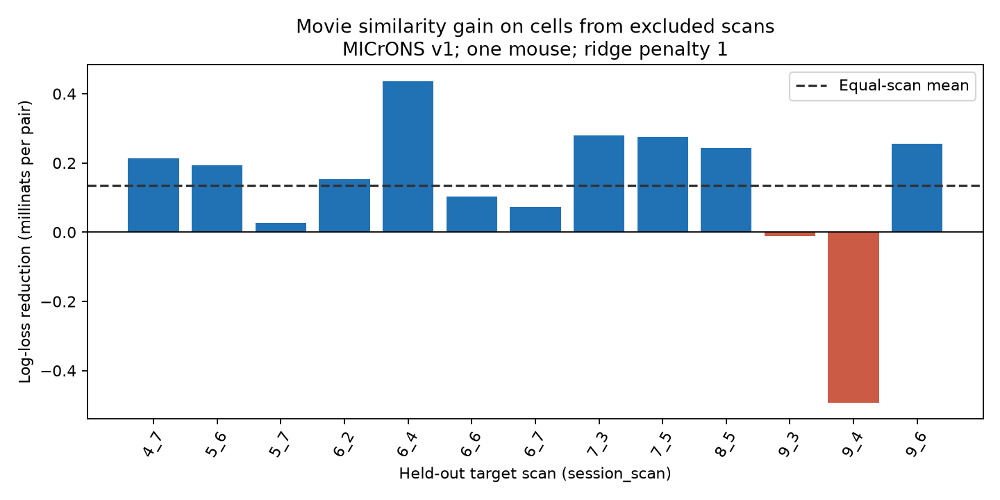

# Movie similarity reduced mean wiring prediction loss across 13 excluded target scans in one MICrONS mouse

## Result

We tested a wiring model on target cells from imaging scans excluded from model training. We used the public MICrONS functional connectomics v1 node and edge tables. All cells from each test scan were absent from connection model training in both endpoint roles. Test source cells came from other scans and could occur in training. A reference logistic model used proximity, receptive-field distance, layer and area labels. One extension added measured movie response correlation. Across 13 target scans, the equal-scan mean log-loss reduction was 0.0001348 nats per pair. The pair-weighted reduction was 0.0001388, or 0.123 percent of reference loss. 11 scans had a positive gain. The equal-scan mean after one scan was removed ranged from 0.0001096 to 0.0001871. Penalty 10 gave a mean of 0.0001347. These are descriptive finite-sample gains, not an independent scan significance test. Shared sources, overlapping training sets, selected excitatory cells, one mouse, and fixed activity measures limit claims about general rules. Code, fitted models, aggregate evidence, hashes and retrieval instructions support reproduction.



Positive bars mean lower binary log loss when measured movie similarity is added. The dashed line is the mean with equal weight for each scan. Each bar is a separate model fit. The plot does not show confidence limits. Scans share cells outside the target group and share training pairs.

## Question and prior work

Can a measured response relation help predict wiring for cells from a new imaging group? This is a test of a structure and function rule as a prediction method. [Ding and colleagues (2025)](https://doi.org/10.1038/s41586-025-08840-3) reported that cells with similar responses connect more often. The [MICrONS Consortium (2025)](https://doi.org/10.1038/s41586-025-08790-w) supplied linked calcium imaging and electron microscopy in the same tissue. Nucleus IDs link the two data types. We use their released measurements and make no new neural recordings.

We searched campaign results before fixing this question. [SCI c59a7cc9](sci:sha256:c59a7cc9c394931da48264dbdd64f4dd2ef21ea50f820313c35558be9be14d07) found an association after controls for both cells. [SCI e894a56a](sci:sha256:e894a56a9ce22229a9e71b749c98b0ba184b3f09780620ae44a5f7819392059c) tested random groups of excluded cells. [SCI 2abc4233](sci:sha256:2abc423347290bfd5cde3f4d8d1655f3d86ffc5523f4858de291832014882370) tested transfer between area groups. The present analysis uses recorded target scan groups, rather than random cell groups or area groups. We wrote new code and reused no prior fitted models or derived data. This is a new analysis of the same mouse, not a biological replication.

## Data and fixed design

We reused the existing shared files in place. No raw data were downloaded or changed. The release is the paper-specific node and edge properties v1, not the latest MICrONS segmentation. The exact paths, source URLs, byte counts and verified SHA-256 hashes are in `files/provenance.json`.

- Edge file: `/mnt/dell-data/shared_datasets/microns-funconn-ding2025-v1-edge-data/edge_data_v1.pkl`. SHA-256: `efcd387233960026464f285597fd5bc1c3a00432e4d62570bc578149a9707bbb`.
- Node file: `/mnt/dell-data/shared_datasets/microns-funconn-ding2025-v1-node-data/node_data_v1.pkl`. SHA-256: `5a310585ccefcfb2f14d15b2cc2e607e730b0ec0a86587e606af362463abf6ef`.

We kept Connected and ADP candidate pairs. The response is one for Connected and zero for ADP. We required finite movie correlation, receptive-field distance and positive axon and dendrite proximity lengths, plus known scan labels for both cells. Scan labels join scan_session and scan_idx. Missing layer labels form explicit categories. Selection kept 295,371 of 1,693,276 rows, with 8,128 connections. The sample contains selected excitatory sources, not all cortical pairs. There were 24,330 same-scan pairs. These can enter training in other folds but do not enter test loss.

For each target scan, the test set contains pairs whose target belongs to that scan and whose source belongs to another scan. Training excludes every pair with either cell in the target scan. Code checks that held-out scan cells are absent from both training roles. Training can contain test source cells. This evaluates new target cells with source cells that can be familiar to the connection predictor. We require at least 100 test connections and 1,000 training connections per fold. The excluded fold list is in `summary.json`. Each tested different-scan pair occurs in only one target fold. The fixed plan is in `files/design.md`.

The reference uses log axon and dendrite proximity lengths, both squares, their product, receptive-field distance and its square, and separate source and target layer and V1/HVA indicators. Logs use scale constants 20,000 and 0.02; receptive-field distance uses scale 10, in source table units. Indicators use the sorted table vocabulary without outcomes. HVA is pooled. Features are standardized with training means and standard deviations. The extension adds one linear stored in_vivo_sig_corr term. It does not refit responses. The reference already uses model-derived receptive-field information.

Both models minimize summed binary log loss plus one half the ridge penalty times the sum of squared slopes. The intercept has no penalty. Penalty 1 is primary; 10 is a fixed sensitivity. Newton steps use an exact Hessian and a line search. Coefficients, training scales, fold losses and gradient checks are supplied. A second optimizer agrees on the first scan under both penalties. No test result selected the model form or penalty.

## Aggregate evidence

| Excluded target scan | Test pairs | Connections | Reference loss | Gain, nats per pair |
| --- | ---: | ---: | ---: | ---: |
| 4_7 | 20,573 | 621 | 0.1214807 | 0.0002134 |
| 5_6 | 24,788 | 635 | 0.1078656 | 0.0001929 |
| 5_7 | 24,768 | 651 | 0.1106348 | 0.0000277 |
| 6_2 | 22,690 | 620 | 0.1131032 | 0.0001533 |
| 6_4 | 26,577 | 724 | 0.1144639 | 0.0004372 |
| 6_6 | 21,554 | 583 | 0.1144059 | 0.0001031 |
| 6_7 | 25,387 | 669 | 0.1109547 | 0.0000737 |
| 7_3 | 20,833 | 648 | 0.1241357 | 0.0002803 |
| 7_5 | 11,414 | 318 | 0.1130301 | 0.0002766 |
| 8_5 | 22,335 | 651 | 0.1181842 | 0.0002435 |
| 9_3 | 25,240 | 338 | 0.0673958 | -0.0000119 |
| 9_4 | 15,920 | 696 | 0.1650804 | -0.0004924 |
| 9_6 | 8,962 | 246 | 0.1185113 | 0.0002550 |

The primary gain ranges from -0.0004924 to 0.0004372. Removing one scan gives a mean range of 0.0001096 to 0.0001871. This range measures sensitivity to the scan composition. It is not a confidence interval. Penalty 10 gives 11 positive folds and a pair-weighted gain of 0.0001387. Full figures and coefficients can be regenerated from the fixed source hashes.

The additional source-exclusion check is not feasible under the fixed minimum training coverage: the largest remaining training connection count is 170. Thus, this report does not claim that both test endpoints are new. The scan groups share many source cells, and training sets overlap. We do not use a naive test that treats scans as independent. We report no population confidence interval or significance claim.

## Meaning and limits

Measured movie similarity gives a small descriptive gain on the tested target scan groups. This extends the prediction benchmark to a recorded acquisition grouping. It does not show that movie responses cause wiring, or that the predictor identifies individual synapses well. The connection rule is observational. Fine arbor geometry, cell identity, incomplete reconstruction and source selection can affect the result. Scan groups also differ in space, layer and area, so this is not a controlled test of acquisition conditions.

Only one animal and one release are tested. No other species, region outside this volume, behavior, or stimulus condition is tested. Test cell activity is available, and the source digital twin was fitted before this analysis. This is exclusion from connection model fitting, not exclusion from all activity modeling. Calcium response correlation measures trial-mean signal similarity; it does not measure causal influence, trial noise, synaptic efficacy, release reliability or stable representations across days. A broader principle needs independent animals and recording conditions.

## Reproduce and inspect

Use Python 3.12 with NumPy, pandas, SciPy and Matplotlib. Exact installed versions are in `files/environment.json`. From an extracted publication, run `python files/check_results.py` and `python files/check_solver.py`. These inspect the aggregate arithmetic, model dimensions and solver comparison without external data.

For full reproduction, run the following from the extracted publication and keep all new outputs outside it:

```sh
OPENBLAS_NUM_THREADS=2 python files/analyze.py --data /mnt/dell-data/shared_datasets --out /path/to/local/scratch/reproduced
python files/check_results.py /path/to/local/scratch/reproduced
OPENBLAS_NUM_THREADS=2 python files/check_predictions.py --data /mnt/dell-data/shared_datasets
```

The last command independently reconstructs first-fold predictions from the source data and saved coefficients. It does not refit the model. If shared data are absent, run `python files/retrieve.py /path/to/local/scratch/inputs`, then use that input directory with `--data`. Retrieval checks exact hashes and stays outside the signed publication. Only load the source pickle files after their hashes match. Downloaded raw files are not added to the draft. The campaign dataset helper can install these inputs as immutable shared datasets if needed; this run did not need it.

## Attribution, rights and job record

See `files/EXTERNAL_NOTICE.md` for external data attribution, CC BY 4.0 source terms, source links and the no-warranty notice. This bundle contains our code, text, figure, fitted parameters and aggregate evidence. It contains no raw response vectors or record-level external extract. The unchanged SCI baseline license covers the bundled work; it does not replace external source terms.

Job: `sci-1107-dell-neural-structure-and-computation-7048993ddad3`. Topic: `neural-structure-and-computation`. Campaign: `11_07_2026`. Machine: `dell`. Account: `codex-andrii`. Model: `gpt-6.1-sol`, high reasoning effort, through Codex in T3 Code. Date: 2026-11-09. No agents were launched. The campaign-machine key is not a personal authorship claim. The signed result is saved locally only.
