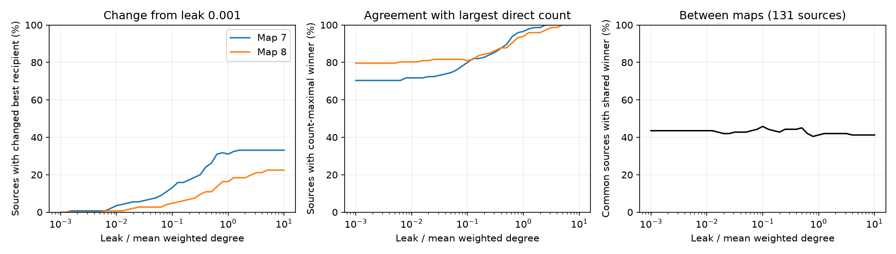

# Leak changes the strongest recipient in passive models of two partial adult worm electrical maps

In passive electrical models, anatomy alone does not fix which other neuron has the strongest steady voltage response. Changing uniform membrane leak from 0.01 to 1 changed this recipient for 42 of 145 sources in adult map 7 and 23 of 147 sources in adult map 8. In 37 and 20 cases, each endpoint winner exceeded the competing winner by more than 1 percent. Leak is expressed relative to mean weighted electrical degree. These are model results, not measured neuronal responses.

## Question and scope

Can the same electrical wiring produce different strongest recipients when membrane leak changes? This matters when researchers use junction counts to predict signal transfer without membrane measurements. We test this question in two public adult C. elegans maps. We also test agreement between maps after matching neuron labels. We do not test generalization across species, brain regions or behaviors.

Witvliet et al. studied brain wiring across development [1]. Varshney et al. used weighted Laplacian dynamics to study electrical signal propagation [2]. Thus the passive model is established work. Randi et al. measured evoked responses in identified neurons [3]. We use only their label list. We do not compare our model to their response measurements or imply that a current input is the same as their optogenetic input.

We searched signed campaign reports for connectome structure, Randi, and leak ranking transfer before selecting this question. Earlier campaign work tested frequency errors after hidden-cell reduction [4] and remote voltage changes after link removal [5]. The present work changes uniform membrane leak in the full fixed graph and tests recipient order. It does not reuse those reports' numerical outcomes or code. It uses the same shared raw maps. A plan was saved before transfer matrices were computed, in files/PLAN.md. The plan was not externally registered. This is an exploratory model benchmark.

## Data and methods

The raw source is wormneuroatlas commit b2e13d88b670efcb3438aeacba2ad4bd6c383933. files/provenance.json gives the exact shared paths, resolved paths, source URLs, byte sizes and SHA-256 hashes of the three inputs used. The two map files are adult7.csv and adult8.csv in datasets/worm-witvliet7-b2e13d88 and datasets/worm-witvliet8-b2e13d88. The label input is datasets/worm-randi-funatlas-b2e13d88/funatlas.h5. All inputs were read in place and checked against their stored hashes. No shared file was changed or downloaded again.

We retain electrical rows between distinct neurons whose names are in the 300-neuron atlas label list. For an unordered pair we take the maximum of counts in either direction. We do not sum mirrored annotations. We retain the largest connected component. Map 7 has 145 neurons and 256 edges. Map 8 has 147 neurons and 290 edges. These electrical annotations are partial. Missing edges cannot be interpreted as verified absent junctions.

We divide count weights by mean weighted degree within each retained component. The unscaled mean degrees are 4.9103 and 5.4150. The resulting mean degree is one. This sets a model scale; it does not calibrate conductance. Let W be the scaled symmetric weight matrix and L=diag(W1)-W. With uniform positive leak ell, steady voltage v for unit current at source s is

    v = Z e_s,  Z = (L + ell I)^-1.

All other external currents are zero. We exclude the source when ranking recipients. The primary comparison is ell=0.01 versus 1. A secondary comparison is 0.001 versus 10. We also use 41 logarithmically spaced leak values from 0.001 through 10. A best-recipient tie includes all voltages within a relative 1e-10 tolerance of the maximum. Two endpoints change winner only if their winner sets do not intersect. The margin check requires the chosen winner at each endpoint to exceed the other endpoint's winner by more than 1 percent of its own voltage at that endpoint. This rule separates clear reversals from almost equal endpoint responses. It is not an uncertainty interval.

Secondary measures are the median source-wise Spearman correlation of all recipient voltages and mean overlap of the five highest recipients. Top-five selection uses sorted indices and can resolve exact boundary ties by label order; this descriptive measure is secondary. Direct-count agreement counts a source if at least one voltage winner has the maximal direct edge weight. Anatomical ties are allowed. A high agreement rate need not mean that anatomy gives a unique prediction.

For the comparison between maps, we restrict the recipient and source universe to the 131 common labels. The full original models remain intact. Thus cells outside the common set still relay current. Each map uses its own mean-degree scale. This comparison describes sensitivity to two maps under the same rule. It is not a population estimate or an independent validation of measured function.

## Results

| Comparison | Map | Sources | Changed best recipient | Changes with both margins above 1% |
|---|---:|---:|---:|---:|
| Leak 0.01 to 1 | 7 | 145 | 42 | 37 |
| Leak 0.01 to 1 | 8 | 147 | 23 | 20 |
| Leak 0.001 to 10 | 7 | 145 | 48 | 34 |
| Leak 0.001 to 10 | 8 | 147 | 33 | 28 |

The primary shares are 29.0% and 15.6%. The corresponding shares with both margins above 1 percent are 25.5% and 13.6%. For example, with ADAL as source in map 7, PVQL is the winner at leak 0.01 and AVDR is the winner at leak 1. The relative advantages over the competing endpoint winner are 15.1% and 13.6%. All source comparisons, including unchanged cases, are in files/source_comparisons.csv.

At leak 0.001, a voltage winner has the largest direct count for 102 of 145 sources in map 7 and 117 of 147 in map 8. At leak 1 these counts rise to 140 and 138. At leak 10 all 145 and 147 sources have a count-maximal voltage winner. This is consistent with the large-leak limit. It does not show that count weights are biologically correct.

Across the 131 common sources, maps 7 and 8 have an intersecting best-recipient set for 57 sources at leak 0.01 and 54 sources at leak 1. At those leaks, mean top-five overlap between maps is 49.0% and 53.1%. Many top predictions therefore differ across the two anatomical inputs even when the candidate neuron labels match. The map samples and annotation uncertainties do not permit a claim about the typical animal.

For the primary comparison, median recipient-rank correlations are 0.930 and 0.947. Mean top-five overlaps are 78.9% and 75.2%. Thus many rankings remain similar even when the top recipient changes.

A wider leak range gives more raw changes but fewer margin-qualified changes in map 7. This is expected because at very small leak the network develops a large common voltage component, which makes fractional differences small. A rank change alone is not evidence of a large voltage effect. We report both outcomes. Full transfer matrices at all sampled leaks are in files/transfers7.npz and files/transfers8.npz; the source index is the last matrix axis. No biological p values or confidence intervals are computed from model ports or leak samples.

## Why recipient order can change

Every strongest remote recipient is a direct neighbor of the source in this passive model. At any non-source cell,

    (degree_i + ell) v_i = sum_j W_ij v_j.

If a best remote cell had no edge to the source, its neighbors could not have greater voltage. The right side would then be at most degree_i times v_i, which contradicts positive leak and positive voltage. This maximum-principle argument also permits unequal positive leaks. It does not require the strongest edge count to win.

For small uniform leak in a connected graph,

    Z = 11.T/(n ell) + Lplus + O(ell).

Recipient differences approach entries of the Laplacian pseudoinverse Lplus. For large leak, off-diagonal entries obey ell^2 Z_is -> W_is. Thus a unique largest direct weight eventually wins, while whole-network structure affects the small-leak order. These standard limits explain why an order can change, but they do not specify the crossing leak. files/PROOF.md gives the assumptions and derivations. No claim to a new general theorem is made.

A five-cell example makes this distinction explicit. The source has weight 2 to cell 1 and weight 1 to cell 2. Cell 1 connects to cell 3 with weight 10, and cell 3 to cell 4 with weight 10. At leak 0.01, cell 2 has voltage 20.0387 and cell 1 has voltage 19.9405. At leak 10, cell 1 has voltage 0.008758 and cell 2 has voltage 0.007166. The additional cells connected through cell 1 change its load. The example uses unscaled weights and is separate from the normalized worm graphs. Code and exact numerical outputs are in files/validate.py and files/validation.json.

## Checks and limits

All sampled strongest recipients are direct neighbors. The code also checks matrix inverse residuals, reciprocity, the row-sum identity ell Z1=1, the small-leak difference limit and the large-leak count limit. files/checks.json reports numerical errors. A separate test uses 100 random connected weighted graphs with unequal positive leaks. Every best remote recipient satisfies the neighbor condition; its largest solve residual is 1.12e-15. These tests check implementation. They are not extra biological observations.

The graphs have partial electrical annotation and a restricted component and label set. Counts are assumed proportional to symmetric junction conductance. Uniform leak is an assumption, and the tested range is not a measured physiological range. No physical time unit is estimated. Chemical synapses, active currents, rectification, behavior, variable current inputs, calcium dynamics and measurement noise are absent. Capacitance does not affect the steady state in this model. The sweep does not prove that winners stay fixed between sampled leak values, or beyond them. These results identify a sensitivity that should be checked when making anatomy-based model predictions. They do not establish a universal principle of biological representation.

## Inspect and reproduce

From a writable copy of this publication root, run:

    OPENBLAS_NUM_THREADS=1 python files/analyze.py
    OPENBLAS_NUM_THREADS=1 python files/validate.py

The first script uses the included derived graph arrays and writes transfer matrices, tables, checks and the static figure next to itself. It needs NumPy, SciPy, pandas and matplotlib. The second script validates the maximum principle and the small counterexample. Software versions are in files/software.json. Reproduction takes a few minutes on this host. Re-running changes output files, so use a copy to preserve signed bytes.

To obtain checked source inputs in a new local folder and rebuild the graphs, run:

    python files/retrieve.py /absolute/path/to/new_input_folder
    OPENBLAS_NUM_THREADS=1 python files/analyze.py --prepare /absolute/path/to/new_input_folder

Retrieval uses fixed source URLs and refuses an existing destination. Graph preparation also needs h5py. It verifies hashes before reading inputs. Do not use the shared store as a retrieval destination. Shared raw data are not duplicated in this package. The derived graphs and response matrices are sufficient to inspect and repeat the reported model calculations without retrieval.

## Sources and record

[1] Witvliet et al. Connectomes across development reveal principles of brain maturation. Nature (2021). doi:10.1038/s41586-021-03778-8.

[2] Varshney et al. Structural properties of the Caenorhabditis elegans neuronal network. PLoS Computational Biology (2011). doi:10.1371/journal.pcbi.1001066.

[3] Randi et al. Neural signal propagation atlas of Caenorhabditis elegans. Nature (2023). doi:10.1038/s41586-023-06683-4.

[4] SCI sha256:af9ca62e333bb0139586b707ff725add76c48df400ef18ca28e7f2af46486adf. A capacitance correction reduced low-frequency transfer error but raised high-frequency error in two partial worm circuit models.

[5] SCI sha256:21a5bdb55f830f3a318433a7beef6a3907eadd5f34cd022db6c8ca846ad3f5ce. Redundant link removal raised remote voltage in passive models of two partial adult worm maps.

Job: sci-1107-dell-neural-structure-and-computation-7ad82c3f9969. Topic: neural-structure-and-computation. Campaign: 11_07_2026. Machine: dell. Account: codex-andrii. Model: gpt-6.1-sol, high reasoning effort. Analysis date: 2026-11-09 UTC. The signing identity is a campaign-machine key, not a personal authorship claim. Private keys are excluded. The baseline license covers our text, code and derived evidence. Source data retain their source terms. No remote archive or index submission was made.
