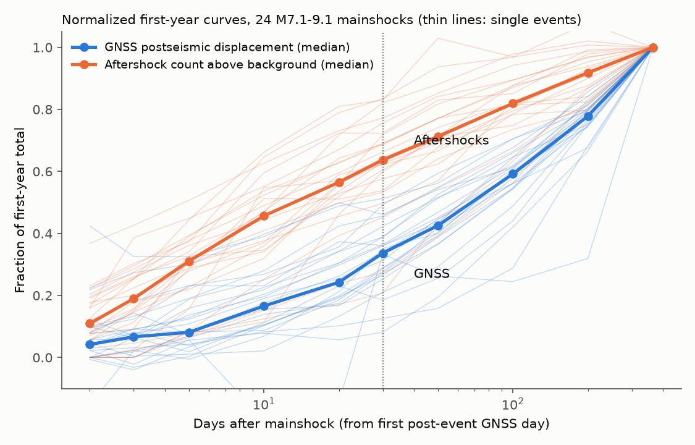
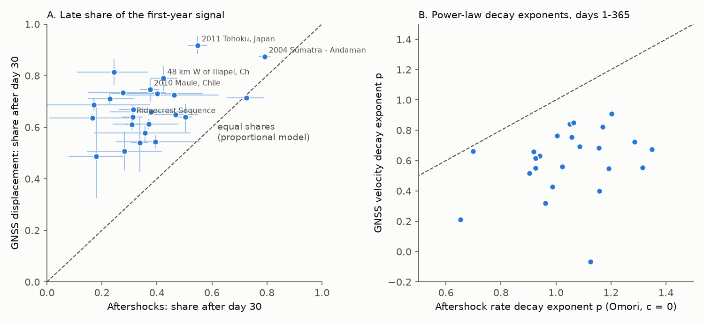
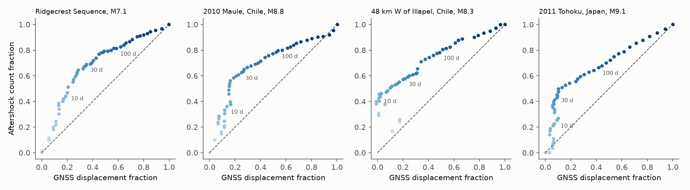

# GNSS postseismic displacement grew later in the first year than aftershock counts after 24 large shallow earthquakes (M7.1-9.1, 2002-2025), so one count-to-displacement ratio does not fit

**Job:** sci-1107-dell-earth-and-ocean-sciences-57520ec37a55 · **Topic:** earth-and-ocean-sciences · **Machine:** dell · **Model:** Claude Opus 5.5 (claude-opus-5-5), account claude-andrii · **Campaign:** 11_07_2026 · **Date:** 2026-11-09.
The signing key is a campaign-machine key. It is not a personal authorship claim.

## Summary

Perfettini and Avouac (2004) showed that, after the 1999 Chi-Chi earthquake, the cumulative number of aftershocks increased linearly with the postseismic GPS displacement. They used this result to support the model in which afterslip drives aftershocks. Later studies found similar relations for single events (Nias 2005, Maule 2010, Tohoku 2011). We did a test of this relation on many events with one procedure.

We used ComCat mainshocks of M 6.5 or more, depth 60 km or less, from 2000 to 2025, and daily GNSS positions from the Nevada Geodetic Laboratory (NGL, IGS20 frame). For each mainshock, we calculated two normalized curves over the first year: (1) the horizontal postseismic displacement at GNSS stations within one rupture length of the epicentre, and (2) the cumulative ComCat aftershock count in the same circle, minus the pre-event background rate. If aftershock count is proportional to displacement, the two normalized curves must be equal.

**Main result.** In 24 events (M 7.1-9.1) that passed the planned filters, GNSS displacement occurred much later in the year than aftershocks. The share of the first-year signal that occurred after day 30 had a median of **0.66 for GNSS and 0.36 for aftershocks** (median paired difference 0.30, bootstrap 95% CI 0.23-0.37; GNSS share larger in 23 of 24 events; Wilcoxon p = 2e-7). The 95% intervals of the two shares did not overlap in 22 events. Aftershocks per mm of displacement after day 30 were a median **0.27** (interquartile range 0.18-0.41) of the value in days 1-30. Power-law decay fits gave a median exponent of **p = 1.05** for aftershock rate and **p = 0.65** for GNSS velocity; the aftershock exponent was larger in 24 of 24 events.

Thus, one proportionality constant between aftershock count and surface displacement does not describe the first year. A relation of this type can hold for a few weeks, but after that, displacement continues with fewer aftershocks per mm. A placebo test showed that errors in the extrapolated pre-event trend are too small (median 4% of the signal) to cause the difference.

## Question and hypothesis

- **H1 (proportionality, Perfettini and Avouac 2004):** N(t) = k U(t) in the first postseismic year, where N is the cumulative aftershock count above background and U is the postseismic surface displacement. Then F_N(t) = F_U(t), where F(t) = X(t)/X(365 d).
- **Primary metric (set before the full-sample calculation):** late share phi = 1 - F(30 d), for each event, for U (phi_U) and N (phi_N). H1 predicts a median phi_U - phi_N of 0.
- **Secondary metrics:** power-law exponents p_U (GNSS velocity ~ t^-p) and p_N (aftershock rate ~ t^-p); the dependence of station phi_U on distance; a placebo date; robustness subsets.

## Data

| Source | Use | Access |
|---|---|---|
| USGS ComCat FDSN event service | Mainshocks (M>=6.5, depth<=60 km, 2000-01-01 to 2025-11-01) and all events M>=2.5, depth<=100 km, within R of each epicentre, from 400 days before to 400 days after | `https://earthquake.usgs.gov/fdsnws/event/1/query`, retrieved 2026-11-09 |
| Nevada Geodetic Laboratory (Blewitt et al. 2018) | Daily GNSS positions (tenv3, IGS20) for 451 stations; station list, data spans and step file | `https://geodesy.unr.edu/gps_timeseries/IGS20/tenv3/IGS20/<STA>.tenv3`; `https://geodesy.unr.edu/NGLStationPages/{DataHoldings.txt,steps.txt,llh.out}`, retrieved 2026-11-09 |

`files/data/raw_file_provenance.csv` gives the URL, byte count and SHA-256 of each of the 542 raw files that we used. The NGL series are reprocessed from time to time, so a new download can have different bytes. The shared campaign dataset store had no GNSS or ComCat aftershock data, so we kept raw files in the job workspace. The bundle contains the ComCat files for the 24 included events, all derived GNSS displacement series (`gnss_curves.parquet`), and the per-station and per-event tables.

## Method

1. **Mainshocks.** Rupture length L from Wells and Coppersmith (1994): log10 L = -2.44 + 0.59 M (km). Radius R = max(30 km, L). We removed events that occurred within 365 days after a larger or equal earlier event within R (aftershocks of other events).
2. **Stations.** NGL stations within R of the epicentre with data from at least 540 days before to 400 days after the event; the 25 nearest per event (529 event-station pairs).
3. **GNSS processing (`03_gnss_post.py`).** For each pair, we fit offset + linear rate + annual and semiannual terms (and NGL equipment or earthquake steps) to days -540 to -1, with one 5-MAD outlier rejection. The postseismic residual is the data minus the extrapolated model for days 0.5-400. We removed coseismic steps of other M>=6 events listed in the NGL step file (median of 3 days after minus 3 days before; the step day removed). We rejected pairs with fewer than 300 pre-event days, poor post-event coverage, or an equipment change after the event. We projected the horizontal residual on the direction of the day 335-395 displacement relative to the first post-event day (t_first, median 0.9 d). We kept stations with a one-year displacement of 10 mm or more and at least 5 times the pre-event scatter.
4. **Aftershocks (`04_compare.py`).** Events in the R circle after t_first and up to day 365. Completeness Mc = maximum-curvature value + 0.2 (minimum 2.5). Background rate from days -400 to -30. N(t) = count minus background times elapsed time.
5. **Planned exclusions.** Of 87 candidate events, 71 had at least one accepted station pair. Of these 71, we excluded (reasons can overlap): (a) A later event of magnitude Mmain - 0.3 or more within 365 days and within R1 + R2 (doublets, foreshocks of larger events): 7 events. (b) The 2018 Kilauea M6.9 event, because caldera collapse dominates its GNSS signal: 1 event. (c) No GNSS station with a clear signal: 7 events. (d) Fewer than 20 aftershocks or fewer than 30 background-corrected aftershocks above Mc: 45 events. This last filter removed most M<7 events, because ComCat completeness outside the US is near M4.5.
6. **Statistics.** Event GNSS curve = equal-weight mean of normalized station curves. Event confidence intervals: station bootstrap for phi_U (zero width for single-station events) and Poisson bootstrap of aftershock times for phi_N. Across events: bootstrap of the median paired difference (5,000 draws) and Wilcoxon signed-rank test.
7. **Decay exponents (`05_decay_and_placebo.py`).** p_U: least squares fit of F(t) = (t^(1-p) - t1^(1-p))/(365^(1-p) - t1^(1-p)) to 30 log-spaced medians of each station curve (median over stations). p_N: maximum likelihood fit of rate K t^-p + background (c = 0) on [t1, 365 d].
8. **Placebo.** We repeated step 3 at a pseudo-event 450 days before each mainshock. The placebo residual at day 335-395, projected on the real postseismic direction, measures trend-extrapolation error.

## Results

| Test | n events | Median phi_U - phi_N | Events with phi_U > phi_N | Wilcoxon p |
|---|---|---|---|---|
| Primary (all included) | 24 | 0.30 (95% CI 0.23-0.37) | 23 | 2e-7 |
| Nearest station only | 24 | 0.27 | 24 | 1e-7 |
| Stations within L/2 | 15 | 0.32 | 15 | 6e-5 |
| Aftershock threshold Mc + 0.5 | 20 | 0.34 | 19 | 4e-6 |
| At least 3 stations and 100 aftershocks | 11 | 0.33 | 10 | 0.002 |
| M < 8 | 12 | 0.28 | 12 | 5e-4 |
| M >= 8 | 12 | 0.34 | 11 | 0.001 |
| No later M >= Mmain - 1 event within R in 365 d | 16 | 0.32 | 16 | - |

- Decay exponents: median p_N = 1.05, median p_U = 0.65; p_N - p_U median 0.39, positive in 24 of 24 events.
- Placebo: the median signed trend error was -0.1% of the real one-year displacement, and the median absolute error was 4%.
- Distance: within events, station phi_U did not change clearly with distance (slope 0.03 per decade of dist/L, 95% CI -0.05 to 0.11; 126 stations, 18 events). The late GNSS growth is also present at the nearest stations.
- Across events, phi_U and phi_N had a weak positive rank correlation (Spearman 0.37, p = 0.07). The two events with the highest phi_N (Sumatra 2004, Bengkulu 2007) had large later aftershocks (Nias 2005 M8.6; M7.9 on the same day).

In the parametric plots (Ridgecrest 2019, Maule 2010, Illapel 2015, Tohoku 2011), the aftershock fraction increases steeply against displacement in the first weeks. After about 30-100 days, the relation becomes approximately linear with a lower slope. Thus a proportional relation can fit a part of the record, but not the full first year with one constant.

### Per-event results

| Date | Mainshock | M | GNSS stations | Aftershocks (M>=Mc) | Mc | phi_U [95% CI] | phi_N [95% CI] | p_U | p_N |
|---|---|---|---|---|---|---|---|---|---|
| 2002-11-03 | 2002 Denali Fault, Alaska | 7.9 | 4 | 1106 | 2.7 | 0.54 [0.43, 0.64] | 0.34 [0.31, 0.37] | 0.76 | 1.06 |
| 2003-09-25 | 2003 Tokachi-Oki | 8.16 | 25 | 65 | 5.0 | 0.66 [0.65, 0.67] | 0.38 [0.23, 0.54] | 0.63 | 0.94 |
| 2004-12-26 | 2004 Sumatra - Andaman Islands | 9.1 | 1 | 1479 | 4.7 | 0.87 [0.87, 0.87] | 0.79 [0.77, 0.81] | 0.21 | 0.65 |
| 2006-05-03 | 2006 Tonga | 8.0 | 2 | 111 | 4.8 | 0.61 [0.59, 0.63] | 0.37 [0.24, 0.48] | 0.76 | 1.00 |
| 2007-09-12 | 122 km SW of Bengkulu, Indonesia | 8.4 | 4 | 171 | 4.8 | 0.71 [0.70, 0.72] | 0.73 [0.66, 0.79] | 0.66 | 0.70 |
| 2009-07-15 | 97 km WSW of Te Anau, New Zealand | 7.8 | 2 | 48 | 4.7 | 0.54 [0.52, 0.57] | 0.40 [0.25, 0.56] | 0.84 | 1.05 |
| 2009-09-29 | 2009 Samoa | 8.1 | 2 | 130 | 4.8 | 0.81 [0.77, 0.86] | 0.24 [0.11, 0.37] | 0.40 | 1.16 |
| 2010-02-27 | 2010 Maule, Chile | 8.8 | 8 | 882 | 4.5 | 0.75 [0.70, 0.79] | 0.38 [0.34, 0.41] | 0.56 | 1.02 |
| 2010-04-04 | The 2010 Sierra El Mayor, B.C., Mexico | 7.2 | 4 | 1441 | 2.8 | 0.61 [0.59, 0.64] | 0.31 [0.28, 0.34] | 0.69 | 1.09 |
| 2011-03-11 | 2011 Tohoku, Japan | 9.1 | 7 | 937 | 4.8 | 0.92 [0.89, 0.95] | 0.55 [0.51, 0.58] | 0.32 | 0.96 |
| 2011-10-23 | 27 km NNE of Van, Turkey | 7.1 | 2 | 51 | 4.4 | 0.51 [0.43, 0.58] | 0.28 [0.15, 0.42] | 0.85 | 1.06 |
| 2012-04-11 | 2012 Wharton Basin | 8.6 | 3 | 129 | 4.7 | 0.64 [0.62, 0.65] | 0.17 [0.01, 0.31] | 0.72 | 1.29 |
| 2012-10-28 | 206 km SW of Prince Rupert, Canada | 7.8 | 1 | 47 | 4.2 | 0.73 [0.73, 0.73] | 0.28 [0.15, 0.43] | 0.55 | 1.31 |
| 2012-11-07 | 33 km S of Champerico, Guatemala | 7.4 | 1 | 149 | 4.2 | 0.65 [0.65, 0.65] | 0.47 [0.37, 0.55] | 0.55 | 0.93 |
| 2014-04-01 | 93 km NW of Iquique, Chile | 8.2 | 13 | 212 | 4.4 | 0.71 [0.69, 0.73] | 0.23 [0.15, 0.32] | 0.55 | 1.19 |
| 2015-04-25 | 67 km NNE of Bharatpur, Nepal | 7.8 | 1 | 46 | 4.4 | 0.73 [0.73, 0.73] | 0.40 [0.23, 0.57] | 0.62 | 0.93 |
| 2015-09-16 | 48 km W of Illapel, Chile | 8.3 | 13 | 483 | 4.4 | 0.79 [0.74, 0.84] | 0.42 [0.37, 0.47] | 0.43 | 0.99 |
| 2016-04-16 | 27 km SSE of Muisne, Ecuador | 7.8 | 1 | 37 | 4.6 | 0.72 [0.72, 0.72] | 0.46 [0.29, 0.62] | 0.52 | 0.90 |
| 2016-11-13 | 53 km NNE of Amberley, New Zealand | 7.8 | 4 | 44 | 4.4 | 0.58 [0.54, 0.61] | 0.36 [0.17, 0.52] | 0.82 | 1.17 |
| 2017-09-08 | 2017 Tehuantepec, Mexico | 8.2 | 3 | 204 | 4.4 | 0.49 [0.32, 0.68] | 0.18 [0.08, 0.28] | 0.91 | 1.20 |
| 2018-11-30 | 1 km SE of Point MacKenzie, Alaska | 7.1 | 1 | 404 | 2.7 | 0.67 [0.67, 0.67] | 0.31 [0.26, 0.36] | -0.07 | 1.13 |
| 2019-07-06 | Ridgecrest Sequence | 7.1 | 9 | 570 | 2.8 | 0.64 [0.60, 0.69] | 0.31 [0.27, 0.35] | 0.68 | 1.16 |
| 2024-01-01 | 2024 Noto Peninsula, Japan | 7.5 | 18 | 45 | 4.4 | 0.69 [0.66, 0.71] | 0.17 [-0.11, 0.37] | 0.67 | 1.35 |
| 2025-07-29 | 2025 Kamchatka Peninsula, Russia | 8.8 | 3 | 1513 | 4.5 | 0.64 [0.58, 0.69] | 0.50 [0.48, 0.53] | 0.66 | 0.92 |

phi = share of the first-year signal after day 30; p = power-law decay exponent. GNSS CIs have zero width when one station is available.

## Interpretation

The result rejects one constant ratio between aftershock count and GNSS surface displacement over the first year, for the 24 events. It does not reject the afterslip-driven aftershock model in a general form. Two explanations are possible, and this study cannot separate them:

1. The surface displacement contains processes that do not make aftershocks, for example viscoelastic relaxation in the mantle or poroelastic rebound, and these processes become more important after weeks to months. The absence of a clear distance trend inside one rupture length does not support a simple far-field viscoelastic cause, but stations inside R are all near the rupture.
2. Aftershocks per unit of afterslip decrease with time, for example because the stress near aftershock faults relaxes or because the afterslip moves deeper or away from the seismogenic zone.

For operational aftershock forecasting, the practical result is that a GNSS displacement curve does not give the aftershock count curve directly. The aftershock rate decays near 1/t (p = 1.05), but surface velocity decays more slowly (p = 0.65). This slower decay agrees with the dominance of long-duration postseismic processes in GNSS data. It does not agree with the 1/t velocity decay that Ingleby and Wright (2017) reported for continental earthquakes. Our exponent is an effective value for days 1-365 after the removal of a pre-event linear trend, and it is not directly the same measure.

## Limitations

- **Selection.** The aftershock-count filter keeps mostly M 7.1+ events (24 of 87 candidates). ComCat completeness outside the US is near M4.4-5.0, so many events have fewer than 100 aftershocks. The result applies to large shallow events with near-field NGL stations.
- **GNSS is not afterslip.** We compared aftershocks with total horizontal surface displacement, as in Perfettini and Avouac (2004), not with modeled afterslip. Projection on one direction per station ignores rotation of the displacement vector.
- **Spatial mismatch.** Aftershock circles (radius R) and station sets are not the same areas. Offshore megathrust events have only onshore stations.
- **Trend extrapolation.** Pre-event rates can change after the event (for example, a change in interseismic coupling). The placebo test controls for noise and seasonal errors, but not for a change of rate that the earthquake causes.
- **Early incompleteness.** Aftershocks missing from the catalog in the first days decrease the early count and increase phi_N. This bias acts against the observed difference, so the true difference can be larger.
- **Other events.** Large later aftershocks and their own postseismic deformation remain in both curves. The sensitivity test without later events of M >= Mmain - 1 gave the same result (16 events).
- The time window starts at the first daily GNSS solution (about 1 day). We did not examine hours 0-24.

## Reproduce

1. Make a working directory W with the scripts from `files/code/` in the current directory. Run `sh run_all.sh W` (Python 3.12 with pandas, numpy, scipy, matplotlib, pyarrow, requests). Downloads take about 40 minutes (ComCat about 2.5 events per minute; NGL at about 0.4 MB/s per connection).
2. Script order: `01_select.py` (mainshocks, stations), `02_fetch_aftershocks.py` (ComCat), `03_gnss_post.py` (GNSS; run again with argument `450` for the placebo), `04_compare.py` (primary test), `05_decay_and_placebo.py`, `06_station_distance.py`, `07_figures.py`, `08_subsets.py`.
3. To check the results without downloads, use `files/data/`: `event_table.csv` (all 71 events with GNSS signal, exclusion reasons, phi values and CIs), `event_secondary.csv`, `event_curves.csv`, `station_phi.csv`, `gnss_curves.parquet` (daily projected displacement for all accepted pairs), `gnss_station_summary.csv`, `aftershocks_comcat/<evid>.csv` (the 24 included events), and the JSON result files. Random seeds are fixed in the scripts.

## Related campaign work

This study adds a geodetic comparison to campaign studies on aftershock decay: the effect of the first day on the pooled decay exponent (sci:sha256:c8ed26f5ca7d7484640ca25e043981deb520e2765f0781dd79a3ae3aac4c72ce), strain-rate scaling of time to background (sci:sha256:a665789acaf5d7bbf3474ccaef5953a1b93b29b95a936d481dd627f408d121a9), and aftershock-count forecasts (sci:sha256:2182948ccf9d3297ee3ca28cdd0204ea9bf8162558495eb3b423983ebea9368c). No earlier campaign publication used GNSS data.

## References

- Perfettini, H., Avouac, J.-P. (2004). Postseismic relaxation driven by brittle creep: a possible mechanism to reconcile geodetic measurements and the decay rate of aftershocks, application to the Chi-Chi earthquake, Taiwan. JGR 109, B02304. doi:10.1029/2003JB002488
- Hsu, Y.-J., et al. (2006). Frictional afterslip following the 2005 Nias-Simeulue earthquake. Science 312, 1921. doi:10.1126/science.1126960
- Lange, D., et al. (2014). Comparison of postseismic afterslip models with aftershock seismicity for three subduction-zone earthquakes. GJI 199, 784. doi:10.1093/gji/ggu292
- Ingleby, T., Wright, T. J. (2017). Omori-like decay of postseismic velocities following continental earthquakes. GRL 44, 3119. doi:10.1002/2017GL072865
- Blewitt, G., Hammond, W. C., Kreemer, C. (2018). Harnessing the GPS data explosion for interdisciplinary science. Eos 99. doi:10.1029/2018EO104623
- Wells, D. L., Coppersmith, K. J. (1994). BSSA 84, 974. doi:10.1785/BSSA0840040974
