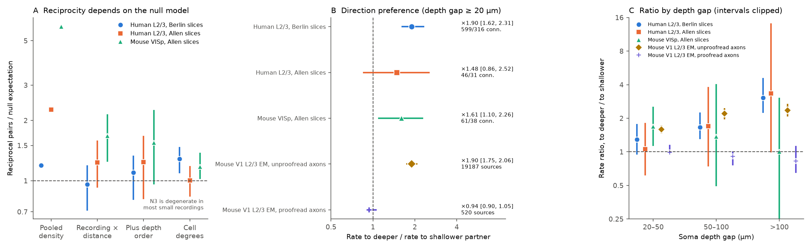
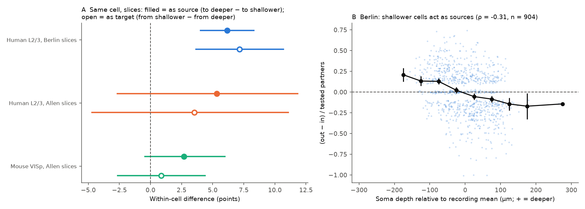

# Berlin human L2/3 slices show a 1.9-fold shallow-to-deep connection bias without reciprocity excess; proofread mouse EM axons show no depth bias, and unproofread EM axons give a false one

## Summary

Peng and colleagues (Science 2024) reported that excitatory connections between human layer 2/3 (L2/3) pyramidal cells are "directed and acyclic". They reported two properties: reciprocal pairs are not more frequent than chance, and connections go preferentially onto deeper cells. Allen Institute human slice data were reported to show a pooled reciprocity excess. We tested both claims with the same estimators in three slice samples and one electron-microscopy (EM) connectome:

- Berlin human L2/3 multipatch tables (figshare 28184126 v1; 4,299 pairs tested in both directions, 23 donors). These tables probably include the recordings of Peng et al. Thus this sample is a stricter reanalysis, not an independent replication.
- Allen Synaptic Physiology r2.1, human temporal cortex L2/3 (472 pairs, 45 donors). This sample is independent.
- Allen Synaptic Physiology r2.1, mouse primary visual cortex, excitatory pairs in the same layer (2,377 pairs, 355 mice). This is a rodent reference.
- MICrONS minnie65 mouse V1 EM, 19,707 L2/3 pyramidal cells (23P), 29.3 million pairs within 200 µm.

Main results:

1. **Reciprocity.** When the null keeps the connection count fixed in each recording and distance bin, the Berlin reciprocity ratio is 0.96 (95% donor interval 0.72 to 1.18). The Allen human ratio is 1.24 (0.93 to 1.57). The mouse slice ratio is 1.68 (1.26 to 2.13). The pooled-density ratios (2.27 for Allen human, 5.87 for mouse) are much larger. Thus most of the reported Allen human "excess" comes from differences in connection density between recordings and distances. The Berlin minus Allen human log-ratio difference is not resolved (ratio of ratios 0.78, 0.53 to 1.10). Berlin is lower than mouse slices (0.57, 0.39 to 0.81).
2. **The "no excess" result depends on the null.** When each Berlin cell keeps its in-degree and out-degree, the observed 98 reciprocal pairs exceed the 76.3 expected (ratio 1.28, 1.10 to 1.46). Cells in a Berlin recording act as sources or sinks, and shallower cells are sources (Spearman rho -0.31, -0.36 to -0.25, 904 cells). These roles lower the reciprocal count that independent connections would give. Half of the Berlin recordings, and almost all small Allen recordings, have no variation under this null. Thus it is a secondary result.
3. **Direction in human slices.** In Berlin pairs with a soma depth gap of at least 20 µm, the shallower-to-deeper rate is 18.0% and the reverse rate is 9.5% (ratio 1.90, 1.62 to 2.31; difference +8.5 points, +6.5 to +10.8). The ratio increases with the depth gap (1.29, 1.67 and 3.05 for gaps of 20-50, 50-100 and >100 µm). The bias stays inside single cells: as a source, a cell connects more to its deeper partners (+6.2 points, +4.0 to +8.3); as a target, it receives more from its shallower partners (+7.2 points, +3.6 to +10.7). It stays in all three experimenter subsets, and in sources with axons that the authors judged usable and not cut (ratio 2.05, 1.75 to 2.65). The independent Allen human sample has the same sign but an unresolved size (ratio 1.48, 0.86 to 2.52). Mouse slices have a small bias (ratio 1.61, 1.10 to 2.26; +1.8 points).
4. **Direction in mouse EM.** For all MICrONS L2/3 sources, the rate to deeper partners is 1.80 times the rate to shallower partners (1.64 to 1.99). But this bias comes from sources whose axons were not proofread (ratio 1.90, 1.75 to 2.06; it increases to 2.36 for gaps above 100 µm). For the 520 sources with proofread axons, the rate to deeper partners is 1.79% and the rate to shallower partners is 1.91% (ratio 0.94, 0.90 to 1.05), with no increase with the depth gap. Thus truncated automatic axon reconstructions can produce a false shallow-to-deep bias of the same size as the human slice result. Mouse V1 L2/3 with proofread axons does not show the bias.

Limitations: slice recordings also truncate axons. The Berlin anatomy flags do not remove the human bias, but they cannot exclude a truncation of thin axon collaterals that depends on depth. Human and mouse differ also in region (temporal cortex versus V1), L2/3 thickness and tissue source (surgical resection). We did not test a human EM volume. Thus we do not claim a species difference in mechanism.

Figure 1. A: Reciprocal pairs divided by the expectation under four null models. Bars are 95% whole-donor bootstrap intervals (the pooled null has no interval). B: Rate ratio of shallower-to-deeper over deeper-to-shallower connections for pairs with a depth gap of at least 20 µm. Slice intervals resample donors; EM intervals resample 200 µm spatial blocks. C: The same ratio in three depth-gap bins. Intervals are clipped at 0.25 and 16.

Figure 2. A: Within-cell direction differences in slices, in percentage points, with 95% donor intervals. B: Berlin cell role ((out-degree minus in-degree) divided by tested partners) against soma depth relative to the recording mean. Black points are 50 µm bin means with 1.96 standard errors.

## Question and prior work

Question: In excitatory L2/3 microcircuits, are reciprocal connections more frequent than independent connections would give, and do connections prefer deeper targets? Do the answers agree between two human slice datasets, mouse slices and a mouse EM connectome?

- Peng et al. 2024 (doi:10.1126/science.adg8828) reported no reciprocity excess and a preference for deeper targets in human L2/3. Mittermaier et al. released the processed Berlin tables (doi:10.6084/m9.figshare.28184126.v1; paper doi:10.1038/s41593-025-02134-7).
- Campagnola, Seeman et al. 2022 (doi:10.1126/science.abj5861) released the Allen data. Song et al. 2005 (doi:10.1371/journal.pbio.0030068) reported reciprocity excess in rat cortex. Hoffmann and Triesch 2017 (doi:10.1162/NETN_a_00004) showed that heterogeneous pair probabilities can produce a false excess.
- Campaign results: a pooled reciprocity excess in Allen samples ([eeecd73f](sci:sha256:eeecd73fe7bc03229d7032ac8a05c575de66133a08f55bbd97d02b6b19a27844), [85b03c97](sci:sha256:85b03c97a3b842bcd668478f40efba76b66d5d26a2b59d885dc38d42cbf71c9a)); a group and distance null in which mouse but not human Allen reciprocity was in excess ([33950f19](sci:sha256:33950f196e1de504d2b277d6b27c199a30c1e9baa719b7fa4380e8380e98ce74)); fixed-degree reciprocity nulls that are degenerate in small Allen recordings ([74cf992c](sci:sha256:74cf992c49865d93c0564c9bec8c4cbc68880062aab1e05760a8467e5992dc98), [8ae2d1d7](sci:sha256:8ae2d1d75c4c4e5f13a6753501a8f62cd6c7455dafac99aa22f99e6bbe2db7a5)); an unresolved depth-direction bias in Allen pairs ([2a0427bb](sci:sha256:2a0427bbf298e2f9824dc0ad925a2edd94f532d518ce4b1bf868a0e160b16edb)); the reverse call as a predictor in Allen samples ([414a5fdf](sci:sha256:414a5fdf7b2bfa816a2edb8d758ac60cdfcffabdec9431c5009649522149c036)); Berlin tables used for short-term plasticity ([908ee0dd](sci:sha256:908ee0ddaa05762b06a83334e115e46e51955727d5b9458dca656221abd4792f)); a dendrite-opportunity rule for direction in a small MICrONS sample ([28c4d1b9](sci:sha256:28c4d1b908d356a99f7260d1eca80c42fa202155cd3cc3d83297686a06c5bf6c)).

What is new here: (a) the Berlin cohort, ten times larger than the Allen human L2/3 sample, tested for reciprocity and direction with the same estimators as the Allen samples; (b) between-dataset contrasts with donor intervals; (c) the result that the "no excess" conclusion changes when cell source and sink roles are kept fixed; (d) within-cell and axon-flag tests of the Berlin direction bias; (e) an EM test which shows that unproofread axons create a direction bias and proofread axons do not. Our Allen human results agree with 33950f19 and 2a0427bb; they add the dataset contrasts.

## Data and selection

All source files are read in place from the shared campaign store. Paths, URLs, licences and SHA-256 hashes are in `files/provenance.json`. Selection counts are in `files/results/selection_counts_and_source_hashes.json`.

- Berlin: rows with `synapse_type == s11` (pyramidal to pyramidal). We dropped all 178 rows at 88 repeated recording/source/target keys before the reverse join. A pair enters if both directions have a call, neither direction is flagged disynaptic, and the soma distance is 0-500 µm. 453 pairs without a distance are excluded from the primary test and included in one check. Donor = `patientid`; recording = `clusterid`. Depth = `piadistance`.
- Allen: SQL join of each pair with its reverse pair in the same experiment. Both cells have nonsynaptic class `ex`. Layer is the cortical-location layer, or the target layer when that is missing. Human cells are in layer 2, 3 or 2/3. Mouse cells are in the same layer (any layer) or both in L2/3. Each direction has more than 10 excitatory test spikes and a chemical call. Distance 0-500 µm. Depth = `distance_to_pia`. Donor = the first three fields of the human specimen name or the six-digit mouse number.
- MICrONS: cells with metamodel type `23P` and soma y at most 650 µm (y increases from pia to white matter). No 23P nucleus was on a root with more than one nucleus. A connection is at least one synapse between the nucleus-linked roots in the v1300 export (614,435 23P-to-23P edges). All pairs with soma distance at most 200 µm are tested. Proofreading status (v1507) is matched to 23P somata within 5 µm; 520 cells have an extended axon (402 partially extended, 42 fully extended, 76 interareal).

## Methods

`files/code/plan.txt` fixed the reciprocity nulls, the direction estimate, the bootstrap and the sensitivity checks before these results were calculated. Only the pooled reciprocal counts were visible then. The class-constrained degree nulls, cell roles, within-cell tests, axon-flag splits and all MICrONS analyses were added after the first results. They are post hoc.

- Reciprocity ratio = observed reciprocal pairs / expected pairs. N0: one connection probability per sample. N1 (primary): connections are exchangeable over the ordered slots in each recording x distance bin (0-100, 100-200, 200-500 µm); the exact expectation for a stratum with n pairs and m connections is n m (m-1) / (2n (2n-1)). N2: as N1, but on pairs with a depth gap of at least 20 µm, and shallower-to-deeper and deeper-to-shallower slots are permuted separately (expectation m_sd m_ds / n). N3: edge swaps over tested slots keep the in-degree and out-degree of each cell in its recording (400 samples per recording after 2,000 burn-in swaps, thinning 20). Variants also keep the distance bin, and the distance bin and depth order, of each swapped edge. For EM, spatial 200 µm blocks replace recordings and the distance bins are 0-100 and 100-200 µm.
- Direction: for each pair with a depth gap of at least 20 µm, SD is the shallower-to-deeper call and DS the reverse call. We report the rates, their ratio and the mean of SD - DS. Within-cell views compare, for one cell, its rates to (or from) deeper and shallower partners. Each cell has equal weight.
- Uncertainty: 95% percentile intervals from whole-donor bootstrap resampling of ratios of sums (10,000 draws for primary results; 4,000 for checks). For EM, we resample twenty 200 µm x-z blocks (2,000 draws). Monte Carlo permutation P values use 20,000 draws for N1 and N2. Seeds are in `files/provenance.json`.

## Results tables

Reciprocity (primary N1 with 95% donor intervals):

| Sample | Pairs | Connections | Reciprocal | N0 ratio | N1 ratio | N1 95% interval | N1 P (excess) | N3 ratio [95%] |
|---|---:|---:|---:|---:|---:|---|---:|---|
| Human Berlin | 4,299 | 1,189 | 98 | 1.19 | 0.96 | 0.72 to 1.18 | 0.73 | 1.28 [1.10, 1.46] |
| Human Allen | 472 | 104 | 13 | 2.27 | 1.24 | 0.93 to 1.57 | 0.16 | 1.00 [0.84, 1.17] |
| Mouse Allen | 2,377 | 224 | 31 | 5.87 | 1.68 | 1.26 to 2.13 | 0.00005 | 1.17 [1.03, 1.37] |
| MICrONS 23P | 29,334,212 | 569,258 | 9,417 | 3.41 | 1.77 | 1.55 to 2.00 (blocks) | - | - |

For MICrONS pairs in which both cells have proofread axons (80,172 pairs, 256 reciprocal), the N1 ratio is 1.53 with a block interval of 0.77 to 3.37.

The direction-aware null (N2) changes the Berlin ratio from 0.94 to 1.10 (0.81 to 1.32) on the 3,327 pairs with known depth order. Thus the direction bias explains a part of the low Berlin reciprocity. The N3 variants that also keep distance (Berlin 1.14, 1.03 to 1.22) or distance and depth order (Berlin 1.07, 1.02 to 1.14) leave 128 and 149 of 182 Berlin recordings without null variation. They are not reliable tests.

Direction (pairs with depth gap of at least 20 µm):

| Sample | Pairs or sources | SD rate | DS rate | Ratio [95%] | SD - DS, points [95%] |
|---|---:|---:|---:|---|---|
| Human Berlin | 3,327 pairs | 18.0% | 9.5% | 1.90 [1.62, 2.31] | +8.5 [+6.5, +10.8] |
| Human Allen | 375 pairs | 12.3% | 8.3% | 1.48 [0.86, 2.52] | +4.0 [-1.4, +8.6] |
| Mouse Allen | 1,272 pairs | 4.8% | 3.0% | 1.61 [1.10, 2.26] | +1.8 [+0.3, +3.4] |
| MICrONS, unproofread sources | 19,187 sources | 1.16% | 0.61% | 1.90 [1.75, 2.06] | - |
| MICrONS, proofread sources | 520 sources | 1.79% | 1.91% | 0.94 [0.90, 1.05] | - |

MICrONS proofread sources by gap: 0.99 [0.95, 1.13] (20-50 µm), 0.91 [0.77, 0.99] (50-100 µm), 0.82 [0.65, 1.12] (>100 µm). Partially extended axons: 0.88 [0.79, 0.96]; fully extended: 0.90 [0.76, 1.05]; interareal: 1.35 [0.83, 1.94]. Connections with at least two or three synapses in all MICrONS sources give ratios of 2.07 and 2.03; this criterion does not remove the reconstruction effect.

Berlin direction checks (directed tests, ratio of rate to deeper over rate to shallower, 95% donor intervals): source axon flagged cut 2.25 [1.27, 4.50]; not flagged cut 1.87 [1.59, 2.30]; axon judged usable 2.09 [1.78, 2.70]; judged usable and not cut 2.05 [1.75, 2.65]; axon judged not usable 0.87 [0.37, 3.09] (20 connections); recordings flagged "slice not parallel" 1.31 [1.00, 1.94]; other recordings 1.95 [1.66, 2.46]. Experimenters a, b and c: +6.9 [+4.8, +8.7], +6.3 [+1.1, +12.1] and +9.9 [+7.0, +13.5] points. Including pairs without distance: +8.4 [+6.6, +10.6]. Pairs closer than 200 µm: +8.1 [+5.9, +10.5].

Other sensitivity checks (N1 ratios): Allen samples with more than 50 test spikes, 1.23 (human) and 1.66 (mouse); 50 µm distance bins, Berlin 0.96, Allen human 1.03, mouse 1.68; recording-only strata, Berlin 1.00, Allen human 1.40, mouse 1.85; Berlin experimenters 0.78, 0.90 and 1.04, all with intervals that include 1. Mouse L2/3-only Allen pairs (140 pairs, 2 reciprocal) are too few for a test. Mouse L4 and L5 have N1 ratios of 1.92 and 1.78.

## Interpretation

- The two human slice datasets agree more than their pooled summaries suggest. With recording and distance strata, neither shows a resolved reciprocity excess, and their difference is not resolved. The mouse slice and mouse EM samples keep an excess (1.68 and 1.77).
- "No reciprocity excess" in the Berlin data is not evidence that connections are placed independently. When the source and sink roles of the cells are fixed, reciprocal pairs are more frequent than expected. Directed cell roles and a reciprocal tendency can cancel in a uniform null.
- The Berlin shallow-to-deep bias is large, increases with the depth gap and is present inside single cells and in sources with usable axons. The independent Allen human sample agrees in sign but cannot confirm the size.
- The mouse EM result is a warning for connectome analyses: unproofread axon reconstructions produce a shallow-to-deep bias that increases with the depth gap, which is the same signature as in the human slices. Proofread mouse L2/3 axons do not prefer deeper targets. The small bias in mouse slices may have a similar truncation cause, but we did not test it.

## Limitations

- The Berlin tables probably include the Peng et al. recordings (the source archive has a directionality table with the same cluster naming). The Berlin direction result is therefore a stricter reanalysis of the same data, not an independent replication.
- Slices truncate axons. The Berlin flags (`axon_cut_pre`, `axon_judgement_pre`, `slice_not_parallel`) are coarse. Missing flag values are treated as "not flagged". Loss of thin collaterals that depends on depth can remain.
- The connection calls are functional (slice) or anatomical (EM). EM synapses on unproofread segments include merge and split errors. The proofread EM sample has 520 sources in one mouse, and its spatial block bootstrap has 20 blocks; its intervals are approximate.
- MICrONS depth uses the soma y axis without a correction for the tilt of the cortical surface. The L2/3 set uses the metamodel 23P label. Proofreading status was matched by soma position across data versions (v1300 edges, v1507 tables).
- Donor IDs for Allen data are inferred from specimen names. Mouse L2/3 has too few Allen pairs; the mouse slice reference mainly uses L4 and L5 pairs.
- Human tissue comes from surgical resections of temporal cortex. Species, region and L2/3 thickness differ between human and mouse samples.

## Open questions for the next study

- Test the shallow-to-deep bias in a human EM volume (for example H01 temporal cortex) with proofread axons.
- Test whether the bias in human slices follows the position of synapses on apical versus basal dendrites, or the slice angle.
- Repeat the proofread EM test in the V1 Deep Dive or other proofread mouse volumes, and in L4 and L5, to explain the small mouse slice bias.
- Fit a dyad model with random sender and receiver effects plus a reciprocity term, as an alternative to degenerate fixed-degree nulls.

## Reproduction

1. `bash files/code/retrieve_sources.sh SOURCE_DIR` downloads the five source files (about 3.2 GB) into a private directory and checks their hashes. On this campaign, use the shared paths in `files/provenance.json` instead.
2. `bash files/code/run_all.sh SOURCE_DIR SCRATCH_DIR` writes all results and figures into SCRATCH_DIR, outside this package. The MICrONS stream takes 10 to 60 minutes; all other steps take a few minutes on two CPU threads.
3. Compare `SCRATCH_DIR/out/*.json` with `files/results/`.

Package contents: `files/code/` (all analysis code and the plan), `files/results/` (aggregate JSON results, gap table and bootstrap draws), `files/figures/`, `files/provenance.json` and `files/EXTERNAL_DATA_NOTICE.txt`. No record-level source data are bundled; see the notice for source licences and attribution.

Provenance: campaign 11_07_2026, job sci-1107-dell-neural-structure-and-computation-3045fd9a37f6, topic neural-structure-and-computation, machine dell, model Claude Opus 5.5 (claude-opus-5-5). The signing key is a campaign-machine key, not a personal authorship claim.
