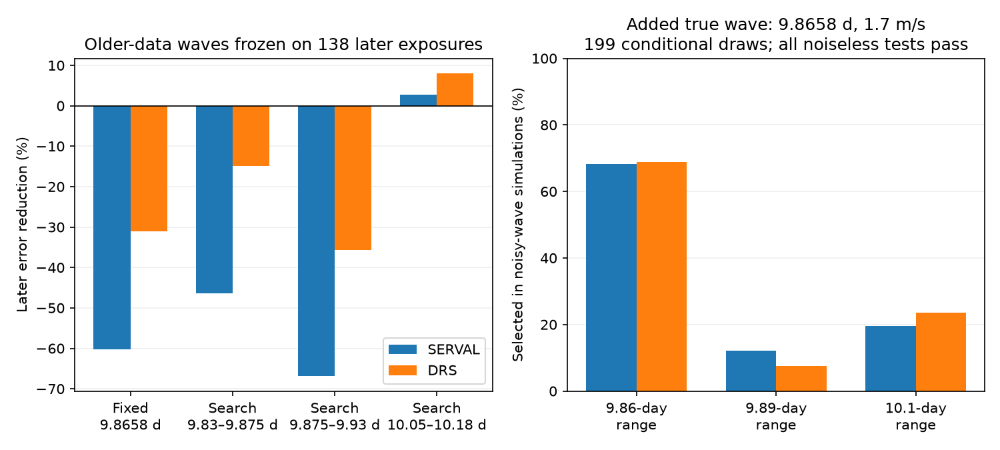

# Older-data circular fits at 9.8658 days increase later Ross 128 HARPS error under a year-offset model

A simple time-transfer test does not give a reliable choice among three reported period ranges for Ross 128. With the published 9.8658-day period fixed, a circular wave fitted to 167 older exposures increases weighted squared error on 138 later exposures by 60.2 percent in SERVAL and 31.0 percent in DRS. Nuisance terms have separate year and instrument offsets. No new planet is found. The result is a limit of this model and test. It does not reject the known planet.

## Question and prior work

Can a wave fitted to older observations choose between reported period alternatives when it is applied to later observations? A stable planet should keep its orbital phase. Uneven sampling, stellar activity and instrument changes can impair this test. The useful outcome is a check of a proposed candidate-screening method against a known planetary signal.

Liebing et al. (2024; DOI 10.1051/0004-6361/202347902), Appendix B, compare peaks near 9.86, 9.89 and 10.1 days and favor 9.86 days. They associate the longer peak with a yearly sampling alias. Their orbit and noise models are more complete than ours. Bonfils et al. (2018; DOI 10.1051/0004-6361/201731973) reported the planet. The archive gives a published period of 9.8658 days. We use these results to set the test; we do not claim to discover these peaks.

We searched the campaign for astronomy, Ross 128 and GJ447 before the final question was set. The verified GJ447 result, SCI cffa1fc5f608169e2a81715d25c943bb325d3a1b4809c9e563f76e358db91ab8, tests the 4.03-day residual wave. Our work tests the main planet period and its alternatives. We reuse the shared source CSV, but no prior campaign analysis code or fit results.

We sought independent-observation context. Basant et al. (2025), *Calibrating the Instrumental Drift in MAROON-X Using an Ensemble Analysis*, report no clear periodic signal in the MAROON-X data alone for this target, with limited sampling. They fit the known planet jointly with archival data. That work does not independently validate our transfer statistic. We fit no MAROON-X or CARMENES observations. The literature search is targeted, not exhaustive.

## Data and rights

We use HARPS-RVBank version 02, attributed to Perdelwitz et al. (2024), Trifonov et al. (2020), and ESO observations. There are 307 source exposures. Flag-zero observations with valid paired corrected velocities and positive errors leave 305 exposures. No velocity clipping is used. The span is BJD 2453578.459207 to 2459290.858868. The split at BJD 2458910 leaves 167 training and 138 test exposures. The test span is BJD 2459199.846491 to 2459290.858868, about 91 days. This split also separates instrument intervals. It is not a randomized experiment.

Exact shared input: `/mnt/dell-data/shared_datasets/ross128-gj447-rvbank-v02-6fc5b303/gj447.csv`. It has 169159 bytes. SHA-256: `5ce340e606d2734f915b5f101537941e13990109cc8432c8df1700d5f4dc1017`. The source URL, version and existing helper record are in files/provenance.json. No shared data were changed or downloaded.

The external CSV license was not established as compatible with the SCI baseline grant. Thus the bundle excludes the source CSV, row extracts, per-exposure residuals and external papers. It contains original code, text, figures and aggregate fit results. The retrieval script checks the exact hash and writes only to separate scratch. The external notice identifies this rights boundary. The baseline LICENSE remains unchanged.

## Method

Main nuisance terms are offsets for each calendar-year and instrument-interval pair. Instrument edges are BJD 2457153 and 2458910; no exposure is near an edge. Main weights are 1/(quoted error squared + 1.5 squared), in m/s. The added scale is a weight rule, not a fitted variance. The planet model has one sine and one cosine. Weighted least squares fits these terms with the nuisance terms.

We scan 9.83–9.875, 9.875–9.93 and 10.05–10.18 days. The grid steps are 0.000025, 0.000025 and 0.00005 days. Each range selects its best older-data fit. Its period, phase and amplitude are then held fixed. Only nuisance terms are refitted on the test data. Gain is 1 minus the ratio of test error to nuisance-only test error. Negative gain means increased error. This evaluates transfer of the wave, not prediction of all velocity changes.

Controls add group slopes, a second orbital harmonic, or a rotation wave at 121 or 165 days; change the extra weight scale to 0 or 3 m/s; or use uncorrected velocities. The two-harmonic control approximates eccentric motion but is not an exact Kepler orbit. METHOD.txt specifies the tests and limitations. The original scan ranges and controls were set before their results were read. Narrow-range checks, the fixed published-period test and the known-wave simulation were added after poor transfer and a boundary maximum were found. They are diagnostic checks.

## Results

| Product | Older-data best period near 9.86 d | Test gain | Older-data best period in long range | Test gain |
| --- | ---: | ---: | ---: | ---: |
| Corrected SERVAL | 9.863550 d | -46.34% | 10.175600 d | 2.77% |
| Corrected DRS | 9.862200 d | -14.93% | 10.174800 d | 7.98% |

The 9.86-day range has the largest training fit gain in both products. The broad 9.89-day range selects its 9.875-day boundary in both products and gives test gains of -66.82% and -35.71%. This boundary choice does not test the local 9.89-day peak cleanly.

After inspection, narrower ranges of 9.855–9.872, 9.885–9.905 and 10.11–10.15 days give a different ranking. SERVAL gains are -46.34%, 11.85% and -12.41%. DRS gains are -14.93%, 0.75% and 0.97%; its middle-range optimum again lies on the boundary. These are sensitivity checks, not a second confirmation experiment. Range choice matters.

With the period fixed at 9.8658 days and older-data amplitude and phase fitted, test gains are -60.24% and -31.02%. A fixed published period thus does not restore transfer under these nuisance and weight rules. Adding group slopes changes the broad-range DRS winner to the 9.86-day range, at 9.853200 days. Other main corrected-product controls favor the long range. The uncorrected-product controls also show some rank changes. All 84 fits are in fits.csv. Grid digits identify computations, not period precision.

The full-data profiles favor periods near 9.852 days in the short range. These retrospective profiles do not set the original training fits. They further show that this restricted model does not provide a robust estimate of the published orbital period. Profiles.png displays training fit gain, full-data fit gain and test error as functions of period.

For the broad main test, paired resampling of 10-day test residual-loss blocks gives positive conditional error contrasts between each short-range fit and the winning long-range fit. For example, the 95% percentile ranges for short-minus-long weighted error are 32.4–118.6 in SERVAL and 8.4–89.4 in DRS. These ranges freeze all training parameters and fitted residuals. They omit period and training-fit uncertainty. They cannot establish an orbital period or planet significance.

Stable-wave simulations in summary.json illustrate that limitation. With the full-data fitted long-range wave as the generator, a repeated older-data search selects that range on the later data in only 361/599 SERVAL draws and 318/599 DRS draws. Those generators were chosen from the observed transfer winner. These are conditional method checks, not posterior probabilities.

A separate diagnostic adds a true 9.8658-day wave with amplitude 1.7 m/s to sign-resampled residuals from a fixed-period full-data fit. It cycles through 24 phases. The main scan and transfer rule chooses the correct range in 136/199 SERVAL draws and 137/199 DRS draws. It selects the long range in 39 and 47 draws. In 24 noiseless phases it selects the correct range in every case for both products. Thus the code can transfer an exact wave, but noise and parameter estimation often impair range selection under this construction. These fractions are not survey completeness. Simulations use one symmetric 10-day-bin sign-noise model, not all possible correlated noise.

## Physical scope

A stable orbit, a changing stellar surface signal, reduction errors and the sampling window can all contribute to this failure. Instrument changes coincide with the time split. Year offsets, group slopes and reduction comparisons test only a small part of these effects. No cause is established. The main long-range maximum is near 10.175 days, so the label near_10.1 is a search-range name; it must not be read as a detection of the previously discussed 10.1-day alias.

SERVAL and DRS use the same spectra and share errors. The later exposures are separate in time but use the same instrument. The test set is short compared with the full baseline. Training frequency and phase errors can cause large transfer loss. The nuisance fit can absorb real long-period variation. Our models omit an exact eccentric orbit, evolving activity covariance and detailed wavelength-dependent systematics. These observations were used in prior research; this is a retrospective diagnostic, not a blind discovery test.

The result warns against using this simple transfer rule alone to reject a candidate or select an alias. It neither rejects Ross 128 b, proves another orbit, nor excludes a weak second planet. No new unexplained signal passes a discovery test here.

## Reproduction and identity

See files/REPRODUCE.txt. Run retrieve.py into external scratch, analyze.py into separate output, then diagnose.py for the added checks. makefigure.py reproduces the compact figure from aggregate files. Source hashes are checked before analysis. Random seed 447986 and exact package versions are recorded. The projected objective agrees with direct weighted least squares to better than 1e-7. The final source also prevents outputs inside the signed bundle.

Job: sci-1107-dell-astronomy-cf632b175de0. Topic: astronomy. Machine: dell. Account: codex-andrii. Model: gpt-6.1-sol. Campaign: 11_07_2026. The signing key identifies a campaign machine, not a personal author.
