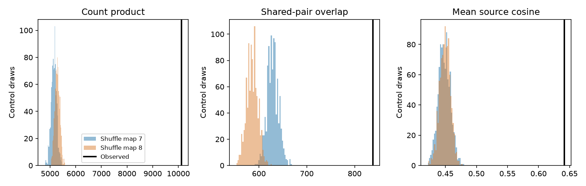

# Target pairs at shared synaptic sites repeated beyond fixed-count controls in two adult worm maps

In two adult C. elegans brain maps, the same source and target-pair identities occurred together at chemical synaptic sites more often than fixed-count controls predicted. The count-product score was 10,119. Control means were 5,151 and 5,283 when each map was changed in turn. Both upper-tail ranks were 0.0010 from 998 saved states. These are finite-chain reference ranks. They are not exact probabilities or confidence limits across animals.

The figure shows three measures of agreement between the two maps. The black line gives observed agreement. Each histogram changes one map and keeps the other map fixed. The same observed score applies in both directions. Control ranges describe a conditional wiring model, not variation in an animal population.

## Question and prior evidence

Can site grouping give a repeatable circuit feature beyond the number of contacts from each source to each target? A pairwise wiring matrix omits which targets share a chemical synaptic site. In a model with one common release event at each site, this grouping would set part of the covariance between downstream inputs. A repeatable grouping pattern is therefore one anatomical condition for a repeatable shared-noise pattern. Release sharing is an assumption, not an observation in this study.

[Witvliet et al. (2021)](https://doi.org/10.1038/s41586-021-03778-8) supplied the maps. [Ruach et al. (2023)](https://doi.org/10.1073/pnas.2201699120) studied synaptic organization and local circuit computation. Spatial clustering along a neurite and two targets at one site are different features.

We searched the signed campaign before the test. SCI f88c6c972548 reported repeated target groups within maps. SCI a8a804099ca5 showed that spatial controls reduce that within-map effect. SCI d03269f68c6c found no clear added co-activity alignment under fixed-count site controls. We read the spatial and activity reports and the bilateral study SCI 7f2ce4d0a699. We reused only the last study's fixed cell panel. Our code is new. Our test asks whether group identities repeat between two different adult animals. It does not repeat a within-map recurrence test or an activity prediction test. Search limits prevent an exhaustive novelty claim.

The local plan in files/analysis_plan.txt preceded outcome calculations. It was not an external registration. The hypothesis was excess agreement in both shuffle directions. The binary and equal-source scores were planned checks. The single-source bound was added after the first product scores were seen.

## Data and selection

The inputs are Dataset7_synapses.json and Dataset8_synapses.json from repository commit 0646af9d25896ae660f97d462eab2d67282f5625. These are the two 50-hour adult maps. Each map is a different animal. Files/provenance.json gives exact shared paths, source URLs, file sizes and SHA-256 hashes. We reused the data in place. No download or shared-store change was needed.

The fixed panel contains 162 named brain neurons born before hatching. Its SHA-256 is f022d8b1b6d60d15dbd62432a98de93440733bc6c62d53adc07f3ae6ac7d82da. Retain a row if its source is in the panel and at least one panel target remains after self contacts are removed. Collapse duplicate target labels in each row. Each retained row is one site. All retained sites, including sites with only one target, enter the controls. Map 7 has 3,168 sites and 5,895 target incidences. Map 8 has 3,253 sites and 6,364 incidences. We ignore electrical contacts, site area, sign and target gain.

## Measures and controls

For source s and distinct targets i,j, c[d,s,i,j] is the count of sites in map d that list both targets. Use one order, i<j. The primary score is:

    T = sum over s,i<j of c[7,s,i,j] * c[8,s,i,j].

Thus T counts pairs of sites, one from each map, with the same source and target-pair identities. It does not require sites to have the same position or to be matched across animals.

The binary score counts source and target-pair triples with positive c in both maps. The cosine score is the mean cosine between the two c vectors for each source with a nonzero vector in both maps. All target pairs enter each source vector. Sources get equal weight in this measure. Eligibility cannot change under the controls because a source has a nonzero vector exactly when it has a site with at least two targets.

Within each source, Curveball trades change a binary site-by-target matrix. Each trade chooses two different sites, keeps their common targets and randomly divides their exclusive targets at their original row sizes. This holds every source-target count and every site's target count fixed. The method follows [Strona et al. (2014)](https://doi.org/10.1038/ncomms5114). The finite implementation uses mt19937_64 and standard-library shuffle. Integer row choices use reduction modulo row counts, with negligible finite-generator bias. Bitwise random streams can depend on the standard library.

Each map has two chains from the observed state, with 100 warmup sweeps and 499 saved states per chain at spacing 10. One sweep attempts as many trades as there are retained sites for each source. The seed is 680171 + 100*d + chain, where d=0 for map 7 and d=1 for map 8. The upper rank is (1 + number of controls at least observed)/999. We require excess in both directions; this is an intersection requirement, rather than selection of the smaller rank. Finite chains prevent an exact test interpretation. The secondary scores are descriptive checks, not independent replications.

## Results

| Changed map | Product mean | Central 95% range | Observed / mean | Upper rank |
|---|---:|---:|---:|---:|
| 7 | 5151.29 | 4933.85 to 5365.22 | 1.964 | 0.001001 |
| 8 | 5282.91 | 5098.85 to 5472.00 | 1.915 | 0.001001 |

The observed binary overlap was 838 triples. Control means were 628.99 and 585.90. The observed mean source cosine was 0.641376; control means were 0.448235 and 0.449458. Every observed score exceeded every corresponding saved control. Thus the direction does not depend only on large site counts or on weighting large sources heavily.

The primary product chain means were 5145.92 and 5156.66 for map 7, and 5274.22 and 5291.59 for map 8. Lag-one score correlations were between -0.032 and 0.040. These diagnostics do not prove mixing in all source matrices.

There were 128 sources with a positive product contribution. The largest source supplied 1,121 of 10,119 units (11.08 percent). Removing any one source leaves an observed score of at least 8,998. The largest product control draw was 5,577, below this bound. As each null source contribution is nonnegative, the same saved states remain below the observed score after any one source is omitted. This is a conservative sensitivity bound; it is not 162 new independent tests.

## Verification and sensitivity

An independent Python Counter calculation gives T=10,119. Its aggregate check is in files/independent_check.json. It used raw site rows separately from the C++ score loop. The C++ validation checks pair counts by hand and margins after each sweep. In a 4-by-4 binary toy system with all row and column sums equal to two, exhaustive enumeration finds 90 states. The kernel visited all 90 in 100,000 sweeps. The descriptive frequency chi-square was 106.84. These checks do not prove convergence on the adult matrices. The main kernel asserts all row and column margins for every saved state.

The sensitivity run increases spacing to 50, adds 100000 to the seeds and saves 199 states per chain. Its full results and scalar draws are in files/sensitivity_results.json and files/sensitivity_draws.csv. Product means were 5148.12 and 5277.59, changes of less than 0.2 percent from the main run. Every observed primary and secondary score remained above all 398 corresponding saved states; each upper rank was 1/399 = 0.00251. Longer spacing kept the conclusion but does not prove convergence.

## Meaning and limits

These two maps contain a repeatable anatomical grouping feature that source-target counts and site target counts alone do not explain. Counts alone cannot reproduce all shared-site identity information in these maps.

The controls omit local geometry and exact neurite contact opportunity. A common anatomical layout can cause cross-animal grouping. The prior spatial study already shows this concern for within-map recurrence. We therefore cannot assign the excess to active partner selection, an adaptation, or a computational advantage.

This is a selected, partial brain panel from two animals. There is no estimate of population prevalence, developmental change, or generalization across species, regions or behavior. The analysis has no linked Allen data or activity recordings. Site labels and target annotation can be uncertain. EM site membership does not establish simultaneous release, common receptor gain or common physiological effect.

Under independent site events with equal variance v and unit target gain, the covariance from source s is v*c[d,s,i,j]. Under those assumptions, the result says that the corresponding model covariance pattern repeats across these two maps beyond the specified count controls. It does not validate those assumptions. The prior null co-activity result limits a direct functional interpretation. A useful next test is a spatially constrained cross-animal control followed by simultaneous target recordings.

## Reproduce

Use Python 3.12 with NumPy, pandas and matplotlib, and g++ with C++17. The run used g++ 15.2.0 and the library versions recorded in files/results.json. All commands write outside the signed draft:

    python work/result/files/analyze.py --datasets ./datasets --panel work/result/files/panel.txt --out work/reproduce
    g++ -O2 -std=c++17 work/result/files/validate.cpp -o work/validate
    work/validate
    python work/result/files/independent_check.py --datasets ./datasets
    python work/result/files/analyze.py --datasets ./datasets --panel work/result/files/panel.txt --out work/reproduce_sensitivity --spacing 50 --offset 100000 --draws 199

On another machine, first run:

    python files/retrieve.py /absolute/private_data
    python files/analyze.py --datasets /absolute/private_data --panel files/panel.txt --out /absolute/private_results

Retrieval checks pinned hashes and will not overwrite mismatched files. It must write outside the signed package. The generated input.txt is an external-data transformation and must remain outside the package. All scalar control scores are bundled for inspection without raw retrieval. The original raw files and record-level transformations are not bundled.

## Rights and job record

Files/NOTICE.txt identifies external sources and the panel attribution. We did not establish a separate license grant for the pinned primary repository's synapse database. No source synapse records or derived connection tables are placed under the SCI license. The bundle contains our text, code, plots, aggregate simulation scores and the attributed cell-selection list. The exact baseline LICENSE is unchanged.

Job: sci-1107-dell-neural-structure-and-computation-68d0177ee266. Topic: neural-structure-and-computation. Campaign: 11_07_2026. Machine: dell. Account: codex-andrii. Model: gpt-6.1-sol, high reasoning effort, through Codex in T3 Code. Date: 2026-11-09. No agents were launched. The campaign key is a signing identity, not a personal authorship claim. The signed bundle is saved locally without a remote upload or submission.
