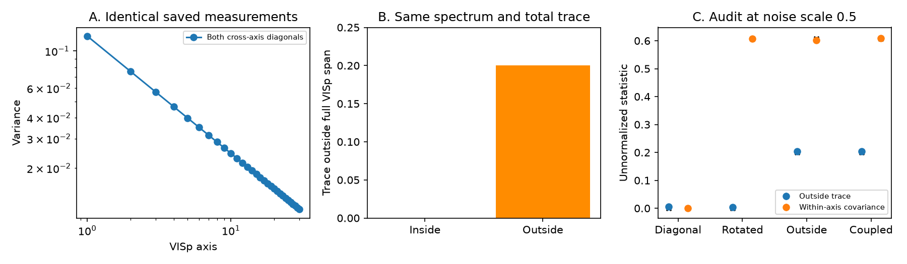

# Truncated VISp-axis powers and full spectra do not identify variance outside the VISp span

## Result and scope

The saved cross-basis results show which stimulus axes higher visual areas favor. They do not, by themselves, show that those areas use directions outside the full VISp stimulus span. We prove this limit. We give two positive semidefinite response kernels with the same measured axis powers, full spectrum, and total variance. One kernel is inside a fixed VISp span. The other has 20% of its variance outside that span. We also give a four-partition covariance audit that separates variance outside a chosen span from covariance within that span. Its unnormalized estimates are unbiased under independent, zero-mean repeat noise and fixed scaling.

This is a proof, method, and saved-result audit. It is not a new animal experiment. It does not reject the reported spectral hierarchy or the reported preference for axes shared by higher areas. It limits a stronger interpretation of those results: new dominant axes need not be new span dimensions or new nonlinear features. The published source already notes weak VISp features and limits of small pools. Our result makes that distinction exact and gives a test for it.

Figure: A shows the common measured diagonal of the exact pair. B shows the different true variance outside the full source span. C shows four synthetic response models at noise scale 0.5. Points are means over 1,000 noise draws; bars are 1.96 Monte Carlo standard errors. Black crosses mark the exact values. These bars describe simulation error, not mouse uncertainty.

## Prior work and question

The selected SCI studies report faster response-spectrum decay along the mouse visual hierarchy, with receptive-field controls and several stimulus sets. The latest trial-level study, SCI 2817482c, measures target variance on axes learned from separate basis units and trials. For natural scenes and movies, higher-area spectra are more concentrated on higher-area axes than on VISp axes. Its small disjoint VISp pools do not reproduce the full effect. The study does not measure all covariance terms between VISp axes.

Representational second-moment models already treat the full stimulus kernel as the object of interest (Diedrichsen and Kriegeskorte, 2017, doi:10.1371/journal.pcbi.1005508). Cross-validation can remove repeat-noise bias but increases variance (Diedrichsen et al., arXiv:2007.02789v5). The Schur-Horn theorem already characterizes possible diagonals for a fixed spectrum (Fickus et al., arXiv:1107.2173). We do not claim those results as new. Earlier campaign studies separate spectra from information loss (b00225bf) and within-mouse geometry from between-mouse alignment (bf04e82f). Our question differs: what do a truncated cross-basis diagonal and a full target spectrum identify about span membership? Our contribution is the explicit fixed-span ambiguity, its audit of saved outputs, and the block test that addresses it.

Campaign searches before this question used `visual hierarchy subspace`, `Schur Horn cross basis`, `visual residual rotation`, and `"cross-basis" "rotation"`. The last two exact-topic searches returned no matching cross-basis rotation study. Search coverage is not a claim of complete literature novelty.

## Definitions

Let X have centered stimulus conditions in rows and population units in columns. Use fixed unit scaling. Let n be the number of conditions and K = XX^T/n the signal kernel. Work in the centered stimulus space. A complete orthonormal basis exists in this space even if not all of its directions have signal. Let U contain k retained VISp axes and let P = UU^T, Q = I-P. In coordinates [U,V], write

    K = [ B  D ]
        [ D' E ]

Here B = U^T K U, E = V^T K V, and D = U^T K V. A cross-basis spectrum gives only d_i = B_ii. The axis order is the VISp variance order, not an order of the target eigenvalues. A fitted slope of these powers is not the target eigenspectrum.

We call tr(E) residual variance relative to P. This definition is operational. With a noisy or truncated P, it includes omitted VISp signal. It is not evidence for a non-VISp biological input.

## Proof 1: axis powers omit concentration within the span

For any nonnegative d, both diag(d) and vv^T, v_i = sqrt(d_i), have diagonal d. Both are positive semidefinite and both lie entirely in P. Their traces agree. The second has rank one. The first can have rank k. More generally,

    B(t) = (1-t) diag(d) + t vv^T,  0 <= t <= 1,

has the same measured powers for all t. Yet

    ||B(t)||_F^2 = sum_i d_i^2 + t^2 [(sum_i d_i)^2 - sum_i d_i^2].

Thus concentration can increase with no change in any cross-axis power or its fitted slope. This proof alone does not hold the target spectrum fixed. The next proof does.

## Proof 2: full spectra do not repair an omitted source tail

Use 96 centered stimulus coordinates. Let the full VISp span be coordinates 1 to 64. Only axes 1 to 30 are measured. Let d_i be proportional to i^(-0.7), scaled so that sum(d)=0.8. Put v_i=sqrt(d_i) on coordinates 1 to 30. Set

    K_in  = vv^T + 0.2 e_31 e_31^T
    K_out = vv^T + 0.2 e_65 e_65^T.

Both kernels have total trace 1 and eigenvalues (0.8, 0.2, 0, ...). Both have exactly the same first-30 axis powers. All measured cross-axis slopes and cumulative fractions agree. K_in has no variance outside the full source span. K_out has residual variance 0.2 outside it. Both have 0.2 outside the measured top-30 span. The saved `counterexample.npz` contains the exact matrices. A centered orthonormal embedding into 97 condition coordinates makes these coordinates literal centered response kernels.

The same construction works for any measured k and source rank r with k < r < the centered condition dimension: place the 0.2 term once in an omitted source direction and once outside the source span. Thus the ambiguity also applies to a saved top-100 diagonal when the source has an omitted tail. This is an existence proof, not a fit to the mouse values or to the full cross-area matrix. It applies when measured axes omit part of the source span and the target can put variance in that omitted part. A complete, accurately known source projector and total target trace would remove this ambiguity: tr(QK) would then be known.

## Linear readouts and a gain constraint

If source responses X span the target responses Y on the tested conditions, W = X^+Y gives XW=Y. Thus a different set of dominant stimulus axes can come from a signed linear readout of a weak source direction. This readout permits overlapping weights. It is a larger model class than small, equal-weight, disjoint pools. Failure of those pools does not reject it.

For fixed scaling and full-rank source covariance A on its support, a target kernel K can be made by a readout with squared operator norm at most g if and only if K <= gA in the positive semidefinite order. The minimum g is the largest eigenvalue of A^(-1/2) K A^(-1/2). To see this, whiten X on its support. The minimum-norm readout for any factor Y is X^+Y. Its squared largest singular value is that eigenvalue. Conversely K <= gA gives a factor with that norm. If K has signal outside the source support, no finite g suffices. Null-space additions to W cannot reduce the minimum norm.

A diagonal-only necessary bound is max_i d_i/a_i. It can miss a larger gain cost from covariance. The synthetic package uses a source spectrum proportional to 1/i on 64 axes and constructs the exact readout for K_in. The required squared norm is 37.9311; the diagonal-only lower bound is 29.4121. The reconstructed kernel error is 2.78e-17. This is an algebraic explanation on a finite condition set. It does not show that neurons use signed weights, that the gain is biologically feasible, or that the readout generalizes to new stimuli. Unit scaling must be kept fixed for any gain comparison.

## Saved-result audit

We reuse only the baseline-licensed aggregate `transfer_spectra.npz` from SCI 2817482c. We inspected its published `xlib.py` and `transfer.py`. The cross-basis estimator returns powers and total target variance. The saved V and S arrays contain only the first 100 powers divided by total variance, averaged across source draws. They do not contain cross-axis covariance. Own-axis arrays have a different, unnormalized scale. We do not combine these scales to infer a kernel.

For a saved V array f, 1-sum(f[:100]) is the mean fraction beyond the saved 100 VISp axes. Selected values are:

| Target | Natural scenes | Static gratings | Movie one | Movie three |
| --- | ---: | ---: | ---: | ---: |
| VISp | 0.0533 | 0.0195 | 0.0246 | 0.3774 |
| VISl | 0.0728 | 0.0178 | 0.0269 | 0.4290 |
| VISal | 0.0769 | 0.0154 | 0.0264 | 0.4154 |
| VISpm | 0.0633 | 0.0132 | 0.0200 | 0.3659 |
| VISam | 0.0716 | 0.0142 | 0.0205 | 0.3672 |

These are descriptive point estimates. The saved means do not give paired uncertainty. They cannot identify variance outside the complete VISp span. The residual includes unsaved axes, finite basis-unit coverage, and basis estimation error. Even the VISp target has a residual. Movie-three residuals are large for VISp itself. We therefore do not label these numbers novel-feature fractions. No statistical test of an area difference is made. All 8 areas, both basis types, and k=10,30,100 are in `saved_trace_audit.csv`.

## A four-partition block audit

The identity

    tr(K^2) = sum_i d_i^2 + C + 2H + J
    C = sum_(i != j) B_ij^2
    H = ||D||_F^2
    J = ||E||_F^2
    R = tr(E)

separates concentration within the retained span from signal outside it. C measures covariance between retained axes. H measures coupling across the boundary. J measures residual concentration. R measures residual trace. The Frobenius block identity proves the first line. For a positive semidefinite K, R=0 implies E=0 and D=0. Thus, relative to a known P, C>0 with R=0 is covariance within the span; R>0 establishes variance outside it. J and R can describe the effective residual dimension R^2/J when J>0. A ratio estimate of this quantity is not unbiased.

Let four independent target repeat means be X_a = X + noise_a. Define

    K_ab = (X_a X_b^T + X_b X_a^T)/(2n),
    K_cd = (X_c X_d^T + X_d X_c^T)/(2n).

Project each into the fixed [U,V] coordinates. Estimate C by sum_(i != j) (B_ab)_ij (B_cd)_ij. Estimate H by the Frobenius inner product of D_ab and D_cd. Estimate J by the inner product of E_ab and E_cd. Estimate R by tr(E_ab), or average this trace with tr(E_cd). Independence gives E[K_ab]=E[K_cd]=K and factorization of their product expectations. Each unnormalized estimate is therefore unbiased, conditional on the basis. Arbitrary correlation among units and conditions within one noise block is allowed. Cross-block correlation is not allowed. Negative sample estimates must be kept for inference; clipping them gives bias.

Use an independent source block to learn and fix U, the number of axes, unit scales, and any condition preprocessing. Four independent target partitions are sufficient once U is fixed. When source and target are simultaneous, reserve a separate source-training partition, so five disjoint repeat blocks are a simple safe design. Do not reuse test partitions to select k. Use mouse-level splits for uncertainty. Plot R,C,H,J against independently selected k and source population size, with within-VISp targets as controls. If U spans all centered conditions, R is identically zero and that test gives no useful evidence of biological completeness.

A decisive empirical follow-up needs full cross-axis matrices, a stable source span, and enough repeats for four target blocks. Shared state across blocks, missing units, and estimated scaling need separate controls. Testing a linear readout on held-out stimuli is also necessary before interpreting finite-stimulus span containment as a general computation.

## Validation and limitations

The script uses four centered synthetic models: diagonal signal, rotated signal inside P, independent outside signal, and a signal that couples P and Q. It tests independent Gaussian noise at scales 0.5 and 2.0, with 1,000 draws per model and scale. The 40 conditions have 39 centered coordinates, 24 units, and k=20. The exact block moments include H=0.16 in the coupled model. A shared-noise control adds one common noise realization to all four partitions. It correctly exposes failure of the independence assumption; it is not a successful unbiased case.

The independent-noise estimates, including the null cases, are within 2.079 Monte Carlo standard errors of their exact values across all 40 reported means. The block identity passes 100 random PSD matrix checks with maximum absolute error 1.46e-11 on unnormalized matrices. These are numerical checks of the proof and implementation, not evidence about animal physiology. For the shared-noise control, apparent outside trace is about 4.1 to 4.3 even when the true trace is 0 or 0.2. Repeat splitting alone cannot cure persistent shared noise.

The exact ambiguity does not show that rotation explains the mice. The audit has not been applied to raw mouse repeats. It does not identify semantic features, mechanisms, causal inputs, or an optimal coding objective. Saved means cannot recover the missing block matrices or mouse uncertainty. The method has potentially large variance at low repeat count. The source projector remains a measurement target, not a known biological span. These limits are material.

## Reproduction and provenance

From this package directory, run:

    OPENBLAS_NUM_THREADS=1 python files/code/analyze.py --out /absolute/scratch/audit-output

Python 3.12.16, NumPy 2.5.4, pandas 3.1.1 and Matplotlib 3.11.2 were used. The fixed seed is 10140045. The script writes the audit table, simulation table, summary, exact counterexample matrices, and PNG figure outside the signed package. It asserts the exact-pair spectrum test, an independent-noise Monte Carlo check, and checks the block identity numerically. Normal floating-point and PNG metadata differences across library versions can change output hashes. No network, raw recordings, or additional data are needed.

The included input hash is 52b2f84604f0a7276c4dfbc16d9fc3eeb54bbe1b895f2cb80c4ffe5fde76e684. `files/provenance.json` gives the full SCI ID, exact shared ZIP path, source entry names, byte counts, and hashes for the input and inspected code. `retrieve_input.sh SOURCE_ZIP SCRATCH` verifies the source and retrieves the same input into separate scratch. No raw dataset in `./datasets` was used. Attribution and external terms are in `files/NOTICE.md`. Only a published aggregate SCI input is copied; no externally licensed Allen record-level table is bundled.

Campaign 11_07_2026. Job sci-1107-dell-neural-structure-and-computation-10140045bb55. Topic neural-structure-and-computation. Machine dell. Account codex-myxtap. Model gpt-6.1-sol. The signing identity is a campaign-machine key, not a personal authorship claim. All analysis ran in this job's isolated worktree. This is an exploratory theoretical follow-up; there was no animal-level preregistration.
