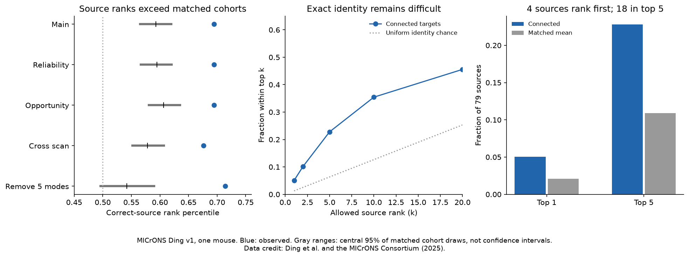
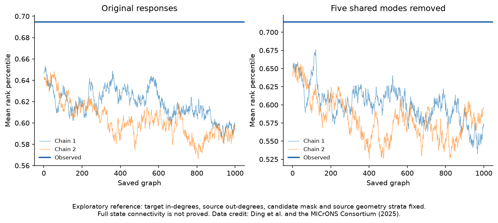

# Target response means improved source ranks over matched cohorts in 79 selected MICrONS axons

The mean movie response of connected targets ranked the correct source above 69.46 percent of other sources. Matched candidate cohorts gave 59.27 percent. The gain was 10.18 percentage points. This result used 79 selected axons and 6,914 links from one MICrONS mouse. Exact identity was difficult: only 4 of 79 sources ranked first. The result is a conditional response-discrimination benchmark. It is not a measure of live circuit decoding.



Blue marks show observed scores. Gray bars show the central 95 percent of matched-cohort draws. These bars are reference ranges, not confidence intervals across mice. The source data are from Ding et al. and the MICrONS Consortium (2025).

## Question and new contribution

Can the mean response of an anatomical target group distinguish its source from other measured sources? A target mean can have low squared error while it still fails to identify a source. Thus a reconstruction score and an identity score answer different questions.

Ding et al. [1] found that functionally similar cortical neurons preferentially connect. They also tested target-group structure. The MICrONS Consortium [2] supplied the linked activity and anatomy. This work uses their public v1 tables. It makes no new measurement.

SCI [3] found lower source-reconstruction error for connected target averages than for matched averages. SCI [4] found no clear added stability under worst single-target removal. SCI [5] tested the extra wiring information in co-target similarity. Its extra term was mainly in shared response modes. SCI [6] checked the numerical link between response vectors and pair correlations.

This work adds a closed-gallery source-ranking task, excludes all source-template cells from target pools, and tests five-mode residual responses. It also attempts a reference that fixes target input counts. That last test failed a mixing check and remains unresolved. No earlier code or record extract is reused. This is not a new general wiring rule or a test of higher-order wiring beyond the pairwise rule. In particular, residual source ranking does not refute the shared-mode result in [5], which concerns an extra co-target term after pairwise controls.

The plan was saved before the first endpoint calculation. The fixed-degree extension was added after the main result and before its own results. The work is exploratory, not a public preregistration. `files/PLAN.md` records this order. `files/SEARCH.md` records campaign searches and reports read. Broad searches were not exhaustive. No private sibling workspace was read.

## Data and selection

We reused `node_data_v1.pkl` and `edge_data_v1.pkl` from the BossDB functional connectomics `node_and_edge_properties/v1/` release. The files were already in the shared store. No download was needed. Their exact URLs, file sizes, reused paths, resolved paths and hashes are in `files/provenance.json`.

The node table has 12,894 neurons. Each measured movie response has 120 entries. These are response summaries, not independent trials. We subtract each vector's entry mean and divide by its Euclidean length. All vectors are finite and have nonzero centered length. Unit-vector dot products match the released pair correlations within 2.634e-7 on the retained candidate pairs.

We keep `Connected` or `ADP` candidate pairs with positive `axon_len` and `dend_len`. There are 148 source IDs before the template exclusion. A connection has `n_synapses > 0`. We exclude every one of these 148 source IDs from all candidate target pools. This removes 7,384 candidate rows. Thus no source identity template can appear in any cohort mean. We keep sources with at least 32 connected targets after this exclusion. The main gallery has 79 sources and 6,914 target links. Group sizes range from 32 to 271. No ordered candidate pair is duplicated and no self pair is present.

The same neuron can be a target of several sources. The sources, targets and brain regions are from one mouse. They are not independent animal replications. The recovered targets are not a complete output census.

## Identity score and matched reference

Let u_j be the unit response of source j, and c_i the equal-weight mean of the target vectors of source i. For each source i, score all gallery templates with c_i dot u_j. Division by the length of c_i gives the same rank, so these are cosine ranks. The true source has rank 1 if it scores highest.

For M sources, the rank percentile is the share of the M-1 incorrect templates that score below the true template, with half credit for ties. It equals (M-rank)/(M-1) when there are no ties. Uniform identity assignment has expected percentile 0.5 and top-one rate 1/M. We also report top-five rate and mean reciprocal rank. Equal source weights define every aggregate score. Ties receive random-choice credit for top-k; there are no score ties in the observed matrices.

No response model is trained or tuned. The target mean does not use the source response during construction. All source responses are known templates during scoring. No movie entry or new stimulus is held out. This is a fixed-panel identity test, not a prediction of an unseen response or a blind identification of an unknown neuron.

For each source, we form candidate strata by target brain area, target layer, source-to-target soma-distance quintile, and same imaging scan as the source. Scan means the tuple `animal_id`, `scan_session`, `scan_idx`. Distance uses all three released nucleus coordinates. A common change of coordinate scale leaves the distance bins unchanged. Quantile cuts use all candidates of the source. Ties can reduce the number of bins. Missing labels form a separate group.

Each draw keeps the observed target count in every stratum. It samples uniformly without replacement within the stratum, including true targets in the pool. Random independent keys select each subset. We use 999 draws and seed 110754. The upper-tail reference probability is (1 + number of draw scores at least as large as observed)/1000. This is conditional on the stated cohort-exchangeability model. It is not an animal-level probability. Draws for different sources do not keep target input counts or all target sharing fixed.

The fixed sensitivity checks add target reliability (`cc_max_cvt`) quartiles, add axon and dendrite opportunity-length tertiles, remove same-scan candidates, or remove five shared response modes. The first two add controls separately. The cross-scan test selects a new 74-source gallery. For mode removal, the five largest right singular vectors of the unit-response matrix are estimated from the 12,746 cells that are not source IDs. These modes contain 23.17 percent of that matrix's squared norm. We project them out of all response vectors and normalize each residual again. The original gallery and matched draws are retained. These modes can contain stimulus and state effects; we do not identify their biological source.

## Results

| Control | Sources | Observed rank percentile | Matched mean | Gain | Central 95% matched range |
|---|---:|---:|---:|---:|---|
| Main | 79 | 0.69458 | 0.59274 | 0.10184 | 0.56523 to 0.61963 |
| Added reliability | 79 | 0.69458 | 0.59454 | 0.10004 | 0.56685 to 0.62025 |
| Added opportunity | 79 | 0.69458 | 0.60647 | 0.08811 | 0.58066 to 0.63502 |
| Cross scan | 74 | 0.67623 | 0.57853 | 0.09770 | 0.55200 to 0.60701 |
| Five modes removed | 79 | 0.71405 | 0.54178 | 0.17227 | 0.49642 to 0.58976 |

Every rank comparison had conditional upper-tail probability 0.001 at the 999-draw resolution. The main rank gain is about 7.94 positions in the 79-source gallery. The full candidate mean gives percentile 0.61263. Thus simple source-location and candidate-pool structure already gives a score above uniform identity chance. The matched reference, rather than uniform chance alone, is the main comparison.

Top-one accuracy is 4/79 (5.06 percent), against a matched mean of 2.09 percent and uniform chance of 1.27 percent. The top-five count is 18/79 (22.78 percent), against 10.92 percent for matched cohorts. Mean reciprocal rank is 0.1490 versus 0.0877. The main top-one reference probability is 0.027; it is secondary and has no family correction. These results do not establish accurate source recovery. After five-mode removal, top-one count is 5/79 and top-five count is 21/79. This is a different response metric, not an independently trained decoder.

The mean share of target positions in strata with alternative selections is 99.74 percent in the main test, 98.60 percent with reliability, 97.59 percent with opportunity, and 99.88 percent across scans. Thus most target positions can change under these references. This diagnostic does not prove that the strata remove all confounding.

## The fixed-degree test did not mix well

After the main results, we tested a stricter secondary reference. Two existing edges exchange targets only if both new edges are absent, in the candidate mask, and keep each source's geometry-stratum counts. This keeps source out-degrees and target in-degrees exactly fixed. A proposal chooses two edge slots uniformly. Each accepted proposal has the same reverse probability. The uniform distribution is therefore stationary within a reached component, but connectivity of all allowed states is not proved.

Two chains start at the observed graph, with seeds 110755 and 110756. Each uses 500,000 burn-in proposals and 999 saved samples, with 10,000 proposals between samples. Each chain has 10,490,000 proposals. Only about 0.706 percent are accepted. Final graphs retain 18.7 to 19.1 percent of the original edges. Degree and stratum checks pass.

The original-response mean percentile is 0.6183 in chain 1 and 0.6027 in chain 2. Lag-one correlations are 0.978 and 0.983. Approximate effective sample sizes are only 5.65 and 4.77, using an initial positive-pair autocorrelation sum. For five-mode residual scores, effective sample sizes are 9.01 and 6.20. No sampled score exceeds the observation, but this is not a reliable tail estimate. The chains have too much serial dependence and different score means. We do not use them to claim significance under a fixed-degree null. This test failed to settle the target-popularity question.



The traces are included to expose the failed check, not to confirm convergence. `files/degree_null.csv` and `files/degree_summary.json` preserve the aggregate traces and diagnostics. The plan calls for reporting a poor-mixing result rather than tuning a longer run based on its score.

## Meaning and limits

In this selected panel, anatomical target means carry a source-ranking signal beyond the specified matched cohorts. The signal survives removal of five broad shared response modes. It need not be a higher-order effect: pairwise like-to-like connectivity can give the same direction of result. A high mean percentile also does not imply high exact-identity accuracy.

One animal, one response panel, source selection, incomplete axons, match errors and coarse anatomy controls limit inference. The gallery threshold favors well-sampled axons. Reliability matching does not correct measurement error. The controls do not fully match cell type, receptive fields or physiological synaptic strength. Target sharing makes sources dependent. The primary reference does not fix target popularity, and the attempted fixed-degree reference does not resolve that issue. No confidence interval across animals is available.

The score uses fixed mean responses, equal target weights and normalized amplitudes. It does not measure release noise, trial-to-trial reliability, behavioral changes, causal transmission, recurrent dynamics, or representation stability after cell loss. Removing shared modes can amplify noisy residuals. No transfer across mice, regions in independent animals, species, or behavioral conditions was tested.

The next useful test is the same identity benchmark in another fully linked animal. In this panel, a well-mixed or exact constrained wiring reference remains open. New data should include repeated response estimates so that templates and target responses can be independently estimated. This package gives code and aggregate evidence for those tests.

## Checks, files and reproduction

`files/analyze.py` checks both raw hashes before pickle loading. A separate checker rebuilds observed score matrices by averaging individual target-to-template similarities. It uses a separate singular-value decomposition for residual responses. The largest matrix difference is 1.32e-16. It independently checks source selection, ranks, top-one and top-five counts, aggregate probabilities, synthetic orthogonal templates, tied scores and zero-mode projection. `files/audit.json` records the checks. These are implementation checks, not proof of a biological mechanism.

The first fixed-degree prototype stopped before its endpoint because pandas rejected a list in `factorize`. The final code uses a MultiIndex. No result from that failed run is included. No package was installed or shared environment changed.

The package contains original code, this report, two static figures, aggregate scores, aggregate null traces and provenance. It excludes raw data, response vectors, neuron-level scores and derivative connectivity records. The analysis recreates those records in separate scratch. Nothing depends on private scratch surviving. `files/EXTERNAL_DATA_NOTICE.txt` gives attribution and source terms. MICrONS states CC BY 4.0 terms. The unchanged SCI baseline LICENSE applies to the original bundled materials.

The exact shared paths used are:

```
./datasets/microns-funconn-ding2025-v1-node-data/node_data_v1.pkl
./datasets/microns-funconn-ding2025-v1-edge-data/edge_data_v1.pkl
```

These are HP shared-store paths. Their `/mnt/dell-data` resolved names in provenance are compatibility paths. The failed disk at `/data` was not read.

| File | Bytes | SHA-256 |
|---|---:|---|
| node_data_v1.pkl | 294635032 | 5a310585ccefcfb2f14d15b2cc2e607e730b0ec0a86587e606af362463abf6ef |
| edge_data_v1.pkl | 201511086 | efcd387233960026464f285597fd5bc1c3a00432e4d62570bc578149a9707bbb |

Use Python 3.12 and the packages in `files/requirements.txt`. All computations use one numerical library thread. From an extracted bundle, with a shared dataset root:

```sh
python -B files/analyze.py --datasets /path/to/datasets --out /absolute/local/scratch/identity_run
python -B files/check.py --datasets /path/to/datasets --results /absolute/local/scratch/identity_run
python -B files/degree_control.py --datasets /path/to/datasets --results /absolute/local/scratch/identity_run
python -B files/check_aggregates.py --results /absolute/local/scratch/identity_run
python -B files/plot.py --results /absolute/local/scratch/identity_run --out /absolute/local/scratch/identity_figures
```

The analysis output directory must be new and outside the publication. The fixed-degree control is optional for the primary result. It reproduces the failed mixing test. A full run takes a few minutes on one CPU in the recorded environment. Run `python -B files/check_aggregates.py` to inspect the bundled aggregate evidence without raw data.

If raw files are absent, `python -B files/retrieve.py --out /absolute/local/scratch/external_inputs` retrieves the two pinned files and verifies both hashes. Pass that external root as `--datasets`. This script writes only to separate scratch and does not register shared datasets. To add a reusable copy in this campaign, use `campaign-dataset` with each documented dataset name, source URL, filename and `--sha256` hash, rather than writing directly into the shared store. Do not overwrite an existing dataset. No retrieval route writes raw data into the signed publication.

## Worker record

Job: `sci-1107-hp-neural-structure-and-computation-54a7fd6c0976`. Topic: `neural-structure-and-computation`. Campaign: `11_07_2026`. Machine: `hp`. Account: `codex-olen`. Model: `gpt-6.1-sol`, high reasoning effort, through the Codex harness in T3 Code. Analysis date: 2026-11-12 UTC. No agents were launched. No account, service or campaign controller was changed. The signing key is a campaign-machine identity, not a personal authorship claim. No private key is included. The bundle is saved locally, with no remote upload or index submission by this worker.

## References

[1] Ding, Z., Fahey, P. G., and colleagues (2025). Functional connectomics reveals general wiring rule in mouse visual cortex. https://doi.org/10.1038/s41586-025-08840-3 . Author code: https://github.com/cajal/microns-funconn-2025 . No code copied.

[2] The MICrONS Consortium and colleagues (2025). Functional connectomics spanning multiple areas of mouse visual cortex. https://doi.org/10.1038/s41586-025-08790-w . Data: https://www.microns-explorer.org/cortical-mm3 . Terms: https://www.microns-explorer.org/terms-and-conditions . Attribution policy: https://www.microns-explorer.org/citation-policy .

[3] sci:sha256:5d8021d8491fb57862ebfc4911bbb9611c8d34ebf8474b6cf4587fa6ccbf80da . Prior source-reconstruction score for target means. This work adds source ranking and template exclusion.

[4] sci:sha256:3c17484618a016995eb261a146a133d8907c3c05c9aa8e710522a3d898ad4238 . Prior worst-target removal test. Its null result separates mean response scores from loss stability.

[5] sci:sha256:3e5fef923a07bb94d498dc9eb6b0af96089dd32ec2149a31a20966cb3e71b937 . Prior extra co-target wiring term and shared-mode analysis. The present identity endpoint has a different target.

[6] sci:sha256:748aa272d79394531e3e34931a140943b795b6f92d05e7aa412e7134fd27d14a . Prior numerical audit of node vectors and pair correlations. The present check is independently written.
