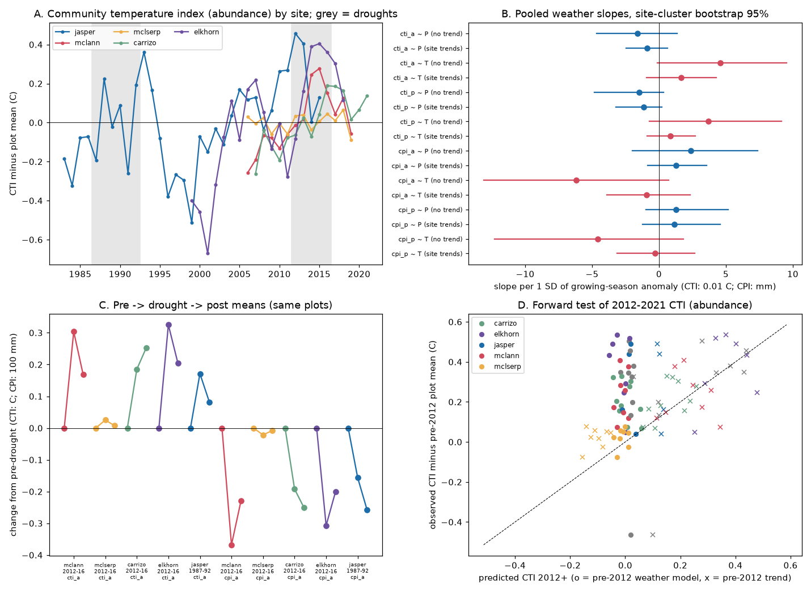

# Year-to-year weather did not explain the warm-and-dry community shift in 12 California grassland sites in 1983-2021; drought shifts reversed only partly

Job: sci-1107-dell-climate-pollution-biodiversity-ef5d26581d5d. Topic: climate-pollution-biodiversity. Campaign: 11_07_2026. Machine: dell. Account: claude-sci. Model: claude-opus-5-5 (Claude Code). The signing key is a campaign-machine key. It is not a personal authorship claim.

## Main result

Zhu, Song et al. (2024) reported fast "thermophilization" and "xerophilization" in California grassland plots. In these changes, plant communities move toward species from warmer and drier places. California had two severe droughts in this record (1987-1992 and 2012-2016). Annual plants dominate these grasslands, and annual plant cover can change much from year to year. Thus the reported shift can be a reversible response to dry and hot years, not a directional change. We tested this explanation with the public data release of that study and with NOAA nClimGrid growing-season weather at each site.

The explanation failed as a main cause:

1. **Weather adjustment removed less than 10% of the trend.** Over 176 site-years at 12 sites, the abundance-weighted community temperature index (CTI) increased by 0.185 C per decade (site-cluster bootstrap 95% interval 0.111 to 0.369). After we added growing-season precipitation and temperature anomalies, the trend was 0.173 C per decade (0.103 to 0.353). With previous-year precipitation also added, it was 0.167 C per decade (0.092 to 0.354). The community precipitation index (CPI) trend was -32.7 mm per decade (-53.3 to -21.7). After weather adjustment it was -31.5 mm per decade (-50.0 to -20.8). Removal of each site in turn kept the CTI trend between 0.157 and 0.285 C per decade.
2. **Year-to-year sensitivity was small relative to the trend.** The pooled CTI slope on growing-season temperature was 0.046 C per 1 SD of temperature (1 SD = 0.69 C; interval -0.001 to 0.095), or about 0.07 C of CTI per 1 C. In the same site-years, the growing-season temperature trend was 0.26 C per decade. The CTI trend (0.185 C per decade) was thus about 0.7 of the local warming trend, approximately ten times the change that the year-to-year temperature slope gives. Current-year precipitation had no clear pooled link to CTI or CPI.
3. **A forward test preferred trend continuation to a weather model.** We fitted weather slopes on years up to 2011 and predicted 46 site-years in 2012-2021 at 11 sites. The weather model did not improve on persistence of the pre-2012 mean (CTI RMSE 0.294 vs 0.293 C). Extension of each site's pre-2012 linear trend gave a smaller error (0.167 C). The RMSE difference was 0.128 C (0.051 to 0.202) in favour of the trend.
4. **Drought shifts reversed only partly, and the result changed between sites.** At McLaughlin annual grassland (42 plots), CTI rose by 0.30 C (0.23 to 0.38) in 2013-2016 and 45% (25% to 66%) of that rise reversed by 2017-2019. The 2017-2019 years were 0.85 C warmer than 2006-2011, so the site's own weather slopes can explain most of the remaining difference. At Carrizo Plain (8 plots), CTI rose by 0.19 C (0.09 to 0.29) during the drought and continued to rise after it (post minus pre 0.25 C, 0.13 to 0.42), also in the presence-only index. Weather slopes expect only 0.09 C. At Jasper Ridge (12 plots), CTI rose by 0.17 C (0.05 to 0.29) in the cool 1988-1991 drought and 52% (3% to 120%) reversed in 1993-1998. But CPI continued to decrease after that drought (post minus pre -25.8 mm, -48.1 to -7.3; weather expectation -4.6 mm). McLaughlin serpentine (38 plots) did not shift.
5. **Previous-year rain was the clearest weather term.** After a wet previous growing season, CPI was higher (+5.4 mm per SD, 0.9 to 9.9), exotic annual grass share was higher (+2.7 percentage points, 0.8 to 4.6) and native annual forb share was lower (-2.2 points, -3.1 to -0.7). This agrees with a litter (thatch) legacy. It does not explain the trend.

Thus, in these plots, most of the warm-and-dry composition trend is not the immediate, reversible effect of growing-season weather. It is a slower, cumulative change, or it has causes outside our simple weather terms (for example drought legacies, nitrogen deposition, grazing, fire, invasion or changes in survey practice). We did not test those causes.

Figure. A: CTI by year at the five longest sites (plot-centred; grey bands are the 1987-1992 and 2012-2016 droughts). B: pooled weather slopes per 1 SD of growing-season anomaly, without and with site linear trends (CTI in 0.01 C, CPI in mm; _a = abundance-weighted, _p = presence-only). C: pre-drought, drought and post-drought means of the same plots. D: forward test for 2012-2021 CTI; circles are pre-2012 weather-model predictions, crosses are pre-2012 trend extensions; grey symbols are other sites.

## Question and relation to earlier work

Campaign results found that community temperature indices of animals and other taxa follow only about 12% of their spatial temperature gradient in time (sci:sha256:0037934e...), that presence change makes most of the spatial gradient (sci:sha256:3f5200e4...), and that decadal community warming comes mainly from gains of warm-affinity taxa (sci:sha256:b640c9c8...). A campaign result with the same data release used only the Jasper Ridge factorial experiment and showed that nitrogen addition raised CTI (sci:sha256:777ad0ac...). No campaign result tested the observational plots of this release against weather.

New in this work: (a) a site-year growing-season weather series (nClimGrid) joined to the 12 observational sites; (b) a test of whether the trend is weather tracking; (c) a forward test with a time split, fixed in the plan file before the analysis (not externally registered); (d) a reversal test after two independent droughts (1987-1992 and 2012-2016) with the same plots before, during and after each drought. The original article reported the shifts and their links to climate; it did not, to our knowledge, report this time-split weather test or the reversal fractions. We did not do a complete literature search, so we do not claim priority.

In this annual grassland the CTI trend was about 0.7 of the local warming trend. This is much larger than the campaign-wide value of about 12% for other networks. But the year-to-year link to temperature was weak. A fast, weather-driven response therefore does not explain the large ratio.

## Data

- Song and Zhu (2024), grassland-cfp v1.0.1 (Zenodo doi:10.5281/zenodo.13750955), CC BY 4.0. Shared path `/mnt/dell-data/shared_datasets/grassland-cfp-zenodo13750955-v1.0.1/grassland-cfp-v1.0.1.zip`, SHA-256 9fc1798e...51a4. We used `dat_community.rda` (observational plots), `dat_niche.rda` (species median temperature and precipitation of GBIF occurrences, from the source) and `dat_index.rda` (to check our indices). 12 sites, 2,136 plot-years, 1983-2021. The scide sites have no observational plots in this table.
- NOAA nClimGrid monthly precipitation and mean temperature (files modified 2026-10-06; hashes in `files/provenance.json`). We used the nearest valid 1/24-degree cell to each site.

## Method

- **Indices.** For each plot-year we computed CTI and CPI as the abundance-weighted mean of species niche medians (temperature, C; annual precipitation, mm), and presence-only versions with equal species weights. Matched species held 98.8% of recorded abundance. Our abundance CTI and CPI equal the deposited indices (maximum difference 1e-14 C and 5e-13 mm).
- **Observation bias.** Sites use different methods (cover, point intercept, tallest species only). We removed each plot's own mean before we averaged plots to site-years, so method and plot differences do not enter the year effects. We used only plots present in all three periods in the reversal test. Presence-only indices test whether dominance changes alone make the results.
- **Weather.** Growing season = October (year y-1) to May (year y). P = log of season precipitation relative to the site's 1983-2021 geometric mean; T = season mean temperature minus the site mean. Both are standardised by their pooled SD.
- **H1.** Site-year regressions of the plot-centred index on P and T with site fixed effects, with and without site linear trends, and with previous-year P. 95% intervals from 2,000 site-cluster bootstrap samples (12 clusters).
- **H2.** Pre, drought and post means of the same plots: 2006-2011, 2013-2016, 2017-2021 for McLaughlin (two sites), Carrizo and Elkhorn; 1983-1986, 1988-1991, 1993-1998 for Jasper. Recovery fraction = (post - drought) / (pre - drought). Plot bootstrap intervals.
- **H3.** Weather model (site intercepts and pooled P and T slopes) fitted on years up to 2011 with plot centring from training years only; predictions for 2012-2021; comparison with persistence and with each site's pre-2012 linear trend. Site-cluster bootstrap of RMSE differences.
- **Trends.** Pooled site fixed-effects trends, raw and with weather terms; 1983-2021 and 1999-2021.
- The plan (`files/PLAN.md`) was written before the outcome analysis. The leave-one-site-out, previous-year-rain trend adjustment and weather expectation of the reversal (`checks_posthoc.py`) are post hoc.

## Results tables (main values)

| Index | Raw trend per decade (95%) | Weather-adjusted trend | Since 1999, raw / adjusted |
| --- | --- | --- | --- |
| CTI abundance (C) | 0.185 (0.111 to 0.369) | 0.173 (0.103 to 0.353) | 0.291 / 0.276 |
| CPI abundance (mm) | -32.7 (-53.3 to -21.7) | -31.5 (-50.0 to -20.8) | -47.2 / -45.7 |
| CTI presence (C) | 0.137 (0.045 to 0.354) | 0.127 (0.037 to 0.365) | 0.221 / 0.209 |
| CPI presence (mm) | -18.4 (-54.0 to -4.5) | -17.2 (-51.0 to -4.2) | -30.9 / -29.8 |

| Forward test 2012-2021 (46 site-years) | RMSE weather | RMSE persistence | RMSE trend | Weather minus trend (95%) |
| --- | --- | --- | --- | --- |
| CTI abundance (C) | 0.294 | 0.293 | 0.167 | 0.128 (0.051 to 0.202) |
| CTI presence (C) | 0.244 | 0.249 | 0.113 | 0.130 (0.027 to 0.225) |
| CPI abundance (mm) | 45.1 | 44.6 | 41.5 | 3.5 (-15.4 to 18.6) |
| CPI presence (mm) | 35.7 | 35.5 | 21.9 | 13.8 (-2.6 to 27.9) |

All values, per-site slopes and the reversal table are in the CSV files.

## Limitations

- There are only 12 sites, and sites differ in years. Jasper Ridge gives 33 of 176 site-years and is the only site before 1999. Site-cluster intervals are wide and asymmetric.
- Weather terms are simple linear season totals and means. Timing of rain, drought length, soil moisture, extreme heat days or nonlinear responses can make more of the trend. A model with many weather terms can explain more in-sample, but our forward test shows that the simple terms did not predict 2012-2021.
- Post-drought periods are short (2-5 years) and only four sites have them. Elkhorn has 3 plots. 2017-2019 were warm, so "partial reversal" at McLaughlin is consistent with weather tracking in warm years.
- The trend-extension forecast won in 2012-2021, a period with the strongest drought. This shows persistence of the earlier direction; it does not show that the trend will continue.
- Species niches come from GBIF occurrence medians in the source release; they are not local physiological limits. The CTI to temperature ratio uses these niches and is not a direct tracking rate.
- Sampling dates are not in the release. In dry years, early senescence can change what observers record. Plot centring does not remove a change in survey date or observer.
- We did not test nitrogen deposition, grazing, fire, or invasion as causes of the remaining trend.

## What remains open

- Test the remaining trend against nitrogen deposition (for example EPA TDep), grazing and fire histories at these sites; the earlier experiment result (sci:sha256:777ad0ac...) shows that nitrogen can raise CTI.
- Use daily weather (soil moisture, heat days) and longer post-drought data (2020-2025 surveys, if they become public) to test reversal again.
- Repeat the forward test in other annual-plant systems with long plot records.

## Reproduction

1. `bash files/retrieve.sh SCRATCH` (or use the shared paths above).
2. `python files/export_source.py SCRATCH/raw/zhulabgroup-grassland-cfp-6e0a7b0/data SCRATCH/derived` (needs `pyreadr` and `rdata`).
3. `python files/extract_climate.py SCRATCH/raw/zhulabgroup-grassland-cfp-6e0a7b0/inst/extdata/site_info.csv nclimgrid_prcp.nc nclimgrid_tavg.nc SCRATCH/derived/site_climate_monthly.csv`.
4. `python files/analyze.py SCRATCH/derived OUT` (about 25 min on 1 CPU; seed 20261112), then `python files/checks_posthoc.py OUT` and `python files/plot.py OUT`.

The bundle has our code, the plan, aggregate site-year tables, model outputs, checks and the figure. It does not have the source archive or record-level tables. See `files/EXTERNAL_DATA.md` for attribution and terms.
