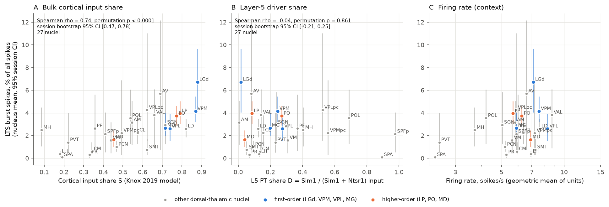
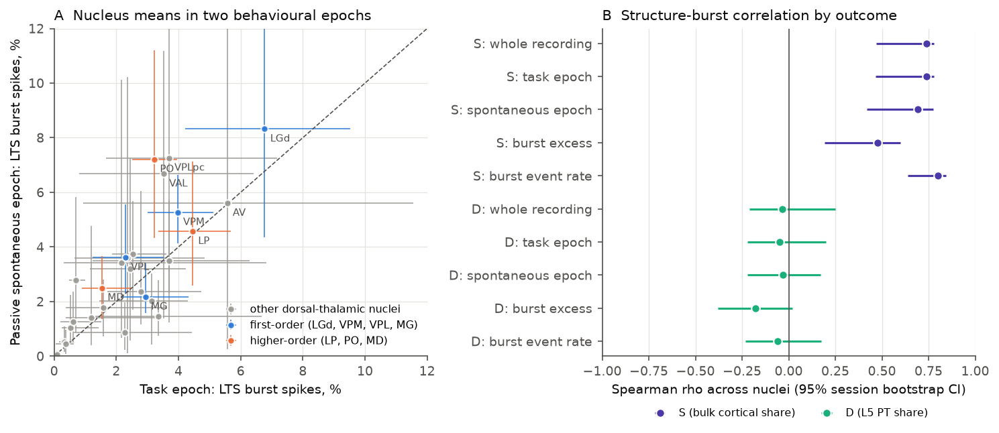
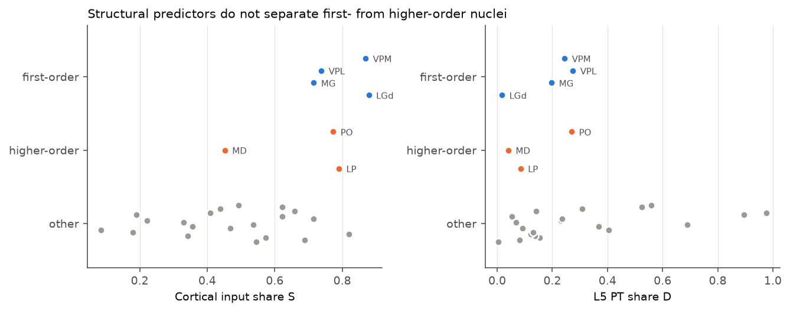

# Bulk cortical input share predicts burst firing across mouse thalamic nuclei, but layer-5 driver share and first-order versus higher-order class do not

Job sci-1107-hp-neural-structure-and-computation-c012bbe4b0b6, campaign 11_07_2026,
topic neural-structure-and-computation, machine hp. Analysis and text: Claude Opus 5.5
(claude-opus-5-5) with the SCI CLI. The signing key is a campaign-machine key.

## Summary

We tested whether the connectivity of a thalamic nucleus predicts how much its neurons fire
in low-threshold-spike (LTS) bursts in awake mice. We used spike times of 9,941 good units in
27 dorsal-thalamic nuclei from the IBL Brain-Wide Map (194 probes, 173 sessions, 97 mice,
12 labs). A burst starts with a spike after at least 100 ms of silence and continues with
intervals of 4 ms or less (Lu, Guido and Sherman 1992). We compared the nucleus burst fraction
with two structural measures that we fixed before we computed any burst value:

* **S**: the share of afferent tracer density from isocortex, against subcortical sources,
  in the Knox et al. 2019 voxel model (pre-registered primary predictor).
* **D**: the layer-5 pyramidal-tract share of corticothalamic input, Sim1-Cre / (Sim1-Cre +
  Ntsr1-Cre), from Allen Connectivity Atlas experiments (co-primary, added by a dated
  amendment before any burst value existed).

Main results:

1. **S predicted burst fraction.** Spearman rho = 0.74 across 27 nuclei (permutation
   p < 0.0001; session bootstrap 95% CI 0.47 to 0.78; mouse bootstrap 95% CI 0.42 to 0.79).
   The relation held in the task epoch (rho 0.74) and in the passive spontaneous epoch
   (rho 0.69). It held after control for nucleus firing rate (partial rho 0.73) and in a
   unit-level mixed model (+0.19 log10 units per SD of S; nucleus bootstrap CI 0.17 to 0.24).
   Removal of any one nucleus gave rho 0.71 to 0.78. Removal of any one lab gave rho 0.50
   to 0.77. All pre-registered criteria for "supported" were met.
2. **D did not predict burst fraction** (rho -0.04, p = 0.86, CI -0.21 to 0.25), in any epoch
   or outcome.
3. **Higher-order nuclei did not burst more than first-order nuclei.** The HO (LP, PO, MD)
   minus FO (LGd, VPM, VPL, MG) difference in unit-mean burst fraction was -0.70 percentage
   points (95% CI -1.95 to +0.55). LGd and VPM were among the most bursty nuclei. This does
   not repeat the monkey result of Ramcharan, Gnadt and Sherman (2005) in this mouse sample.
4. **Neither structural measure separates first-order from higher-order nuclei** (Figure 3).
   S is high for both groups (LGd 0.88, VPM 0.87; LP 0.79, PO 0.77) and low for midline and
   intralaminar nuclei. Thus, S mainly orders nuclei on a sensory-relay versus
   midline/intralaminar axis, not on the first-order/higher-order axis.

Important limits: the relation is across nucleus averages and is correlational. In each half
of the S range alone, the relation was positive but not significant (rho 0.31, n = 14;
rho 0.46, n = 13). Bulk tracer density mixes layer-6 feedback, layer-5 input and axons of
passage. The burst criterion uses extracellular spike times only; in most nuclei the burst
fraction was close to the value from shuffled interspike intervals.

## 1. Question and prior work

Thalamic relay cells fire in tonic and burst modes. Bursts come from T-type calcium channels
after hyperpolarization. Sherman and Guillery divide relays into first-order (FO) nuclei,
which get driver input from the periphery, and higher-order (HO) nuclei, which get driver
input from cortical layer 5. In awake monkeys, HO relays burst more than FO relays
(Ramcharan, Gnadt and Sherman 2005, PNAS 102:12236). We asked a brain-wide form of this
question in mice: does a continuous connectome measure of cortical input predict burst
firing across many nuclei, and does it generalize across behavioural epochs, mice and labs?

A search of this campaign found no earlier publication about thalamic burst firing and
structure.

## 2. Data

* IBL Brain-Wide Map 2026_Q2: aggregate cluster table (CCF location, quality label) and
  spike times of each probe with at least one good thalamic unit. Spike-sorting revision
  2024-05-06; every unit uuid matched the aggregate table.
* Knox et al. 2019 regional voxel-model matrix (normalized connection density).
* Allen Mouse Connectivity Atlas Cre-line experiments with an isocortex injection:
  Sim1-Cre_KJ18 (L5 PT, 25 experiments), Ntsr1-Cre_GN220 (L6 CT, 39), Rbp4-Cre_KL100 (L5, 55).
* Allen CCF ontology (structure graph 1) to map units to Knox regions.

Exact URLs, hashes, licences and the download path are in `files/provenance.md` and
`files/EXTERNAL_DATA_NOTICE.txt`.

## 3. Methods

The full plan is `files/analysis_plan.md`; its hash log is
`files/analysis_plan_hash_log.txt`.

* **Units.** IBL label 1 (passes all three IBL single-unit metrics), CCF location under
  thalamus. Each unit goes to its nearest Knox region. We left out RT, LGv, IGL, SubG, IntG
  and units with only the "TH" label. A unit needs at least 200 spikes. A nucleus needs at
  least 20 units from at least 3 sessions. 27 nuclei met this rule.
* **Burst statistics.** Burst fraction BF (burst spikes / all spikes), burst event rate,
  and burst excess (BF minus mean BF of 20 ISI-shuffled trains). Epochs: whole recording,
  task (first trial start to last trial end), passive spontaneous period (about 5 min).
  Intervals do not cross epoch edges.
* **Predictors.** S = C / (C + B). C is the sum of ipsilateral density from all isocortex
  sources. B is the sum from STR, PAL, HY, MB, P, MY and CB sources. D = L5PT / (L5PT + L6CT).
  For each line, input = mean over experiments of projection volume in the nucleus divided by
  injection volume. A rank test of D does not change if one line labels more cells than the
  other by a constant factor.
* **Tests.** Spearman rho across nuclei with 100,000 label permutations; 95% CI from 2,000
  session bootstrap samples; partial Spearman given log firing rate; unit mixed model
  log10(BF + 0.001) ~ predictor + log10(rate) with a session random intercept; HO minus FO
  difference with a session bootstrap. Exploratory checks (not pre-registered): mouse
  bootstrap, leave-one-lab-out, leave-one-nucleus-out, split at the median of S.

## 4. Results

### 4.1 Pre-registered tests

| Test | Predictor | Outcome | rho | permutation p | 95% CI (session bootstrap) |
|---|---|---|---|---|---|
| T1 whole recording | S | BF | 0.74 | < 0.0001 | 0.47 to 0.78 |
| T2 partial, given log rate | S | BF | 0.73 | - | - |
| T3 task epoch | S | BF | 0.74 | < 0.0001 | 0.46 to 0.78 |
| T3 spontaneous epoch | S | BF | 0.69 | 0.0001 | 0.42 to 0.78 |
| T4 burst excess | S | BF - shuffled BF | 0.48 | 0.012 | 0.19 to 0.60 |
| T4 burst event rate | S | bursts/s | 0.80 | < 0.0001 | 0.64 to 0.84 |
| T1 whole recording | D | BF | -0.04 | 0.86 | -0.21 to 0.25 |
| T3 task epoch | D | BF | -0.05 | 0.81 | -0.22 to 0.20 |
| T3 spontaneous epoch | D | BF | -0.03 | 0.89 | -0.22 to 0.17 |
| T4 burst excess | D | BF - shuffled BF | -0.18 | 0.37 | -0.38 to 0.02 |
| T4 burst event rate | D | bursts/s | -0.06 | 0.76 | -0.23 to 0.18 |

Unit mixed model (9,941 units, session random intercept), per SD of the predictor:
S +0.187 log10 units (nucleus bootstrap 95% CI 0.171 to 0.240);
D -0.046 (CI -0.135 to 0.058). In both models, units with a higher firing rate had a lower BF
(-0.17 log10 units per log10 spike/s).

T5: HO minus FO unit-mean BF = -0.70 percentage points (CI -1.95 to +0.55; 4,745 HO and
2,635 FO units).

Sensitivity: S with OLF, HPF and CTXsp added to cortex, rho 0.74; log10 of cortical density
alone, rho 0.44 (p = 0.024); S without LGd, rho 0.71; D with Rbp4-Cre in place of Sim1-Cre,
rho -0.45 (p = 0.019). Nucleus firing rate also correlated with S (rho 0.52), but the S
relation stayed after rate control.

Bootstrap note: the session-bootstrap CIs are not symmetric about the point estimate. The
resampling adds noise to nuclei with few sessions, and this pulls the bootstrap rho down.

### 4.2 Exploratory checks

* Mouse bootstrap (97 mice): S 95% CI 0.42 to 0.79; D -0.19 to 0.23.
* Leave one lab out (12 labs): S rho 0.50 (without mainenlab) to 0.77; D -0.13 to 0.09.
* Leave one nucleus out: S rho 0.71 to 0.78; D -0.11 to 0.07.
* Split at median S: upper 14 nuclei rho 0.31 (p = 0.29); lower 13 nuclei rho 0.46
  (p = 0.11). Much of the relation is a contrast between groups of nuclei.
* Mean BF across nuclei was 2.57%; mean BF of ISI-shuffled trains was 2.50%. 13 of 27
  nuclei had a positive burst excess. Thus, for most nuclei, the criterion counts are near the
  count that the ISI distribution alone gives. LGd, AV, LP and VPLpc had the largest excess.
* 20 of 27 nuclei had a higher BF in the spontaneous epoch than in the task epoch.

### 4.3 Construct check of the predictors

S does not separate FO from HO nuclei: VPM and LGd have the highest S of all thalamic
targets. The probable causes are dense layer-6 feedback to FO relays and the absence of
retinal and most brainstem sensory sources from the Knox source set. D also does not
separate them. LGd and LP have low D, and ventral nuclei near the internal capsule (SPFp,
PoT, PIL, VPMpc) have high D. Axons of passage from layer-5 PT neurons can enter these
projection measures. We recorded this problem for S before we computed any burst value
(amendment 1). D was added for this reason, but D has its own problem.

## 5. Interpretation

Across 27 mouse thalamic nuclei, burst firing followed the bulk share of cortical input. The
order was midline and intralaminar nuclei lowest, and sensory relay and associative nuclei
(LGd, VPM, AV, LP, PO) highest. The order was the same in a decision task and in passive
rest. It was the same after firing-rate control and after removal of any one lab. A possible
mechanism is that dense corticothalamic (mostly layer-6) feedback, together with reticular
inhibition, sets the hyperpolarization that de-inactivates T-type channels. Our data do not
test this mechanism. The layer-5 driver share did not predict bursting, and first-order relays
did not burst less than higher-order relays. Thus, in awake mice, the burst propensity of a
nucleus does not follow the first-order/higher-order class as in the monkey study.

## 6. Limitations

* Correlational, nucleus-level result with 27 nuclei. Nuclei are not independent in space
  or in development; we did not use a spatial null model.
* Bulk tracer predictors mix layer-6 feedback, layer-5 input and fibres of passage. The Knox
  model has no retinal source. The Cre-line sample is small (25 Sim1-Cre experiments), and
  the experiments cover cortical areas unequally.
* Extracellular burst criterion only. No intracellular confirmation of LTS. The shuffle
  control shows that most criterion counts are near the ISI-distribution expectation; the
  burst-excess outcome still correlated with S (rho 0.48).
* Spike sorting can split or merge units. Units with high contamination can add short
  intervals. We used only IBL label-1 units, but we did not model sorting error.
* Epochs: the task epoch is long (about 1 h); the spontaneous epoch is about 5 min, so its
  estimates are noisier. Arousal, pupil and locomotion were not controlled.
* Brain state differs across labs and mice. Leaving out mainenlab reduced rho to 0.50.
* Unit locations come from IBL histology alignment to the CCF; border errors are possible.
* The FO/HO labels are a simple literature assignment for 7 nuclei.

## 7. Reproduction

1. Create a Python 3.12 environment (`files/environment.txt` lists versions).
2. Run `bash files/code/run_all.sh /path/to/scratch`. It downloads the inputs (about 75 GB of
   spike files pass through scratch, one probe per worker, and are deleted), and writes
   results and figures into the scratch folder. Nothing goes into this bundle.
3. Scripts: `01_extract_bursts.py` (burst statistics per unit), `02_structure_predictor.py`
   (S), `03_layer_specific_input.py` (D), `04_analysis.py` (pre-registered tests),
   `05_figures.py`, `06_exploratory.py`, `07_mouse_lab_checks.py` (needs a session-to-mouse
   table; `files/results/ibl_session_subjects.csv` is the one we used).

Bundled results (`files/results/`): `unit_burst_stats.csv.gz` (one row per unit, IBL-derived),
`nucleus_burst_table.csv` (nucleus burst statistics and bootstrap CIs; predictor columns are
not bundled because of Allen terms), `tests.csv`, `summary.json`, `exploratory.json`,
`mouse_lab_checks.json`, `cre_experiment_ids.csv`, `ibl_insertions_2026-11-09.csv`,
`ibl_session_subjects.csv`.

## 8. Licence and external data

The LICENSE file (SCI baseline: CC BY 4.0 for text, figures and data; MIT for code) covers
our own work. Third-party data terms and attribution are in
`files/EXTERNAL_DATA_NOTICE.txt`. IBL data are CC BY 4.0. Allen data are under the Allen
Institute Terms of Use and are not bundled.

## References

* Lu SM, Guido W, Sherman SM (1992) J Neurophysiol 68:2185-2198.
* Ramcharan EJ, Gnadt JW, Sherman SM (2005) Higher-order thalamic relays burst more than
  first-order relays. PNAS 102:12236-12241.
* Sherman SM, Guillery RW (2006) Exploring the Thalamus and Its Role in Cortical Function.
* Knox JE et al. (2019) Network Neuroscience 3:217-236.
* Oh SW et al. (2014) Nature 508:207-214.
* Harris JA et al. (2019) Nature 575:195-202.
* International Brain Laboratory et al. A brain-wide map of neural activity during complex
  behaviour. bioRxiv 2023.07.04.547681.
