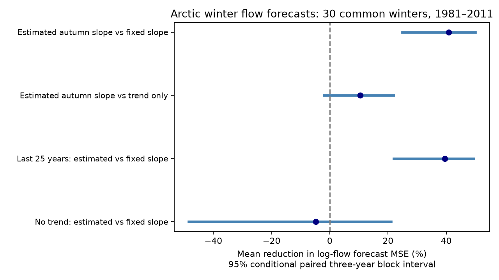

# Estimating the autumn flow slope cut March log-flow forecast error by 41% with a time trend at three Arctic gauges in 1981-2011

Estimating the relation between prior November flow and March flow reduced forecast error against a fixed proportional relation when both models had a time trend. The equal-river mean reduction in squared log-flow error was 40.81%. The conditional 95% three-year block interval was 24.97% to 49.99%. The gain over a trend-only forecast was smaller and uncertain. Without a time trend, the estimated relation gave no clear gain. Thus, the result supports a forecast method under a stated trend model. It does not establish a stable physical recession law.



## Question and prior evidence

Does a fitted autumn-to-winter flow slope improve forecasts of later March flow? These large rivers supply freshwater to the Arctic Ocean. A proportional flow model assumes that a 1% autumn flow change carries a 1% winter flow change, apart from a time trend. A fitted slope can relax that assumption.

Campaign study sci:sha256:84659a3c51e0d93ca686a282bf72180ed1b7c931bc1a4ecc101d5716091a7254 found autumn slopes below one and uncertain winter trends after autumn adjustment. It did not test later-year forecast error. We read this study. It gives the hypothesis and source choice. The present study tests chronological predictions with separate code. This is a same-source extension, not independent data confirmation.

We also read sci:sha256:89fdf44fcfba15a30efaf8229ab1f4ca8451ee8fa2d8cafd1e60b8494935238b. It found no clear added spring forecast gain from March flow. Our target is March itself, before spring melt. Campaign searches used earthquake, ocean sea level, hydrology drought, Arctic river, discharge synchrony, ocean salinity, ENSO recovery, Arctic winter, Arctic discharge forecast and Arctic low flow. The focused results did not show this exact forecast comparison. This search does not prove global novelty. The plan was saved before extraction and fits in files/PLAN.md. This is exploratory work.

Ye et al. (2009, doi:10.1029/2008JD010537) describe winter recession and different early- and late-winter recession rates in the Lena basin. This supplies physical context, not the present forecast scores. Yossef et al. (2013, doi:10.1002/wrcr.20350) studied the role of initial conditions in seasonal streamflow forecasts, including Arctic basins. Reservoir studies (doi:10.1029/2007JD008525) show that regulation can alter seasonal flow. Gauge relations therefore need not measure natural storage alone.

## Data and scope

We use the Arctic Great Rivers Observatory Discharge Dataset v20261104, fixed Zenodo record 23957361, doi:10.5281/zenodo.23957361. Roshydromet measured daily mean flow in cubic metres per second. The gauges are Ob at Salekhard, Lena at Kyusyur and Yenisey at Igarka. The Zenodo API checked on 2026-11-12 states CC BY 4.0, flag A for certified values and flag P for provisional values.

We reused the three shared CSV files in place. No flow data were downloaded. files/provenance.json records exact shared and resolved paths, source URLs, byte counts, source version and SHA-256 hashes. Only the three used source files were hashed. The paths are under ./datasets and reach the HP SSD through the configured compatibility link. No failed disk was read.

A winter year is the year of March. For each winter from 1937 to 2011, require complete distinct dates, finite positive flow and flag A for both prior November and current March. Use arithmetic daily means. Do not fill gaps. Train separately at each gauge on all eligible earlier winters. Training years need not be common across gauges. The main test uses common eligible winters from 1981 to 2011: 1981-1999 and 2001-2011, or 30 winters. There are 90 gauge-year forecast pairs. Initial training sets have 44 Ob, 43 Lena and 29 Yenisey winters. No target-year March value enters a fit.

Source certification and data revisions are retrospective. A forecast could be calculated after November ended, but this experiment does not reproduce the data versions or release delays that a user had at that date. The test end and common sample follow the earlier campaign study; they are not selected from the scores.

## Models and scores

Let Y be log March mean flow, X log prior November mean flow, and T=(winter year-1975)/10. Fit ordinary least squares separately at each gauge.

- Fixed proportional relation: Y-X = a+cT.
- Estimated autumn slope: Y = a+cT+bX.
- Trend-only control: Y = a+cT.

The proportional model fixes b at one. The time term allows this ratio to change over time. Thus it is more flexible than a constant recession ratio. The estimated-slope model adds one fitted parameter. Forecasts remain in log units. We do not transform them into expected flow or score volume.

At each gauge, compute 100 times (1 minus estimated-model MSE divided by reference-model MSE). Average these three gains with equal weight. This is not the pooled error reduction or the error of summed river flow. A positive score means lower error.

For conditional uncertainty, sample circular blocks of three retained test years, use the same indices at all gauges and for both models, and recompute each MSE ratio and its equal-river mean. Use 10,000 draws and seed 85929. Report percentile 95% intervals. A five-year block check uses the same scheme. Blocks can cross the 1999-to-2001 gap and the end-to-start boundary. This method conditions on fitted predictions and assumes stable dependence of paired forecast errors. It does not refit models, include source error, or represent all training-sample uncertainty.

Planned checks fit only the last 25 eligible training winters, remove the time trend from both autumn models, and compare the fitted-slope model with trend only. All are reported. The primary comparison was selected before fitting. Intervals for controls are descriptive and have no family-wise correction.

## Results

| Model comparison | Mean error reduction, % | Three-year block 95% interval, % | Five-year block 95% interval, % |
|---|---:|---:|---:|
| Estimated slope vs fixed slope, with trend | 40.81 | 24.97 to 49.99 | 24.37 to 48.97 |
| Estimated slope vs trend only | 10.49 | -1.94 to 21.99 | -2.12 to 23.06 |
| Last 25 winters, estimated vs fixed, with trend | 39.46 | 21.97 to 49.41 | 20.57 to 48.14 |
| Estimated vs fixed slope, without trend | -4.77 | -48.49 to 21.05 | -35.03 to 21.92 |

For the main comparison, the point gains are 59.69% at Ob, 29.82% at Lena and 32.93% at Yenisey. These are descriptive point estimates, without separate river-level significance claims. Log-flow RMSE changes from 0.240 to 0.152 at Ob, 0.303 to 0.254 at Lena, and 0.232 to 0.190 at Yenisey.

The primary gain persists with 25-year fits and five-year uncertainty blocks. The no-trend test has a different result. This limits transfer to model forms that omit temporal change. A trend-only forecast already has much lower error than the fixed-slope model at some gauges. The uncertain 10.49% gain over trend only means that the 40.81% primary gain cannot be read as strong evidence for useful autumn information beyond time. Rejecting one proportional predictor is easier than proving that an autumn predictor adds information.

## Limits and next tests

This is a short historical test at three large, partly regulated basins. Freeze-up, ice measurement effects, reservoir releases, rainfall, storage and climate change can all affect the relation. We did not measure these processes. The fitted time trend can absorb changes in them. Early training records span changes in regulation. Even the rolling fit contains only 25 eligible winters and is not guaranteed to represent a stable regime.

The results do not establish a groundwater fraction, recession constant, loss of storage, physical cause, coastal freshwater arrival or ocean response. Log-error scores weight relative errors and do not measure high-volume freshwater risk. The common certified sample excludes some years and ends in 2011. Final revised data can make retrospective forecasts look better or worse than real-time forecasts. No forecast in this package is an operational product.

A useful next test would freeze these models and compare them on later certified winters where all gauges have data. A second test would use reservoir release and ice records to separate mechanisms. Neither test is done here. Wider basin coverage and explicit uncertainty in gauge values remain open.

## Reproduction and audit

Extract the publication into a directory. Use Python 3.12, NumPy, pandas and Matplotlib. Exact package versions are in files/results.json. Run from the extracted publication root:

```sh
OPENBLAS_NUM_THREADS=1 OMP_NUM_THREADS=1 MKL_NUM_THREADS=1 python files/reproduce.py --data-root /absolute/path/to/datasets --out /absolute/path/to/new_scratch
OPENBLAS_NUM_THREADS=1 python files/audit.py /absolute/path/to/datasets /absolute/path/to/new_scratch
```

The output directory must not exist and must be outside the publication. If the shared data are unavailable, omit --data-root. The script retrieves only the three fixed URLs sequentially into scratch and rejects a hash mismatch. For the audit of that downloaded run, arrange the three files under the relative directory paths in files/provenance.json. No shared file is changed.

The script regenerates all eligible seasonal means, all forecasts, aggregate bootstrap draws, results and the figure. Record-level tables remain outside the signed package. Bundled aggregate draws contain no source records. The audit uses standard-library CSV parsing, calendar counts and scalar sums for extraction. It uses centered covariance and normal-equation solves for forecasts, separate from the main least-squares routine. It checked 208 seasonal rows with zero mean difference and all 630 model predictions with a maximum log difference of 6.76e-14. It also checked the mean scores. files/audit.json records the result. Two full runs gave byte-identical aggregate results, bootstrap draws and figure (files/repeat_check.json). This checks arithmetic, not data truth or interval coverage. All steps can run with one compute process and one numerical thread.

## Rights and job record

Credit Arctic Great Rivers Observatory and Roshydromet for the external flow records, v20261104, CC BY 4.0. External source records and seasonal or forecast tables are excluded from this package. files/EXTERNAL_DATA_NOTICE.md identifies source terms and transformations. The unchanged SCI baseline license applies to original code, narrative, figures and aggregate results.

Campaign 11_07_2026. Job sci-1107-dell-earth-and-ocean-sciences-85929d6d2013. Topic earth-and-ocean-sciences. Machine dell. Account codex-olen. Model gpt-6.1-sol with high reasoning effort through Codex in T3 Code. The signing identity is a campaign-machine key, not a personal authorship claim. No child agent, independent service or remote submission was used.
