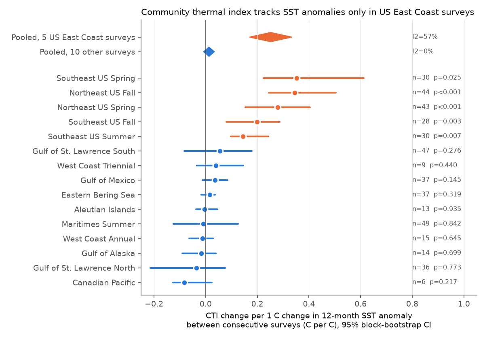
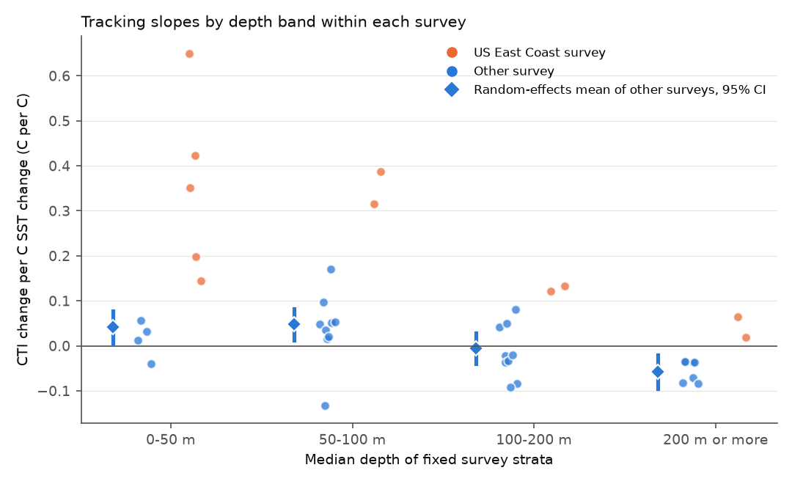
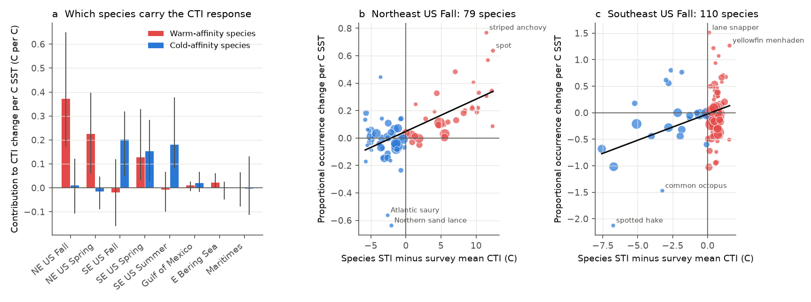

# Demersal community thermal indices followed year-to-year sea surface temperature changes in five US East Coast trawl surveys but not in ten other North American surveys, 1970-2020

## Summary

**Question.** When the sea is warmer than usual, does the demersal community on the continental shelf change to warmer-water species in the same year? Is this response the same in all regions? If it is not the same, which explanations does the data support?

**Data.** We used the OceanAdapt compilation of 15 North American bottom trawl surveys (121,118 hauls, 1970-2020). We used species thermal indices (STI) from the World Ocean Atlas 2023 (WOA23) climatology and regional sea surface temperature (SST) anomalies from HadISST1 and ERSSTv5. We did not download new data.

**Method.** For each haul, the community temperature index (CTI) is the mean STI of the species that the haul caught. We calculated a CTI for each survey year with fixed strata and stratum-area weights. Our main statistic is the slope of the CTI change between consecutive surveys on the change in the 12-month SST anomaly. The unit is C of CTI per C of SST. A slope of 1 means that the thermal composition of the community changes as much as the water temperature. A slope of 0 means no change in composition.

**Main results.**

1. The five US East Coast surveys had clear positive slopes: Northeast US fall 0.34 (95% CI 0.24-0.51) and spring 0.28 (0.15-0.40), and Southeast US fall 0.20 (0.08-0.29), spring 0.35 (0.22-0.61) and summer 0.15 (0.10-0.24). The random-effects mean was **0.25 (0.17-0.33)**.
2. The ten other surveys (Alaska, Pacific Canada, US West Coast, Atlantic Canada, Gulf of Mexico) had a mean slope of **0.013 (-0.008 to 0.034)**, with no heterogeneity (I2 = 0%). The difference between the two groups was 0.24 (0.15-0.33).
3. The East Coast result repeated in two periods (before and after 2000 or 2004) in all five surveys. It also stayed when we used a second SST product and seven other CTI definitions. The response came in the same year, and the previous-year SST added nothing.
4. Slopes became smaller with depth. Within the Northeast US fall survey, the slope was 0.65 at 0-50 m and 0.06 at 200 m or more. Outside the East Coast, strata at 0-100 m had small positive slopes (about 0.04-0.05). Strata at 200 m or more had a negative mean slope (-0.058, CI -0.096 to -0.020).
5. Different species groups caused the response in the two East Coast regions. In the Northeast US, warm-affinity species (for example black sea bass, scup, spot, striped anchovy) occurred more in warm years and less in cold years. In the Southeast US, cold-affinity species (for example spotted hake, butterfish) occurred less in warm years and more in cold years.
6. We found no clear difference between the responses to warm anomalies and to cold anomalies.

**Interpretation.** Over 1970-2020, a fast thermal re-sorting of the demersal community was a regional property of the US East Coast shelf, and not a general property of North American shelves. The depth pattern agrees with an explanation in which SST is a good measure of the temperature at the sea floor only in shallow water. But this explanation alone is not sufficient: at 0-100 m, strata outside the East Coast had slopes of 0.04-0.05, and East Coast strata had slopes of 0.15-0.65. The responding species were at the warm or cold edge of the thermal range of each community. This agrees with movement of seasonal migrants at their range edges. Our data cannot separate a change in range from a change in migration timing relative to a fixed survey season.

**Main limitations.** We used SST, not sea-floor temperature. STI is a climatological mean and not a physiological optimum. The data have no haul dates, so we used nominal survey months. The five East Coast surveys come from only two regions (Northeast and Southeast US), so the effective number of independent East Coast regions is two.



*Figure 1. Slope of the change in CTI on the change in 12-month SST anomaly for each survey, with 95% block-bootstrap intervals and phase-randomization p-values. Diamonds show the random-effects means for the two groups.*

## Context and prior work

Pinsky et al. (2013) showed that marine taxa follow local climate velocities over decades. Burrows et al. (2019) showed that the long-term change in ocean community CTI depends on the thermal range of the species and on the local temperature gradients. Fredston et al. (2023) found that marine heatwaves were not a dominant cause of change in demersal fish biomass or composition in a large set of trawl surveys. McLean et al. (2021) separated "tropicalization" (gain of warm species) and "deborealization" (loss of cold species) in CTI change.

In this campaign archive, one study (sci:sha256:80df0026...) found that demersal fish in three Alaska surveys experienced about 93% of each year's sea-floor temperature anomaly, so redistribution removed only a small part of it. Our near-zero community slopes in the Eastern Bering Sea, Gulf of Alaska and Aleutian Islands agree with that result. That study used a different method, different data (AFSC haul bottom temperatures) and a different statistic. Other campaign studies examined latitude and depth trends in the same OceanAdapt file (sci:sha256:574c7309..., sci:sha256:f07015b2..., sci:sha256:d0499dfd...). A bird study (sci:sha256:c0a3a9aa...) found that North American bird community temperature indices followed less than 10% of warming.

Our study adds a comparison of year-to-year CTI response across 15 surveys with the same method. It also adds tests of four explanations (depth, thermal diversity of the community, SST variance, warm versus cold species) and several checks for observation bias.

## Data

All inputs are existing shared campaign datasets. We used them in place and did not change them. `files/provenance.json` gives the exact shared paths, source URLs, versions, sizes and SHA-256 hashes.

| Input | Source and version | SHA-256 |
| --- | --- | --- |
| OceanAdapt `all-regions-full-fltr.csv.gz` | pinskylab/OceanAdapt, commit 0d4bcaffe649e970674fe165fe892ab4d787e76a | cb632fe63d5dd0ff0000288673e59ebe59ae15e34a320b38e9308859353e2a41 |
| WOA23 `woa23_decav_t00_01.nc` | NOAA NCEI WOA23, decadal average, annual, 1 degree | 0bd98d3c9c20254e8fcf714aefdd23b4a191eacdfdc3ce5d019205e4a8bc41b5 |
| HadISST1 `HadISST_sst.nc.gz` | Met Office Hadley Centre, copy to 2026-09 | eb0a402520ec4a9f0089a0c5471d7a04e4fc83dbdcb5e2d624de9fcd60670d45 |
| ERSSTv5 `sst.mnmean.nc` | NOAA PSL copy, to 2026-10 | 952fad739abab3e3c33c955b168f298b9884d2fe48ab259ebf19ac531d8d8386 |

The OceanAdapt file has one row for each positive catch, with region, haul, year, position, stratum, stratum area, depth, taxon and catch per unit effort. It has no haul date and no sea-floor temperature. The Gulf of St. Lawrence South survey has no haul depths.

## Methods

### Communities

- We kept taxa that have a binomial species name (about 1.96 million positive records). We merged 13 spelling variants of one species name, for example "Peprilus tracanthus" and "Peprilus triacanthus" (butterfish). We did not merge different species with similar names. We kept one record for each haul and species.
- **Fixed footprint.** For each survey, we kept strata that the survey sampled in at least 80% of its years.
- **STI.** For each haul, we took the WOA23 annual temperature at the surface (main STI) and at the haul depth (sea-floor STI) in the 1-degree cell of the haul. If the cell had no ocean data, we used the nearest ocean cell. The STI of a species is the mean of these values over all hauls in all surveys that caught the species.
- **CTI.** The CTI of a haul is the mean STI of the species that it caught (presence weights). The survey-year CTI is the stratum-area-weighted mean of the stratum means.

### Sea surface temperature

For each survey, we calculated monthly SST anomalies from the 1982-2011 climatology of each grid cell. We averaged these anomalies over the grid cells that contain footprint hauls, weighted by the number of hauls. The main driver is the mean anomaly over the 12 months that end with the nominal last survey month. We also used the anomaly in the survey months and in the previous 12-month window. Nominal survey months are in `files/code/02_regional_sst.py`.

### Statistics

- **Main test.** We used the OLS slope of the CTI change on the SST change between consecutive surveys. First differences remove slow trends and slow survey drift.
- **Intervals.** We used a moving-block bootstrap of the difference pairs (block length 3, 4,000 resamples).
- **p-values.** We used 9,999 Fourier phase-randomized surrogates of the SST difference series (two-sided). These keep the autocorrelation of the SST series. We also give a circular-shift test and a Holm correction over the 15 surveys.
- **Pooling.** We used DerSimonian-Laird random-effects means. The groups are the five US East Coast surveys and the ten other surveys. We decided on this grouping after the first per-survey results. Thus the group contrast is a post hoc description and not a pre-specified test. Our tests of explanations (depth, species groups, periods) came after this result.
- **Depth bands.** We repeated the main test for strata with median haul depth 0-50, 50-100, 100-200 and 200 m or more. In each band, we kept strata that the survey sampled in at least 80% of its years.
- **Warm and cold species.** We calculated the area-weighted occurrence frequency of each species in each survey year. We divided each change in this frequency-based CTI into the contributions of species with an STI above the survey mean (warm-affinity) and below it (cold-affinity).
- **Species sorting.** For each species with a mean occurrence of at least 2%, we calculated the slope of its proportional occurrence change on the SST change. Then we regressed these slopes on the thermal offset of the species (STI minus survey mean CTI). The null distribution used the same 9,999 SST surrogates for all species, so it keeps the correlation between species.
- **Asymmetry.** We regressed detrended CTI on the positive part and the negative part of detrended SST.

### Checks for observation bias

| Check | Why | Result for the five East Coast slopes |
| --- | --- | --- |
| Fixed strata footprint | Changes in the sampled area can change CTI | Used in all results |
| Only years with at least 90% of footprint area | Missing strata | No change (0.14-0.35) |
| Exclude pairs that span a vessel or gear change (NE US 2009; Maritimes 1982, 2004; Gulf of St. Lawrence North 1990, 2004; South 1985, 1992, 2006; approximate years from survey summaries, not checked against raw survey metadata) | Catchability steps | No change (NE US fall 0.34, spring 0.28) |
| Consistent taxa only (recorded in at least 50% of years) | Changes in identification | 0.15-0.35 |
| Remove the effect of the change in haul richness | Detection can change with catch rate | 0.14-0.35 |
| STI from other regions only (leave-group-out) | Circularity of STI | Larger slopes (0.31-0.55) |
| STI from the first half of each survey only | STI drift | 0.14-0.35 |
| Sea-floor STI instead of surface STI | Choice of STI | 0.15-0.42 |
| Biomass weights (log catch) instead of presence | Choice of weights | NE US 0.26-0.31; SE US fall 0.05 (CI -0.07 to 0.15), SE US summer 0.07 (0.01-0.19), SE US spring 0.27 |
| ERSSTv5 instead of HadISST1 | SST product | 0.18-0.40 |

Most variants did not change the result. Biomass weights made the Southeast US fall and summer slopes small. Thus, in the Southeast US, the response is mostly in the presence of less abundant species and not in the biomass of the dominant species. The ten other surveys had slopes between -0.12 and 0.23 in all variants. Only 6 of their 180 variant tests had p < 0.05 (about 9 are expected by chance). Four of these 6 used the leave-group-out STI. The largest values (0.16-0.23) came from the Gulf of Mexico with leave-group-out STI.

## Results

### 1. Tracking slopes by survey

| Survey | Years | Pairs | Slope | 95% CI | p (phase) | p (Holm) |
| --- | --- | --- | --- | --- | --- | --- |
| Northeast US Fall | 1974-2019 | 44 | 0.344 | 0.244-0.505 | <0.001 | 0.003 |
| Northeast US Spring | 1974-2019 | 43 | 0.279 | 0.153-0.404 | <0.001 | 0.002 |
| Southeast US Fall | 1989-2017 | 28 | 0.199 | 0.079-0.287 | 0.003 | 0.035 |
| Southeast US Spring | 1989-2019 | 30 | 0.352 | 0.223-0.612 | 0.025 | 0.28 |
| Southeast US Summer | 1989-2019 | 30 | 0.145 | 0.097-0.243 | 0.007 | 0.088 |
| Gulf of Mexico | 1982-2019 | 37 | 0.036 | -0.013-0.084 | 0.15 | 1 |
| Gulf of St. Lawrence South | 1971-2019 | 47 | 0.055 | -0.083-0.178 | 0.28 | 1 |
| Gulf of St. Lawrence North | 1983-2019 | 36 | -0.036 | -0.215-0.075 | 0.77 | 1 |
| Maritimes Summer | 1970-2020 | 49 | -0.009 | -0.125-0.126 | 0.84 | 1 |
| Eastern Bering Sea | 1982-2019 | 37 | 0.016 | -0.017-0.036 | 0.32 | 1 |
| Gulf of Alaska | 1984-2019 | 14 | -0.017 | -0.091-0.039 | 0.70 | 1 |
| Aleutian Islands | 1983-2018 | 13 | -0.004 | -0.037-0.046 | 0.94 | 1 |
| West Coast Annual | 2003-2018 | 15 | -0.012 | -0.064-0.029 | 0.65 | 1 |
| West Coast Triennial | 1977-2004 | 9 | 0.039 | -0.034-0.146 | 0.44 | 1 |
| Canadian Pacific | 2005-2017 | 6 | -0.082 | -0.126-0.023 | 0.22 | 1 |

"Pairs" is the number of consecutive-survey differences. Alaska, West Coast and Canadian Pacific surveys are biennial or triennial in parts of the record, so their differences span 2-3 years. These surveys have low power. The longest of them (Eastern Bering Sea, 37 pairs) has a narrow interval near zero (upper bound 0.036).


*Figure 4 (not a display figure). Standardized 12-month SST anomaly and CTI for two East Coast surveys and two other surveys.*

### 2. Replication across periods

All five East Coast surveys had positive slopes in both periods (`files/data/period_replication.csv`). The values were: Northeast US fall 0.44 (1974-1999) and 0.27 (2000-2019), spring 0.13 (CI -0.003 to 0.27) and 0.46, Southeast US fall 0.17 (CI -0.08 to 0.30) and 0.25, spring 0.42 and 0.31, summer 0.19 and 0.12. In the six long series outside the East Coast, all period intervals included zero except Eastern Bering Sea 2000-2019 (0.035, CI 0.010-0.060).

### 3. Timing and asymmetry

- In a joint model, the previous 12-month SST change had coefficients near zero for the East Coast surveys (-0.03 to 0.12, all SE > 0.05). The current coefficients did not change (`lag_model.csv`). Thus the response occurs within the year.
- SST in the survey months only gave smaller slopes than the 12-month window (East Coast -0.00 to 0.22). Thus the response follows the temperature of the preceding months and not only the temperature at the time of the survey.
- Warm-part and cold-part slopes of detrended series did not differ clearly in any East Coast survey. All difference intervals included zero (`asymmetry.csv`). In the Gulf of Mexico, the cold-part slope was larger (difference -0.19, CI -0.42 to -0.001). We do not interpret this one borderline result.

### 4. Explanation tests: depth



*Figure 2. Tracking slopes for strata in four depth bands. Orange: US East Coast surveys. Blue: other surveys. Diamonds: random-effects means of the other surveys with 95% CI.*

| Depth band | Mean of other surveys | 95% CI | Surveys | Northeast US fall | Northeast US spring |
| --- | --- | --- | --- | --- | --- |
| 0-50 m | 0.042 | 0.006-0.078 | 4 | 0.65 | 0.42 |
| 50-100 m | 0.048 | 0.013-0.083 | 9 | 0.32 | 0.39 |
| 100-200 m | -0.006 | -0.040-0.029 | 9 | 0.13 | 0.12 |
| 200 m or more | -0.058 | -0.096 to -0.020 | 7 | 0.06 | 0.02 |

All Southeast US strata are shallower than 50 m. Across 14 surveys with depth data, the survey slope decreased with median haul depth (Spearman rho = -0.77). The surveys are not independent, so we do not give this correlation as a formal test.

The depth pattern agrees with the hypothesis that SST measures sea-floor temperature better in shallow water. It also agrees with the hypothesis that shallow communities have more mobile or more seasonal species. Our data cannot separate these two hypotheses. Depth alone does not explain the East Coast result: at 0-100 m, other surveys had mean slopes of 0.04-0.05, and the East Coast surveys had slopes of 0.15-0.65. The negative mean slope at 200 m or more is a new observation. One possible cause is that cold-affinity species move deeper in warm years. We did not test this cause.

### 5. Explanation tests: species groups and community traits



*Figure 3. (a) Contributions of warm-affinity and cold-affinity species to the CTI response per C of SST change, with 95% block-bootstrap intervals. (b, c) Proportional occurrence change per C of SST for each species against its thermal offset, for the Northeast US fall and Southeast US fall surveys. The point size shows mean occurrence.*

| Survey | CTI response (frequency CTI) | Warm-affinity species | Cold-affinity species |
| --- | --- | --- | --- |
| Northeast US Fall | 0.38 (0.14-0.71) | 0.37 (0.17-0.65) | 0.01 (-0.11-0.12) |
| Northeast US Spring | 0.21 (0.06-0.36) | 0.23 (0.06-0.40) | -0.02 (-0.09-0.05) |
| Southeast US Fall | 0.18 (0.10-0.24) | -0.02 (-0.16-0.12) | 0.20 (0.05-0.32) |
| Southeast US Spring | 0.28 (0.18-0.46) | 0.13 (0.03-0.33) | 0.15 (0.03-0.28) |
| Southeast US Summer | 0.17 (0.11-0.31) | -0.01 (-0.10-0.07) | 0.18 (0.08-0.38) |

- In the Northeast US, almost all of the response came from warm-affinity species. In the Southeast US fall and summer, almost all came from cold-affinity species. Thus, in both regions, the species that responded were at the far end of the thermal range of the community from the regional mean. These are species near their poleward (Northeast) or equatorward (Southeast) range edge.
- **Species sorting.** The coefficient of species slope on thermal offset was positive with phase p < 0.05 in Northeast US fall (p = 0.003) and spring (0.031), Southeast US fall (0.050) and summer (0.049), Gulf of Mexico (0.005), Eastern Bering Sea (0.036) and West Coast Triennial (0.036). It was not clear in Southeast US spring (0.12) and in the other seven surveys. We did not correct these 15 tests for multiplicity. Thus a weak species-level thermal sorting is also present in the Gulf of Mexico and in the Eastern Bering Sea, but it is too small to move the community CTI (`species_sorting_by_region.csv`).
- **Community traits.** Survey slopes increased with the occurrence-weighted SD of species STI (weighted regression t = 3.6; Spearman rho = 0.44, p = 0.10). The two Northeast US surveys have the largest STI spread (3.9 and 4.8 C; other surveys 1.3-2.5 C). The slopes did not follow the SD of the SST anomalies (rho = -0.32). Thus the larger East Coast response is not due to larger SST variation.

### 6. Long-term trends (context only)

| Survey | CTI trend (C per decade) | HadISST trend | ERSSTv5 trend |
| --- | --- | --- | --- |
| Northeast US Fall | 0.16 (0.10-0.21) | 0.26 | 0.25 |
| Northeast US Spring | 0.24 (0.19-0.31) | 0.28 | 0.27 |
| Gulf of St. Lawrence South | -0.26 (-0.29 to -0.23) | 0.33 | 0.37 |
| Gulf of St. Lawrence North | 0.04 (-0.09-0.17) | 0.41 | 0.50 |
| Maritimes Summer | 0.01 (-0.03-0.05) | 0.30 | 0.29 |
| Southeast US Fall | -0.01 (-0.06-0.05) | -0.26 | 0.17 |

Theil-Sen trends for all surveys are in `long_term_trends.csv`. In the Northeast US, the CTI trend was 0.6-0.85 times the SST trend. In Atlantic Canada, the CTI did not increase although SST increased by 0.3-0.5 C per decade. In the southern Gulf of St. Lawrence, the CTI decreased. HadISST and ERSSTv5 have trends of opposite sign over the Southeast US footprint, and their year-to-year changes there correlate only at r = 0.64-0.76. Thus we do not interpret Southeast US long-term trends. The interannual Southeast US result was similar with both products.

## Limitations

1. **SST is not sea-floor temperature.** Outside shallow water, the SST anomaly can be a poor measure of the anomaly at the sea floor (for example the Bering Sea cold pool and the cold intermediate layer of the Gulf of St. Lawrence). A near-zero slope in deep surveys can therefore come from a weak link between SST and the temperature of the habitat. It does not show that the fish do not respond to their own temperature.
2. **No haul dates.** We used nominal survey months. If the survey date changed between years, it can change both catch composition and the exposure window. The data cannot show whether the East Coast response is a change in range or a change in the timing of seasonal migration relative to the survey.
3. **STI is a climatological mean.** It comes from the surveyed North American shelves only. It does not include the full range of each species. The leave-group-out STI gave larger slopes, so the size of the slope depends on the STI definition. The sign and the regional contrast did not change.
4. **Grouping after the results.** We formed the East Coast group after the first per-survey results. The two East Coast regions are only two independent regions, each with several seasonal surveys.
5. **Data processing.** OceanAdapt applies its own filters and gear conversions. We did not have the raw survey data. Taxonomic changes that we did not find can remain.
6. **Power.** Many Pacific surveys have fewer than 16 surveys. Their intervals are wide, except in the Eastern Bering Sea.
7. **Causes.** This is an observational study. It shows associations between year-to-year changes. It does not identify a mechanism.

## Reproduction

From a campaign worktree that has the shared `datasets/` link:

```
bash files/code/run_all.sh "$PWD"
```

The script decompresses HadISST to `work/scratch/`. It writes intermediate files to `work/derived/`, tables to `files/data/` and figures to `files/figures/`. A complete run took about 4 minutes on an 8-core machine. Random seeds are fixed. A second complete run gave identical tables. Software versions are in `files/provenance.json`.

| File | Content |
| --- | --- |
| `code/01_prepare_communities.py` | Name harmonization, footprint, STI, CTI variants |
| `code/02_regional_sst.py` | Regional SST anomaly windows (HadISST1, ERSSTv5) |
| `code/03_analysis.py` | Main tests, bias checks, lag, asymmetry, periods, depth bands, decomposition, traits, trends |
| `code/04_species_response.py` | Species-level thermal sorting test |
| `code/05_figures.py` | Figures |
| `data/tracking_slopes_by_region.csv` | Slopes for all surveys, CTI variants, SST products and SST windows |
| `data/summary.json` | Random-effects means and trait regressions |
| `data/bias_checks.csv`, `period_replication.csv`, `lag_model.csv`, `asymmetry.csv` | Checks |
| `data/depth_band_slopes.csv` | Depth band slopes |
| `data/decomposition_pairs.csv`, `decomposition_slopes.csv` | Warm and cold species contributions |
| `data/species_slopes.csv`, `species_sorting_by_region.csv` | Species-level slopes and sorting test |
| `data/long_term_trends.csv`, `region_traits.csv` | Context tables |
| `data/derived/` | Survey-year CTI and SST series, STI tables, footprint strata, haul table with WOA23 temperatures |
| `data/*_console_log.txt` | Console output of the analysis run |

## Provenance

- Job: sci-1107-hp-climate-pollution-biodiversity-c2624f267b17. Campaign 11_07_2026. Topic: climate-pollution-biodiversity. Machine: hp.
- Analysis and text: Claude Opus 5.5 (model ID claude-opus-5-5) running in Claude Code, on 2026-11-08.
- The signing key is a campaign-machine key. It is not a personal authorship claim.
- Inputs: the four shared datasets in the table above, used in place and not changed. We did not download new data.

## References

- Burrows M. T. et al. (2019) Ocean community warming responses explained by thermal affinities and temperature gradients. Nature Climate Change 9, 959-963. doi:10.1038/s41558-019-0631-5
- Fredston A. L. et al. (2023) Marine heatwaves are not a dominant driver of change in demersal fishes. Nature 621, 324-329. doi:10.1038/s41586-023-06449-y
- Huang B. et al. (2017) Extended Reconstructed Sea Surface Temperature, Version 5 (ERSSTv5). Journal of Climate 30, 8179-8205. doi:10.1175/JCLI-D-16-0836.1
- McLean M. et al. (2021) Disentangling tropicalization and deborealization in marine ecosystems under climate change. Current Biology 31, 4817-4823. doi:10.1016/j.cub.2021.08.034
- Pinsky M. L. et al. (2013) Marine taxa track local climate velocities. Science 341, 1239-1242. doi:10.1126/science.1239352
- Rayner N. A. et al. (2003) Global analyses of sea surface temperature, sea ice, and night marine air temperature since the late nineteenth century. Journal of Geophysical Research 108, 4407. doi:10.1029/2002JD002670
- OceanAdapt: https://github.com/pinskylab/OceanAdapt
- World Ocean Atlas 2023: https://www.ncei.noaa.gov/products/world-ocean-atlas
