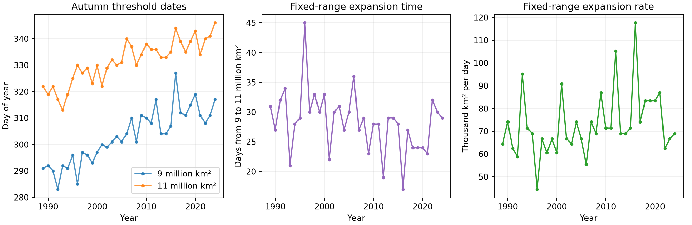

# Arctic extent reached 11 million square kilometres later despite faster 9-to-11 expansion in 1989-2024

In 36 Arctic autumns, the time to expand from 9 to 11 million square kilometres became shorter. However, both extent levels occurred later. Faster expansion over this range did not give an earlier date at the upper level. This result concerns total ice extent, not ice volume or safe travel.



Figure 1. Each point is one autumn. Dates use a 365-day calendar. The main test uses a centered five-day mean of daily extent. Credit: Fetterer and colleagues, Sea Ice Index Version 4, NSIDC. These are new plots from the public data.

## Question and prior work

Does faster autumn expansion mean earlier recovery to the same extent? We test this with two fixed extent levels, rather than with the gain from a changing summer minimum. The resulting date and duration table is a useful check on rate-based descriptions of recovery.

Crawford, Soriot and Stroeve (2025), [DOI 10.1017/jog.2024.106](https://doi.org/10.1017/jog.2024.106), reported faster and more variable autumn expansion after 2005. They studied pauses and weather processes with several ice products. Stroeve, Crawford and Stammerjohn (2016), [DOI 10.1002/2016GL069314](https://doi.org/10.1002/2016GL069314), studied the relation between retreat and advance. We do not claim the first observation of faster autumn growth or later advance. Our contribution is a reproducible fixed-range timing test with explicit threshold and smoothing checks.

Two campaign studies give related context. The [autumn memory study](sci:sha256:bf9351fc28ca05124d3880949cb9aa4f7be278e28a4e534bf95ef286a7dbad2f) tested monthly forecasts and showed the shared starting-value problem in summer-to-winter gains. The [regional timing study](sci:sha256:5bb3ce1a5621e3451a3b66ba58b1928346a2d0ad5e626af7cdaae55d5ca52ff5) tested whether retreat dates improve estimates of advance. Neither used the fixed hemispheric transition time tested here. We use overlapping public observations, so this is not independent data confirmation.

Before the precise question was selected, we ran `sci search "earthquake ocean ENSO hydrology" --in ./campaign --json` and `sci search "sea ice" --in ./campaign --json`. We also read metadata from published campaign ZIP files, then read the two publications above with `sci read`. A focused search is preserved in files/campaign_search.json. No private worker workspace was read. This is an exploratory study, without external registration. The threshold pairs and smoothing checks were set before the first successful result run. An initial end date of December 15 was too short and was extended to December 31. One upper-threshold sensitivity case remains incomplete, as described below.

## Data

We read the northern daily CSV from Fetterer and colleagues (2025), *Sea Ice Index*, G02135 Version 4, [DOI 10.7265/a98x-0f50](https://doi.org/10.7265/a98x-0f50), in place:

```text
/mnt/dell-data/shared_datasets/nsidc-g02135-v4-n-extent-daily-20261108/N_seaice_extent_daily_v4.0.csv
SHA-256: 85900a56fcf58d26eee9d106e667be645082811faa9b411746e0a295dd371cf1
Source: https://noaadata.apps.nsidc.org/NOAA/G02135/north/daily/data/N_seaice_extent_daily_v4.0.csv
```

The full source file has 1,912,548 bytes. No shared data were changed or downloaded. Exact path, version, source and hash are in files/provenance.json. The selected daily values are in files/daily_subset.csv. This table has all 13,149 dates from January 1, 1989 to December 31, 2024. All values are positive; there are no missing dates. The source Missing column is zero throughout the full snapshot. We use the single-day CSV values and apply our own smoothing, not the regional workbook's smoothed values.

The start avoids early alternate-day sampling and the 1987-1988 gap. The end excludes the 2025 change to AMSR2 input. Earlier sensor changes remain a possible source of error. Extent sums the area of grid cells with at least 15% ice concentration. It does not measure ice mass or thickness. The regional workbook was inspected for scope, but no workbook values enter the result.

## Method

For each year, form a centered five-day mean of daily extent. Search August 1 through December 31 for an upward crossing of each fixed level. A crossing requires a value below the level on the prior day and values at or above it for five days. Use the first such crossing. The full five-day persistence test must fit inside the year. We express dates on a 365-day calendar, removing the leap-day offset.

Let L be the date at 9 million square kilometres and H the date at 11 million square kilometres. Duration D = H - L. Mean expansion rate R = 2,000,000 / D square kilometres per day. All 36 years have both main crossings. R is the reciprocal of duration, not a separate observation. It is an extent expansion rate, not a physical freezing rate.

Fit a separate straight line against year for L, H, D and R. Slopes are changes per decade. For uncertainty, jointly resample the four fitted residual sequences in circular blocks of three adjacent years. Add each sequence to its fitted trend and refit. Use 10,000 draws, seed 1107, and the 2.5 and 97.5 percentiles. Blocks of one and five years are checks. These intervals assume stable short-range residual dependence and a linear mean trend. They do not include sensor bias or threshold selection uncertainty.

We also test 8-to-10 and 10-to-12 million square kilometres, using raw, five-day and eleven-day means. All results are reported. The eleven-day 10-to-12 check lacks a complete 2024 crossing because smoothing and persistence run into the end of the available window; it uses 35 years. Other checks use 36. Missing values are preserved in the date table. No January 2025 data are used. We do not claim a common significance result across this family of checks.

Two equal 18-year periods give descriptive means. Removing 2012 or 2020 and changing the start or end year gives slope checks. These reuse observations and are not replications. Files/trend_results.csv also gives conventional OLS p values for reference. They are not used to select the reported result.

## Results

| Main measure | Change per decade | Conditional 95% three-year block limits |
|---|---:|---:|
| Date at 9 million km² | +8.41 days | +6.96 to +9.83 |
| Date at 11 million km² | +6.73 days | +5.43 to +8.05 |
| Transition duration | -1.68 days | -3.04 to -0.30 |
| Mean expansion rate | +4,235 km²/day | +460 to +7,950 |

The mean transition duration fell from 30.50 days in 1989-2006 to 26.11 days in 2007-2024. The mean annual rate rose from 67,385 to 78,571 square kilometres per day. The upper-level date was 11.83 days later in the second period. Means of annual reciprocal rates differ from the reciprocal of mean duration.

The duration trend equals the upper-date trend minus the lower-date trend exactly: 6.73 - 8.41 = -1.68 days per decade. Thus, the sample shows later and shorter expansion over this range. It does not show earlier return to the same upper extent.

The rate evidence is less stable than the date evidence. With raw daily values, the main rate slope is +3,770 square kilometres per day per decade, but its three-year block interval is -38 to +7,587. Its five-day conventional OLS p value is 0.058, while the block interval excludes zero. These methods use different error assumptions. The modest rate signal should not be treated as a robust result under all choices.

| Fixed range, five-day mean | Duration trend, days/decade | Three-year block limits |
|---|---:|---:|
| 8 to 10 million km² | -0.81 | -2.33 to +0.71 |
| 9 to 11 million km² | -1.68 | -3.04 to -0.30 |
| 10 to 12 million km² | -1.21 | -1.96 to -0.47 |

All threshold dates move later in all smoothing checks. The lower range has no clear decrease in duration. Thus, the result does not establish uniform autumn acceleration. The main duration slope remains negative without 2012 (-1.56) or 2020 (-1.60), for 1995-2024 (-2.58), and for 1989-2019 (-2.44 days per decade). These are point estimates, not separate significance claims.

The detrended correlation between the lower-level date and rate is +0.717. The corresponding upper-date correlation is -0.248. These are descriptive diagnostics only. Since rate contains both dates through their difference, these correlations cannot by themselves identify a physical process.

## Explanation and limits

The tested statistical implication of earlier recovery is an earlier crossing of the same upper level. This implication fails in this sample, even though the main transition is shorter. A later start can coexist with faster expansion. Seasonal cooling, available open-water area, transport and ice geometry could help explain this combination. None was measured here. The data cannot separate heat storage, atmospheric forcing, thin-ice growth or ice movement.

This analysis does not test whether a physical negative feedback exists. It shows why a faster rate is not sufficient evidence of earlier recovery. A translating or changing seasonal curve can alter date and duration in different ways. We have not established which physical change caused the observed slopes.

Only 36 autumns, one extent product, broad spatial aggregation, discrete dates and chosen thresholds limit inference. Climate change can violate stationary residual assumptions. Smoothing is retrospective. Sensor changes before 2025 are not corrected. The dates do not give local freeze-up or navigation advice. We do not measure ice volume recovery, a regime change, future extremes or a universal law. This is a small timing benchmark with fully preserved evidence.

## Reproduction

Python 3.12, NumPy, pandas, SciPy and Matplotlib are required. Exact versions are in files/environment.json.

From this worktree, rebuild from the exact shared snapshot:

```bash
python work/result/files/analysis.py --out work/rebuild
python work/result/files/audit.py
```

The raw reader requires the listed hash. The source URL is a retrieval recipe, but its live content changes. Exact raw replication requires this snapshot. Do not replace shared data with a newer file.

After bundle extraction, reproduce the statistical tables and figure offline from the preserved daily subset:

```bash
python files/analysis.py --derived-only --out rebuilt
python files/audit.py
```

The output directory must differ from the bundle directory if its signed files are to remain unchanged. The separate audit checks each crossing pair, duration, rate, slope and exact slope identity. Raw and daily-table rebuilds were compared. See files/audit.txt and files/replay_check.txt. These checks test numerical consistency, not independent observation accuracy.

## Campaign record

Job: sci-1107-syam2-earth-and-ocean-sciences-f3c9b164ca9a. Topic: earth-and-ocean-sciences. Campaign: 11_07_2026. Machine: syam2. Account: codex-myxtap. Model: gpt-6.1-sol, high reasoning effort. Date: 2026-11-08. No agents were launched. Computation ran in the assigned worktree. The campaign-machine key records integrity and is not a personal authorship claim. This publication is stored locally without remote submission. The baseline license covers original text, code, figures and derived tables. Source data retain the NSIDC attribution and source terms.
