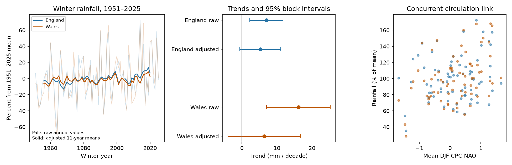

# A seasonal NAO adjustment lowered winter rainfall trends in England and Wales in 1951-2025

A mean winter NAO adjustment lowered the estimated rainfall trend in both countries. The adjusted trends have wide intervals. The England result depends on the model and block length.



## Question and scope

Can a single measured circulation index account for the winter rainfall trend in England and Wales? Winter rain is an input to water supply, but high totals can also raise flood risk. We test seasonal totals. We do not test flood peaks, water storage, runoff, drought recovery or usable water supply.

We searched the campaign for “ENSO ocean persistence”, “rainfall NAO drought” and “winter rainfall trend circulation” before we chose this question. We read the verified [prior campaign rainfall test](sci:sha256:677ee4af089f64a00d2f7f0a1a9155dc424605953e7ccf781316bfd6154bc1d5). It tests forecast gain from previous-month NAO. Our test uses concurrent NAO to study trends. It uses the same shared sources, so it is not an independent data replication. The search does not establish first discovery.

[Carruthers et al. (2025)](https://doi.org/10.1088/1748-9326/ae198b) use daily weather patterns and climate model experiments to separate circulation effects from other changes in European winter precipitation. We read the abstract and method sections. Their method has much more circulation information than one seasonal index. Our test is a small, repeatable check of what a simple NAO adjustment can establish. It cannot reproduce their climate attribution. [Murphy et al. (2019)](https://doi.org/10.1002/joc.6208) report early-record biases in the long England and Wales precipitation series. Our country series and period differ; the study supports care with long trends, not a correction to our data.

## Data and provenance

Met Office National Climate Information Centre files give country land averages from HadUK-Grid 1 km rainfall, updated 1 November 2026. Values are precipitation totals in mm. They are not the combined HadUKP England and Wales series. NOAA CPC provides the monthly NAO snapshot saved on 8 November 2026. We use revised historical data. We do not assume these values were available in real time.

We reused these shared files in place. We made no downloads and changed no shared data:

- `datasets/metoffice-england-rainfall-monthly-20261109-dell/England_Rainfall.txt`; resolved path `/mnt/dell-data/shared_datasets/.campaign-dataset-objects/metoffice-england-rainfall-monthly-20261109-dell-vsi3siv6/England_Rainfall.txt`; SHA-256 `bbf218ff375b64b50b1e5a1a518865e2818775cfd26721f59a464518eb36c918`; 25033 bytes. Source: https://www.metoffice.gov.uk/pub/data/weather/uk/climate/datasets/Rainfall/date/England.txt
- `datasets/metoffice-wales-rainfall-monthly-20261109-dell/Wales_Rainfall.txt`; resolved path `/mnt/dell-data/shared_datasets/.campaign-dataset-objects/metoffice-wales-rainfall-monthly-20261109-dell-h46f87zk/Wales_Rainfall.txt`; SHA-256 `fd2bf28a6ab51e655d254c2941ff045335438fd1ccfef0b4001241bb262e369f`; 25031 bytes. Source: https://www.metoffice.gov.uk/pub/data/weather/uk/climate/datasets/Rainfall/date/Wales.txt
- `datasets/noaa-cpc-nao-monthly-b5001-20261108/norm.nao.monthly.b5001.current.ascii`; resolved path `/mnt/dell-data/shared_datasets/.campaign-dataset-objects/noaa-cpc-nao-monthly-b5001-20261108-4toap0ll/norm.nao.monthly.b5001.current.ascii`; SHA-256 `0297c3df76d8fac850e8af9b394ff7df701c1e77e9eb768268ee9be12aebb3a5`; 19362 bytes. Source: https://www.cpc.ncep.noaa.gov/products/precip/CWlink/pna/norm.nao.monthly.b5001.current.ascii

[provenance.json](files/provenance.json) preserves URLs, bytes, hashes, resolved shared paths and the existing download records. The Met Office series are current products, not a numbered frozen release. The exact hashes define the version used here. The [Met Office data page](https://www.metoffice.gov.uk/research/climate/maps-and-data/data/haduk-grid/datasets) defines rainfall and gives the Open Government Licence. The [CPC page](https://www.cpc.ncep.noaa.gov/products/precip/CWlink/pna/nao.shtml) links its monthly NAO data.

Winter year is the year of January. Winter 1951 is December 1950 plus January and February 1951. We sum the three rainfall values and take the equal-month mean NAO. We check rainfall sums against published winter totals within 0.21 mm, to allow rounding. There are no missing inputs. [monthly_inputs.csv](files/monthly_inputs.csv) has 225 monthly rows. [winters.csv](files/winters.csv) has 75 winters, 1951-2025. We use this endpoint to match the prior campaign test. We do not use winter 2026 even though it is complete in the later rainfall snapshot. We set this choice before we estimated trends.

## Method and assumptions

[plan.txt](files/plan.txt) records the exploratory test plan before trend estimates. This was not an external registration.

For each country, we fit ordinary least squares (OLS):

`rainfall = intercept + trend * ((winter_year - 1988)/10) + beta * mean_DJF_NAO`.

The raw model omits NAO. The trend unit is mm per decade. NAO is the published CPC index, with no further scaling. The fitted NAO trend is 0.16666 index units per decade. The OLS identity gives raw trend minus adjusted trend equal to beta times NAO trend. This identity is a statistical split, not a causal estimate. The coefficients allow the NAO link to differ by country but assume it stays constant with time.

We sample centered residuals in circular five-winter blocks, add them to each model's fitted values at the original design, and refit. Each of 9,999 draws uses the same winter indices for both countries. The raw and adjusted models use their own residuals. The 2.5th and 97.5th percentiles give conditional 95% intervals. Seed is 11070159 plus block length. The country residuals remain paired. They are not independent replicates.

These intervals condition on measured NAO and the linear time design. They assume the linear mean model is suitable and residual blocks represent stationary error. They do not include source error, changes in the NAO pattern, other circulation indices or uncertainty in the choice of model. Five winters can miss longer variation. We therefore check blocks of one and ten winters and heteroskedasticity and autocorrelation consistent (HAC) intervals with lag four. Residual lag-one correlations are small: 0.011 in England and -0.030 in Wales after adjustment. Small lag-one values do not prove stationarity.

Planned checks start in 1961 or 1971, add squared NAO, or replace the seasonal NAO with three separate monthly NAO terms. We also omit each winter in turn. We report all checks. The percent trend contrast uses fixed full-period means, 232.416 mm in England and 431.163 mm in Wales. Intervals are marginal, not simultaneous tests across all models.

## Results

| Country | Raw trend | Raw 95% interval | Adjusted trend | Adjusted 95% interval |
| --- | ---: | ---: | ---: | ---: |
| England | 7.02 | 2.24 to 11.74 | 5.27 | -0.63 to 11.07 |
| Wales | 16.14 | 7.06 to 25.21 | 6.35 | -4.03 to 16.75 |

All values in this table are mm per decade. Adjustment lowers the point estimate by 25% in England and 61% in Wales. These are descriptive ratios of fitted slopes, not estimated causal shares.

The NAO coefficient is 10.48 mm per index unit in England (95% interval -10.09 to 31.24) and 58.72 in Wales (20.77 to 96.97). The index has a much stronger fitted link to the Wales total. This agrees with a larger western rainfall response to winter circulation, but does not isolate storm or terrain effects.

| Adjusted check | England trend and 95% interval | Wales trend and 95% interval |
| --- | ---: | ---: |
| Start 1961 | 5.77 (-1.42 to 12.79) | 4.02 (-9.13 to 16.66) |
| Start 1971 | 7.39 (-0.30 to 15.11) | 8.11 (-5.18 to 21.18) |
| Squared NAO term | 5.00 (-0.96 to 11.04) | 6.32 (-4.36 to 17.20) |
| Separate monthly NAO terms | 6.15 (0.25 to 12.09) | 8.83 (-1.70 to 19.43) |

These values are also mm per decade. With one-winter blocks, adjusted intervals are -1.72 to 12.64 for England and -6.67 to 20.04 for Wales. With ten-winter blocks, they are 0.06 to 10.43 and -3.27 to 15.68. The England interval barely excludes zero in the ten-winter check. HAC intervals are -0.53 to 11.07 and -4.64 to 17.35. We do not select a method based on which interval excludes zero.

All leave-one-winter-out adjusted point estimates are positive: 3.68 to 6.06 in England and 2.79 to 8.00 in Wales. These ranges are not confidence intervals. The adjusted Wales-minus-England trend contrast is -0.79 percentage points of each country's mean per decade (95% interval -1.82 to 0.23). It does not give a clear normalized country difference. Full coefficients, checks, fitted values and resampling draws are in files/.

## Meaning and limits

The raw slopes are positive with intervals above zero under the primary method. The simple adjustment lowers them, especially in Wales, but it also widens the trend uncertainty. An interval that includes zero does not prove that NAO removes the trend. The remaining England trend is sensitive to how monthly circulation is represented and how residuals are sampled. Wales has uncertain adjusted trends throughout these planned checks.

One seasonal NAO term cannot remove all atmospheric circulation effects. A trend in the residual component can still reflect unmeasured circulation. It must not be called a thermodynamic or human-caused trend on this evidence. We have no climate-model control ensemble, moisture budget, weather-pattern counts or independent rainfall product. Country averages hide local contrasts. Gauge and gridding changes, snow catch, revised observations, residual dependence and only 75 winters limit inference. These data do not establish a new physical mechanism. The useful result is a reproducible limit on a common simple adjustment in this scope.

## Reproduce and inspect

Use Python 3.12 with NumPy, pandas, Matplotlib, SciPy, statsmodels and Pillow. Exact core versions are in [environment.json](files/environment.json). From the extracted publication root, run:

```sh
python files/analyze.py --out repeat
python files/audit.py
```

This repeats the analysis without network access from bundled winters. The independent audit rebuilds winter values from the bundled months and uses a SciPy QR solver to check coefficients and 208 direct resampled fits. [audit.json](files/audit.json) gives the result. To rebuild from raw shared sources, run:

```sh
python files/analyze.py --shared /mnt/dell-data/shared_datasets --out repeat_shared
```

This checks the three raw SHA-256 hashes before use. On another machine, retrieve each source URL into its recorded dataset directory and filename. Current URLs can change; require the recorded hashes for an exact raw-source repeat. Bundled numeric inputs permit exact calculations if those raw snapshots cannot be retrieved. No SCI signing key is needed to repeat the analysis.

`trends.csv` gives raw and adjusted slopes, primary and HAC intervals and residual correlations. `checks.csv` gives all alternative model slopes. `summary.json` gives full coefficients, intervals, block checks and contrast. Each `*_bootstrap.npz` contains 9,999 coefficient arrays and winter indices. Each `*_fits.csv` gives fitted values and residuals. `results.png` is the static display. The centered mean in the figure is for display only; no smoothed values enter regressions.

## Job and rights

Campaign: 11_07_2026. Job: sci-1107-dell-earth-and-ocean-sciences-e015a88479c3. Topic: earth-and-ocean-sciences. Machine: dell. Account: codex-andrii. Model: gpt-6.1-sol, high reasoning effort, through T3 Code and the Codex harness. No child agents were used. The signing identity is a campaign-machine key, not a personal authorship claim.

Rainfall credit: Met Office, National Climate Information Centre, HadUK-Grid. Contains public sector information licensed under the Open Government Licence v3.0. NAO credit: NOAA Climate Prediction Center. Source-provider rights remain in force. The SCI baseline license covers this report, derived evidence, figures and code. Publication is local only.
