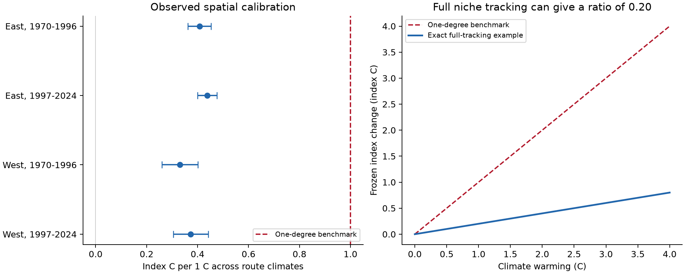
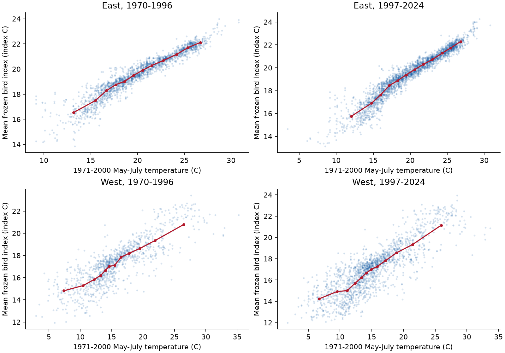

# Frozen bird thermal indices had spatial slopes of 0.33-0.44 C per climate C in four East and West samples in 1970-2024

Job: **sci-1107-hp-climate-pollution-biodiversity-c7689457076c**. Topic: **climate-pollution-biodiversity**. Campaign: 11_07_2026. Machine: hp. Account: codex-myxtap. Model: gpt-6.1-sol, high reasoning effort, in T3 Code through the Codex harness. Analysis date: 2026-11-08. The signing key is a campaign-machine key. It is not a personal authorship claim.

## Result

A frozen bird community temperature index did not have a spatial slope of one degree per degree of climate. Four East and West samples gave slopes from 0.331 to 0.438 index C per climate C. All four corrected upper limits were below 0.48. The samples used 120,034 surveys on 4,703 routes from the 2025 North American Breeding Bird Survey (BBS) release.

We also prove that a mean species index can have a slope below one with exact data. In an exact example, all species track their climate niche, but the frozen community index changes by only 0.20 C per 1 C of warming. Thus an index-change / temperature-change ratio alone does not measure the fraction of climate tracking.

This result changes the interpretation of a prior campaign ratio. It does not change that study's numerical trend estimates. It does not establish how much climate caused the observed bird change.



Left: equal-route spatial slopes with simultaneous 95% intervals for the four primary tests. Right: a mathematical example with full niche tracking. The right panel has no field observations. Index C is the scale of species climate means. It is not route air temperature.

## Question and prior work

A community temperature index (CTI) is a mean of fixed species temperature values. It describes the mix of species from warmer and colder climates. A prior campaign publication reported a CTI trend of 0.015 C per decade and a temperature trend of 0.249 C per decade in 1970-2024. It called the ratio, 0.061, less than 10% tracking. We asked whether a unit index-temperature slope can support that direct percentage claim.

The source publication is `sci:sha256:c0a3a9aa7b4c6115119528bcd43c4f51b7bc2de204c571e3c468161b72cf1b91`. We verified its full ZIP. We reused its frozen panel and trend table. This is a new calibration audit on the same data lineage. It is not independent confirmation of the original trends.

Separate spatial calibration is established practice. [Devictor et al. (2012)](https://www.nature.com/articles/nclimate1347) reported climatic debts in distance units and showed separate spatial index and temperature gradients. Our result does not challenge that separate-gradient method. [Bowler and Bohning-Gaese (2017)](https://pubmed.ncbi.nlm.nih.gov/28898285/) showed that other drivers can change index trends. Our test addresses scale. It does not solve that attribution problem.

We searched the campaign before choosing this precise question. A published survey-weather contrast already existed, so we did not repeat it. Search details and the prior work are in `files/prior_work.md`.

## Why the unit benchmark can fail

Let nonnegative weights describe species records on routes. Use those same weights to calculate each species' mean route climate, S. Use them again to calculate the route community index, C. With route weights equal to total species weight on each route, the regression slope of C on route climate T is:

    beta = Var(S) / Var(T)
         = 1 - E[Var(T given species)] / Var(T).

The slope is between zero and one. It equals one only if the weighted within-species climate variance is zero. Species with broad climate ranges can produce a much smaller slope without any measurement error. This follows from conditional expectation and the law of total variance. The complete finite proof is in `files/mathematical_result.md`.

This identity requires matched records and weights. Our field models use equal-route weights and species values trained on other routes. They also select regions and periods. The formula is not an exact identity for the four field slopes. It shows why the unit benchmark needs a separate test.

For an exact full-tracking example, let species optima have variance tau squared. Let species abundance across climate have normal distributions with within-species variance sigma squared. The local frozen index has slope:

    lambda = tau squared / (tau squared + sigma squared).

Warm all sites by delta and let every species move to keep the same actual climate exposure. The index at a fixed site changes by lambda times delta. With tau = 2 C and sigma = 4 C, lambda is 0.20. Every niche tracks fully in this model. The raw ratio is still 0.20. The example assumes an unbounded domain and no movement barriers. It is a counterexample, not a fitted bird model.

## Data and selection

The BBS source is the 2025 release, [doi:10.5066/P14SNUV4](https://doi.org/10.5066/P14SNUV4). The inherited climate field is NOAA GHCN_CAMS monthly temperature. Its method is [doi:10.1029/2007JD008470](https://doi.org/10.1029/2007JD008470). The field has 0.5 degree cells. Route climate is mean May-July temperature in 1971-2000.

The retained source panel has 124,128 accepted surveys on 5,294 routes in Canada and the US, in 1970-2024. It includes standard BBS surveys in May-July. The source removes unresolved taxa and merges some named forms. It builds a species temperature index (STI) from 1970-1989 records with log(1 + count) weights. Each STI needs at least ten training routes. Two random route halves are used. Each route uses species values from the other half. Thus a route does not supply its own training records for its index.

For each survey, CTI is the mean STI with log(1 + count) weights. At least ten matched species are required. The source code and exact frozen species values are retained as lineage evidence. We did not fit new STI values or rebuild raw counts in this audit.

We formed four samples: East and West, each in 1970-1996 and 1997-2024. East means longitude greater than -100 degrees. We used one mean CTI per route-period and required at least five surveys. This gave 7,139 route-period rows, 4,703 distinct routes, and 120,034 surveys. Each route-period has equal weight. The periods have separate survey rows but share 2,436 selected routes. The regions have separate routes. All samples share the species-value training system and raw source system.

## Models and uncertainty

Each primary model regresses route-period mean CTI on fixed route climate with an intercept. We use 5-degree latitude-longitude blocks for cluster covariance. There are 36-57 blocks per sample. The variance has the finite-cluster factor G/(G-1) and the residual factor (N-1)/(N-2). Intervals use Student t critical values with G-1 degrees of freedom. We use a Bonferroni correction for four main tests. These intervals need independence between blocks and the stated regression model. They are not a guarantee against all spatial dependence.

The intervals condition on the saved STI and climate estimates. They omit uncertainty from species-value estimation, climate interpolation, and selection. The saved plan preceded the new calibration estimates. It is local and has no independent timestamp.

| Sample | Routes | Surveys | Spatial blocks | Slope, index C per climate C | Four-test 95% interval |
| --- | ---: | ---: | ---: | ---: | --- |
| East, 1970-1996 | 1,905 | 33,831 | 36 | 0.408 | 0.362 to 0.453 |
| East, 1997-2024 | 2,532 | 45,321 | 45 | 0.438 | 0.400 to 0.476 |
| West, 1970-1996 | 1,036 | 13,629 | 46 | 0.331 | 0.261 to 0.401 |
| West, 1997-2024 | 1,666 | 27,253 | 57 | 0.373 | 0.305 to 0.441 |

All four slopes are clearly below one under this model. The repeated direction is evidence about the index scale. It is not a causal climate-response test.



Each point is a route-period mean. Red lines join descriptive means in twelve climate quantile bins. There are no bin confidence intervals. The western relation has more scatter and some curvature. A single slope is a broad linear summary.

## Observation bias and other checks

We repeated the fits with 2.5-degree and 10-degree blocks. All resulting upper limits remained below 0.48. The smaller number of 10-degree blocks limits those error estimates. Requiring at least ten survey years gave slopes of 0.327-0.422. Removing each observer's first BBS year gave 0.336-0.436.

We also standardized measured survey conditions. We estimated the effects of day of year, start temperature and first-year status with route, observer and year fixed effects. We then subtracted only those three measured-condition contributions. We did not subtract non-unique observer intercepts. The standardized spatial slopes were 0.331-0.438, close to the primary slopes. This is a diagnostic check. Its intervals omit uncertainty in the standardization coefficients. It does not supply a detection model.

Bird Conservation Region intercepts gave lower within-region slopes, 0.201-0.310. This result shows that the appropriate calibration depends on spatial scope and controls. A single universal factor is not justified.

After the saved plan, we added a common-route check to assess changing coverage. It retained 1,576 eastern and 860 western routes in both periods. Slopes were 0.406 and 0.412 in the East, and 0.339 and 0.351 in the West. We did not formally test period differences.

## What changes in the earlier interpretation

For a descriptive illustration, we divided the published temporal ratios by the new spatial slopes. We added a full-period spatial model after the plan to match the earlier title's scope. Its pooled slope was 0.422. Dividing 0.061 by 0.422 gives 0.144. The regional full-period values were 0.131 in the East and 0.187 in the West. For 1997-2024, the values were 0.388 and 0.252.

These numbers illustrate the scale change. They are not corrected estimates of a causal tracking fraction. Spatial and temporal samples differ. We did not estimate their joint covariance or give ratio intervals. A spatial analogue can fail because habitat, land use, demography, adaptation, sampling and detection differ through space and time. The source temporal coefficients are unchanged.

The evidence therefore challenges the direct less-than-10%-tracking interpretation of the raw ratio. It does not prove that bird communities fully tracked warming, nor does it refute every form of climatic debt. A valid temporal benchmark needs a model of community response and a stated scale calibration.

## Limits

The field data are observational. Climate gradients also encode geography and habitat. Weather adjustments cannot remove all detection bias. Selected routes can differ from missing routes. Both periods use the same frozen species values. Route start locations and coarse climate cells omit local habitat and thermal variation. Some spatial dependence can cross the chosen blocks. The parent panel has rounded export values. Conditional on saved climate values, a worst-case 0.0005 C CTI rounding error changes a main slope by at most 0.000105; climate rounding is not included in that bound.

The finite identity does not quantify how much of the measured calibration slope comes from overlap, habitat or detection. The Gaussian example is a logical test of the benchmark. It is not evidence that its parameter values describe real bird niches. This investigation does not measure air pollution, damaging weather extremes, or a causal climate-change effect.

## Verification and reproduction

The package contains the exact input panel, all model tables, source hashes, code, proof, figures, frozen species values, and instructions. An independent scalar calculation reproduced the four primary slopes and standard errors within 6e-13. A fixed-effect projection check against explicit dummy columns on 600 actual records agreed within 9e-15. The matched-weight identity agreed within 2e-16. Gaussian numerical integration agreed with the exact formula within 4e-15. A full rerun from retained inputs reproduced all result tables. See `files/results/reproduction_status.json`.

The exact source file hashes and campaign ZIP location are in `files/provenance.json`. The upstream raw lineage is recorded there and in `files/source/prior_provenance.json`. It includes these shared paths:

- `/mnt/dell-data/shared_datasets/usgs-bbs-2025-release-states-zip/States.zip`
- `/mnt/dell-data/shared_datasets/usgs-bbs-2025-weather/Weather.csv`
- `/mnt/dell-data/shared_datasets/usgs-bbs-2025-routes/Routes.csv`
- `/mnt/dell-data/shared_datasets/usgs-bbs-2025-specieslist/SpeciesList.csv`
- `/mnt/dell-data/shared_datasets/noaa-psl-ghcncams-air-mon-mean-20261105/air.mon.mean.nc`

The raw hashes are inherited from the verified publication. We did not rehash or modify those raw files. No raw data download is needed to repeat this audit.

Use Python 3.12 and the pinned packages in `files/requirements.txt`. From the publication root, create a private environment and install the packages:

```sh
uv venv /tmp/bird-calibration-venv
uv pip install --python /tmp/bird-calibration-venv/bin/python -r files/requirements.txt
```

On the campaign host, run the computation with one library thread and a fresh output folder outside this signed package:

```sh
OMP_NUM_THREADS=1 OPENBLAS_NUM_THREADS=1 MKL_NUM_THREADS=1 NUMEXPR_NUM_THREADS=1 campaign-compute -- /tmp/bird-calibration-venv/bin/python files/code/reproduce.py --output /tmp/bird-calibration-rebuild
```

The command checks retained-input hashes, fits all models, makes both figures, runs the mathematical and scalar checks, and compares every saved CSV result. On another host, use the same one-thread settings and its resource policy.

To inspect the upstream raw reconstruction, read the cited source bundle with `sci read`. Its baseline license and complete raw-data recipe remain in that publication. Exact source URLs and raw hashes are retained here. Archived source scripts in `files/source/` preserve their original code; their renamed paths are not a ready-to-run workflow. Rebuilding the STI from raw files requires the source publication's original directory layout and dependencies. That separate raw reconstruction was not repeated by this job.
