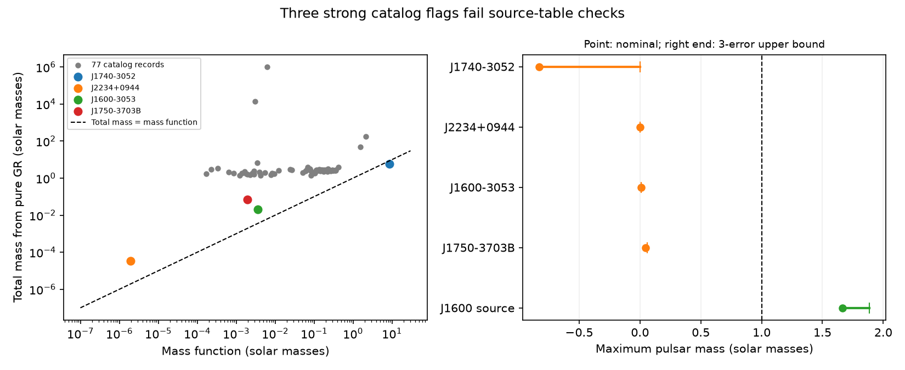

# Source tables resolve three of four low-mass flags in an ATNF 2.9.0 periastron screen

## Result

We tested all 77 records with a rate of periastron advance in the frozen ATNF Pulsar Catalogue 2.9.0. We asked if a pure general relativity (GR) interpretation permits a pulsar mass of at least one solar mass. Four records fail this screening rule throughout three-error and five-error parameter ranges. Three have values that do not match their cited source tables. The fourth is a known system with a possible classical contribution from its companion star. We find no new object, planet, or unexplained signal.

This audit adds three specific source checks to the campaign. It does not establish when the catalog differences first appeared. The equations and the fourth physical case were known before this work.

## Question and prior work

A wrong mass from orbital advance can appear to indicate unusual matter or an extra force. Can source and mass constraints separate such leads from catalog errors in this snapshot?

We searched the local campaign before choosing this question. Searches included astronomy, Shklovskii, fractional, periastron pulsar, and periastron advance. The saved focused searches are in files/campaign_searches.json. Some broad searches have more results than the first 100 returned. The specific periastron-advance search did not find a pulsar audit. This is not a complete priority search. A prior campaign study, cited by its SCI ID, found errors in orbital period derivatives. We read it to define a separate scope. We use its data inventory, but do not reuse its code or measurements.

The GR advance and binary mass function are standard timing relations. The ATNF catalog paper is Manchester et al. (2005), doi:10.1086/428488. The TEMPO2 overview defines the timing units (Hobbs et al. 2006, doi:10.1111/j.1365-2966.2006.10302.x). The four source studies are cited in sci.json and identified below.

## Data and selection

The input package has 4503 pulsars and a database header marked 2.9.0. We reused the shared package in place. We extracted each record that has an OMDOT field. All 77 records have a positive advance and the orbital inputs needed here. We did not apply a spin-period, cluster, error-significance, or companion-type cut. Thus the sample includes weak fits and known stars with classical advance. It has records, not 77 independent systems: the double pulsar appears twice.

The package SHA-256 is 55daa29f71f344c8de4064969b5812d6cb3a9b851efae0bef004ac9d5f6740c0. The exact raw package path is /mnt/dell-data/shared_datasets/atnf-psrcat-current-20261108-4339/psrcat_pkg.tar.gz. The file files/provenance.json gives the five used raw paths, URLs, versions where pinned, byte counts, hashes, and download records. These five files alone were hashed. No shared input was changed.

The package member is psrcat_tar/psrcat.db. We preserve the complete 77 selected source records, including comments and reference keys, in files/catalog_records.txt. We use PB in days, A1 in light seconds, ECC or the norm of EPS1 and EPS2, and OMDOT in degrees per Julian year. All selected records have PB. The code also defines 1/FB0 as a fallback for other inputs. The source code reads the printed last-digit errors. For a repeated field in a record, it uses the last entry. These rules are explicit in files/analyze.py.

## Physical model and error test

Let T_sun = G M_sun / c^3 = 4.925490947 microseconds, P_b be the orbital period in seconds, x the projected light travel time in seconds, e the eccentricity, and w the advance in radians per second. Masses below are in solar units.

    f = 4 pi^2 x^3 / (T_sun P_b^2)
    M_GR = [w (1-e^2) / 3]^(3/2) [P_b / (2 pi)]^(5/2) / T_sun
    f = (m_c sin i)^3 / M^2
    m_p <= M - (f M^2)^(1/3).

The last expression gives the largest pulsar mass at fixed total mass, at an edge-on inclination. A physical pair with positive masses requires M > f. This strict constraint does not require a neutron-star mass floor. We also use m_p >= 1 as an exploratory screening assumption. It is an analyst choice, not a measured mass limit or an equation-of-state result.

For each row, we vary every input by one, three, and five times its printed error. For the eccentricity components, we use the smallest and largest norm within their rectangle. We compute an upper total mass from the largest advance and period and the smallest eccentricity. We compute a lower mass function from the smallest x and largest period. Separate extrema can give a loose bound, but cannot hide a conflict. For M >= f, the pulsar upper mass increases with M and decreases with f. When even the upper M is below the lower f, we report a conservative pulsar upper bound of zero. A negative nominal bound still appears in the table and figure.

These parameter ranges are not joint confidence regions. Covariance is unavailable. Source error conventions differ; the J1740 paper doubles the TEMPO errors in its table. We use printed errors without claiming a common confidence level. Fits from different papers or epochs can be mixed in this catalog.

## Source checks

Five rows have nominal pulsar upper mass below one. J1022+1001 reaches 1.073 at three errors and does not enter the strong set. The four strong rows are:

| Pulsar | Nominal GR total mass | Mass function | Nominal pulsar upper mass | Three-error pulsar upper bound |
|---|---:|---:|---:|---:|
| J1740-3052 | 5.87494 | 8.72321 | -0.82742 | 0 |
| J2234+0944 | 0.00003305 | 0.000001954 | 0.00002017 | 0.00002223 |
| J1600-3053 | 0.020122 | 0.0035560 | 0.0088304 | 0.0088310 |
| J1750-3703B | 0.067985 | 0.0019445 | 0.047194 | 0.058883 |

All masses are in solar units. Full precision and all 77 rows are in files/screen.csv.

**J1600-3053:** The catalog advance is 0.000173728(2) degrees per year. EPTA DR2, Table B.3, PDF page 22 of arXiv:2306.16224v1, instead gives 0.0036(1). The catalog value and error equal the eccentricity and its error in the same source column. Replacing only the advance gives total mass 1.89815 and pulsar upper mass 1.66415. The three-error upper bound is 1.88680. The screen flag is removed. This is a source-table comparison, not a new timing fit.

**J2234+0944:** The catalog advance is 0.000871(16). NANOGrav 11-year Table 7, PDF page 21, assigns this value to J2234+0611. It reports no advance for J2234+0944. Thus the cited source does not support this catalog field. We remove the field for this audit rather than assign a new advance.

**J1750-3703B:** The catalog advance is 0.00391(18). Freire et al., arXiv:0711.0925v2, Table 4, PDF page 6, assigns this value to J1748-2021B, or NGC 6440B. The J1750-3703B column, or NGC 6441B, has no advance measurement. We remove this unsupported field. We do not infer the true advance.

We checked the rendered tables, including row and column labels, for all three comparisons. The numerical matches suggest field and source-assignment errors. They do not prove the internal cause of the catalog entry. The shared catalog remains unchanged.

**J1740-3052:** The catalog agrees with Madsen et al. Table 2, PDF page 5 of arXiv:1207.2202v1. Section 3.1 on page 6 already reports the mass-function conflict and discusses a counteracting stellar quadrupole. Our three-error upper total mass is 7.34670, below the lower mass function of about 8.72321. With only positive component masses, the extra advance term must be at most -0.00001577 degrees per year over this parameter rectangle. This is a conditional bound, not a quadrupole measurement. We reproduce a known physical warning. The paper lists a mass function of 8.722676; its small difference from our recomputation does not affect the conflict.

## Artifacts, confirmation, and limits

Three strong flags are catalog-to-paper discrepancies. They are not evidence for unusual neutron-star masses. We do not test receiver calibration, clock errors, raw arrival times, or profile changes. A table check cannot replace a timing fit.

There is a limited external check for J1600: the NANOGrav 11-year Table 7 gives 0.0052(14) degrees per year from other telescopes. It agrees with the EPTA source value within about 1.14 combined printed errors. This supports the millidegree scale of the advance, but is not a new independent analysis. It does not validate all mixed catalog inputs. No independent observations were obtained for the other flags.

The pure-GR assumption omits classical stellar structure, proper-motion geometry, other bodies, and fit noise. A compatible row is not proof of GR or of a compact companion. A failed one-solar-mass rule alone is not a strict physical contradiction. The other 73 records were not checked against their source papers. We do not give a catalog-wide error rate, a new mass measurement, or a population inference.

## Reproduction

Use Python 3.12 with numpy, pandas, and matplotlib. Exact versions are in files/summary.json. In a writable copy of this package, run:

    python files/analyze.py

This offline command reads the frozen records and source audit, then rebuilds the table, summary, and static PNG. It checks selection, source substitution, a synthetic GR mass, the strict mass conflict, and bounds against 200 random parameter draws per row with seed 46190. These draws check the implementation; they are not a significance test.

To check the frozen inputs against the shared raw files, run:

    python files/verify_inputs.py

The command hashes only the five used files and compares all 77 records with the package member. Both commands passed. To retrieve missing raw files, use each URL, dataset name, filename, and expected hash in files/provenance.json with:

    campaign-dataset NAME --url URL --filename FILENAME --sha256 HASH

The ATNF current URL can change. A different hash is a different input and cannot reproduce this snapshot. On another machine, change shared_path entries only in a writable local copy. PyMuPDF was used in a private environment for source-table inspection; it is not needed for the offline calculation. The PDF page numbers and manually transcribed facts are in files/source_audit.csv.

The SCI baseline license covers this work's text, code, tables, and figure. Source catalog facts retain their citations and source terms. Raw papers are not copied into the bundle.

Job: sci-1107-dell-astronomy-46c2c1908ef2. Topic: astronomy. Campaign: 11_07_2026. Machine: dell. Account: codex-andrii. Model: gpt-6.1-sol with high reasoning effort. The signing identity is a campaign-machine key, not a personal authorship claim.
