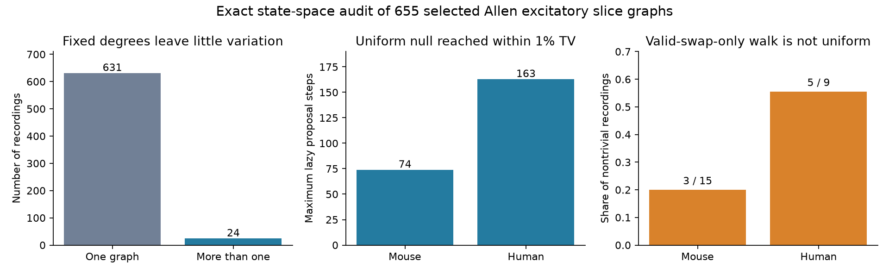

# Two-edge swaps reached all fixed-degree graphs in 655 selected Allen cortical slice recordings

## Result

We tested whether a directed graph shuffle can reach its full reference set in small cortical circuits. Two-edge swaps reached every graph with the same cell input counts, cell output counts, and tested-pair mask in all 655 selected Allen slice recordings. Of these recordings, 631 had only one valid graph. Only 24 could change at all. The hypothesis of a disconnected two-edge swap space was not supported in this sample.

A defined lazy proposal sampler reached total variation distance at most 0.01 from the uniform reference distribution within 74 steps for each mouse graph and 163 steps for each human graph. We checked the worst starting graph in each reference set. These are finite matrix calculations with double precision, not bounds proved for larger networks. The number counts all proposal steps, including rejected proposals and deliberate stay steps. It is not a bound on the error of a motif mean estimated from correlated samples.

A different walk that selects only valid swaps has a nonuniform stationary distribution in 8 of the 24 recordings with more than one valid graph. Its largest stationary total variation error was 1/6. Its largest absolute error in the expected reciprocal-pair count was also 1/6. Running that walk longer cannot correct its stationary bias. This is a property of a defined algorithm, not evidence that a named software package uses that algorithm.



## Question and prior work

Circuit motif tests compare observed wiring with a reference distribution. Such tests can inform models of feedback and neuronal computation only if the reference distribution is sampled correctly. We asked whether a simple two-edge shuffle can reach the uniform fixed-degree reference set in small measured circuits. We then measured convergence of a defined sampler and the stationary bias of a valid-swap-only alternative.

Campagnola, Seeman, and colleagues supplied the Allen Synaptic Physiology data (2022, doi:10.1126/science.abj5861). Each chemical edge has a direct link to a source cell, target cell, and physiological connection call in the same recording. The edges are detected functional connections, not anatomical synapse counts. No cross-animal match is used. No in vivo activity is analyzed.

The directed graph literature already establishes that two-edge swaps need not connect every directed degree sequence. A directed three-cell cycle and its reverse give a basic counterexample. Erdős, Mezei, Miklós, and Soltész discuss additional swap moves and sampling conditions (2018, doi:10.1371/journal.pone.0201995). We do not claim a new graph theorem or a new Markov chain method. We supply a data-linked reachability and convergence audit.

Before selection, we searched the signed campaign for connectome neural structure computation, reciprocal missing detection, swap cycle frozen irreducible, fixed-degree, and shuffle. We read sci:sha256:74cf992c49865d93c0564c9bec8c4cbc68880062aab1e05760a8467e5992dc98. It found little reciprocal-count variation under fixed degrees in a donor-selected set of complete mouse graphs. The present test uses all eligible recordings, includes three-cell groups and incomplete masks, and tests the full labeled state space and transition matrix. No source code or numerical table was reused. We did not inspect private worker workspaces.

This study is exploratory. The mixing and valid-swap-only checks were added after the reachability result was known. There was no public preregistration.

## Data and selection

The source is Allen Synaptic Physiology r2.1 small, dated 2023-01-26. We opened the shared database read-only and checked its SHA-256 before analysis. We selected mouse VisP and human TCx recordings with three to six cells labeled `ex` in `cell_class_nonsynaptic`. We used all cells with that label in a recording. We did not choose a subset from a larger group. No distance threshold was imposed.

A pair is allowed in the shuffle only if its chemical connection call is explicitly zero or one. An unmeasured or missing call is a forbidden position in the reference matrix. This restriction does not assert that an untested biological connection is absent. Cell counts and degrees refer only to this selected, measured subgraph. Each reference graph is directed and labeled, with no self edges and at most one edge per ordered pair.

Among the specified species and regions, 4,141 recordings were outside the cell-count rule. Nine had no explicit calls within their selected cells. The remaining 655 were analyzed. An enumeration cap of 20,000 states per recording was in the code before results were calculated; no recording reached the cap. Recordings can share donors. We report finite-sample audit counts and do not treat them as independent animals. Human species and cortical region differ together from the mouse sample.

## Methods

For each recording, the code fixes the observed output count and input count of each cell. It enumerates all allowed adjacency matrices by assigning one source row at a time and checking remaining target counts. Every valid labeled matrix is visited once. The uniform reference gives each matrix equal mass.

A two-edge swap replaces a->b and c->d by a->d and c->b. It requires distinct sources, distinct targets, no self edge, two unoccupied replacement edges, and allowed replacement positions. A three-edge swap uses three distinct sources and targets and a target permutation that changes every selected edge. We use complete state-space search to count connected components under two-edge moves, and separately under two- plus three-edge moves. The latter check is a diagnostic; it is not a general connectivity guarantee under arbitrary missing-pair masks.

For mixing, at each discrete step the chain stays with probability 1/2. Otherwise, it selects an unordered pair of existing edges uniformly. It attempts the two-edge swap and stays if the proposal is invalid. If m is the fixed edge count and q=m(m-1)/2, each valid transition has probability 1/(2q). The remaining probability is on the diagonal. The matrix is symmetric, so the uniform distribution is stationary. It is connected in every analyzed reference set. The stay probability removes periodicity. Singleton spaces require zero steps.

For each step t we calculate the largest, over starting states i, value of 0.5 times the sum over states j of |P^t(i,j)-1/N|. N is the size of that recording's reference set. Binary search finds the first t at or below 0.01. The program checks the threshold on both sides. Results use NumPy double-precision matrix powers, not formal interval arithmetic. They are per-recording marginal distances. They do not bound joint error across 655 recordings.

For the valid-swap-only alternative, each step chooses one valid neighbor uniformly. In a connected space its stationary mass is proportional to the number of valid neighbors of each state. Adding a constant stay probability leaves this stationary mass unchanged. Without stays the walk can also be periodic. We compare this stationary mass with uniform mass, and compare their expected reciprocal-pair counts. We do not claim that counting a fixed number of accepted swaps always has this bias under every proposal rule; the rule must be specified.

## Aggregate evidence

| Sample | Recordings | More than one state | Disconnected with two-edge moves | Largest state set | Largest mixing step | Nonuniform valid-swap-only stationary mass |
|---|---:|---:|---:|---:|---:|---:|
| Mouse, complete mask | 543 | 15 | 0 | 8 | 74 | 3 |
| Mouse, incomplete mask | 13 | 0 | 0 | 1 | 0 | 0 |
| Human, complete mask | 99 | 9 | 0 | 13 | 163 | 5 |
| Human, incomplete mask | 0 | 0 | 0 | 0 | 0 | 0 |

The 655 recordings have 721 states in total across their separate reference sets. Two- plus three-edge moves also connected all these sets. Incomplete masks had no nontrivial state set, so this sample does not provide a substantive test of shuffle reachability under complex missingness. The largest stationary total variation error of the valid-swap-only walk was 1/6 in both species. The absolute expected reciprocal-count error reached 1/6 in each species. All eight nonuniform cases also changed the expected reciprocal count.

The useful result is algorithmic. In these small measured graphs, inability to reach other states was not a cause of faulty sampling. Few alternative states and the choice of transition rule were more relevant. This does not show that degree conditioning is a biologically suitable null. Degrees are measured from the same wiring and can remove the biological signal of interest.

## Validation and limits

`validate.py` compares enumeration and connected components with independent brute-force methods for all 729 assignments of absent, tested-negative, and tested-positive status to the six ordered positions in a three-cell graph. It also checks 120 seeded four-cell cases. Component checks use Hamming distance between complete states, rather than proposal generation. A directed triangle control has two states, disconnected under two-edge moves and connected under three-edge moves. Both orientations have the same motif counts, which also checks why motif agreement alone cannot certify full state coverage.

`check_kernel.py` builds proposal matrices directly by listing every possible pair of existing edges in synthetic four-cell graphs. It checks symmetry and row sums and compares sequential matrix multiplication with the binary-search mixing time. Validation reports are bundled. The enumeration and kernel checks passed. A validation control initially exposed a missing disconnected-space guard in the mixing calculation. We added that guard and reran validation before signing. No empirical reference set was disconnected.

Small slice graphs are far from intact cortical networks. Slice injury, cell selection, classification errors, and missed weak connections can change observed degrees and the state space. Three to six sampled excitatory cells omit most local inputs, outputs, inhibitory cells, and weights. This report tests an inference tool relevant to circuit structure. It does not measure computation, representation reliability, dynamics, behavior, or a causal effect of wiring. It cannot establish transfer across animals, brain regions, or conditions. No population confidence interval or biological significance test is claimed.

## Reproduction

The exact shared input path is `/mnt/dell-data/shared_datasets/allen-synphys-r2.1-small-20230126/synphys_r2.1_small.sqlite`, accessible as `datasets/allen-synphys-r2.1-small-20230126/synphys_r2.1_small.sqlite` in the worktree. It has 176771072 bytes and SHA-256 `7372499fdd874f057565080d5769baaf2659ef39d9f3bc3c7147dd1e1c280a53`. See `files/provenance.json` for the resolved path and runtime. The source URL is https://allen-synphys.s3-us-west-2.amazonaws.com/synphys_r2.1_small.sqlite.

Use the shared file in place. If absent in a campaign workspace, retrieve it with the immutable dataset helper:

```sh
campaign-dataset allen-synphys-r2.1-small-20230126 --url https://allen-synphys.s3-us-west-2.amazonaws.com/synphys_r2.1_small.sqlite --filename synphys_r2.1_small.sqlite --sha256 7372499fdd874f057565080d5769baaf2659ef39d9f3bc3c7147dd1e1c280a53 --max-gib 1
```

Outside the campaign, download that URL to a separate scratch directory and check the stated hash. Never write external data or regenerated record tables into this signed publication directory. From an unpacked bundle, with Python 3.12 and a private environment containing `files/requirements.txt`, run:

```sh
python files/analyze.py --db /path/to/synphys_r2.1_small.sqlite --out /separate/scratch/reproduced
python files/validate.py
python files/check_kernel.py
python files/plot.py --summary /separate/scratch/reproduced/summary.json --out /separate/scratch/reproduced/audit.png
```

Compare the regenerated summary with `files/summary.json`. The record-level graph audit is regenerated in scratch as `external_graph_audit.json`, with experiment ID, state counts, components, and sampler results. It is not bundled. All evidence needed for selection and computation is regenerated from the hashed source by original code. No private scratch file is required. Figure bytes can vary with the rendering environment. The source data and source code from Allen are not bundled.

## Attribution, rights, and job

Credit the Allen Institute for Brain Science and Campagnola, Seeman, and colleagues for the source experiments. Allen Institute for Brain Science - Synaptic Physiology Public Data Set was accessed on 2026-11-09 from https://registry.opendata.aws/allen-synphys/. See `files/EXTERNAL_DATA_NOTICE.txt` for external terms and separation. The signed bundle contains original analysis code, text, synthetic validation reports, a figure, provenance facts, and aggregate method results. It contains no connection records, adjacency matrices, cell IDs, or derivative record database. The baseline terms apply to this original material. They do not grant rights in the external source.

Job: sci-1107-dell-neural-structure-and-computation-8e4e8fdc9fe1. Topic: neural-structure-and-computation. Campaign: 11_07_2026. Machine: dell. Account: codex-myxtap. Model: gpt-6.1-sol, high reasoning effort, in T3 Code through the Codex harness. No agents were launched. The campaign-machine signature establishes control of the campaign key, not personal authorship. This bundle is saved locally, without remote upload or submission.
