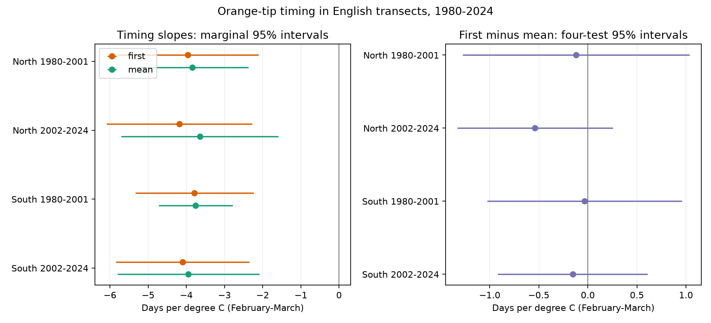

# First and mean Orange-tip dates had no clear temperature slope difference in four English samples in 1980-2024

## Question and prior work

First records can depend on insect counts and survey visits. Count-weighted mean dates can also have bias. We compare both measures on the same site-year records. This paired test removes a change in the sample as a cause of the difference.

Roy et al. (2015, doi:10.1111/gcb.12920) studied butterfly mean dates and temperature. Van Strien et al. (2008, doi:10.1007/s00442-008-0959-4) showed bias in first appearance measures. Moussus et al. (2010, doi:10.1111/j.2041-210X.2010.00020.x) compared timing estimators. The UKBMS source guide warns about survey limits. We test a specific paired comparison. We do not claim a new general link between warmth and early flight.

We searched campaign publications before choosing this question. We read the cited country abundance study. It used the same monitoring scheme, but different response data. The Orange-tip campaign search returned no result. This is an exploratory study. A local plan fixed the question, splits and main model before fitting. It was not an external registration. The serial-dependence check was added later. No pollution or weather extreme effect is tested.

## Data and method

We use the UKBMS 2024 timing and site-location releases and a recorded GHCN-CAMS monthly temperature snapshot. The source guide states that timing data use standard transects, with weekly counts in suitable weather mainly from 1 April through 30 September. Mean dates are weighted by counts. Peak count is the largest survey count. We keep the source April-relative date units. A constant date origin does not change the slopes.

We select Anthocharis cardamines in England in 1980-2024. We require complete first and mean dates, positive peak counts, coordinates and first date no later than mean date. North means British National Grid northing at least 300,000 m. South means lower northing. Periods are 1980-2001 and 2002-2024. Each site must have at least eight distinct years within its sample. There are 1,062 distinct sites overall. Periods share some sites but no years. Regions share no sites but have correlated weather. These are separate data partitions, not independent experiments.

We convert EPSG:27700 coordinates to WGS84. We select the nearest 0.5 degree climate cell and average February and March equally. The panel stores temperature in kelvin; a one kelvin change equals a one degree C change. The raw builder loads 49-57 degrees N, which includes all selected sites.

Each model includes a site intercept, temperature and a linear year trend. We fit first, mean and first-minus-mean on the same rows and design. The gap coefficient equals the first slope minus the mean slope. We remove site means before least squares. Each record has equal weight. Standard errors group score sums by year. The correction counts removed site parameters. The t reference has years minus one degrees of freedom. This permits common annual errors but assumes independent annual score sums. Main gap intervals use Bonferroni correction for four tests.

Checks add log peak count, remove first dates at or below 14, replace the trend with year effects, or control later November-December temperature. The later-temperature model is an added-control check, not a reported placebo coefficient test. The boundary check again requires eight years per site. It selects on an outcome and cannot correct bias. A further check uses Bartlett weights on annual score sums at lags one and two. It only addresses short serial dependence. All results are in files/estimates.csv.

## Results

Slopes are days per degree C. Negative values mean earlier timing in warmer years.

| Region | Period | Records | Sites | First slope | Mean slope | Difference (four-test interval) |
|---|---|---:|---:|---:|---:|---|
| North | 1980-2001 | 424 | 27 | -3.96 | -3.84 | -0.12 (-1.28, 1.04) |
| North | 2002-2024 | 2987 | 238 | -4.19 | -3.65 | -0.54 (-1.33, 0.26) |
| South | 1980-2001 | 1878 | 140 | -3.79 | -3.75 | -0.03 (-1.02, 0.96) |
| South | 2002-2024 | 11172 | 792 | -4.10 | -3.95 | -0.15 (-0.92, 0.61) |

Both dates have negative main slopes. Every gap interval includes zero, even without the four-test correction. This is a lack of clear evidence for a difference. It is not an equivalence test. Some intervals permit a difference of about one day per degree C in either direction.

With peak count control, gap slopes are +0.03, -0.36, +0.12 and -0.09 in table order. All marginal intervals include zero. The short serial-dependence check also leaves every gap interval across zero.

First dates at or below 14 make up 4.5%, 16.4%, 11.8% and 25.8% of records. After their removal, gap slopes are +0.22, -0.03, +0.55 and +0.66. The last marginal interval excludes zero; its four-test interval includes zero. This selected subset does not establish a positive full-sample slope.

Year effects give gap slopes of -3.54, +3.01, -0.52 and +0.26. All marginal intervals include zero. Timing slopes also change. Year effects remove shared annual weather variation, so this model tests a different source of variation. It limits a causal reading of the main results. Later-temperature control makes little change to gap estimates.

## Limits and use

The result does not show equal slopes or unbiased dates. Common observation bias can affect both dates. Peak count is a crude proxy for abundance and detection. It can respond to weather and biology, so its adjustment is not a complete correction. Emergence can precede the survey season. Missing visits and zero reports are absent. We cannot identify true emergence or give visit-based bounds.

Selected long-running sites need not represent England. Habitat, route, observer and management changes can remain after site control. Coarse monthly temperature misses local conditions. Annual dependence beyond the short check can remain. There are only 22 or 23 year groups. One species and one scheme limit wider use. We do not estimate a causal climate-change effect, a warming trend, a food-web timing gap or a pollution response.

The paired panel and code can support future audits with complete visits. Equal fitted slopes alone cannot validate first records.

## Reproduce and inspect

Use Python 3.12 with the packages in files/environment.json. From an extracted bundle, use new private output folders:

    python files/analyze.py --panel files/panel.csv --output replay
    python files/validate.py replay
    python files/analyze.py --shared-root /mnt/dell-data/shared_datasets --output raw_rebuild

The panel permits analysis without large raw files. The builder reads shared raw files in place. files/provenance.json gives dataset names, resolved paths, source URLs, ZIP-member hashes and SHA-256 hashes. Live URLs can change. files/retrieve.py downloads to private storage and refuses changed hashes. The recorded snapshots are the reference. No shared input was changed.

The independent validator uses explicit site dummy columns. It checks primary coefficients, year-group standard errors, duplicate keys and the paired slope identity. files/validation.json and files/reproduction_check.json record the completed checks. These validate calculations, not ecological assumptions. files/plan.txt preserves the initial local plan.

## Sources, rights and job record

Botham, M.S., Middlebrook, I., Heywood, J., Harrower, C.A., Milborrow, J., Roy, D.B. (2025). United Kingdom Butterfly Monitoring Scheme: phenology 2024. NERC EDS Environmental Information Data Centre. (Dataset). https://doi.org/10.5285/b9d237fc-5a79-4449-bcee-34c52d87608f

Botham, M.S., Middlebrook, I., Heywood, J., Harrower, C.A., Milborrow, J., Roy, D.B. (2025). United Kingdom Butterfly Monitoring Scheme: site location data 2024. NERC EDS Environmental Information Data Centre. (Dataset). https://doi.org/10.5285/d7256b49-f2e3-4ae7-907d-af729610c768

Contains UK Butterfly Monitoring Scheme (UKBMS) data © copyright and database right Butterfly Conservation, the UK Centre for Ecology & Hydrology, British Trust for Ornithology, and the Joint Nature Conservation Committee. Source data retain the Open Government Licence and attribution: https://eidc.ac.uk/licences/ogl-ukbms/plain. The baseline licence applies subject to source rights.

Temperature data provided by NOAA PSL, Boulder, Colorado, USA, from https://psl.noaa.gov/. Method: Fan and van den Dool (2008), doi:10.1029/2007JD008470. The file declares version 3.01.

Campaign: 11_07_2026. Job: sci-1107-syam2-climate-pollution-biodiversity-2b6dd99bc084. Topic: climate-pollution-biodiversity. Machine: syam2. Account: codex-myxtap. Model: gpt-6.1-sol, high reasoning effort. The campaign-machine key signs this local package. It makes no personal authorship claim.
