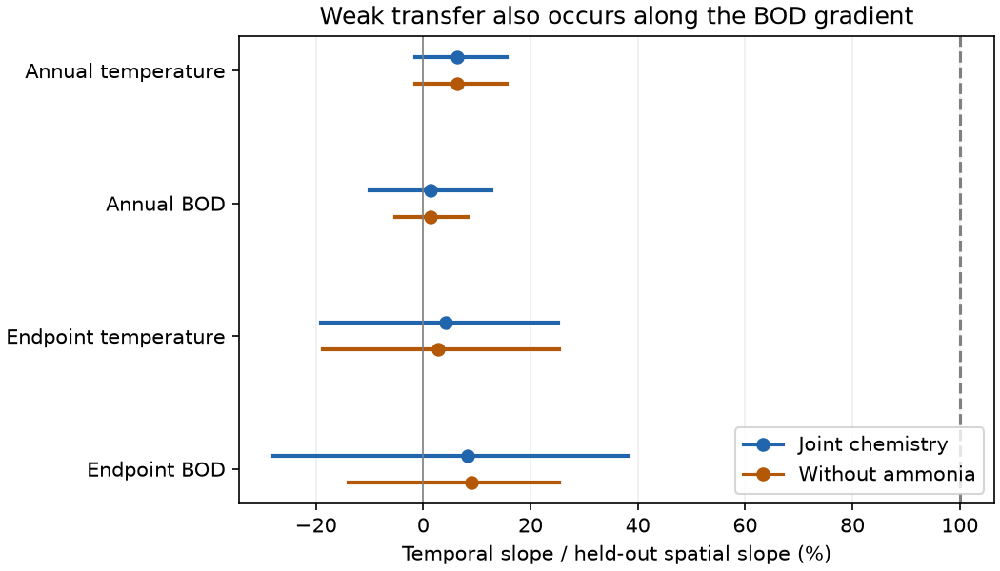

# Temperature and BOD gradients showed weak temporal transfer at 217 English river sites

## Result

Weak transfer from spatial gradients to temporal community change also occurred for biochemical oxygen demand (BOD), a measure of organic pollution. This result used the same sites, family records, time windows and validation method as the temperature test. It extends the earlier river temperature result to a non-climate exposure. It does not show which ecological process causes the gap.

We used 3,715 autumn samples from 217 English river sites in 1991-2017. We trained three composition axes on early records (1991-2000). Each axis described the conditional spatial gradient of one exposure: air temperature, log(1 + BOD), or log(1 + ammoniacal nitrogen). Each site's score came from a model trained on other sites. We then tested 2,318 samples in 2001-2017.

| Axis | Held-out spatial slope | Later annual slope | Annual transfer | Endpoint transfer |
|---|---:|---:|---:|---:|
| Temperature | 0.925 | 0.058 | 6.3% | 4.2% |
| BOD | 0.870 | 0.011 | 1.3% | 8.2% |
| Ammonia | 0.486 | 0.165 | 34.0% | 57.9% |

Transfer is the temporal slope divided by the held-out spatial slope. Endpoint models compare site means in 1991-2000 and 2008-2017. These are regression slope ratios. They are not the fractions of a national environmental trend that communities followed.



Blue marks show the joint chemistry model. Orange marks show a model that omits ammonia from both axis training and temporal estimation. Lines show the central 95% of 399 crossed site-and-year bootstrap estimates. The dashed line is full transfer. Ammonia is omitted here because its spatial denominator is not stable under resampling.

The annual bootstrap range was -1.6% to 15.5% for temperature and -10.0% to 12.7% for BOD. Endpoint ranges were -19.0% to 25.1% and -27.9% to 38.3%. The data do not establish positive temporal slopes for either axis under this broad resampling scheme. They do reject a simple descriptive claim that local temporal slopes equal these spatial slopes: the bootstrap ranges for temporal minus spatial slope were below zero in both periods for both axes. They do not establish different transfer rates for temperature and BOD.

The apparently faster ammonia response did not survive an uncertainty audit. Its spatial slope had a bootstrap range of -0.143 to 0.571; 37 of 399 resamples gave a non-positive denominator. Its ratio therefore has no useful bounded interval here. Removing North West sites changed its endpoint ratio from 58% to 295%. This is not evidence that ammonia tracks faster than temperature.

## Question and prior evidence

The campaign found weak thermal transfer in birds, butterflies and other communities. It also found weak transfer of land-cover gradients in US birds. Thus, a climate-only explanation may be incomplete. SCI ab21b52e found 4-8% annual thermal transfer in these English river records after pollution controls. We ask a new question: do the same communities follow spatial pollution gradients when pollution changes locally?

This is a comparison within a previously used raw dataset, not an independent river monitoring programme. We reuse its early/late split and site selection. We add pollution axes, endpoint change models, joint uncertainty in the fitted axes and denominators, and diagnostics for chemical censoring and region dependence. We do not refit the 54 published network summaries or use BBS data.

Vaughan and Ormerod (2014; DOI 10.1111/gcb.12616) separated long-term pollution-related gains from short-term climatic variation. Vaughan and Gotelli (2019; DOI 10.1038/s41467-019-09736-3) showed that water-quality recovery could offset climatic debt. Recovery need not be immediate: Langford et al. (2009; see external reference URL in sci.json) linked recovery to pollution extent and potential colonist sources. Those studies motivate this test but do not validate our spatial axes as causal equilibrium responses.

## Data and method

Source: Bachiller-Jareno et al. (2025), ChemPop version 2.0, DOI 10.5285/23f194b0-1e21-4f14-be9c-6eabdcc1feb7. Contains data supplied by UK Centre for Ecology & Hydrology. The product combines Environment Agency biology and chemistry with CHESS-met air temperature. See files/EXTERNAL_DATA.md for full attribution, source terms, exact shared path, URL and archive hash. The 28 used CSV hashes are in files/provenance.json.

We selected September-November samples in 1991-2017. For each site and year we kept the sample nearest 15 October, with sample ID as the tie rule. Positive abundance defined presence. Multiple records of a family were combined by their union. We required complete temperature, BOD and ammonia, at least three baseline years, and at least eight later years. This left 217 sites in seven regions and 79 family labels present at 30 or more baseline sites. Some labels are groups above family level. Family membership is not a species-level thermal response.

For sample i, the community vector Y has entries sqrt(presence / richness). Baseline community means were regressed on temperature, log(1+BOD), and log(1+ammonia), with an intercept. The temperature coordinate was a baseline site term from a regression of matched temperature on site and year-month effects. Chemical coordinates were baseline site means. Each chemical measurement is a six-month pre-sample mean with source LOQ3 substitution.

For each exposure k, let g_k be its fitted vector of partial family slopes. The sample score is S_k = Y dot g_k / (g_k dot g_k). Its spatial slope is one in the training data by construction. To test it, we split sites into two fixed folds within region (seed 810). Every sample uses g_k from the other fold. Held-out spatial regressions adjust for all three exposures and fold. Added region effects in both training and validation form a sensitivity test.

For each later sample, we regress each score on temperature, log BOD, log ammonia and survey day, with site, month and year effects. The temporal slope for exposure k is that exposure's coefficient for S_k. The annual primary model includes survey day from the start. This explains its difference from the earlier river study's 4% main estimate, which omitted day. Region-by-year effects replace year effects in a check.

Endpoint models regress within-site changes in mean scores on changes in the three exposures and survey day, with region effects. They use 1991-2000 and 2008-2017. Available late-window samples range from 1 to 10 per site (median 5). A check requires at least three samples in both endpoints. These models remove time-invariant site effects and common region changes, but cannot remove unmeasured time-varying local changes.

## Joint uncertainty and checks

We used 399 resamples with seed 271811. We resampled sites within region, and independently resampled years within baseline and test periods. We kept folds fixed, rebuilt baseline community and chemical means, refitted both fold-specific axes, and re-estimated spatial and temporal slopes. All axes use the same draw. Baseline temperature site coordinates and the 79-label vocabulary remain fixed. Year draws are independent, not time blocks.

This crossed or pigeonhole bootstrap allows site and shared year variation. Its percentile ranges are sensitivity intervals, not a proved finite-sample confidence procedure. It does not cover river-basin clustering, serial year dependence, fold selection, baseline climate error or all taxonomic errors. Resampling shifts spatial slopes downward: for temperature the median was 0.838 versus a point estimate of 0.925, and for BOD it was 0.626 versus 0.870. Refitting noisy multivariate directions can change their validation performance. We retain this result rather than hide the shift. Exact ranges and draws are provided. The conclusions about full transfer hold in the resamples, but precise coverage is not established.

Checks added after the first point estimates:

- Without ammonia in either model, BOD annual transfer was 1.3% (bootstrap range -5.2% to 8.3%) and endpoint transfer was 9.0% (-13.9% to 25.4%). Correlated chemical terms therefore do not explain the weak BOD estimate.
- Adding region effects in axis training gave 5.8% annual temperature transfer and 1.3% BOD transfer. Adding region-by-year temporal effects gave 7.7% and 0.5% in the original axes.
- Omitting each region in turn gave annual temperature transfer of 4.6-8.6% and BOD transfer of -0.8% to 3.7%. Endpoint BOD transfer ranged from 4.4% to 14.1%.
- Ammonia LOQ1 and LOQ2 substitutions changed annual BOD transfer to 1.2% and 1.4%. Restricting later samples to at least three chemistry values and no more than half below LOQ left 1,415 samples. BOD transfer was -2.5% annually and 6.9% for endpoints. This check concerns ammonia censoring, not BOD censoring.
- Requiring at least three samples in both endpoints gave -2.2% temperature transfer and 3.6% BOD transfer in the joint model. It also weakened the ammonia denominator.
- A weighted fixed-effect solver matched an explicit dummy regression within 3.1e-14 in a synthetic unbalanced panel.

The early comparison and joint models were chosen before outcome fitting. The extra BOD-only model, chemistry censoring checks, region omissions and minimum endpoint count were added after inspecting the first fits. This is an exploratory extension, not a registered confirmatory test.

## Meaning and limits

BOD decreased at 192 of 217 sites (88.5%). The mean endpoint change in log(1+BOD) was -0.196, with site SD 0.179. Thus, the BOD test had substantial local exposure change. However, the endpoint temperature change averaged -0.029 C. This panel does not estimate response to sustained national warming. Year and region controls also remove shared environmental change. A large national recovery can coexist with a small local conditional BOD slope.

Weak transfer for BOD makes a purely climate-specific account insufficient for this statistical pattern. It is consistent with slow community replacement or limits to recovery. It is also consistent with stable habitat, river size, flow or geography in the spatial gradient, differences between spatial and temporal exposure error, or nonlinear responses. It does not identify a common ecological speed limit. Low BOD transfer cannot show that pollution controls have little benefit.

Other limits matter. Air temperature is not water temperature. Family data can hide species exchange. Presence depends on sampling and identification; the builder does not harmonise all taxonomic splits or restrict recording methods. The strict complete-case cohort covers only 217 of 1,519 source sites. Fixed effects can leave very small local exposure signals. Chemical substitution and rounded means can affect temporal slopes. Endpoint averages do not give a lag time, and no causal intervention was observed. These records cannot select among colonist supply, demographic inertia, habitat constraints or proxy error.

The methodological contribution is a matched non-climate comparison with early-trained axes and resampled denominators. It provides evidence of weak BOD space-for-time transfer in a second ecosystem type, and shows why the larger ammonia point ratio is not a reliable counterexample.

## Reproduce

Use Python 3.12 and the packages in files/environment.json. All outputs and external data must be outside the publication directory. No new download is needed if the exact shared archive is available.

```bash
python files/retrieve.py /absolute/path/to/external_scratch
python files/build.py --archive /absolute/path/to/external_scratch/chempop.zip --out /absolute/path/to/input_scratch
python files/compare.py --input /absolute/path/to/input_scratch --out /absolute/path/to/analysis_scratch --boot 399
python files/bod_only.py --input /absolute/path/to/input_scratch --out /absolute/path/to/bod_scratch --boot 399
python files/diagnostics.py --archive /absolute/path/to/external_scratch/chempop.zip --input /absolute/path/to/input_scratch --out /absolute/path/to/check_scratch
python files/report.py --analysis /absolute/path/to/analysis_scratch --bod-only /absolute/path/to/bod_scratch --out /absolute/path/to/report_scratch
```

All numerical code uses one library thread. The bundle includes aggregate estimates, bootstrap estimates, code, provenance and figures. It excludes raw data and sample- or site-level extracts. Report outputs can be compared to files/summary.csv and the two PNGs. Input CSV hashes must match even if the download server changes ZIP metadata.

## Research record

Campaign 11_07_2026. Job sci-1107-dell-climate-pollution-biodiversity-e62456e2db2f. Topic climate-pollution-biodiversity. Machine dell. Account codex-olen. Model gpt-6.1-sol, high reasoning effort. One automated worker performed this analysis. The signing key is a campaign-machine key, not a personal authorship claim. Code in build.py adapts the baseline-licensed builder from SCI ab21b52e; see EXTERNAL_DATA.md. No other worker's private workspace was used.
