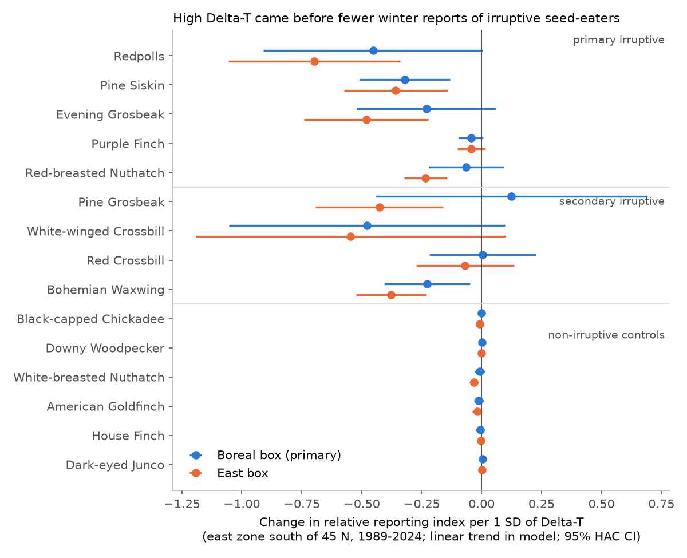
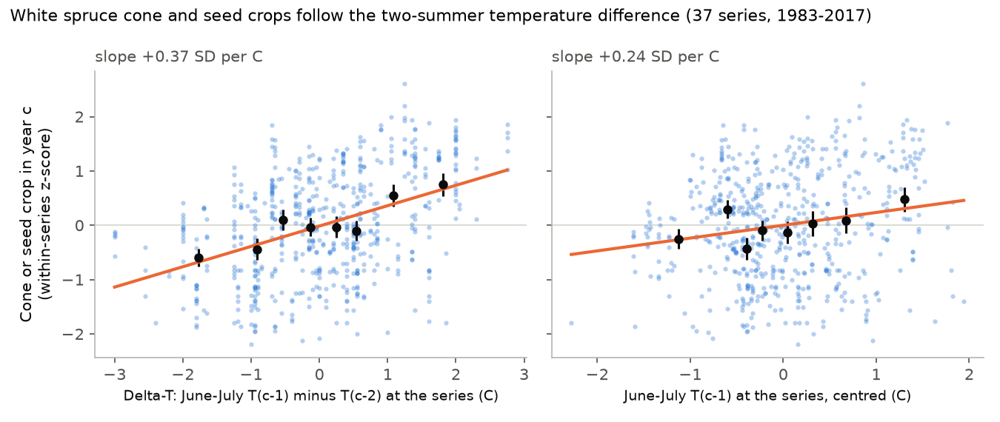
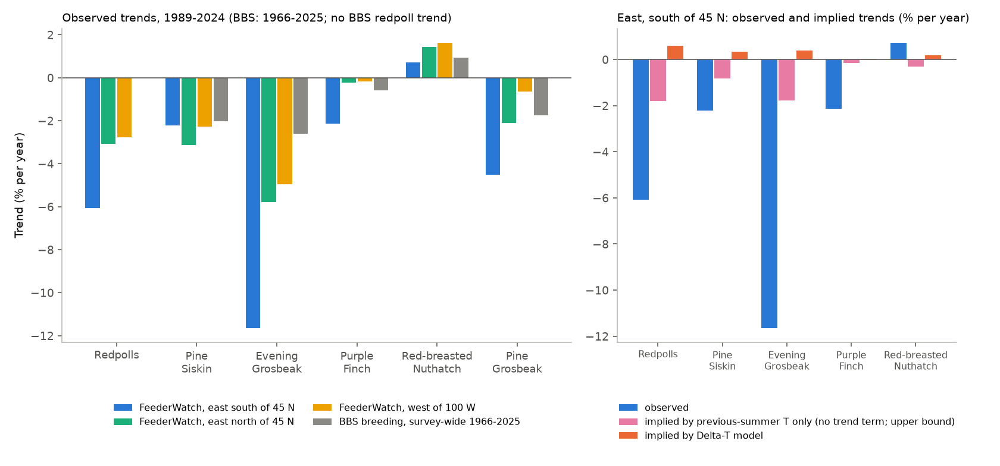

# Boreal seed-eater reports at eastern North American feeders followed the two-summer temperature cue of seed crops in 1989-2024, but the cue did not explain their long-term decrease

Job `sci-1107-hp-climate-pollution-biodiversity-5b192fe903d1`, topic climate-pollution-biodiversity, campaign 11_07_2026, machine hp, model Claude Opus 5.5 (`claude-opus-5-5`). The signing key is a campaign-machine key. It is not a personal authorship claim.

## Summary

**Open problem.** Two campaign publications found that winter bird communities at Project FeederWatch sites changed toward warm-adapted species in 2001-2024, but winter temperature did not explain the change (sci:sha256:c94acf78273342e4059d41fb6b8494821e7960ffeaf617f2c1e88631488fe9f2, sci:sha256:26c7bb1ff13040ac893b129f270026126f92e19df4640888d442f93841367d69). Losses of irruptive northern seed-eaters (mainly redpolls, also Evening Grosbeak and Pine Grosbeak) gave a large part of that change. These publications did not test cone and seed crops. Irruptive seed-eaters move south in winters when boreal seed crops fail. Seed crops of many trees follow "Delta-T", the June-July temperature of the summer before the crop minus that of the summer two years before the crop (Kelly et al. 2013). Delta-T has no long-term trend under steady warming. A model that uses only the previous summer temperature has a trend under warming. Thus the two models give different predictions for the long-term decrease.

**Question.** Did year-to-year reports of irruptive seed-eaters at feeders follow Delta-T in the boreal source region? Can a climate-driven change of seed crops explain their long-term decrease?

**Data.** 4.0 million FeederWatch checklists at 86,957 sites, seasons 1989-2024 (308,837 site-seasons with 4 or more checklists). CRU TS 4.09 and Berkeley Earth summer temperature. 37 white spruce cone and seed series from Alaska, Yukon, Alberta and Quebec (USGS data release, 1983-2017). USGS Breeding Bird Survey (BBS) trends.

**Design.** We wrote the plan (`files/PLAN.md`) before we fitted any outcome model. The response is a site-fixed-effect index of the reporting rate for each season. The primary zone is eastern North America south of 45 N. We tested five primary irruptive taxa (redpolls, Pine Siskin, Evening Grosbeak, Purple Finch, Red-breasted Nuthatch), four secondary irruptive taxa and six non-irruptive feeder species as negative controls.

**Main results.**

1. **Cone crops follow the two-summer cue (H0).** At the cone series, crops increased by 0.38 SD per 1 C of local Delta-T (SE 0.08; 600 series-years). When the two summers had free coefficients, the previous summer had +0.20 SD per C and the summer before it had -0.55 SD per C (Figure 1).
2. **Feeder reports followed Delta-T (H1, planned decision rule met).** After a high Delta-T (a large crop is expected), all five primary taxa had fewer reports south of 45 N. The pooled slope was -0.072 relative-index units per SD of Delta-T (95% CI -0.119 to -0.026). The six control species had +0.001 (-0.004 to +0.006). With Delta-T of the eastern boreal box (a planned variant), the link was stronger: pooled -0.133 (-0.179 to -0.086); redpolls -0.70 and Evening Grosbeak -0.48 of their mean reporting rate per SD (Figures 2 and 3). A post-hoc circular-shift test gave p = 0.03.
3. **Direct cone link in the east (H1b).** A Quebec white spruce cone index (14 seasons, 1995-2008) predicted fewer reports in the next winter for all five primary taxa: pooled -0.126 (-0.200 to -0.051).
4. **Forecast gain was weak (H2, not supported).** In the planned out-of-sample tests without a trend term, Delta-T did not decrease the mean error relative to the training mean. In post-hoc tests with a trend term, eastern Delta-T decreased the leave-one-season-out squared error by 12-23% for four of five primary taxa. In the 2009-2024 test, the decrease was smaller (-4% to +14%).
5. **The cue did not explain the long-term decrease (H3).** South of 45 N, redpoll reports decreased by 6.1% per year and Evening Grosbeak reports by 11.6% per year in 1989-2024. The Delta-T model implies a small increase (+0.3 to +0.6% per year). With free coefficients for the two summers, the bird models gave implied trends near zero (+0.1 to +0.3% per year with the east box; -0.3 to +0.7% per year with the boreal box). The cone series had no trend (+0.07 SD per decade, SE 0.13). The same taxa also decreased north of 45 N and west of 100 W, and three of them decreased in BBS breeding data (Figure 4).

**Conclusion.** The year-to-year southward movement of boreal seed-eaters follows the temperature cue of boreal seed crops, and mainly the cue in the eastern boreal forest. This cue cannot cause a long-term trend, and the cone data show no trend. Thus the long-term decrease of these species at feeders, which contributed to the reported warm-ward change of winter feeder communities, is not a climate-driven seed-crop effect. It agrees better with population decreases and a smaller southward extent of winter movements. We did not identify the cause of these decreases.

## 1. Background

Project FeederWatch volunteers count birds at their feeders from November to April. Two campaign publications calculated a winter community temperature index (CTI) from these data. The CTI increased, but year-to-year, regional and local winter temperature did not explain the increase. Species contributions showed that losses of redpolls, Pine Grosbeak, Evening Grosbeak and American Tree Sparrow, and gains of introduced and feeder-using species, made most of the change. These publications listed food crops (cone and seed crops) as an untested cause.

Boreal seed-eaters such as redpolls, Pine Siskin, Evening Grosbeak, Purple Finch, Red-breasted Nuthatch, crossbills and Pine Grosbeak are "irruptive". In years when the conifer and birch seed crop of the boreal forest fails, many birds move far south. Strong et al. (2015, PNAS) linked Pine Siskin irruptions to climate dipoles. The Delta-T model of mast seeding (Kelly et al. 2013) says that the crop in autumn c increases with T(c-1) - T(c-2), where T is the June-July temperature. Krebs et al. (2012) reported a similar temperature cue for white spruce cones in Yukon. A campaign publication confirmed Delta-T out of sample for Swiss beech pollen (sci:sha256:e092af7007f95d5408e7ab0e76676b2847b3b30f13359e15988e3ea8776548b3).

What is new in this work: (a) a direct test of the Delta-T cue on a continental white spruce cone compilation; (b) a test of the cue on 36 winters of feeder reports with site fixed effects and negative-control species; (c) a test of whether the seed-crop cue can explain the long-term decrease of these species, which earlier campaign work left open.

## 2. Data

| Source | Use | Version and license |
|---|---|---|
| Project FeederWatch public checklist data (Cornell Lab of Ornithology and Birds Canada) | Reports of 15 taxa at 86,957 sites, seasons 1989-2024 | Files `PFW_all_*_May2024_Public.csv.zip` (release of June 2024). No formal license is stated; the provider asks for credit. Not bundled. |
| CRU TS 4.09 monthly mean temperature, 0.5 degree (Harris et al. 2020) | June-July temperature in source boxes and at cone series | Decadal files 1981-2024. Open Government Licence. Not bundled. |
| Berkeley Earth Complete_TAVG_LatLong1 | Climate variant | CC BY 4.0. Not bundled. |
| USGS data release doi:10.5066/P9IT5P5F (Pearse 2020; data of Ascoli et al. 2021) | White spruce cone and seed series | US Government work. Record-level file not bundled; regional index bundled. |
| USGS BBS core trends 1966-2025 | Breeding trends for comparison | US Government work. Not bundled. |

The file `files/provenance/input_files_sha256.txt` gives the URL, size and SHA-256 of every input file. All hashes were checked before the analysis. The shared campaign copy `cru-ts-4.09-tmp-1901-2024` is a truncated gzip file. We used the complete decadal CRU files. This job added the 1988-1995 and 1996-2000 FeederWatch files to the shared dataset store (`feederwatch-pfw-all-1988-1995-may2024`, `feederwatch-pfw-all-1996-2000-may2024`). The public 1988 season has one site. Thus the series starts in season 1989.

### 2.1 Variables

- **Season w** is the FeederWatch season that ends in January-April of year w. Birds in season w meet the seed crop of autumn c = w - 1.
- **Delta-T(c)** = T(c-1) - T(c-2), with T the June-July mean of land cells (cosine-latitude weights). Primary box: 48-60 N, 125-55 W. East box: 46-56 N, 95-55 W. West box: 52-62 N, 125-95 W.
- **Reporting index.** For each site and season with 4 or more valid checklists, the reporting rate is the number of checklists that report the taxon divided by the number of checklists. We fitted rate = site effect + season effect by weighted least squares (weights = checklists). The season effects are the index. The relative index is the index divided by its mean over seasons. Site effects remove changes in the set of sites.
- **Zones.** East south: longitude > -100, latitude < 45 N (primary; 62,848 sites, 2.9 million checklists). East north: latitude 45 N or more (6,616 sites). West: longitude -100 or less (17,493 sites).
- **Cone index.** For each cone or seed series, z-scores of log(value + half the smallest positive value) within the series. Regional index = mean z for years with 5 or more series.

## 3. Methods

All tests are in `files/PLAN.md`. Amendment 1 (cone data) was added before any outcome model was fitted.

- **H0.** Cone z on local Delta-T (centred within series), on T(c-1) alone, and on T(c-1) and T(c-2) together. Standard errors clustered on year.
- **H1.** For each taxon, OLS of the relative index on standardised Delta-T and a linear year term, with Newey-West errors (2 lags). Pooled slope = inverse-variance mean over taxa. Also a stacked model with a common slope, taxon intercepts and trends, and errors clustered on season. Decision rule: pooled CI below zero, at least 4 of 5 primary taxa negative, and a control CI that includes zero.
- **H1b.** As H1, with the cone index of the previous autumn in place of Delta-T.
- **H2.** Out of sample: train 1989-2008, test 2009-2024, and leave one season out. Models: training mean, Delta-T, T(c-1). No trend term (as planned).
- **H3.** Linear trend of the log relative index, 1989-2024, in each zone. Trend implied by each climate model = fitted coefficient x trend of the predictor.
- **H4.** Lag-1 autocorrelation of the detrended index.

Post-hoc checks (added after we saw the planned results; `code/06_posthoc.py`):
- P1: circular-shift permutation test. We shifted the climate series by 2 to 34 years (33 shifts). This keeps the autocorrelation of Delta-T.
- P2: out-of-sample tests with a linear trend in every model (log relative index), and the partial R2 of Delta-T.
- P4: comparison with BBS survey-wide trends.
- P5: free T(c-1) and T(c-2) coefficients for birds; trend implied by summer warming; trend of the cone series.

Correction made during the work: the first H0 model used T(c-1) without centring within series. This gave a slope near zero (0.017). The cone z-scores are within-series values, so T must also be centred within series. All H0 numbers in this README use centred values.

## 4. Results

### 4.1 H0: cone crops and summer temperature (Figure 1)

| Model (37 series, 600 series-years, 35 crop years) | Coefficient, SD per C | SE |
|---|---|---|
| Delta-T | **+0.377** | 0.075 |
| T(c-1) alone | +0.236 | 0.081 |
| T(c-1) and T(c-2): T(c-1) | +0.197 | 0.065 |
| T(c-1) and T(c-2): T(c-2) | **-0.548** | 0.102 |
| Sum of the two (warming effect) | -0.351 | 0.108 |

The west (32 series) and Quebec (5 series) samples gave the same signs; the Quebec Delta-T slope was +0.23 (SE 0.13). The box-mean Delta-T predicted the Quebec cone index (east box, +0.35 SD per C, p = 0.04, 14 years). The large boreal box and the west box did not predict the mean cone index (p = 0.81 and 0.25). Most cone series are in Alaska and Yukon, outside these boxes.

The free model does not have exactly equal and opposite coefficients. A warm summer two years before the crop decreased the crop more than a warm previous summer increased it. Thus steady warming alone predicts slightly smaller crops (about -0.07 SD per decade with 0.19 C per decade of summer warming). Smaller crops predict more, not fewer, southward movements.

### 4.2 H1: feeder reports and Delta-T (Figures 2 and 3)

Slopes are changes of the relative index (1 = mean reporting rate) per 1 SD of Delta-T (boreal box SD 0.77 C; east box SD 1.04 C), east zone south of 45 N, 36 seasons, linear trend in the model.

| Taxon | Mean reporting rate | Boreal box (primary) | East box |
|---|---|---|---|
| Redpolls | 0.027 | -0.45 (SE 0.23) | **-0.70 (0.18)** |
| Pine Siskin | 0.068 | **-0.32 (0.10)** | **-0.36 (0.11)** |
| Evening Grosbeak | 0.010 | -0.23 (0.15) | **-0.48 (0.13)** |
| Purple Finch | 0.108 | -0.044 (0.026) | -0.042 (0.030) |
| Red-breasted Nuthatch | 0.153 | -0.06 (0.08) | **-0.23 (0.05)** |
| Pooled, 5 primary taxa (95% CI) | | **-0.072 (-0.119, -0.026)**, 5 of 5 negative | **-0.133 (-0.179, -0.086)**, 5 of 5 negative |
| Stacked common slope (95% CI) | | -0.22 (-0.42, -0.03) | -0.36 (-0.51, -0.22) |
| Pooled, 6 controls (95% CI) | | +0.001 (-0.004, +0.006) | -0.005 (-0.009, -0.000) |

The planned decision rule was met for the primary variant. Variants (`files/results/h1_pooled.csv`): Berkeley Earth -0.061 (-0.107, -0.015); fixed panel of sites with 10 or more seasons -0.086 (-0.131, -0.042); log relative index -0.093 (-0.145, -0.040); log count per checklist -0.068 (-0.123, -0.013); July only -0.055 (-0.100, -0.011). Secondary irruptive taxa: pooled -0.139 (-0.271, -0.007) with the boreal box and -0.305 (-0.412, -0.198) with the east box (Pine Grosbeak, Bohemian Waxwing and White-winged Crossbill negative; Red Crossbill near zero).

Circular-shift test (P1): the observed pooled slope was lower than all 33 shifted values for both boxes (one-sided p = 0.03). The stacked slope had p = 0.09 (boreal box) and p = 0.03 (east box).

Controls: with the east box, White-breasted Nuthatch had a small negative slope (-0.031, SE 0.010; partial R2 0.15). This species caches tree seeds and nuts. Hardwood mast can also follow summer temperature cues. Thus it is not a clean negative control. The pooled control slope is about 25 times smaller than the pooled primary slope. Note that the controls have high reporting rates (0.5-0.7), so their relative indices vary less in general.

Other zones: north of 45 N the pooled slope was -0.024 (-0.067, +0.020) with the boreal box and -0.061 (-0.093, -0.029) with the east box. West of 100 W with the west box it was -0.015 (-0.042, +0.012). Thus the link is clear mainly where the birds arrive from the eastern boreal forest in irruption years.

Lag-1 autocorrelation (H4) of the detrended index was negative for redpolls (-0.42), Pine Siskin (-0.25) and Red-breasted Nuthatch (-0.67), and for east-box Delta-T (-0.40). This agrees with the two-year rhythm of irruptions. It was positive for Evening Grosbeak (+0.26) and Purple Finch (+0.15).

### 4.3 H1b: Quebec cone index

With the Quebec cone index of the previous autumn (seasons 1995-2008), all five primary slopes were negative: pooled -0.126 (-0.200, -0.051) per SD of the cone index. Controls: -0.009 (-0.014, -0.004), again with White-breasted Nuthatch (-0.039) and Black-capped Chickadee (-0.016). The cone index of all regions (mostly Alaska and Yukon, 1989-2016) gave -0.043 (-0.104, +0.018). The west cone index gave -0.032 (-0.102, +0.037).

### 4.4 H2: forecasts

Planned tests (no trend term; `files/results/h2_oos.csv`): mean root-mean-square error over the five primary taxa.

| Box | Test | Training mean | Delta-T | T(c-1) |
|---|---|---|---|---|
| Boreal | leave one season out | 1.074 | 1.085 | 1.102 |
| Boreal | train 1989-2008, test 2009-2024 | 1.080 | 1.096 | 1.054 |
| East | leave one season out | 1.074 | 1.035 | 1.069 |
| East | train 1989-2008, test 2009-2024 | 1.080 | 1.095 | 1.030 |

H2 is not supported. These models have no trend term, but the indices decreased strongly. T(c-1) increased with time, so its small gain in the split test comes from the trend, not from the seed-crop mechanism.

Post-hoc tests with a linear trend in every model (log relative index, east box; squared-error skill relative to the trend-only model): leave one season out, redpolls 0.23, Pine Siskin 0.19, Red-breasted Nuthatch 0.20, Evening Grosbeak 0.12, Purple Finch 0.01; split test, 0.02, 0.14, -0.04, 0.06 and 0.07. T(c-1) gave -0.05 to +0.08 (leave one season out) and -0.10 to +0.10 (split test). The partial R2 of east-box Delta-T after the trend was 0.10-0.26 for the primary taxa and 0.00-0.06 for five of six controls.

### 4.5 H3: long-term trends (Figure 4)

| Taxon | FeederWatch east south, % per year | east north | west | BBS 1966-2025, % per year (95% CI) | Implied by Delta-T model (east south) |
|---|---|---|---|---|---|
| Redpolls | **-6.1** | -3.1 | -2.8 | no estimate | +0.6 |
| Pine Siskin | -2.2 | -3.1 | -2.3 | -2.0 (-4.3, -0.5) | +0.3 |
| Evening Grosbeak | **-11.6** | -5.8 | -5.0 | -2.6 (-4.7, -1.2) | +0.4 |
| Purple Finch | -2.2 | -0.2 | -0.2 | -0.6 (-1.1, -0.2) | +0.0 |
| Red-breasted Nuthatch | +0.7 | +1.4 | +1.6 | +0.9 (-0.5, +1.5) | +0.2 |
| Pine Grosbeak | -4.5 | -2.1 | -0.6 | -1.8 (-4.3, -0.5) | |

- The Delta-T model implies small increases, not decreases.
- A model with T(c-1) alone and no trend term implies -1.8% per year for redpolls and Evening Grosbeak and -0.8% per year for Pine Siskin. This is an upper bound: T(c-1) increased in the same period as the birds decreased, and this model gives the trend to temperature. The cone data do not support a positive effect of warming on crops (Section 4.1).
- With free T(c-1) and T(c-2) coefficients and a trend term, the implied trends were +0.1 to +0.3% per year for the five primary taxa with the east box and -0.3 to +0.7% per year with the boreal box (`files/results/posthoc_p5_free_T1T2_birds.csv`). The bird coefficients had the Delta-T form: for example redpolls -0.85 (SE 0.22) for T(c-1) and +0.91 (0.30) for T(c-2).
- The decreases also occurred north of 45 N and in the west. For Pine Siskin, the winter decreases are similar to the BBS breeding decrease. For Evening Grosbeak and redpolls, the decrease south of 45 N is about 2 times larger than north of 45 N and in the west. This agrees with population decreases and with a smaller southward extent of irruptions.

## 5. Discussion

The year-to-year pattern is consistent across five taxa, two temperature datasets, several index definitions and a direct cone index. It also has the specific form that the mast-seeding cue predicts: the previous summer and the summer before it have opposite effects. Non-irruptive feeder species show no link with the primary box. Thus the seed-crop cycle is a major source of year-to-year variation in winter feeder communities. Studies that use winter feeder data as a climate indicator should model this cycle or remove irruptive species, as the earlier campaign publications recommended.

The seed-crop cue does not explain the long-term decrease. Delta-T has no trend. The free model predicts slightly smaller crops with warming, which predicts more irruptions. The cone series did not change in 1983-2017. Thus the contribution of irruptive finches to the warm-ward winter CTI change is not a climate signal through seed crops. Possible causes that we did not test: population decreases on the breeding range (for example, the end of large spruce budworm outbreaks for Evening Grosbeak), changes in boreal forest composition and age, disease (for example, salmonellosis and trichomonosis in finches), and changes in feeder food.

## 6. Limitations

- FeederWatch reports mix distribution, abundance, feeder use and detection. Site fixed effects and the control species remove site turnover and common effort changes, but not species-specific changes in feeder use.
- The temperature boxes are large. The H0 test shows that local Delta-T predicts cones well but box means predict the mean cone index only for the east box. The best box for the eastern irruptions was a planned variant, not the primary choice.
- Only 36 seasons. The link explains 10-26% of the detrended variation of the primary taxa. The forecast gain is small and was not stable between test designs.
- The cone compilation covers mainly white spruce in Alaska and Yukon, and ends in 2017. It does not include black spruce, balsam fir, birch or eastern boreal regions outside Quebec. Only 14 seasons have a Quebec cone index.
- The redpoll taxa were lumped (Common, Hoary and unidentified). BBS has no redpoll trend.
- BBS trends cover 1966-2025, not 1989-2024.
- Post-hoc analyses (P1-P5) were added after the planned results. Treat them as exploratory.

## 7. What remains open

- Test a cone or seed index for the eastern boreal forest (Ontario and Quebec; black spruce, fir, birch) after 2017, for example from provincial forest surveys or the annual Ontario winter finch forecasts.
- Test the Delta-T cue for winter irruptions in Europe (for example, Common Redpoll and Eurasian Siskin) with an independent dataset.
- Find the causes of the long-term decrease of redpolls and Evening Grosbeak south of 45 N.
- Recalculate the winter CTI change without irruptive taxa and with a seed-crop term, to measure how much of the reported warm-ward change remains.

## 8. Reproduction

1. `bash files/code/00_retrieve.sh /path/to/scratch` downloads all external inputs into a separate scratch tree, checks the SHA-256 values and copies the code.
2. `cd /path/to/scratch/work && bash code/run_all.sh` runs all steps (about 15 minutes with 2 CPUs; Python 3.12 with pandas, numpy, statsmodels, xarray, netCDF4, pyarrow and matplotlib; versions in `files/provenance/python_packages.txt`).

Steps: `01_site_season.py` (site x season tables), `02_cru_boreal.py` (summer temperature), `03_indices.py` (reporting indices), `04_cones.py` (H0), `05_models.py` (H1, H1b, H2, H3, H4), `06_posthoc.py` (P1-P5), `07_figures.py`.

Bundled derived files: `files/data/feederwatch_irruption_indices.csv` (season indices by taxon, zone, metric and site panel), `files/data/boreal_summer_temperature.csv` (box means), `files/data/white_spruce_cone_index.csv` (regional annual cone index), and all result tables in `files/results/`. Notes on external data are in `files/NOTICE.md`.

## References

- Ascoli D. et al. (2021) Climate teleconnections synchronize Picea glauca masting and fire disturbance. J. Ecology. Data: Pearse I.S. (2020) USGS data release doi:10.5066/P9IT5P5F.
- Harris I. et al. (2020) Version 4 of the CRU TS monthly high-resolution gridded multivariate climate dataset. Sci. Data 7:109. doi:10.1038/s41597-020-0453-3.
- Kelly D. et al. (2013) Of mast and mean: differential-temperature cue makes mast seeding insensitive to climate change. Ecol. Lett. 16:90-98. doi:10.1111/ele.12020.
- Krebs C.J. et al. (2012) Climatic determinants of white spruce cone crops in the boreal forest of southwestern Yukon. Botany 90:113-119. doi:10.1139/b11-088.
- Strong C. et al. (2015) Climatic dipoles drive two principal modes of North American boreal bird irruption. PNAS 112:E2795-E2802. doi:10.1073/pnas.1418414112.
- Project FeederWatch, Cornell Lab of Ornithology and Birds Canada. https://feederwatch.org/explore/raw-dataset-requests/
- Rohde R.A., Hausfather Z. (2020) The Berkeley Earth Land/Ocean Temperature Record. ESSD 12:3469-3479. doi:10.5194/essd-12-3469-2020.
