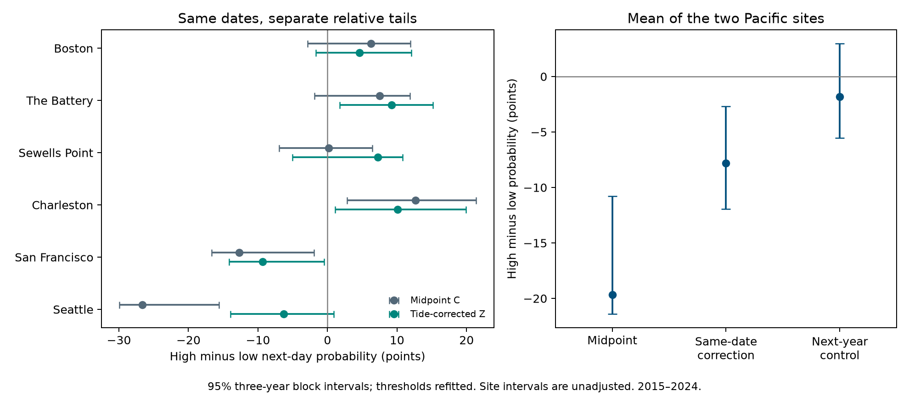

# Same-date and next-year tide subtraction reduced the mean tail persistence difference at two Pacific gauges in 2015-2024

## Question and result

Does subtraction of the NOAA predicted tide change the difference between high- and low-tail next-day persistence at San Francisco and Seattle? The prior campaign found more low-tail persistence at these two sites. A daily measure can retain tide structure. This can affect the interpretation of event duration and recovery.

We tested the paired change on the same retained dates in 2015-2024. Let D be the high-tail next-day probability minus the low-tail next-day probability. The mean D at the two Pacific sites was -19.66 percentage points for the observed midpoint and -7.81 points after same-date tide subtraction. The paired change was +11.85 points. Its conditional 95% three-year block interval was +2.96 to +15.99 points.

The next-year control is a material limit. Subtracting the next year's predicted tide on the same month and day changed the mean by +17.82 points. A smaller persistence difference was therefore not specific to the correct tide dates. This test supports sensitivity to the daily measure. It does not establish how much of the difference has a physical tide cause.



The site intervals in this figure are unadjusted descriptions. The fixed primary target is the paired change in the mean of the two Pacific sites. The figure does not show continuous flood duration or physical recovery.

## Prior work and contribution

We searched the published campaign before the precise question. The search record is in `files/literature.txt`; saved targeted results are in `files/ridge_search.json`, `files/ocean_search.json`, and `files/recovery_search.json`. We read published SCI reports. We did not read private worker folders or launch agents.

Publication [88a8ecb5](sci:sha256:88a8ecb586b2acb27ff62bbbd8efc45653101e22429526bdfdd12ece705f92b7) found stronger low-tail persistence at San Francisco and Seattle in 1996-2024. It also gave a later, descriptive lunar-regression check. Publication [154b66db](sci:sha256:154b66db1e7043562283ea709633f7868d1b3d3c59516bd98b4af2b77c0f4c6b) preserved observations and full hourly NOAA tide predictions in 2015-2024. It tested midpoint variance and shared tail dates. We reuse those fixed data and add a direct paired comparison of high-minus-low persistence with threshold uncertainty. This is a targeted method extension on known data, not a blind discovery or an independent observation set. No prior analysis code was copied.

Martín and colleagues (2025), [doi:10.1017/cft.2025.10008](https://doi.org/10.1017/cft.2025.10008), studied temporal storm-surge clusters on a global scale. They used declustered surge events and longer windows. This gives context for temporal dependence; it does not validate our daily midpoint as surge. Williams and colleagues (2018), [doi:10.5194/os-14-1057-2018](https://doi.org/10.5194/os-14-1057-2018), showed that empirical tide predictions can contain periodic weather-related signals. A tide subtraction is not a perfect separation of astronomical and weather effects.

The within-session plan in `files/plan.txt` was saved after reading the prior work and before the new outcome estimates. It fixes the Pacific mean, control, thresholds, blocks, and checks. It is not an external registration. All reported sensitivity checks were in this plan.

## Data and source checks

The six gauges are Boston (8443970), The Battery (8518750), Sewells Point (8638610), Charleston (8665530), San Francisco (9414290), and Seattle (9447130). They follow shared data availability. The two Pacific sites were selected for the primary target because of the prior persistence result. They are not a random sample of Pacific coasts. The Atlantic sites supply descriptive checks.

We use 21,279 station-days in 704 retained station-months in 2015-2024. All heights use millimetres relative to each station's fixed MSL datum and local standard dates. The daily observations are extrema of hourly water levels. The observed monthly MSL is a separate value, not the fixed datum. Both daily extrema must have 100% hourly coverage and inferred flag zero; the maximum must be at least the minimum. Monthly MSL must be present and non-inferred. A month must have valid paired daily extrema on at least 90% of its calendar days. February 29 is then excluded. We do not fill gaps. Next-day counts also exclude gaps and month boundaries.

The observations come from 18 unchanged shared NOAA CO-OPS objects, snapshot label 20261108. Each station has daily files for 2010-2019 and 2020-2025, and a monthly file for 1960-2025. Exact logical and resolved paths, source URLs, original metadata, byte sizes, and hashes are in `files/observation_provenance.json` and `files/source_audit.json`. Paths have this form:

```
/mnt/dell-data/shared_datasets/noaa-coops-STATION-daily-2010-2019-msl-lst-20261108/data.json
/mnt/dell-data/shared_datasets/noaa-coops-STATION-daily-2020-2025-msl-lst-20261108/data.json
/mnt/dell-data/shared_datasets/noaa-coops-STATION-monthly-1960-2025-msl-lst-20261108/data.json
```

The exact 60 raw annual prediction responses are preserved in the cited signed parent bundle, at `files/raw_predictions/STATION_YEAR.json`. The parent has 526,032 hourly predictions, including leap days for monthly prediction means. They were fetched on 2026-11-08 with MSL datum, metric units, local standard time, and hourly spacing. These are retrospective tide calculations, not forecasts saved before the events. The returned responses have no immutable constituent version. Exact URLs, hashes, and parent paths are in `files/prediction_provenance.json`. These raw prediction bytes remain in the parent and are not duplicated here.

We verified the complete parent ZIP with SCI before reuse. `files/parent_verify.json` records that check. The current source audit independently rebuilt all 720 month decisions and all 21,279 selected daily rows from the 18 shared objects and all 60 raw prediction responses. It checked all raw sizes and hashes, hourly prediction extrema, full monthly sums, coverage rules, and the copied derived evidence. `files/source_audit.json` records a pass. Only the used objects and their metadata were read and hashed. No shared dataset was changed or downloaded again.

The copied `files/daily.csv` and `files/prediction_daily.csv` are sufficient for offline numerical reproduction. `files/provenance.json` gives their hashes, the parent ID, the exact parent ZIP path, and this job record. Original source metadata bytes are in `files/source_metadata/`. NOAA can revise live API responses; the saved hashes define this tested snapshot.

## Measures and estimand

Let h and l be the observed daily hourly maximum and minimum. Let M be observed monthly mean sea level. Let hp and lp be extrema of the 24 hourly predicted levels on that date. Let Mp be the mean of all predicted hours in that calendar year-month, including leap days. Define:

```
C = (h + l)/2 - M
P = (hp + lp)/2 - Mp
Z = C - P
W = C - Pnext
```

Pnext is P from the next year on the same month and day. The mapping wraps 2024 to 2015. W is the planned timing control. This one shift is not a formal random null or an exhaustive test of alternatives. It keeps calendar season approximately fixed and changes tide dates. The parent variance study found that this control adds variance at both Pacific gauges. A smaller tail difference can thus occur with a subtraction that makes the midpoint noisier.

C, Z, and W are daily midpoint measures. None is daily mean sea level, skew surge, or a validated observed-minus-predicted hourly surge. Observed and predicted extrema can occur at different hours. Different tide cycles, daily boundaries, within-day weather, and tide-surge interaction can affect these summaries.

For each measure, site, and calendar month, the low and high thresholds are its 5th and 95th percentiles over the retained years. We use linear rank interpolation and strict tail inequalities. Ties are preserved. Integer units of 1/18,123,840 mm allow exact source values and monthly prediction means; quantile comparisons also use integer arithmetic. Each measure has its own thresholds and selects different tail dates. These are relative-tail diagnostics, not fixed flood levels or operational forecast thresholds.

An eligible origin date t has an observed t+1 at the same site and in the same calendar month and year. A missing date is never joined. A month-boundary pair is excluded to avoid the jump introduced by monthly mean removal. For each tail, p is the count of same-tail pairs divided by the eligible origin-tail count. Define D = p_high - p_low. A negative D means greater low-tail endpoint persistence. The primary effect is the equal-site mean of D(Z)-D(C) at San Francisco and Seattle. It measures a change between statistics with different tail members. It is not a causal effect on the same events.

## Uncertainty

We generated 4,999 circular three-year block samples of the ten year labels. Each draw joins random blocks, allows a block to wrap from 2024 to 2015, and keeps ten sampled years. The same draw applies to all sites and measures. Every draw refits every calendar-month threshold with sampled year multiplicities and then sums within-month pair counts. No artificial pair is made at a resampled boundary. The seed is 828099.

The 2.5th and 97.5th percentiles give the primary 95% interval. One-year and five-year blocks use 1,999 draws each. All 8,997 draw weights and 647,784 count cells are in `files/bootstrap_counts.csv`. Intervals are conditional on these sites, snapshots, filters, correction, and year-block assumptions. Ten years provide little information about long dependence. Percentile intervals are approximate and can be asymmetric. No exact coverage or discovery p value is claimed. Site and other group intervals are descriptive and unadjusted; the Pacific mean change is the fixed primary target.

## Results

Counts below are joint same-tail next-day pairs / eligible origin-tail days. D is high minus low in percentage points.

| Site | C high | C low | Z high | Z low | D(C) | D(Z) |
|---|---:|---:|---:|---:|---:|---:|
| Boston | 50/171 | 40/174 | 49/173 | 42/177 | +6.25 | +4.59 |
| The Battery | 63/176 | 49/173 | 56/176 | 40/177 | +7.47 | +9.22 |
| Sewells Point | 73/172 | 74/175 | 74/172 | 63/176 | +0.16 | +7.23 |
| Charleston | 78/176 | 56/177 | 70/182 | 50/176 | +12.68 | +10.05 |
| San Francisco | 54/166 | 76/168 | 60/169 | 74/165 | -12.71 | -9.35 |
| Seattle | 44/173 | 89/171 | 53/171 | 63/169 | -26.61 | -6.28 |

At San Francisco, the change in D was +3.36 points. At Seattle it was +20.33 points. Thus Seattle supplied most of the primary mean change. The six sites do not show a common response; two Atlantic changes were negative. Full probabilities and all control counts are in `files/estimates.csv`.

| Two-site Pacific mean quantity | Estimate (points) | Conditional 95% interval (points) |
|---|---:|---:|
| D(C), before correction | -19.66 | -21.41 to -10.78 |
| D(Z), same-date subtraction | -7.81 | -11.94 to -2.70 |
| D(W), next-year subtraction | -1.84 | -5.52 to +2.98 |
| D(Z) - D(C), primary change | +11.85 | +2.96 to +15.99 |
| D(W) - D(C), control change | +17.82 | +9.12 to +20.94 |
| D(Z) - D(W) | -5.98 | -12.89 to +1.23 |

The corrected Pacific mean still has more low-tail persistence. A near-zero control difference would not imply independent days: both high and low tails can have strong and similar persistence. The next-year control weakens a unique tide-timing interpretation of the primary change. We do not use the primary estimate to assign a fraction of persistence to tides.

## Planned checks

The primary change stays positive with one-year blocks, with interval +2.39 to +17.82 points, and five-year blocks, with interval +5.56 to +15.16 points. Agreement does not solve the short-record limit. The same-date-minus-control interval includes zero with one- and three-year blocks, but is negative with five-year blocks (-14.63 to -1.87 points). Under that check, the control reduces the difference more. The correction has no demonstrated advantage in reducing this statistic.

Other planned checks are point estimates only. With 10th/90th percentile tails, the primary mean change is +9.31 points; with 2.5th/97.5th tails it is +10.83 points. Lag-two and lag-three endpoint changes are +11.98 and +5.08 points. They require valid endpoints in the same month, and do not require uninterrupted tail membership between them.

Separate five-year periods refit their own thresholds. Their changes are +6.10 points in 2015-2019 and +4.53 points in 2020-2024. These are smaller than the ten-year estimate and are not additive: each period defines different relative tails. Omitting one year at a time gives changes from +7.99 to +13.93 points. Every planned count and estimate is in `files/sensitivity.csv`. These checks have no separate discovery claims.

## Meaning and limits

A full NOAA tide correction changes the high-minus-low persistence difference, but the next-year control changes it more. This shows why reduction of a relative-tail difference is not sufficient evidence that the correct physical signal was removed. Subtraction changes variance, rank, and tail membership. A timing control is useful when a daily-summary correction is interpreted through nonlinear tail statistics.

The test does not determine the physical cause of either tail or validate the control as a weather model. NOAA tide predictions can contain empirical periodic weather signals and can differ from historical tides. Remaining low-tail persistence can reflect weather, other coastal dynamics, tide error, or the daily summary. We have no matched hourly observation residuals, wind, pressure, waves, or river-flow covariates to separate them.

The findings apply to two selected Pacific sites, ten years, this snapshot, and these thresholds. They do not establish a Pacific-wide rule, flood duration, hazard return period, physical recovery time, climate trend, or a causal tide share. Daily hourly extrema can miss six-minute peaks. Monthly mean removal can discard weather signal. Coverage filters can select against severe events. Excluding month boundaries discards some real episodes. Gauge changes and source processing were not independently studied. Bootstrap intervals omit instrument, source revision, missingness, tide-model, and site-selection uncertainty.

## Reproduction and inspection

Use a writable local copy of the bundle. Keep raw shared data unchanged. Create a Python environment outside the bundle and install `files/requirements.txt`. Exact versions are in `files/environment.json`. All substantial computation in this job used `campaign-compute`; all library thread limits were one. No remote SCI publication or index was used.

From the bundle root, run the offline repeat:

```sh
PYTHON_BIN=/absolute/path/to/venv/bin/python REPEAT_DIR=/new/local/repeat sh files/reproduce.sh
```

This reconstructs all numerical outputs from the two bundled input CSV files, without network or shared-source access. It compares seven numerical output files byte for byte. `files/repeat_audit.json` records a successful repeat. A new figure is also made, but figure bytes are not part of that comparison. On another host without `campaign-compute`, apply its resource limits and run `python files/analyze.py --out /new/local/repeat`, then `python files/compare_repeat.py /new/local/repeat`.

For the independent arithmetic audit, from a writable copy run:

```sh
OPENBLAS_NUM_THREADS=1 OMP_NUM_THREADS=1 MKL_NUM_THREADS=1 NUMEXPR_NUM_THREADS=1 PYTHONDONTWRITEBYTECODE=1 campaign-compute -- python files/audit.py
```

This uses rational arithmetic to check every corrected and control value, all eligibility flags, all 432 thresholds and 18 primary count rows. It explicitly replicates years for 13 selected bootstrap draws (234 site/measure count sets) and checks all saved-draw Pacific interval endpoints. It does not explicitly replicate every draw. `files/audit.json` records a pass.

For the full raw-source rebuild, first verify the cited parent ZIP. Then run:

```sh
sci verify /path/to/154b66db1e7043562283ea709633f7868d1b3d3c59516bd98b4af2b77c0f4c6b.zip --json
OPENBLAS_NUM_THREADS=1 OMP_NUM_THREADS=1 MKL_NUM_THREADS=1 PYTHONDONTWRITEBYTECODE=1 campaign-compute -- python files/source_audit.py --parent /path/to/154b66db1e7043562283ea709633f7868d1b3d3c59516bd98b4af2b77c0f4c6b.zip --datasets /mnt/dell-data/shared_datasets
```

The source audit reads only the 18 named observation objects and their exact metadata. The raw prediction source is the verified parent ZIP. To retrieve observations elsewhere, `python files/retrieve_observations.py /new/private/local/raw` uses the exact saved query URLs and rejects changed bytes. Do not target the shared store. The parent raw prediction entries can be inspected after SCI verification with ZIP tools or `sci read`. Live NOAA responses may have changed; the preserved derived evidence still permits the full numerical repeat.

`files/daily_labels.csv` gives all 63,837 daily measure values, exact scales, tail labels, and pair eligibility flags. `files/thresholds.csv` gives exact rational thresholds. `files/annual_counts.csv`, `files/bootstrap_counts.csv`, `files/estimates.csv`, and `files/summary.json` give the count and interval evidence. No private key is in the package.

## Job and signing record

Job: `sci-1107-hp-earth-and-ocean-sciences-8280997584e3`. Topic: `earth-and-ocean-sciences`. Campaign: `11_07_2026`. Machine: `hp`. Account: `codex-myxtap`. Model: `gpt-6.1-sol`, high reasoning effort. Date: 2026-11-08 UTC.

The campaign-machine key signs this publication. The signature is not a personal authorship claim. The bundle is saved in the local shared campaign only. NOAA facts remain attributed to NOAA. Reused SCI evidence retains its source attribution. The baseline license applies as stated in `LICENSE`.
