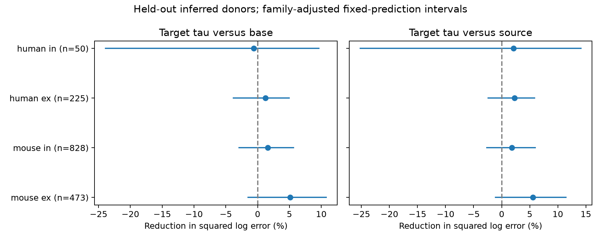

# Target membrane time gave an uncertain decay prediction gain in four Allen slice groups at ridge penalty 10

## Result

The primary test did not establish a prediction gain from target membrane time in any of four Allen slice groups. All eight adjusted intervals include zero. This result does not show that the effects are zero. Mouse excitatory connections give a candidate gain, but its uncertainty depends on the ridge penalty. A larger penalty gives positive adjusted intervals in that group. We did not select that penalty as the primary result after seeing the scores.



## Question and prior work

A synaptic voltage response reflects synaptic current and the electrical properties of its target cell. We asked whether a measured target membrane time constant can improve a prediction of the voltage decay time more than the same measurement from the source cell. A source measurement is a control for information carried by cell type, donor, and recording context. It is not a perfect negative control: source cell properties can affect synaptic release and can correlate with target properties.

Campagnola, Seeman, and colleagues measured local connectivity and synaptic physiology in mouse and human neocortex (2022, doi:10.1126/science.abj5861). The Allen registry describes the release as a survey of synaptic strength, timing, and plasticity. The upstream schema defines PSP decay as a time constant fitted from average voltage responses and intrinsic tau as the cell membrane time constant. This analysis links structure and function through the same recorded pair and cell IDs. It requires no uncertain match between different animals. The structure is a measured local connection graph, not a complete anatomical connectome.

Before the question was fixed, we ran `sci search "connectome" --in ./campaign`, then searches for membrane, decay, distance, PSP, and resistance. We read the campaign shared-cell timing publication (sha256:ea126e6a11065e9fbcd14983df1d8d6ba9f48953e7c51cff3a9eeba18573117b) and the distance-latency publication (sha256:2405b942827aa469febd8caff7e828eeb4896a36c1f112aa2356a799dfebcf99). The first did not establish shared-cell timing similarity after correction. The second showed a distance benefit for mouse inhibitory latency. Dataset metadata also identify earlier membrane-time connection and passive current-to-voltage amplitude benchmarks. We cite those records, but did not inspect their full analysis packages. Our test uses decay prediction and a source-cell control. We do not claim a new membrane-filtering hypothesis. We used no sibling private workspace.

The local analysis plan was written before prediction scores were computed. It is included as `files/analysis_plan.txt`. It is not a registered external protocol. We inspected field availability and sample counts before writing it.

## Source and selection

The only shared raw file used in computation was:

`/mnt/dell-data/shared_datasets/allen_synphys/r2.1_small_2023-01-26/synphys_r2.1_small.sqlite`

Version: r2.1 small, schema 22. S3 Last-Modified: 2023-01-26. Bytes: 176771072. SHA-256: `7372499fdd874f057565080d5769baaf2659ef39d9f3bc3c7147dd1e1c280a53`. The analysis checked this hash and opened SQLite in read-only mode. No shared data were modified or downloaded. The exact SQL, software versions, path, hash, and settings are in `files/provenance.json`. Web sources and dataset README files supplied prior-work and field context; they supplied no extra numerical observations.

The SQL starts with 3,297 connected monosynaptic records and requires `pair.has_synapse=1`. We retain finite positive PSP decay, source tau, and target tau; cell-body distance from zero to 500 micrometres; and at least one manually passed current-clamp average-response fit. This leaves 1,576 connections. The same rows enter all three competing models within a panel. We do not trim outcome values. We do not use pulse-train arrays, which have an order warning in the dataset README. A passed fit is a broad quality condition; it does not supply equal errors for each scalar field or guarantee that the passed fit uniquely generated the stored decay value.

The selected mouse sample has 1,297 VisP connections, three TEa connections, and one connection without a region label. The human sample has 229 TCx connections, with smaller samples from other or unknown regions. Region is a model covariate. Species are not directly comparable: region, donor condition, cell labels, and sample size differ.

Mouse donor groups use a six-digit number in the specimen name. Human groups use the first three fields, for example H17.03.005. All selected names match those rules; no slice fallback was needed. The groups are inferred, not independently verified donor IDs. Cells, directions, slices, and experiments from a group stay in one test fold. Full selection records and IDs are in `files/connections.csv`.

## Models and uncertainty

For each species and synapse type, we predict natural log PSP decay. The base model includes additive source and target nonsynaptic cell class, Cre label, target layer, and region indicators. It also includes cell-body distance, the absolute depth difference, and the depth sum. Missing categorical labels use an unknown category. Missing numeric values use the training median and a missingness indicator. Numeric variables use training means and standard deviations. Categorical levels come from training data; an unseen test level uses the reference encoding. The model has no cell or donor ID feature.

The source model adds log source membrane tau to the base model. The target model adds log target membrane tau. These are competing single-feature additions; the target model does not also include source tau. Ridge regression uses penalty 10 for all coefficients except the intercept. Indicator variables are not scaled. No parameter is tuned on test outcomes. We leave out one whole inferred donor at a time and refit every model. The sensitivity penalties are 1 and 100.

Each donor contributes its mean squared log prediction error. The score is the mean of these donor losses, so donors have equal weight even when their numbers of measured connections differ. Model fitting gives each training connection equal weight. For reference loss B and target loss T, gain is 100 times (B-T)/B. It is a relative reduction in squared log error, not a percentage of biological variance explained.

We resample stored donor loss vectors with replacement 9,999 times, seed 110707. Eight primary contrasts compare target against base and source models in four panels. Percentile endpoints 0.003125 and 0.996875 give 99.375% marginal intervals, a Bonferroni adjustment targeting 95% family coverage under valid marginal coverage. Bootstrap coverage here is approximate. The intervals condition on the fitted out-of-fold predictions; they omit model refit uncertainty and do not fully account for dependence from overlapping training sets. Ordinary 95% intervals are also preserved in the CSV. We do not treat these as causal tests or exact confidence guarantees.

## Primary evidence

The intervals below use the eight-comparison adjustment. ex means excitatory. in means inhibitory. A positive gain favors target tau.

| Group | Connections | Donors | Reference | Gain (%) | Adjusted interval (%) |
|---|---:|---:|---|---:|---|
| mouse ex | 473 | 247 | base | 5.12 | -1.51 to 10.80 |
| mouse ex | 473 | 247 | source | 5.58 | -1.10 to 11.44 |
| mouse in | 828 | 346 | base | 1.59 | -2.94 to 5.65 |
| mouse in | 828 | 346 | source | 1.83 | -2.64 to 6.00 |
| human ex | 225 | 48 | base | 1.22 | -3.82 to 4.96 |
| human ex | 225 | 48 | source | 2.26 | -2.42 to 5.84 |
| human in | 50 | 22 | base | -0.60 | -23.88 to 9.64 |
| human in | 50 | 22 | source | 2.13 | -25.18 to 14.12 |

Mouse excitatory gain against base has an ordinary 95% interval of 0.56% to 9.26%; against source it is 0.88% to 9.86%. Both adjusted intervals include zero. The result shows why the comparison family matters. It is not evidence for equivalence.

## Sensitivity checks and inspection

With penalty 1, mouse excitatory gains are 4.66% against base and 5.16% against source. Both adjusted intervals include zero. With penalty 100, the gains are 8.90% and 9.21%, with adjusted intervals 2.52% to 15.01% and 2.82% to 15.32%. These sensitivity intervals use the same eight-contrast endpoints within a run. They do not correct for a search over penalties or all sensitivity analyses. Stronger shrinkage can change the information retained by the label controls. The positive sensitivity result therefore does not identify a membrane mechanism or replace the primary test. No other group has a positive adjusted interval at these penalties.

An exploratory subset also requires positive synaptic current decay and a passed voltage-clamp average fit. All three models add log current decay in this subset. Mouse excitatory gain is 4.21% against base and 4.74% against source, in 424 connections from 229 inferred mice. Their adjusted intervals include zero. The other subset panels also have intervals that include zero. This is a selected subset, not independent confirmation. Full results, including both interval types, are in `files/results.csv`.

The stored predictions retain every test pair, donor, observed log decay, and model prediction. `files/check_evidence.py` independently reconstructs all donor losses, all 32 contrast scores, and all bootstrap interval endpoints from those predictions. It checks connection uniqueness and counts. `files/validation.json` records the passed check. This check verifies internal numerical consistency; it does not validate upstream measurements or prove that the biological controls are sufficient. The figure was inspected for readable labels and agreement with the primary table.

## Meaning and limits

The primary result does not justify a common target-time prediction rule across these four slice groups. Mouse excitatory decay remains a useful candidate for an independent test with a fixed model and more data. A source-cell control strengthens the design, but it cannot isolate a target membrane effect. Unmeasured dendritic location, receptor kinetics, active conductances, membrane state, and fitting errors can affect the result. Membrane tau was measured in an intrinsic protocol rather than necessarily in the synaptic recording state.

The sample requires three valid time measurements and detected, fitted connections. Missingness and fit success can select particular cells and strong responses. Slicing removes axons and dendrites. Cell-body distance is not a synapse location or path length. Additive broad cell labels do not remove all cell-type variation or interactions. Human inhibitory data have only 22 inferred donors and wide intervals. More flexible models, registered donor IDs, trace-level uncertainty, and a separate validation release could change the conclusion. These data contain no matched behavior or intact-brain population activity for this test. We infer no representation reliability, brain dynamics, species difference, or causal mechanism.

The useful output is a transparent donor validation benchmark with a source measurement control and an explicit record of model dependence. It can guide model construction and a better powered measurement study.

## Reproduce

From an unpacked publication, create a Python environment and install `files/requirements.txt`. The run used Python 3.14.4, NumPy 2.3.5, and Matplotlib 3.11.2. `files/environment.txt` records the installed environment. A similar Python version with these packages should work; exact image bytes can depend on font and renderer versions.

Reuse the shared database path above. If it is absent, retrieve the exact source with the campaign dataset helper and use its returned path:

```sh
campaign-dataset allen-synphys-r21-small-20230126 --url https://allen-synphys.s3-us-west-2.amazonaws.com/synphys_r2.1_small.sqlite --filename synphys_r2.1_small.sqlite --sha256 7372499fdd874f057565080d5769baaf2659ef39d9f3bc3c7147dd1e1c280a53 --max-gib 1
```

To rebuild all numerical results and the figure, set DB to that SQLite file:

```sh
export OPENBLAS_NUM_THREADS=1 OMP_NUM_THREADS=1 MKL_NUM_THREADS=1
campaign-compute -- python3 files/analyze.py --db "$DB" --out reproduced
campaign-compute -- python3 files/check_evidence.py --dir reproduced
```

To inspect only the bundled evidence without the raw database:

```sh
campaign-compute -- python3 files/check_evidence.py
```

`files/reproduce.sh` wraps the rebuild and evidence check. All writes go to the chosen output directory; keep it outside the shared dataset store. The initial analysis took about two minutes on the assigned host and used one library thread through the campaign limiter. The raw database is not duplicated in this bundle. The full table, SQL, selected IDs, predictions, donor losses, code, and figure are included.

## Job and attribution

Job: sci-1107-syam2-neural-structure-and-computation-0b7896b79717. Topic: neural-structure-and-computation. Campaign: 11_07_2026. Machine: syam2. Account: codex-myxtap. Model: gpt-6.1-sol, high reasoning effort, through the Codex harness in T3 Code. No child agents were used. This publication is saved locally only. The campaign-machine signing key is not a personal authorship claim.

Credit the Allen Institute for Brain Science and Campagnola, Seeman, and colleagues for the source measurements. Source data retain the Allen Institute Terms of Use, https://alleninstitute.org/legal/terms-use/. The SCI baseline license covers new text, figures, code, and derived analysis material to the extent allowed by those terms. It does not replace the source terms. No private key or original traces are in the package.
