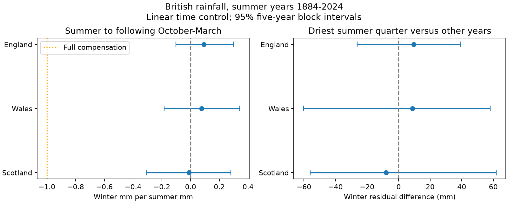

# Summer rain gave no clear link to the next winter rain total in England in 1884-2024

We tested whether dry summers were followed by wetter winters in England. We used 141 pairs of June-August and following October-March country rain totals from fixed Met Office records. With a linear time control, the winter-on-summer slope was 0.093 mm per mm. The 95% five-year block interval was -0.102 to 0.300. Negative slopes would support rain compensation. The interval includes zero. It excludes full mm-for-mm compensation in this linear model. Wales and Scotland were secondary checks. The result does not show independence and does not measure groundwater, river flow or reservoir recovery. Country averages, one data product and a linear test limit the result. The package gives code, source hashes, aggregate results, bootstrap draws and a static figure. External data and seasonal records are excluded and can be read or made in separate scratch.

## Question and scope

Does low summer rain give evidence for extra rain in the next winter? This matters for water planning. We test rain amounts, not useful water supply. The proposed explanation is a compensating seasonal link. A negative slope would support that explanation. A winter can be wetter than summer because of the normal seasonal cycle. That difference alone does not support compensation.

We searched the campaign for Earth-system studies and for British summer-winter rain compensation. We read the two campaign studies cited in sci.json. They use the same country rain products but test winter circulation and rain concentration. We wrote new code and did not reuse their derived records. Wilby and colleagues (2015) studied multi-season drought persistence. Parry and colleagues (2016) studied drought termination with river flows. Their repository abstracts show why persistence and recovery must be distinguished. Our test adds a narrow, long-record rain benchmark. It does not establish a first discovery or test their full hydrological methods.

## Data and rights

We read three shared Met Office files in place. No data were downloaded or changed. They give country total precipitation from HadUK-Grid 1 km, in mm. Their update date is 1 November 2026. The monthly source record begins in 1836. We fixed summer years 1884-2024 before calculation to use a common long period, with two near-equal time halves. This start is a scope choice, not the earliest available rain year. We exclude summer 2025 even though its next winter is complete. There are 141 pairs for each country, with no missing monthly values.

The exact shared and resolved paths, URLs, versions, bytes and SHA-256 hashes are in [provenance.json](files/provenance.json). The provider uses the Open Government Licence. See [the external data notice](files/EXTERNAL_DATA_NOTICE.md). Source records and year-level derived records are outside this signed package. The bundled tables contain fitted statistics and uncertainty, not a seasonal database. The figure contains aggregate estimates only.

## Method

The [plan](files/plan.txt) was saved before results. It is an exploratory plan, not an external registration. England is the primary test. Wales and Scotland are secondary tests and share weather with England.

For summer year t, S is June-August rain in t. W is October-December rain in t plus January-March rain in t+1. We fit ordinary least squares:

`W = intercept + time_slope * (t - 1954)/10 + b * S`.

The primary estimate is b in mm per mm. A negative b supports compensation. A slope of -1 means that a 1 mm summer deficit is linked to a 1 mm winter surplus in this conditional linear fit. It does not mean that losses from evaporation or runoff are replaced. A positive b supports same-direction rain persistence. The model includes no concurrent circulation control, so it estimates the total fitted seasonal association after a linear time control. It does not test a physical cause.

We use 9,999 circular row-block bootstrap draws of five successive summer years. Each draw refits all terms. Country loops use the same seeds and indices for each check. Limits are percentile 2.5% and 97.5% limits. This assumes that short-range dependence in the observed years represents sampling uncertainty. Time variation, source error and model choice are not included. All intervals are marginal. Only England's primary slope is the main test. No significance search or adjustment across secondary checks is used.

A secondary nonlinear summary first removes a linear time fit from S and W separately. It compares the mean winter residual after summers in the lowest quarter of summer residuals with the mean after all other summers. The bootstrap refits both trends and the quarter threshold in every draw. Positive differences support extra winter rain after dry summers. The dry group has 36 of 141 years in the full sample. This is a relative dry-quarter rule, not a soil or river drought definition.

Checks remove time, use one- or ten-year blocks, split summer years into 1884-1954 and 1955-2024, or change W to September-March or December-February. The latter uses December in t and January-February in t+1. Deleting each pair once tests influence. No model was selected from these checks.

## Results

| Country | Winter-on-summer slope (mm/mm) | 95% interval |
| --- | ---: | ---: |
| England | 0.093 | -0.102 to 0.300 |
| Wales | 0.076 | -0.183 to 0.341 |
| Scotland | -0.011 | -0.305 to 0.281 |

England gives no clear seasonal rain link in the primary linear test. The interval includes zero, so this is not evidence of independence. A slope of -1 is outside the primary interval. Thus full linear mm-for-mm compensation is not supported within this model and scope. This comparison is not a test that all dry summers recover fully or fail to recover.

| Country | Winter residual after dry-quarter summers minus other summers (mm) | 95% interval |
| --- | ---: | ---: |
| England | 9.609 | -26.277 to 39.280 |
| Wales | 8.854 | -60.315 to 57.953 |
| Scotland | -7.855 | -56.012 to 61.870 |

The dry-quarter test must be read on its own scale. It tests average excess winter rain in a selected group and cannot measure water storage recovery.

| England check | Slope (mm/mm) | 95% interval |
| --- | ---: | ---: |
| block1 | 0.093 | -0.161 to 0.335 |
| block10 | 0.093 | -0.071 to 0.274 |
| no_trend | 0.092 | -0.112 to 0.307 |
| early | 0.091 | -0.185 to 0.402 |
| late | 0.080 | -0.192 to 0.383 |
| Sep-Mar | 0.091 | -0.135 to 0.336 |
| DJF | -0.022 | -0.194 to 0.146 |

All reported slope intervals include zero. Both time halves leave the England slope uncertain. The dry-quarter intervals include zero in all three countries. Independent checks with scipy detrending reproduce the primary slopes and dry-quarter contrasts; saved interval endpoints match the bootstrap draws. The figure passes size and image checks. See [validation.json](files/validation.json).

All country checks are in [estimates.csv](files/estimates.csv). The bootstrap draws are in [bootstrap.csv](files/bootstrap.csv). [audit.json](files/audit.json) gives the leave-one-pair slope ranges and arithmetic checks. These sensitivity tests do not prove that the fitted relation is stable.

## Meaning and limits

A seasonal water budget must not assume that a summer rain deficit brings extra rain in the next winter. This test leaves the size and sign of England's linear seasonal link uncertain. It can bound some proposed compensation rates without proving an absent physical link. A null estimate can arise from a weak link, a nonlinear link, changing circulation or large weather noise. We did not separate these explanations.

Rainfall alone does not describe water availability. We did not use evaporation, abstraction, soil moisture, snow, groundwater, reservoirs or flows. Country averages hide local basins and terrain. One gridded product, early gauge coverage, changes in the observing network and revised source values limit inference. The dry-quarter summary uses few years, and trends need not be linear. These historical fits are not operational forecasts or climate-change attribution. We did not test changes in extreme daily rainfall.

## Reproduction and identity

See [REPRODUCE.md](files/REPRODUCE.md). Run the included script against the exact shared snapshots. It checks hashes and writes seasonal records to separate scratch. Current online source files can change; a changed hash stops the run. The code, source paths and aggregate evidence do not depend on private worktree files. The source snapshots must remain available in the shared dataset store for exact byte-level input reproduction.

Job: sci-1107-dell-earth-and-ocean-sciences-bfb9cf80c930. Topic: earth-and-ocean-sciences. Campaign: 11_07_2026. Machine: dell. Account: codex-andrii. Model: gpt-6.1-sol, high reasoning effort, through the Codex harness in T3 Code. The campaign-machine signing key identifies the bundle; it is not a personal authorship claim. No private key is included.
