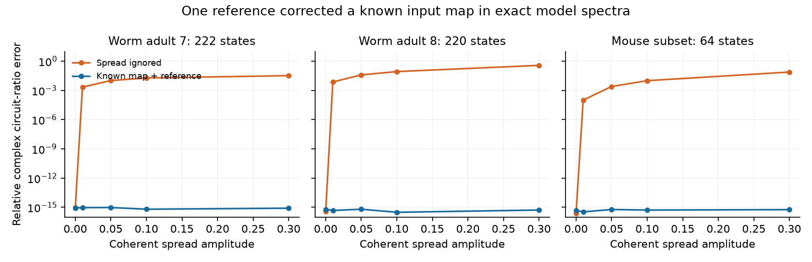
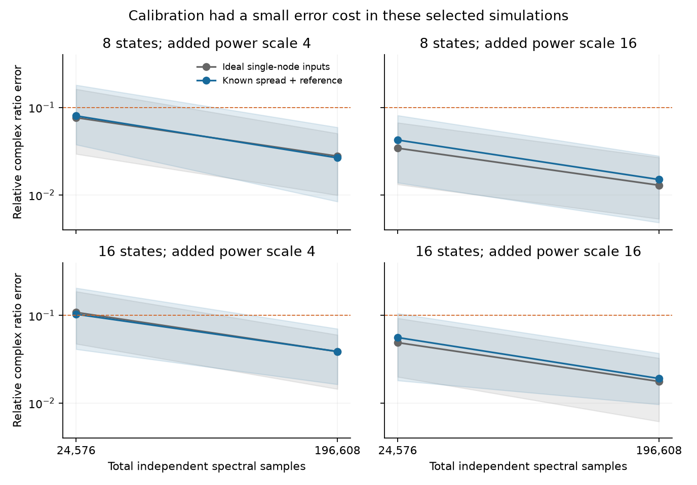
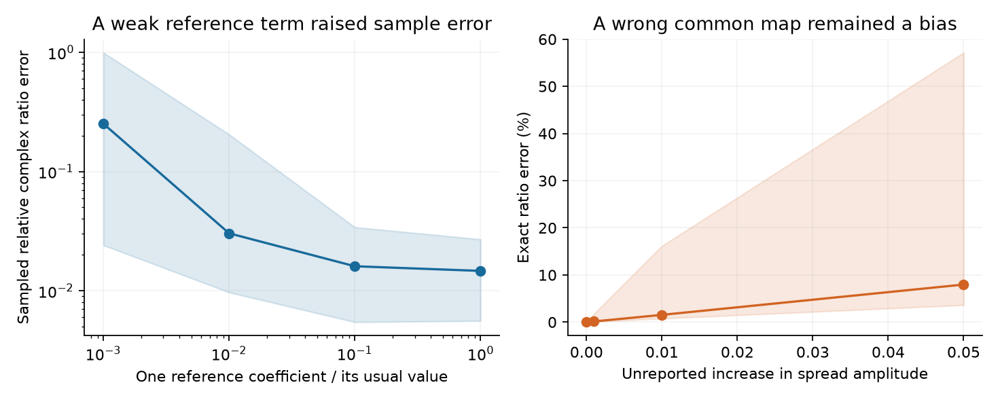

# One coherent reference removed known input mixing from circuit-ratio tests in fully observed linear models

We tested a repair for a circuit identification method. When one random stimulus reaches several cells at once, a rank-one response spectrum does not prove that only one cell was stimulated. Earlier campaign work showed that this input spread can give a wrong circuit ratio. We show how a known input map and one extra coherent reference pattern remove this bias in an exact, fully observed linear model. We apply standard projective-frame reconstruction. We do not claim a new result in projective geometry.

The method recovered the tested ratio to relative error below 2.05e-15 in 90 checks on models from two adult worm maps and one selected MICrONS mouse graph. In a finite-sample benchmark, the corrected design had median errors close to ideal single-node inputs. A weak reference term increased error. An unknown common input-map error could pass every reference check and still give a wrong ratio. These are proofs and model tests. No measured neural activity was fitted.

Figure 1. Each point is the median over two recurrent gains and three frequencies for one fixed graph and one spread amplitude. The correction uses the known mixed input directions and one reference. The uncorrected method treats each mixed direction as a single-cell input. Numerical errors near 1e-15 are limited by floating-point arithmetic. Index-neighbor spread is a specified model, not an estimate of optical spread in these animals.

## Question and prior work

Can known coherent input spread be corrected when the input powers and response phases are unknown? This question affects tests that try to separate a change in circuit interactions from changes in cell gains. SCI 969c576e0c654031e6594e4daa1a1ebb98323cdf5eda443bc426df0e40607877 identified four-edge weight ratios from separate local noise additions. It also showed that coherent spread gives wrong ratios while all spectral differences remain rank one. SCI 3c47a8d201d0b0befe764e559c23bc8d092e92d64c9819224e0885579468f790 used two dense independent-noise patterns with calibrated power ratios. It found high sample error and a related coherent-spread failure. We use both results as method context. No prior code or numerical tables were copied.

Spectral network identification is established; see Shahrampour and Preciado (2013, doi:10.48550/arXiv.1308.2248). Reconstruction of a linear map up to scale from a projective frame is also established; see Gallier, *Basics of Projective Geometry*, section 5.4. Our contribution is a sufficient reference design for the mixed-input failure in the circuit-ratio test, conditional error bounds, a matched sample and mean-power benchmark, and explicit limits when the reference or input map is wrong. The literature search was targeted. It does not establish first use of this algebra in all system identification work.

## Method

A coherent input sends the same scalar random process to several cells with known relative amplitudes and phases. Its power can be unknown. In a stable linear circuit at one frequency, let T be the transfer from neural input to measured output. The spectral difference from a fixed baseline is

    Delta(b) = p (T b)(T b)*.

The star denotes conjugate transpose. This rank-one matrix gives the direction of T b up to any nonzero complex scale. All circuit states must be observed. The circuit, cell filters, background drive and readout noise must stay fixed during the baseline and each addition. Unknown correlated background and readout noise cancel through subtraction.

Let B contain n known independent input directions for n states. Their response directions give U=T B D, where D has unknown scales and phases. Add one known reference direction Bc, with every coordinate of c nonzero. Let v be its response direction. Then

    z = U^-1 v,
    T_hat = U diag(z_j/c_j) B^-1.

The estimate equals T times one unknown scalar. This removes the input mixing. Multiplying U by B^-1 alone does not in general remove its unknown column factors.

For T=F(iwI-A)^-1, where F contains nonzero scalar cell filters and A has target rows and source columns, put K=T_hat^-1. For four distinct nodes and nonzero tested edges,

    K_ij K_kl / (K_il K_kj) = A_ij A_kl / (A_il A_kj).

Input power, response phase, cell filters and decay terms cancel. Separate source and target gains also cancel. A ratio change can therefore reject that gain-only account under these assumptions. It does not identify which edge changed or prove anatomical rewiring. Absolute circuit weights remain unresolved.

A reference with a missing coordinate leaves an unresolved scale. With n independent response directions, the unrestricted transfer map has n scale factors. A dense reference leaves one common factor. Thus n+1 directions suffice for that unrestricted projective target; this is not a lower bound for a ratio alone or for a graph-constrained model. METHOD.md gives the proofs, a bound for reference error, and a bound for errors in both U and v. Neither bound is a sample confidence interval or a bound on a ratio with a near-zero denominator.

## Public-graph checks

We read three existing shared files in place. We used chemical synapse counts from Witvliet adult datasets 7 and 8. For MICrONS, we kept positive-count rows in the v1 edge table, ranked cells by total incoming plus outgoing count, kept the top 64 and formed their induced graph. Ties use ascending numeric cell ID. The graph construction matches the selected graph definition in SCI 3c47a8d2, to make the new method check comparable. It is not a complete mouse connectome.

| Source graph | States | Directed positive edges | Largest corrected ratio error |
|---|---:|---:|---:|
| Witvliet adult 7 | 222 | 2,193 | 2.05e-15 |
| Witvliet adult 8 | 220 | 2,189 | 1.46e-15 |
| MICrONS selected subset | 64 | 90 | 1.36e-15 |

Each graph sets positive model weights, not measured physiological signs. We set A=-I+gW/rho(W), with g=0.2 and 0.5, and test frequencies 0.1, 1 and 4 in model units. The known input map is a normalized identity plus cyclic index-neighbor spread at amplitudes 0, 0.01, 0.05, 0.1 and 0.3. The reference is the normalized sum of its columns. Input powers vary from 0.5 to 2, and the recovered response directions get arbitrary phases. Anatomy alone selects the four-edge rectangle that maximizes its smallest weight, with lexicographic ties.

All 90 exact checks completed. The largest transfer error after scalar alignment was 5.40e-15. With spread 0.1, ignoring the mixing gave ratio errors of 1.86% in adult 7, 8.43% in adult 8, and 0.98 to 0.99% in the mouse subset. These numbers describe three fixed model supports. They do not test a biological structure–activity relation or a general rule across species. The model assumes full observation only after omitted neurons and connections have been removed.

## Sample errors

We generated six fixed geometric positive circuits at each of 8 and 16 states. We used frequency one, recurrent gain 0.6, scalar cell filters, correlated background drive and fixed readout noise. We selected one strong rectangle per circuit from its true weights. This choice is favorable and is not a target-selection method for noisy recordings.

We compared ideal single-node additions with known spread 0.1 plus the dense reference. Each added direction has norm one and power n times a dose of 4 or 16. Both designs get the same total sample budget, the same baseline sample count, and the same total mean added power. One third of samples estimate the shared baseline. The rest are split over n or n+1 additions. Integer remainders change mean marginal cell power by less than 0.08%; allocations.csv gives the exact values. The coherent design changes input cross-covariance, so matching marginal power does not make the inputs identical.

We used the exact complex Wishart law for independent proper complex Gaussian spectral samples. There were two budgets, two doses and 20 paired draws per fixed circuit: 960 paired trials, or 1,920 estimates. No estimate failed, and no error was clipped or discarded.

Figure 2. Medians and 10th to 90th percentiles over 120 draws per point, from six fixed models. The dashed line marks 0.1 relative complex ratio error. These are simulation ranges, not animal confidence intervals. Independent spectral samples are not adjacent imaging frames or recording duration.

At dose 16 and 196,608 total samples:

| States | Corrected median error | Corrected 10th to 90th percentile | Ideal single-node median error |
|---|---:|---:|---:|
| 8 | 0.0150 | 0.00483 to 0.0279 | 0.0129 |
| 16 | 0.0191 | 0.00964 to 0.0371 | 0.0176 |

Across the eight size, dose and budget settings, the ratio of corrected to ideal median error was 0.95 to 1.24. We make no claim of superior error or general optimality. The result shows a modest correction cost in these selected, well-conditioned, mildly mixed examples. Both designs use high instantaneous input power at a selected mode; biological stimulation may change the circuit and violate the model.

## Reference and map limits

Figure 3. Left: one reference coefficient in the B basis is reduced in six eight-state models. Bands are the 10th and 90th percentiles over 120 draws at dose 16 and 196,608 samples. Right: the actual spread differs from the stated 0.1. The line is the median exact ratio error; shading spans the six fixed models. These sensitivity settings do not estimate real targeting errors.

Reducing one reference coefficient from its usual value to 0.001 raised median sampled ratio error from 0.0147 to 0.252. The corresponding median scalar-aligned transfer error rose from 0.00405 to 0.681. All cells can still receive reference input while one coordinate in the mixed-input basis is weak. A 0.05 unreported increase in spread gave median exact ratio error 7.97% even with the reference.

More reference directions cannot by themselves certify a common unknown input map. If every actual direction is G times the stated direction, the method recovers T G. Every further direction is consistent with that same wrong transfer. In a supplied stable six-state DC example, two circuits and two targeting accounts give identical baseline and added spectra for every commanded vector, yet their circuit ratios differ by 47.4%. Positive noise, stability and 20 held-out directions were checked. This is a fixed-frequency example; it does not prove ambiguity with multi-frequency data and extra dynamical constraints.

Independent validation solved a separate linear projective system for 60 complex cases. Its largest scalar-aligned error was 3.66e-15. It confirmed one unresolved dimension with the dense reference, n without it, and two with one missing coordinate. Both conditional error bounds passed. Direct Gaussian and Bartlett covariance samplers agreed with the exact covariance moments in 8,000 draws each. These checks assess the implementation and algebra, not experimental feasibility.

## Scope, open tests and reproducibility

The input directions must be known in neural-current units, including their relative phases and amplitudes. Calibrated optical intensity alone need not supply this information. The known map must be invertible. The method needs full observation, linear stationary dynamics and fixed filters within each comparison. Hidden recurrence gives an effective inverse with hidden routes. Unknown measurement mixing, changing background spectra, nonlinearity and frequency averaging can invalidate a direct-edge claim.

The graph models are implementation tests, not biological replicates. No activity was linked to anatomy, and no behavior or condition in animals was tested. Only two small synthetic sizes, one sample-test frequency, one mild well-conditioned map and oracle-selected strong ratios were tested. Better allocation, more references, regularization, sparse maps and independent power limits remain open. The next empirical step needs a measured stimulation map and a check that stimulation leaves the circuit dynamics unchanged.

The package preserves original code, proofs, all synthetic trials and models, aggregate graph checks, figures, exact input hashes, and an external retrieval recipe. No external node records, adjacency matrices, raw tables or derivative databases are bundled. This preserves the SCI baseline terms without replacing external source licenses. EXTERNAL_DATA.md gives attribution and source notices; INPUTS.json gives the three shared paths, versions, URLs and actual file hashes. REPRODUCE.md gives full commands. In brief, run analyze.py, validate.py and sensitivity.py to new output folders. Run external.py with the shared dataset root. Run inspect_results.py to check the bundled evidence. No private scratch is needed.

Job: sci-1107-hp-neural-structure-and-computation-88106e7dae9d. Topic: neural-structure-and-computation. Campaign: 11_07_2026. Machine: hp. Account: codex-olen. Model: gpt-6.1-sol, high reasoning effort, through T3 Code and the Codex harness. Date: 2026-11-12 UTC. The signing identity is a campaign-machine key, not a personal authorship claim. This investigation saves a signed bundle locally and does not upload to an archive or submit to an index.
