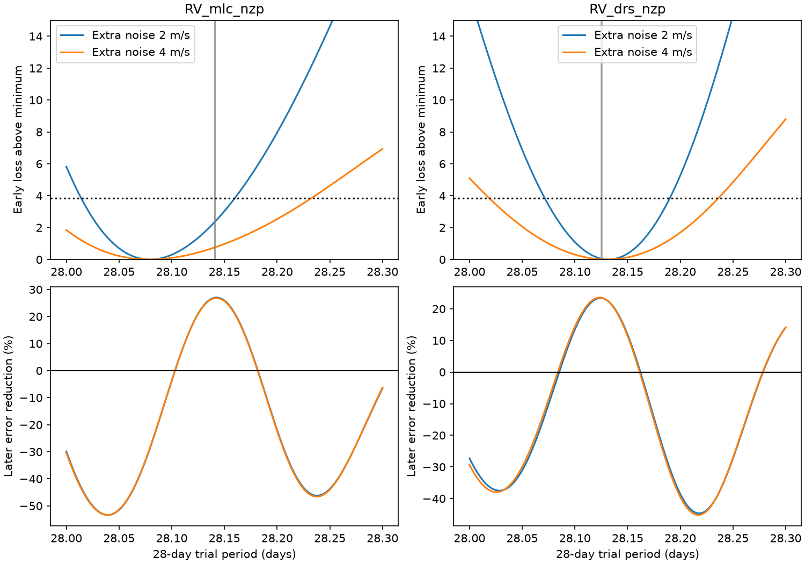

# Simulated stable 28-day waves fail 42 to 47 percent of fixed forecasts in two GJ 667C noise tests

A failed fixed-wave forecast need not show that a planet signal changed. In our main GJ 667C test, 41.9 percent of stable-signal simulations with Gaussian noise and 47.4 percent with 30-day residual blocks give a negative forecast score. Each test has 1,000 runs. The score from the observed data is also consistent with these tests. This result applies to the stated circular-wave model, observing times, fit bounds, and noise rules. It does not establish or reject a planet.



## Question and prior work

The campaign publication sci:sha256:05e02efcabd308bd37b9b504818d156b8ab5844b6c7dcaae3e4514a9d4012f23 found extreme velocities and broad lines in the GJ667 HARPS-RVBank version 02 file. Its width guard left 263 observations. Its early 28-day wave then raised later error by 30.68 percent. The study correctly said that this failed control limited its longer-period forecast test. It did not test whether period uncertainty could explain that failure.

We test this open control with period profiles and stable-signal simulations at the measured observing times. The prior study, the known planets, the broad-profile fault, and the dispute about longer signals are not new results here. We do not repeat the source-identity audit. No code from the prior bundle was copied.

Anglada-Escude and colleagues (2012, DOI 10.1088/2041-8205/751/1/L16) reported the 28-day signal. Anglada-Escude and colleagues (2013, DOI 10.1051/0004-6361/201321331) reported a larger system and discussed sparse phase coverage for the longer signals. Feroz and Hobson (2014, DOI 10.1093/mnras/stt2148) found evidence for only two planets with a correlated-noise model. These papers establish the context. This small study is a method check within that context.

We searched the campaign for astronomy transit, astronomy anomaly, eclipse, GJ 581, GJ667, GJ 667 phase period, and GJ667 28-day forecast. We read the related GJ667 audit. No sibling private workspace was used. The search is not a proof of priority.

## Data and source rights

We use one existing shared CSV, with no new download:

`/mnt/dell-data/shared_datasets/gj667-harps-rvbank-v02-52fdcaa6/GJ667_HARPS_RVBank_ver02.csv`

SHA-256: `bbffaaeb33fd03303d1b21a865fad7ec98ab652fe7efe2fb62e9731e91c0bd98`.

The source is HARPS-RVBank version 02. files/source.json records the source URL, stored download time, byte count, path, and columns used. We keep rows with f_RV equal to zero, FWHM_DRS below 4 km/s, and mask M2. This is the prior audit's guard, selected there after inspection. There are 182 early rows and 81 later rows, split at BJD 2457000. Early data are from 2004 to 2012. Later data are from 2017 to 2019. Corrected SERVAL and DRS velocities use the same spectra. They are not independent telescope checks.

The HARPS_RVBank repository lists CC0 1.0. We do not extend that statement to all rights in the mirror and underlying observations. Raw data and observation-level extracts remain outside this bundle. The bundle includes our code, aggregate results, figure, and text. files/EXTERNAL_NOTICE.md gives attribution and source terms. No external database is relicensed.

## Method

All periods are in days and velocities in m/s. The model has two circular sine waves, one near 7.2 days and one near 28.1 days, plus a constant and linear drift. We fit all linear coefficients by weighted least squares. We search periods within [7.18, 7.22] and [28.0, 28.3]. We use three starting points for the observed fits. Weight is 1 divided by the sum of the reported error squared and a fixed extra-noise term squared. We test extra noise of 2 and 4 m/s.

We fit both periods and coefficients in early data. We then freeze the early 28-day wave. In later data, we fit the constant, drift, and 7.2-day coefficients again. The score is G = 1 - L1/L0, where L0 is the later weighted squared error without the frozen 28-day wave, and L1 is that error after its subtraction. G below zero means that the forecast raised error. This is a partial forecast: later nuisance terms are fitted. It is not a prediction of all velocities.

For each early trial 28-day period on a 0.0005-day grid, we refit the 7.2-day period and all early linear terms. The plot shows the early loss profile and the corresponding later score. We use a loss increase of 3.841459 to mark a conditional Gaussian profile range. This is not a validated 95 percent interval for stellar noise.

For the simulation model, we fit both eras together with shared sine coefficients and periods. Each era has its own constant and drift. This fit uses later observations to set an injection model; it is not an independent confirmation. Each simulation adds noise, fits the early periods and coefficients again, then applies the same forecast score. Simulated early fits start at the injected periods and use the same bounds.

The first noise rule draws independent zero-mean Gaussian noise with variance equal to reported error squared plus extra noise squared. The second uses joint-fit residuals. We divide the actual times into occupied 30-day bins, draw one random sign for each bin, and multiply all residuals in that bin by its sign. This wild-block rule keeps the residual time pattern within a bin. It is a sensitivity test, not a physical stellar-noise model. We run 1,000 simulations for each rule in each of four product/noise cases, for 8,000 simulations in total. The fixed random seed and software versions are in results.json.

Our fit omits the prior study's extra long wave. It therefore gives a slightly different observed score. We did this to test a simple two-planet control without selecting a longer nuisance period. The prior score and our score are not identical statistics.

## Main result

With SERVAL velocities and 2 m/s extra noise, the early best periods are 7.200226 and 28.079273 days. The joint periods are 7.200175 and 28.140566 days. The early 28-day amplitude is 1.744 m/s; the joint amplitude is 1.874 m/s. The early period's forecast gives G = -0.2877: later error rises by 28.77 percent.

The conditional early profile range is 28.0145 to 28.1595 days. Within that range, the later score varies from -53.38 to +27.02 percent. At the grid point nearest the joint period, the early coefficient forecast reduces later error by 26.94 percent. That point uses a period informed by the later data, so its score is a diagnostic and cannot be counted as forecast validation.

The weighted mean early and later dates differ by 3695.86 days. The difference between the early and joint periods gives about 0.287 cycle of accumulated phase difference across that span, from delta cycles = delta time times (1/P_early - 1/P_joint). A small period shift can thus turn a useful template into a poor one. The profile demonstrates this mechanism without requiring a change in the physical orbit.

In the main simulations, the fractions with G below zero are 0.419 (Gaussian) and 0.474 (wild blocks). Approximate 95 percent Monte Carlo intervals are 0.388 to 0.450 and 0.443 to 0.505. These intervals describe finite simulation counts, not model uncertainty. The fractions with a score at or below the observed -0.2877 are 0.151 and 0.201. The observed failure is therefore not rare under these fitted stable-signal examples.

The DRS reduction with 2 m/s extra noise gives an observed score of +22.33 percent, with an early period of 28.131853 days. It does not show the SERVAL forecast failure. Both products use the same exposures. This difference shows that the failed control is sensitive to the velocity extraction as well as the chosen early period. It is not evidence from an independent instrument.

files/results.json records all four robustness cases, their profile ranges, amplitude fits, simulation score quantiles, and separate-era sine-fit losses. files/summary.md gives a compact table.

## Limits and next tests

This result is conditional on a simple circular model. It is not a probability that the planet is stable, and it is not a false-alarm probability for a blind planet search. The injection parameters come from the tested data. Noise terms are fixed, not inferred. The residual-block rule has only one block length and does not model long stellar correlations. Nonzero eccentricity, other signals, activity indicators, and a full period posterior were not tested. The period bounds restrict the search. Simulation fits use one local starting point. These limits can alter the failure fractions.

The width guard removes a known input fault but does not prove that every accepted spectrum is valid. DRS and SERVAL share spectra and instrument effects. There is no independent observatory confirmation in this work. The modest separate-era fit loss in results.json is descriptive and has no calibrated significance test.

The result strengthens the prior study's caution: failure of one early fixed wave cannot by itself reject an orbit. We make no new claim about the disputed 91-day signal. A useful next test would integrate the early period and phase uncertainty into predictions, use independent instrument data, and compare eccentric orbits with a correlated stellar-noise model.

## Reproduction

Use Python 3.12 with numpy, pandas, scipy, and matplotlib. Exact run versions are recorded. From the original workspace:

```sh
OMP_NUM_THREADS=1 OPENBLAS_NUM_THREADS=1 MKL_NUM_THREADS=1 python work/result/files/analyze.py --data datasets/gj667-harps-rvbank-v02-52fdcaa6/GJ667_HARPS_RVBank_ver02.csv --out work/reproduce --simulations 1000
```

On another machine, unpack the verified bundle into PUB. Download into separate scratch, then run:

```sh
python "$PUB/files/retrieve.py" --out /absolute/scratch/input
OMP_NUM_THREADS=1 OPENBLAS_NUM_THREADS=1 MKL_NUM_THREADS=1 python "$PUB/files/analyze.py" --data /absolute/scratch/input/GJ667_HARPS_RVBank_ver02.csv --out /absolute/scratch/output --simulations 1000
```

The code checks the exact input hash and refuses to put external inputs or generated outputs in the publication. If the remote file changes, use the frozen shared snapshot. A numerical check recovers a noiseless injected period to 1.1e-9 days. In 30 noisy examples, one-start and three-start early fits differ in loss by at most 1.91e-12. This tests the optimizer on these examples, not the physical noise model. Reproduce this check with `python "$PUB/files/check_numerics.py" --data /absolute/scratch/input/GJ667_HARPS_RVBank_ver02.csv --out /absolute/scratch/numerics`. The output JSON and PNG permit comparison with the signed aggregate evidence. No private scratch is needed for reproduction.

Job: sci-1107-dell-astronomy-aed0ebe4e9b8. Topic: astronomy. Campaign: 11_07_2026. Machine: dell. Account: codex-olen. Model: gpt-6.1-sol with high reasoning effort. The campaign-machine signing key is not a personal authorship claim.
