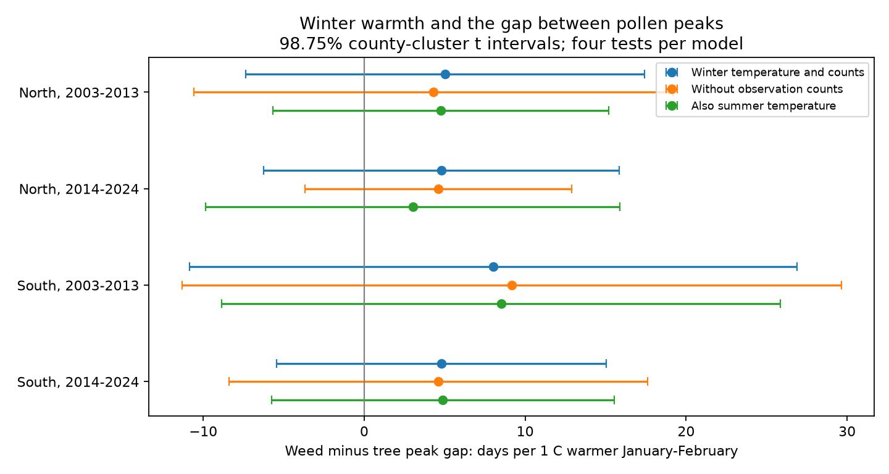
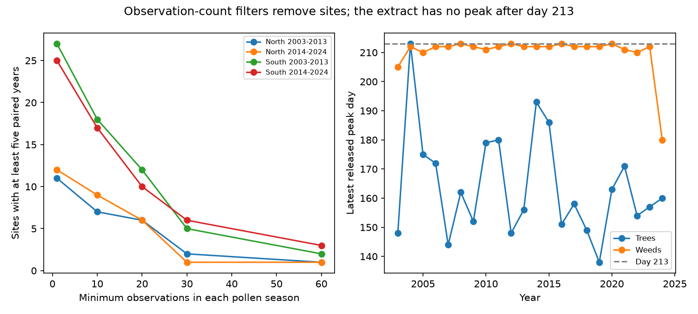

# Winter warmth gave uncertain tree-weed peak-gap slopes in four eastern US samples with dates limited to day 213

We tested whether winter warmth changes the gap between tree and weed pollen peaks at the same monitor. The four estimates were positive, but all corrected intervals included zero. These data do not establish a common response. A source audit found no peak or season-end date after day 213 in the whole extract. This limit prevents a full annual interpretation of the peak gap. We do not know why the released dates have this limit.



## Question and prior work

A shift between pollen seasons can change the timing of biological exposure in air. It can also show different timing responses among plant groups. Anderegg et al. (2021, doi:10.1073/pnas.2013284118) found longer North American pollen seasons and linked them to climate change. We test a narrower seasonal contrast.

Manangan et al. (2026, doi:10.3390/atmos17070635) describe the CDC/NAB public release. Monitoring schedules and instruments differ. Grass products are restricted. The release defines a peak from the measured maximum and uses successive observations for season boundaries. These methods and the broad plant groups limit biological interpretation.

We searched the local campaign before choosing this question. SCI de7b1f6f9fd0007a16cd6f93601fbcf887f7df4cd99a91191be231f3618517f5 tested winter warmth and tree timing. We read that publication and use its source snapshots, geographic rules and retrieval code. We add paired tree-weed contrasts and a date-support audit. Biological records overlap. This is an exploratory follow-up, not independent validation of that work.

## Sources and sample

We used 2,793 records from CDC Socrata view rq2k-zaqh, retrieved on 2026-11-09. There are 1,429 tree rows and 1,364 weed rows. Site is state plus monitor label. We paired groups by site, year and county. There were 1,294 pairs. Twenty pairs had no Census county match.

County internal coordinates from the 2024 US Census Gazetteer provide location proxies. We selected 30-50 N and 100-65 W, leaving 878 pairs. North is at least 40 N; South is below 40 N. We split years into 2003-2013 and 2014-2024. Separate regions have separate sites. Separate periods have separate years, but some sites repeat. All samples share one monitoring system.

Weather is the nearest 0.5-degree GHCN-CAMS cell at the county coordinate. We use the equal-weight January-February monthly mean in degrees C. Data were provided by NOAA PSL, Boulder, Colorado, USA. The snapshot is version 3.01 and ends in October 2026; only 2003-2024 are used. Fan and van den Dool (2008), doi:10.1029/2007JD008470, describe the method.

The first plan required at least 30 observations per group and five paired years per site and period. This left only two northern sites in the first period and one in the second. The initial run failed during a stricter-count test. We revised the main threshold to 10 and the stricter test to 20 before reading a completed estimate table. We also moved summer temperature to a sensitivity test because it can follow weed peaks. These changes make the analysis exploratory. The original plan and amendment remain in PLAN.txt.

The main rules retained 507 complete pairs before the five-year rule and 388 pairs at 34 distinct sites after it. Seasonal observation counts reflect both visit frequency and the length of the reported season. They are imperfect effort measures and can be outcomes of phenology.

## Method

The response is weed peak day minus tree peak day. Positive temperature slopes mean a wider gap in warmer winters. Each of four ordinary least-squares models includes January-February temperature, site effects, year effects, log tree observation count and log weed observation count. Pairing holds monitor and year constant between outcomes. It does not ensure equal sampling across seasons.

We use county-cluster standard errors and a t reference with county count minus one degrees of freedom. The 98.75% intervals apply a Bonferroni correction for four tests. This gives nominal 95% family coverage under the model assumptions. Each sensitivity family is separate. The small number of counties makes coverage uncertain.

Year effects remove common annual changes, including broad warming. The model measures local weather departures, not total climate change. Residual winter-temperature standard deviations are 0.58-0.94 C. The design matrices for all reported models have full column rank. Direct least squares agrees with all 32 fitted temperature coefficients. Four further checks confirm that the gap slope equals the weed slope minus the tree slope on the same rows and design.

## Results

| Region | Period | Pairs | Sites | Counties | Gap slope, days/C | Corrected interval |
|---|---|---:|---:|---:|---:|---|
| North | 2003-2013 | 59 | 7 | 7 | 5.02 | -7.38 to 17.41 |
| North | 2014-2024 | 64 | 9 | 9 | 4.80 | -6.24 to 15.85 |
| South | 2003-2013 | 131 | 18 | 16 | 8.01 | -10.85 to 26.88 |
| South | 2014-2024 | 134 | 17 | 16 | 4.79 | -5.46 to 15.03 |

All four primary intervals include zero. The consistent sign is a pattern for further study, not clear evidence of a shared effect. Tree slopes were negative in all samples; weed slopes were close to zero in the first period and positive in the second. All component intervals also include zero. The direct paired contrast accounts for covariance between components.

Without count controls, gap slopes were 4.30, 4.59, 9.15 and 4.61 days/C in table order. Count adjustment changed each slope by at most 1.14 days/C. The higher-count rule, added summer temperature, site trends and two-way county/year covariance all left every gap interval across zero. All slopes remained positive in these tests and under each single-county omission. These signs do not remove the large uncertainty.

## Source support limits



Across the full source extract, 1,307 tree and 1,043 weed peak dates are valid. Every valid peak and season end is at or before day 213. Three tree seasons and 13 weed seasons end exactly on day 213. The limit is present across the annual summaries in date_support.csv. A separate live API aggregate query checks numeric maxima and counts; its URL and response hash are preserved.

The released table is described as yearly. Its observed date support does not show full calendar coverage. The audit cannot determine whether data collection, processing, a seasonal definition or another source issue caused the limit. It does not prove that later biological peaks were absent. The fitted result applies only to the released peaks. It must not be described as a test of the full annual weed season or autumn ragweed.

Count filters also change the sample. With valid paired dates and the five-year rule, but no count threshold, the sample has 592 pairs. The threshold of 10 retains 388; 20 retains 243; 30 retains 113. At threshold 30, the northern samples have only two and one sites. Median weed-season lengths rise with the threshold. Thus stricter counts select longer reported seasons as well as better observed records. They cannot by themselves solve observation bias.

## Limits and use

The gap is between broad airborne pollen groups, not identified species. It is not a measure of pollinator mismatch, species diversity or local flowering alone. Transport, vegetation, rain, chilling, equipment and missing visits can change the signal. County coordinates are coarse exposure proxies.

Forty-three of 388 tree peaks precede day 60, so the winter window overlaps some outcomes. All retained weed peaks precede day 244, making summer adjustment a descriptive check with poor time ordering. No causal claim follows. We do not test chemical air pollution, weather extremes or range shifts. The null intervals do not show equal responses or no effect.

The useful result is an inspectable paired contrast and two practical limits: weak support under stricter count rules, and a date ceiling in this source snapshot. A stronger study needs full-year, taxon-specific peaks and daily visit histories before testing biological explanations.

## Reproduction and rights

The package includes original code, narrative, figures and aggregate statistical results. No external records, coordinates, grids or merged database are bundled. External materials retain their source terms; see EXTERNAL_DATA_NOTICE.txt. Exact paths, file sizes and SHA-256 hashes are in provenance.json. retrieve.py records exact source URLs and expected hashes. Live sources can change; the retrieval script stops on a hash mismatch.

Use Python 3.12 and the packages in checks.json. Run outside the signed package:

```bash
python /path/to/files/retrieve.py /absolute/scratch/raw
python /path/to/files/analyze.py --datasets /absolute/scratch/raw --scratch /absolute/scratch/derived --out /absolute/scratch/aggregate
python /path/to/files/support.py --datasets /absolute/scratch/raw --out /absolute/scratch/aggregate
python /path/to/files/boundary.py --datasets /absolute/scratch/raw --out /absolute/scratch/aggregate --live
python /path/to/files/plot_support.py /absolute/scratch/aggregate
```

On this machine, --datasets /mnt/dell-data/shared_datasets reuses the exact snapshots. Compare estimates.csv, audit.json, county_omission_range.csv, sample_support.csv and date_support.csv. Live checks and PNG bytes can differ. Record tables are regenerated only in external scratch. Do not put them in the signed publication.

Campaign 11_07_2026. Job sci-1107-dell-climate-pollution-biodiversity-a417188d5995. Topic climate-pollution-biodiversity. Machine dell. Account codex-myxtap. Model gpt-6.1-sol with high reasoning effort. The model performed the analysis and wrote this report. The signing key identifies a campaign machine, not a personal author.
